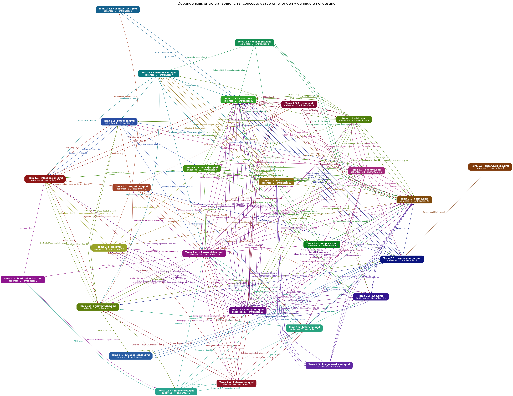
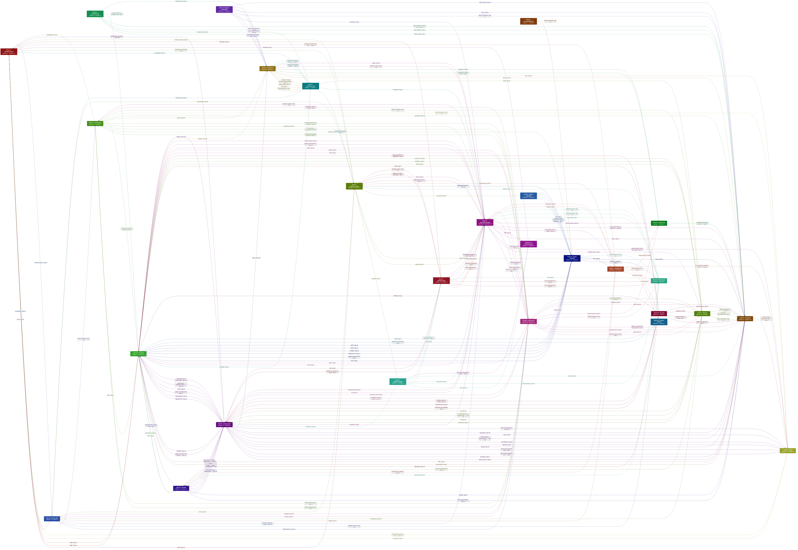

# Desarrollo de Aplicaciones Distribuidas

En este repositorio se encuentra el código con ejemplos y ejercicios resueltos de las diferentes partes de la asignatura "Desarrollo de Aplicaciones Distribuidas" del Grado en Ingeniería de Computadores de la ETSII de la URJC.

El contenido del repositorio se distribuye bajo licencia [Apache-2.0](https://github.com/codeurjc/dad2425/blob/main/LICENSE).

## El temario de la asignatura se divide en 5 partes

### Tema 1: Patrones arquitectónicos de aplicaciones distribuidas

* Tema 1.1: Introducción a las aplicaciones distribuidas
* Tema 1.2: Patrones arquitectónicos de aplicaciones distribuidas
* Tema 1.3: Domain-Driven Design

Las transparencias, ejemplos y ejercicios del tema 1.3 pueden encontrarse en [Parte 1](https://github.com/codeurjc/dad/tree/main/parte_1/tema_1.3_ddd)

### Tema 2. Desarrollo de aplicaciones y servicios web

* Tema 2.1: Spring y Maven
* Tema 2.2: Aplicaciones Web con Spring
* Tema 2.3: APIs REST con Spring
* Tema 2.4: Introducción a las Bases de datos
* Tema 2.5: Bases de datos SQL en Spring
* Tema 2.6: Construcción y despliegue
* Tema 2.7: Seguridad en aplicaciones distribuidas ([transparencias, ejemplos y ejercicios](https://github.com/codeurjc/dad/tree/main/parte_2/tema_2.7_seguridad))

Los ejemplos y ejercicios de esta parte pueden encontrarse en [Parte 2](https://github.com/codeurjc/dad2425/tree/main/parte_2)

### Tema 3. Comunicación de aplicaciones distribuidas

* Tema 1: Comunicación de aplicaciones: Mensajes
* Tema 2: Comunicación de aplicaciones: Websockets
* Tema 3: Arquitecturas dirigidas por eventos

Los ejemplos y ejercicios de esta parte pueden encontrarse en [Parte 3](https://github.com/codeurjc/dad2425/tree/main/parte_3)

Las transparencias, ejemplos y ejercicios del tema de arquitecturas dirigidas por eventos están en [parte_3/tema_3.3_eventos](https://github.com/codeurjc/dad/tree/main/parte_3/tema_3.3_eventos)

### Tema 4. Despliegue y actualización de aplicaciones

* Tema 4.1: Introducción
* Tema 4.2: Docker
* Tema 4.2.1: Docker Compose
* Tema 4.4: Kubernetes ([transparencias, ejemplos y ejercicios](https://github.com/codeurjc/dad/tree/main/parte_4/tema_4.4_kubernetes))

Los ejemplos y ejercicios de esta parte pueden encontrarse en [Parte 4](https://github.com/codeurjc/dad2425/tree/main/parte_4)

### Tema 5. Escalabilidad y tolerancia a fallos

* Tema 5.1: Introducción
* Tema 5.2: Topología centralizada
* Tema 5.3: Separación servidor y base de datos
* Tema 5.4: Servidor con caché y base de datos
* Tema 5.5: Balanceadores de carga: múltiples servidores
* Tema 5.6: Replicación de bases de datos
* Tema 5.7: Otras soluciones arquitectónicas
* Tema 5.8: Observabilidad en sistemas distribuidos ([transparencias, ejemplos y ejercicios](https://github.com/codeurjc/dad/tree/main/parte_5/tema_5.8_observabilidad))

Los ejemplos y ejercicios de esta parte pueden encontrarse en [Parte 5](https://github.com/codeurjc/dad2425/tree/main/parte_5)

Las transparencias, ejemplos y ejercicios ampliados del tema 5.5 (balanceo de carga, *sticky sessions*, *SSL passthrough* y elasticidad) están en [parte_5/tema_5.5_balanceo](https://github.com/codeurjc/dad/tree/main/parte_5/tema_5.5_balanceo)

## Transparencias

Las transparencias de cada tema están en la carpeta `slides/` de su tema (por ejemplo, [`parte_2/tema_2.6_despliegue/slides/despliegue.qmd`](parte_2/tema_2.6_despliegue/slides/despliegue.qmd)) y se generan con [Quarto](https://quarto.org) como presentaciones [reveal.js](https://revealjs.com/). El HTML generado no se versiona.

### Entorno

El repositorio incluye un [`shell.nix`](shell.nix) con todo lo necesario para generar las transparencias y para compilar y ejecutar los ejemplos (JDK 25, Maven, Quarto, clientes de Docker y Kubernetes, herramientas de pruebas de carga...):

```bash
nix-shell
```

Sin Nix basta con tener instalado [Quarto](https://quarto.org/docs/get-started/) 1.4 o posterior.

### Generar las transparencias

Desde la raíz del repositorio:

```bash
quarto render                                                   # todas
quarto render parte_2/tema_2.6_despliegue/slides/despliegue.qmd  # una sola
quarto preview parte_2/tema_2.6_despliegue/slides/despliegue.qmd # con recarga automática
```

Cada `.qmd` genera un `.html` a su lado, que se abre directamente en el navegador.

Para obtener un PDF, una página por diapositiva: sirve el repositorio por HTTP (por ejemplo, con `python3 -m http.server`), abre la presentación añadiendo `?print-pdf` a la URL (`.../despliegue.html?print-pdf`) e imprímela a PDF desde el navegador, sin márgenes y con los gráficos de fondo activados.

### Estilo común

Todas las presentaciones comparten la plantilla de codeurjc. La configuración común está en [`_quarto.yml`](_quarto.yml); el tema, los logotipos y el script que encaja el contenido que no cabe están en [`_slides/`](_slides), y la extensión que repite el título en las diapositivas de continuación y genera los índices de sección está en [`_extensions/gortazar/title-slides`](_extensions/gortazar/title-slides).

En los `.qmd`:

* `#` abre una sección: con `show-index: true` (el valor por defecto) se genera antes una diapositiva de índice con la sección actual en negrita. Los mazos que ya tienen su propia diapositiva de contenidos lo desactivan con `show-index: false` en la cabecera.
* `##` abre una diapositiva con título.
* Una diapositiva que empieza con `---` continúa la anterior y repite su título.
* Las clases `.ejemplo`, `.ejercicio` y `.aviso` dan recuadros para el código de ejemplo, los ejercicios y los avisos.

## Informe: conceptos que se usan antes de definirse

Revisión de las 27 presentaciones, hecha el 24 de noviembre de 2026, buscando los conceptos que una diapositiva usa como si el alumno ya los conociera, pero que no se han explicado antes.

### Cómo se ha hecho

* **Orden del curso**: el de la numeración de los temas (1.1, 1.2... 5.8). Cuando dos mazos comparten número, primero el que viene del material original: el 4.4 de Docker Compose va antes que el 4.4 de Kubernetes.
* **Lo que se da por sabido**: Java y orientación a objetos, estructuras de datos, redes básicas (IP, TCP, UDP, puertos, cliente/servidor, DNS), terminal de Linux, git y vocabulario general de sistemas (proceso, hilo, memoria...). Todo lo demás cuenta si se usa sin explicar.
* **Proceso**: primero se extrajo, mazo a mazo, qué conceptos define cada uno y cuáles usa sin definir. Después se cruzó todo en el orden del curso: un concepto sin definir no se anota si un tema anterior ya lo explica. Por último, se revisaron a mano los cruces dudosos y los términos clave se comprobaron en el texto de las diapositivas.
* **Límites**: el texto de los diagramas SVG sí cuenta, pero el de las imágenes PNG no. Algún concepto puede estar explicado dentro de una imagen, sobre todo en los mazos que vienen de Impress. Además, decidir si una frase "define" un concepto es una cuestión de criterio, así que el informe es una guía para revisar, no una lista cerrada.

En total hay **286 casos**: **160** conceptos que no se definen en ningún tema, **79** que se definen en un tema posterior al primero que los usa y **47** que se usan antes de definirse dentro del mismo mazo.

### Lo más importante

1. **El tema 1 adelanta tecnología de las partes 2 a 5.** Los mazos de DDD (1.3), microservicios (1.4) y fundamentos (1.5) tienen ejemplos con Spring, JPA, Maven, H2, REST, JSON y códigos HTTP, y hablan de Docker Compose, imágenes de contenedor, Kubernetes, transacciones, ACID, consistencia eventual, sagas, balanceadores y caché. Todo eso no se presenta hasta los temas 2.1–2.5, 3.3, 4.2–4.4, 5.2–5.3 y 5.5. Las soluciones posibles son impartirlos después de la parte 2 o añadir al principio de cada uno una diapositiva con lo que se da por sabido y el tema donde se explica.
2. **El protocolo HTTP no se explica en ningún tema.** El 2.3.1 define los métodos y los códigos de estado, pero ya se usan antes, en 1.3, 1.4 y 2.2. Las cabeceras, `Content-Type` y los tipos MIME, el cuerpo de la petición y de la respuesta y las cookies no se definen nunca, aunque aparecen en 1.3, 1.4, 2.2, 2.3.1, 2.5, 2.7 y 2.8.
3. **Faltan piezas básicas de Spring Boot.** `application.properties` se usa en 1.4, 2.2, 2.5, 2.6 y 2.7 sin presentarse nunca. Tampoco se explican `@SpringBootApplication`, `@RestController` (que aparece desde 2.3.1), `@RequestMapping`, `ResponseEntity` (2.2, 2.3.1 y 2.5) ni `@Scheduled` (1.5 y 3.3).
4. **YAML no se presenta nunca.** Sin embargo, es el formato de la configuración de Spring Cloud Gateway (1.4), de los escenarios de Artillery (2.8), de Docker Compose (4.4) y de los manifiestos de Kubernetes (4.4).
5. **Docker aparece antes de la parte 4.** Hay `docker run`, imágenes o Docker Compose en 1.4, 2.5, 2.6, 2.7, 3.2 y 3.3. Docker se explica en 4.2 y Compose en 4.4.
6. **El tema de seguridad (2.7) da por sabida la criptografía y la seguridad web.** TLS/HTTPS y los certificados, el cifrado, las funciones hash, la criptografía asimétrica, HMAC, Base64, los atributos de las cookies, CORS, CSRF, XSS, SSO y LDAP se usan sin explicar. De TLS, solo la terminación se explica después, en 5.5.
7. **Las pruebas automáticas no se presentan.** JUnit, MockMvc y los dobles de prueba aparecen en 1.3, 1.5, 2.1, 2.5 y 2.7. El 1.4 enumera los tipos de prueba, pero no explica las herramientas.
8. **La mensajería va por delante de su tema.** Las colas y la publicación/suscripción se usan en 1.2, 1.4 y 2.4, antes del 3.2. Dentro del propio 3.2, la publicación/suscripción, los consumidores competidores y los *topics* se nombran, pero solo se explican en 3.3. Los WebSockets aparecen en 2.1, 2.8, 3.2 y 3.3 y no se explican en ningún mazo: el temario de este README incluye un tema de WebSockets que no tiene transparencias.
9. **La parte de cliente web no tiene base.** HTML, JavaScript, AJAX, SPA, `fetch` y jQuery se usan en 2.2, 2.3.1, 2.3.3 y 2.7 sin explicarse.
10. **Otros huecos que se repiten en varios temas:**
    * *endpoint* (1.4, 2.3.1 y 2.8);
    * clave primaria y clave ajena (2.5);
    * clúster (1.5, 2.8 y 4.1);
    * transacción distribuida y 2PC (1.4, 1.5 y 3.3);
    * Redis (5.2 y 5.5);
    * punto único de fallo (5.5).

### Detalle por tema

En cada tabla, la diapositiva es la primera que usa el concepto. Primero van los conceptos que no se definen en ningún tema, después los que se definen en un tema posterior y al final los que se definen más adelante en el mismo mazo.


<details>
<summary><strong>Tema 1: Patrones arquitectónicos</strong> (92 casos)</summary>

#### Tema 1.1 · [`introduccion.qmd`](parte_1/tema_1.1_introduccion/slides/introduccion.qmd)

| Concepto | Primera diapositiva que lo usa | Dónde se define |
|---|---|---|
| Middleware | ¿Por qué construir apps distribuidas? | en ningún tema |
| Servicios web | ¿Por qué construir apps distribuidas? | en ningún tema |
| RPC | Caracterización | en ningún tema |
| DoS / DDoS | Caracterización | en ningún tema |
| Replicación de datos | Caracterización | en ningún tema |
| Proxy | Problemas | en un tema posterior: 1.2 (patrón Broker: proxy del cliente y del servidor) |
| Caché | Problemas | en un tema posterior: 5.2 |
| REST | Problemas | en un tema posterior: 2.3.1 (API REST) |
| JSON | Problemas | en un tema posterior: 2.3.1 (JSON) |


#### Tema 1.2 · [`patrones.qmd`](parte_1/tema_1.2_patrones/slides/patrones.qmd)

| Concepto | Primera diapositiva que lo usa | Dónde se define |
|---|---|---|
| Idiom (en diseño) | Patrones Arquitectónicos | en ningún tema |
| IDL | Broker | en ningún tema |
| API | Broker | en ningún tema |
| Marshalling | Broker | en ningún tema |
| Llamada a procedimiento remoto (RPC) | Broker | en ningún tema |
| Colas de mensajes | Broker | en un tema posterior: 3.2 |
| Publish/subscribe | Broker | en un tema posterior: 3.3 |
| Escalado horizontal | Microservicios | en un tema posterior: 5.5 (Escalado horizontal (scale out)) |
| Entrega y despliegue continuo (CI/CD) | Microservicios - Ventajas | en un tema posterior: 1.4 (Pipeline de CI/CD) |
| Aplicación monolítica / monolito | Broker | más adelante en el mismo tema: Beneficios y problemas del monolito |


#### Tema 1.3 · [`ddd.qmd`](parte_1/tema_1.3_ddd/slides/ddd.qmd)

| Concepto | Primera diapositiva que lo usa | Dónde se define |
|---|---|---|
| JUnit (@Test, assertThrows) | Probar el dominio sin infraestructura | en ningún tema (1.4 presenta los tipos de prueba, pero JUnit no se explica) |
| CRUD | Tipos de subdominio | en un tema posterior: 2.3.1 (Operaciones CRUD) |
| SaaS | Tipos de subdominio | en un tema posterior: 4.1 (SaaS) |
| Transacción | Reglas de diseño de agregados | en un tema posterior: 2.5 (Transacción) |
| Consistencia eventual | Reglas de diseño de agregados | en un tema posterior: 3.3 (Consistencia eventual) |
| JPA | Ejemplo 2: el agregado Order | en un tema posterior: 2.5 (JPA (Java Persistence API)) |
| API REST | Ejemplo 2: el agregado Order | en un tema posterior: 2.3.1 (API REST) |
| Spring / Spring Data (@Repository) | Repositorios | en un tema posterior: 2.1 (Spring (framework)) |
| Anotaciones JPA (@Entity, @Embeddable) y mapping objeto-relacional | Modelo de dominio vs modelo de persistencia | en un tema posterior: 2.5 (JPA (Java Persistence API)) |
| @Service y @Transactional (Spring) | Servicios | en un tema posterior: 2.1 (Spring (framework)) |
| H2 | Ejemplo 2: estructura del proyecto | en un tema posterior: 2.5 (Base de datos en memoria (H2)) |
| HTTP (métodos, cabecera Content-Type) y curl | Ejemplo 2: estructura del proyecto | en un tema posterior: 2.3.1 (solo métodos y códigos de estado; cabeceras y curl, en ninguno) |
| Broker de mensajes (RabbitMQ) | Del monolito modular a servicios | en un tema posterior: 3.2 (RabbitMQ) |
| Maven y Spring Boot | Ejemplos del tema | en un tema posterior: 2.1 (Spring (framework)) |
| Inyección de dependencias | Ejercicio 1: préstamos de una biblioteca (II) | en un tema posterior: 2.2 (Inyección de dependencias) |
| Monolito modular | Ejemplo 3: contextos y ACL | más adelante en el mismo tema: Bounded contexts y microservicios |
| Puerto | Ejemplo 3: contextos y ACL | más adelante en el mismo tema: Arquitectura hexagonal (puertos y adaptadores) |
| Repositorio | Ejemplo 3: contextos y ACL | más adelante en el mismo tema: Repositorios |
| Infraestructura (capa) | Ejemplo 3: contextos y ACL | más adelante en el mismo tema: Arquitectura en capas |
| Adaptador | La Anti-Corruption Layer | más adelante en el mismo tema: Arquitectura hexagonal (puertos y adaptadores) |
| Servicio de aplicación | Agregados | más adelante en el mismo tema: Servicios |
| Arquitectura hexagonal | Ejemplo 2: el agregado Order | más adelante en el mismo tema: Arquitectura hexagonal (puertos y adaptadores) |


#### Tema 1.4 · [`microservicios.qmd`](parte_1/tema_1.4_microservicios/slides/microservicios.qmd)

| Concepto | Primera diapositiva que lo usa | Dónde se define |
|---|---|---|
| Smart endpoints and dumb pipes | ¿Qué es un microservicio? | en ningún tema |
| Transacciones distribuidas (2PC) | Consultas y transacciones que cruzan servicios | en ningún tema |
| Endpoint | Contratos y versionado de APIs | en ningún tema |
| Cabeceras HTTP (Accept, tipos MIME) | Contratos y versionado de APIs | en ningún tema |
| TLS y CORS | API Gateway | en ningún tema (solo la terminación TLS, en 5.5) |
| Configuración YAML de Spring Cloud Gateway (rutas, predicados, filtros) | Ejemplo 2: Spring Cloud Gateway | en ningún tema (YAML no se presenta en ningún tema) |
| Configuración de pruebas en Spring (@TestConfiguration, @Bean, @Primary) y doble de prueba | Pruebas | en ningún tema |
| HTTP | ¿Qué es un microservicio? | en un tema posterior: 2.3.1 (Métodos HTTP (GET, DELETE, POST, PUT, PATCH)) |
| Transacción | Ventajas y costes | en un tema posterior: 2.5 (Transacción) |
| Consistencia eventual | Ventajas y costes | en un tema posterior: 3.3 (Consistencia eventual) |
| Esquema de BD, JOIN y tipos de BD (SQL, documentos, grafos) | Una base de datos por servicio | en un tema posterior: 2.4 (SQL) |
| H2 | Ejemplo 1: dos servicios, dos bases de datos | en un tema posterior: 2.5 (Base de datos en memoria (H2)) |
| REST | Ejemplo 1: dos servicios, dos bases de datos | en un tema posterior: 2.3.1 (API REST) |
| Spring (@Component, @Value, propiedades, RestClient) | Ejemplo 1: dos servicios, dos bases de datos | en un tema posterior: 2.1 (Spring (framework)) |
| Códigos de estado HTTP (404, 409, 503, 4xx/5xx) | Ejemplo 1: dos servicios, dos bases de datos | en un tema posterior: 2.3.1 (Códigos de estado HTTP) |
| Anotaciones JPA (@Entity, @Table, @Id, @GeneratedValue) | Copias locales de datos de otros servicios | en un tema posterior: 2.5 (JPA (Java Persistence API)) |
| JSON y Jackson (@JsonIgnoreProperties) | Copias locales de datos de otros servicios | en un tema posterior: 2.3.1 (JSON) |
| Saga y compensación | Consultas y transacciones que cruzan servicios | en un tema posterior: 3.3 (Saga) |
| ACID | Consultas y transacciones que cruzan servicios | en un tema posterior: 5.3 (Propiedades ACID) |
| Broker de mensajes | Síncrona vs asíncrona | en un tema posterior: 3.2 |
| Autenticación JWT / OAuth2 | API Gateway | en un tema posterior: 2.7 (Autenticación) |
| Dependencias Maven / starters de Spring Boot | Ejemplo 2: Spring Cloud Gateway | en un tema posterior: 2.1 (Spring (framework)) |
| Publicar un puerto (contenedores) | Ejemplo 2: Spring Cloud Gateway | en un tema posterior: 4.2 |
| Balanceador de carga | Descubrimiento de servicios | en un tema posterior: 5.2 (Balanceador de carga) |
| Docker Compose | Descubrimiento de servicios | en un tema posterior: 4.4 (Docker Compose) |
| Imagen (de contenedor) | Configuración externalizada | en un tema posterior: 4.2 |
| ConfigMaps y Secrets de Kubernetes | Configuración externalizada | en un tema posterior: 4.4 (Kubernetes) |
| Caché | Patrones de resiliencia | en un tema posterior: 5.2 |
| Operación idempotente | Reintentos: con cuidado | en un tema posterior: 3.3 (en el propio 1.4 solo se da la clave de idempotencia) |
| Rolling update, blue/green, canary | Despliegue | en un tema posterior: 4.4 (Rolling update (maxSurge, maxUnavailable)) |
| Observabilidad | Ventajas y costes | más adelante en el mismo tema: Despliegue |
| CI/CD | ¿Cuándo tiene sentido? | más adelante en el mismo tema: Despliegue |
| API Gateway | Consultas y transacciones que cruzan servicios | más adelante en el mismo tema: API Gateway |
| Kubernetes | Descubrimiento de servicios | más adelante en el mismo tema: Despliegue |


#### Tema 1.5 · [`fundamentos.qmd`](parte_1/tema_1.5_fundamentos/slides/fundamentos.qmd)

| Concepto | Primera diapositiva que lo usa | Dónde se define |
|---|---|---|
| Cerrojo distribuido | Linealizabilidad: un ejemplo | en ningún tema |
| Clúster | Linealizabilidad: un ejemplo | en ningún tema |
| Entrega diferida a réplicas caídas (hinted handoff) | Ejemplo 2: un almacén sin líder | en ningún tema |
| Transacción distribuida | El problema del consenso | en ningún tema (3.3 nombra el 2PC sin explicarlo) |
| Latido (heartbeat) | Raft: elección de líder | en ningún tema |
| JUnit (@ParameterizedTest, @ValueSource) | Raft en el código | en ningún tema |
| @Scheduled (Spring) | ¿Y yo para qué necesito esto? | en ningún tema |
| ACID | Linealizabilidad: un ejemplo | en un tema posterior: 5.3 (Propiedades ACID) |
| Transacción | Linealizabilidad: un ejemplo | en un tema posterior: 2.5 (Transacción) |
| etcd | PACELC | en un tema posterior: 4.4 (Plano de control y nodos de trabajo (kube-apiserver, etcd, scheduler, controller-manager, kubelet, kube-proxy)) |
| Hash consistente | Particionado | en un tema posterior: 5.5 (Hash consistente (anillo, nodos virtuales)) |
| Maven | Ejemplos del tema | en un tema posterior: 2.1 (Maven) |
| Líder (de un clúster) | ¿Caído o lento? | más adelante en el mismo tema: Tres formas de replicar |
| Consenso | ¿Caído o lento? | más adelante en el mismo tema: El problema del consenso |
| Orden total | Ejemplo 1: los dos relojes en Java | más adelante en el mismo tema: Ejercicio 1: chat con entrega causal (II) |
| Réplica / replicación asíncrona | Linealizabilidad: un ejemplo | más adelante en el mismo tema: Replicación síncrona y asíncrona |
| Log replicado / state machine replication | El problema del consenso | más adelante en el mismo tema: Raft: replicación del log |


</details>


<details>
<summary><strong>Tema 2: Aplicaciones y servicios web</strong> (114 casos)</summary>

#### Tema 2.1 · [`spring.qmd`](parte_2/tema_2.1_spring/slides/spring.qmd)

| Concepto | Primera diapositiva que lo usa | Dónde se define |
|---|---|---|
| WebSockets | Spring | en ningún tema |
| Arquetipo Maven (plantilla de proyecto) | Maven | en ningún tema |
| Versión SNAPSHOT | Maven | en ningún tema |
| Ámbito (scope) de dependencia / JUnit | Maven | en ningún tema |
| Fases/objetivos de Maven (clean, install, test) | Crear proyecto Spring | en ningún tema |
| Servicios REST | Spring | en un tema posterior: 2.3.1 (REST (REpresentational State Transfer)) |
| Bases de datos relacionales (SQL) y NoSQL | Spring | en un tema posterior: 2.4 (SQL) |
| XML | Maven | en un tema posterior: 2.3.1 (Formatos alternativos (XML, Protocol Buffers)) |


#### Tema 2.2 · [`web.qmd`](parte_2/tema_2.2_web/slides/web.qmd)

| Concepto | Primera diapositiva que lo usa | Dónde se define |
|---|---|---|
| HTML | Spring MVC | en ningún tema |
| @SpringBootApplication / SpringApplication.run | Spring MVC | en ningún tema |
| Logger (LoggerFactory) | Spring MVC | en ningún tema |
| Contenido estático (carpeta static) | Proceso de formularios y enlaces | en ningún tema |
| @RequestMapping | Proceso de formularios y enlaces | en ningún tema |
| Cuerpo de la petición HTTP | Proceso de formularios y enlaces | en ningún tema |
| Codificación multipart/form-data | Imágenes | en ningún tema |
| MultipartFile | Imágenes | en ningún tema |
| ResponseEntity | Imágenes | en ningún tema (2.5 solo usa ResponseEntity.of) |
| Cabecera HTTP Content-Type / tipo MIME | Imágenes | en ningún tema |
| application.properties (configuración de Spring Boot) | Spring MVC | en ningún tema (se usa también en 1.4, 2.5, 2.6 y 2.7) |
| Protocolo HTTP / petición HTTP | Spring MVC | en un tema posterior: 2.3.1 (solo métodos y códigos de estado; el protocolo no se explica) |
| @ControllerAdvice y @ModelAttribute | Generación de HTML con Mustache | en un tema posterior: 2.5 (@ControllerAdvice para errores; @ModelAttribute, en ninguno) |
| Método HTTP GET | Spring MVC | más adelante en el mismo tema: Proceso de formularios y enlaces |
| @Controller | Spring MVC | más adelante en el mismo tema: Inyección de dependencias |


#### Tema 2.3.1 · [`rest.qmd`](parte_2/tema_2.3_rest/slides/rest.qmd)

| Concepto | Primera diapositiva que lo usa | Dónde se define |
|---|---|---|
| Protocolo HTTP | Introducción | en ningún tema (se usan sus métodos, códigos y cabeceras, pero el protocolo no se presenta) |
| AJAX | Introducción | en ningún tema |
| SPA (Single Page Application) | Introducción | en ningún tema |
| Servicio web | APIs REST | en ningún tema |
| URI (frente a URL) | Características de una API REST | en ningún tema |
| Cabeceras HTTP | Características de una API REST | en ningún tema |
| Cuerpo de la petición HTTP | Características de una API REST | en ningún tema |
| Cabecera Content-Type | Características de una API REST | en ningún tema |
| JavaScript | Clientes de APIs REST | en ningún tema |
| API estándar del navegador para peticiones (fetch/XMLHttpRequest) | Clientes de APIs REST | en ningún tema |
| jQuery ($.ajax, $(document).ready) | Clientes de APIs REST | en ningún tema |
| Endpoint REST | APIs REST con Spring | en ningún tema |
| @RestController | APIs REST con Spring | en ningún tema |
| ResponseEntity | APIs REST con Spring | en ningún tema |
| API REST | Introducción | más adelante en el mismo tema: APIs REST |


#### Tema 2.3.2 · [`json.qmd`](parte_2/tema_2.3_rest/slides/json.qmd)

| Concepto | Primera diapositiva que lo usa | Dónde se define |
|---|---|---|
| Data binding | Conversión entre objetos y JSON | en ningún tema |
| Procesador de anotaciones (annotation processor) | MapStruct | en ningún tema |
| Relaciones entre entidades | Patrón DTO en APIs REST | en un tema posterior: 2.5 (Relaciones entre entidades (1:1, 1:N, M:N; uni/bidireccionales)) |
| Anotaciones JPA (@Entity, @Id, @GeneratedValue, @ManyToMany, mappedBy) | Referencias circulares en entidades | en un tema posterior: 2.5 (JPA (Java Persistence API)) |
| Relación muchos a muchos | Referencias circulares en entidades | en un tema posterior: 2.5 |


#### Tema 2.3.3 · [`clientes-rest.qmd`](parte_2/tema_2.3_rest/slides/clientes-rest.qmd)

| Concepto | Primera diapositiva que lo usa | Dónde se define |
|---|---|---|
| fetch (API del navegador) | Clientes REST en el servidor | en ningún tema |
| Cuerpo de la respuesta HTTP | Clientes REST en el servidor | en ningún tema |


#### Tema 2.4 · [`bd.qmd`](parte_2/tema_2.4_bd/slides/bd.qmd)

| Concepto | Primera diapositiva que lo usa | Dónde se define |
|---|---|---|
| Bases de datos documentales (tipos de NoSQL) | Bases de datos NoSQL | en ningún tema |
| Colas de mensajes | Bases de datos NoSQL | en un tema posterior: 3.2 |


#### Tema 2.5 · [`bd-spring.qmd`](parte_2/tema_2.5_db/slides/bd-spring.qmd)

| Concepto | Primera diapositiva que lo usa | Dónde se define |
|---|---|---|
| Clave primaria | Bases de datos SQL en Spring | en ningún tema |
| ResponseEntity | Bases de datos SQL en Spring | en ningún tema |
| application.properties | Bases de datos SQL en Spring | en ningún tema |
| JDBC / URL JDBC | Bases de datos SQL en Spring | en ningún tema |
| Clave ajena (foreign key) | Relación 1:1 unidireccional | en ningún tema |
| Restricción unique | Generación de tablas desde entidades | en ningún tema |
| Carga perezosa (lazy loading) / Hibernate.initialize | Generación de tablas desde entidades | en ningún tema |
| Subida de ficheros multipart (MultipartFile) | Imágenes | en ningún tema |
| Cabeceras HTTP y Content-Type (tipo MIME) | Imágenes | en ningún tema |
| Test unitario y dobles de test | — | en ningún tema (1.4 presenta los tipos de prueba, pero no JUnit ni los dobles) |
| Docker (docker run) | MySQL | en un tema posterior: 4.2 |
| JPA | Bases de datos SQL en Spring | más adelante en el mismo tema: Java Persistence API (JPA) |
| JPQL | Java Persistence API (JPA) | más adelante en el mismo tema: Consultas |


#### Tema 2.6 · [`despliegue.qmd`](parte_2/tema_2.6_despliegue/slides/despliegue.qmd)

| Concepto | Primera diapositiva que lo usa | Dónde se define |
|---|---|---|
| Servidor de aplicaciones | Construcción en Spring Boot | en ningún tema |
| Señal SIGTERM | Jar con Spring Boot | en ningún tema |
| application.properties | Jar con Spring Boot | en ningún tema |
| Propiedades del sistema de la JVM (-D) | Jar con Spring Boot | en ningún tema |
| Proveedor cloud | Construcción en Spring Boot | en un tema posterior: 4.1 |
| Imagen Docker | Otros formatos de empaquetado | en un tema posterior: 4.2 |


#### Tema 2.7 · [`seguridad.qmd`](parte_2/tema_2.7_seguridad/slides/seguridad.qmd)

| Concepto | Primera diapositiva que lo usa | Dónde se define |
|---|---|---|
| Certificado digital | ¿Por qué es más difícil? | en ningún tema |
| CORS | OWASP API Security Top 10 (2023) | en ningún tema |
| Segundo factor (2FA) y passkey | Autenticación y autorización | en ningún tema |
| RBAC / ABAC | Autenticación y autorización | en ningún tema |
| Cifrado | Contraseñas | en ningún tema |
| Función hash (MD5, SHA-1, SHA-256) | Contraseñas | en ningún tema |
| Cookie | Sesiones o tokens | en ningún tema |
| CSRF | Sesiones o tokens | en ningún tema |
| Base64 / Base64URL | Anatomía de un JWT | en ningún tema |
| Cabecera Authorization: Bearer | Anatomía de un JWT | en ningún tema |
| Criptografía asimétrica (clave pública/privada, RSA) | Anatomía de un JWT | en ningún tema |
| JWKS | Anatomía de un JWT | en ningún tema |
| HMAC | Firma simétrica o asimétrica | en ningún tema |
| Token introspection | Problemas habituales con los JWT | en ningún tema |
| localStorage del navegador | Problemas habituales con los JWT | en ningún tema |
| XSS | Problemas habituales con los JWT | en ningún tema |
| Atributos de cookie HttpOnly, Secure, SameSite | Problemas habituales con los JWT | en ningún tema |
| SPA (Single Page Application) | Authorization code + PKCE | en ningún tema |
| Single sign-on (SSO) | OpenID Connect y Keycloak | en ningún tema |
| Federación de identidades (LDAP) | OpenID Connect y Keycloak | en ningún tema |
| Cliente público/confidencial y service account | OpenID Connect y Keycloak | en ningún tema |
| curl | Probar la seguridad | en ningún tema |
| Tests con JUnit y MockMvc | Probar la seguridad | en ningún tema |
| Validación de entradas (@Valid) | Otras defensas | en ningún tema |
| UUID | BOLA: el fallo más común en APIs | en ningún tema |
| Cabeceras de seguridad HSTS y CSP | Otras defensas | en ningún tema |
| TLS / HTTPS | Principios | en un tema posterior: 5.5 (solo la terminación TLS; el protocolo no se explica) |
| Sticky sessions | Sesiones o tokens | en un tema posterior: 5.2 (Balanceo por IP de origen (persistencia, sticky sessions)) |
| Docker Compose | Ejemplo 2: un resource server | en un tema posterior: 4.4 (Docker Compose) |
| Servidor de identidades / de autorización | ¿Por qué es más difícil? | más adelante en el mismo tema: OAuth 2: roles |
| OAuth 2 | Principios | más adelante en el mismo tema: OAuth 2: roles |
| OpenID Connect (OIDC) | Principios | más adelante en el mismo tema: OpenID Connect y Keycloak |
| Sesión y token como credencial | Autenticación y autorización | más adelante en el mismo tema: Sesiones o tokens |
| Scopes | Autenticación y autorización | más adelante en el mismo tema: OAuth 2: roles |


#### Tema 2.8 · [`pruebas-carga.qmd`](parte_2/tema_2.8_pruebas_carga/slides/pruebas-carga.qmd)

| Concepto | Primera diapositiva que lo usa | Dónde se define |
|---|---|---|
| npm / Node.js | Introducción a Artillery | en ningún tema |
| Endpoint | Introducción a Artillery | en ningún tema |
| Content-Type (tipo de contenido HTTP) | Introducción a Artillery | en ningún tema |
| YAML | Artillery - Test Scripts | en ningún tema |
| WebSockets | Artillery - Test Scripts | en ningún tema |
| Entorno de staging | Artillery - Test Scripts | en ningún tema |
| Cabeceras HTTP | Artillery - Test Scripts | en ningún tema |
| Cookie | Artillery - HTTP | en ningún tema |
| JSONPath ($.id) | Artillery - HTTP | en ningún tema |
| Smoke tests | Artillery - Expectations & Assertions | en ningún tema |
| Cluster de nodos | Artillery Distribuido | en ningún tema |
| SUT (System Under Test) | — | en ningún tema |
| TLS/SSL y certificados (autofirmados) | Introducción a Artillery | en un tema posterior: 5.5 (solo la terminación TLS) |
| Balanceador de carga (load balancer) | Artillery - HTTP | en un tema posterior: 5.2 (Balanceador de carga) |


</details>


<details>
<summary><strong>Tema 3: Comunicación</strong> (29 casos)</summary>

#### Tema 3.2 · [`mensajes.qmd`](parte_3/tema_3.2_colas/slides/mensajes.qmd)

| Concepto | Primera diapositiva que lo usa | Dónde se define |
|---|---|---|
| Notificaciones one-way | Patrón de mensajes asíncronos | en ningún tema |
| Código no bloqueante | Petición/Respuesta asíncrona | en ningún tema |
| Persistencia y durabilidad de mensajes | Patrón de mensajes asíncronos | en ningún tema |
| WebSockets | AMQP | en ningún tema |
| Streaming / eventos | — | en ningún tema |
| Publicación/Suscripción | Patrón de mensajes asíncronos | en un tema posterior: 3.3 (Llamadas síncronas vs publicación/suscripción) |
| Publicación/respuestas asíncronas | Patrón de mensajes asíncronos | en un tema posterior: 3.3 (Llamadas síncronas vs publicación/suscripción) |
| Consumidores competidores (competing consumers) | Patrón de mensajes asíncronos | en un tema posterior: 3.3 (Publicación/suscripción vs consumidores competidores) |
| Canal de mensajes / topic | Patrón de mensajes asíncronos | en un tema posterior: 3.3 (Tipos de exchange (direct, fanout, topic, headers)) |
| Productor/consumidor de mensajes | AMQP | en un tema posterior: 3.3 (Productor, consumidor y broker de eventos) |
| Especificación de API asíncrona (AsyncAPI) | Petición/Respuesta asíncrona | más adelante en el mismo tema: AMQP |
| AMQP | Patrón de mensajes asíncronos | más adelante en el mismo tema: AMQP |
| STOMP | Patrón de mensajes asíncronos | más adelante en el mismo tema: AMQP |


#### Tema 3.3 · [`eventos.qmd`](parte_3/tema_3.3_eventos/slides/eventos.qmd)

| Concepto | Primera diapositiva que lo usa | Dónde se define |
|---|---|---|
| curl y peticiones HTTP POST | Tres formas de escuchar | en ningún tema |
| RabbitTemplate (convertAndSend) | El productor no conoce a los consumidores | en ningún tema |
| Cola durable | Cada consumidor declara sus colas | en ningún tema |
| @RabbitListener | Cada consumidor declara sus colas | en ningún tema |
| @Scheduled y polling | El relay del outbox | en ningún tema |
| Two-phase commit (2PC/XA) | Transacciones que cruzan servicios | en ningún tema |
| WebSocket | Consistencia eventual | en ningún tema |
| Bloqueos semánticos | Consistencia eventual | en ningún tema |
| Snapshots y streams de eventos | Event sourcing: ventajas e inconvenientes | en ningún tema |
| Streaming | RabbitMQ vs Kafka | en ningún tema |
| Modelo desnormalizado | — | en ningún tema |
| Escalado horizontal | Publicación/suscripción vs consumidores competidores | en un tema posterior: 5.5 (Escalado horizontal (scale out)) |
| Docker Compose | Probar el ejemplo 2 | en un tema posterior: 4.4 (Docker Compose) |
| Particionar | Publicación/suscripción vs consumidores competidores | más adelante en el mismo tema: Orden de los mensajes |
| Outbox y relay | ¿Cuántas veces llega un mensaje? | más adelante en el mismo tema: El problema de la doble escritura |
| Kafka | Orden de los mensajes | más adelante en el mismo tema: RabbitMQ vs Kafka |


</details>


<details>
<summary><strong>Tema 4: Despliegue</strong> (25 casos)</summary>

#### Tema 4.1 · [`introduccion.qmd`](parte_4/tema_4.1_introduccion/slides/introduccion.qmd)

| Concepto | Primera diapositiva que lo usa | Dónde se define |
|---|---|---|
| CPD (centro de proceso de datos) | Ventajas e inconvenientes de la virtualización | en ningún tema |
| HPC | Desventajas del Cloud | en ningún tema |
| Vendor lock-in | Nubes privadas | en ningún tema |
| Cluster | Nubes privadas | en ningún tema |
| Calidad de servicio (QoS) | — | en ningún tema |
| Balanceador de carga | Computación en la nube | en un tema posterior: 5.2 (Balanceador de carga) |
| Imagen de contenedor / repositorio de imágenes | — | en un tema posterior: 4.2 |


#### Tema 4.2 · [`docker.qmd`](parte_4/tema_4.2/slides/docker.qmd)

| Concepto | Primera diapositiva que lo usa | Dónde se define |
|---|---|---|
| namespaces y cgroups | ¿Cómo funciona Docker? | en ningún tema |


#### Tema 4.3 · [`imagenes-docker.qmd`](parte_4/tema_4.3/slides/imagenes-docker.qmd)

| Concepto | Primera diapositiva que lo usa | Dónde se define |
|---|---|---|
| Instrucción RUN | Construir la imagen | en ningún tema |
| Builder (de Buildpacks) | Buildpacks | en ningún tema |
| Capa de imagen | Creación de imágenes | más adelante en el mismo tema: Caché de construcción por capas |


#### Tema 4.4 · [`compose.qmd`](parte_4/tema_4.4_compose/slides/compose.qmd)

| Concepto | Primera diapositiva que lo usa | Dónde se define |
|---|---|---|
| YAML | Introducción | en ningún tema |
| Volumen | Introducción | más adelante en el mismo tema: Introducción |


#### Tema 4.4 · [`kubernetes.qmd`](parte_4/tema_4.4_kubernetes/slides/kubernetes.qmd)

| Concepto | Primera diapositiva que lo usa | Dónde se define |
|---|---|---|
| YAML | Kubernetes | en ningún tema |
| CRD (Custom Resource Definition) | Kubernetes | en ningún tema |
| Sidecar | Pod y Deployment | en ningún tema |
| 12-factor app | ConfigMap y Secret | en ningún tema |
| RBAC | ConfigMap y Secret | en ningún tema |
| Balanceo de carga / balanceador | Lo que Docker Compose no resuelve | en un tema posterior: 5.2 (Balanceador de carga) |
| Afinidad de sesión (sticky sessions) | Ejercicio 1: colas en Kubernetes (II) | en un tema posterior: 5.2 (Balanceo por IP de origen (persistencia, sticky sessions)) |
| TLS / terminación TLS | — | en un tema posterior: 5.5 |
| Réplica | Lo que Docker Compose no resuelve | más adelante en el mismo tema: Pod y Deployment |
| kubectl apply | Estado deseado y bucles de control | más adelante en el mismo tema: kubectl: lo imprescindible |
| Rolling update | Pod y Deployment | más adelante en el mismo tema: Actualizaciones progresivas (rolling update) |
| Pod listo (Ready) / readiness | Pod y Deployment | más adelante en el mismo tema: Sondas (probes) |


</details>


<details>
<summary><strong>Tema 5: Escalabilidad y tolerancia a fallos</strong> (26 casos)</summary>

#### Tema 5.2 · [`arquitecturas.qmd`](parte_5/tema_5.2_arquitecturas/slides/arquitecturas.qmd)

| Concepto | Primera diapositiva que lo usa | Dónde se define |
|---|---|---|
| Redis | Balanceadores de carga | en ningún tema (5.5 lo usa para la sesión, sin presentarlo) |
| Balanceador de carga | Introducción | más adelante en el mismo tema: Balanceadores de carga |
| Replicación de bases de datos | Introducción | más adelante en el mismo tema: Replicación de bases de datos |


#### Tema 5.3 · [`bd-distribuidas.qmd`](parte_5/tema_5.3_bd_distribuidas/slides/bd-distribuidas.qmd)

| Concepto | Primera diapositiva que lo usa | Dónde se define |
|---|---|---|
| Herramientas de sincronización / variables sincronizadas | Consistencia basada en los datos | en ningún tema |
| Notación WS(x1;x2) (conjunto de escrituras) | Consistencia basada en el cliente | en ningún tema |
| Conflictos escritura-escritura | Consistencia basada en el cliente | en ningún tema |


#### Tema 5.5 · [`balanceo.qmd`](parte_5/tema_5.5_balanceo/slides/balanceo.qmd)

| Concepto | Primera diapositiva que lo usa | Dónde se define |
|---|---|---|
| Punto único de fallo | Escalar hacia arriba o hacia fuera | en ningún tema |
| TTL de DNS | Niveles de balanceo | en ningún tema |
| Redis | Ejemplo 2: sesión en Redis | en ningún tema |
| SNI | Comparativa | en ningún tema |
| Cabecera X-Forwarded-For | Comparativa | en ningún tema |
| WAF | ¿Cuándo usar SSL passthrough? | en ningún tema |
| Anycast | El balanceador no puede ser el punto único de fallo | en ningún tema |
| CDS/AOT y GraalVM native image | Cómo conseguir elasticidad (I): la aplicación | en ningún tema |
| Serverless / escalar a cero | Elasticidad: más allá de las instancias | en ningún tema |
| Autoescalado | Apagado ordenado (graceful shutdown) | más adelante en el mismo tema: Cómo conseguir elasticidad (II): la plataforma |


#### Tema 5.8 · [`observabilidad.qmd`](parte_5/tema_5.8_observabilidad/slides/observabilidad.qmd)

| Concepto | Primera diapositiva que lo usa | Dónde se define |
|---|---|---|
| SLF4J | Logs estructurados en Spring Boot | en ningún tema |
| Formato ECS | Logs estructurados en Spring Boot | en ningún tema |
| MDC (Mapped Diagnostic Context) | Identificador de correlación | en ningún tema |
| Serie temporal | Métricas con Micrometer | en ningún tema |
| Etiquetas (dimensiones) de una métrica | Métricas con Micrometer | en ningún tema |
| traceId | Identificador de correlación | más adelante en el mismo tema: Propagación del contexto |
| Grafana | Centralizar los logs | más adelante en el mismo tema: Grafana |
| Prometheus | Métricas con Micrometer | más adelante en el mismo tema: Prometheus |
| Histograma de métricas | Ejemplo 2: métricas de negocio | más adelante en el mismo tema: PromQL |
| Reglas de alerta | Ejemplo 2: métricas de negocio | más adelante en el mismo tema: Alertas que sirven |

</details>


## Dependencias entre transparencias

El diagrama muestra qué presentaciones dependen de cuáles:

* **Cada nodo** es una presentación (un fichero `.qmd`), con el número de enlaces que salen de ella y el de enlaces que llegan.
* **Cada enlace** va de la presentación que *usa* un concepto a la que lo *define*. La etiqueta indica el concepto y la diapositiva del origen donde aparece. Si un concepto se usa en varias presentaciones, hay un enlace por cada una.
* **Los colores**: cada presentación tiene el suyo, y sus enlaces salientes van en ese mismo color.

Los datos salen de la revisión del [informe anterior](#informe-conceptos-que-se-usan-antes-de-definirse). Los conceptos que no se definen en ningún tema no tienen destino, así que no aparecen. Los que se definen más adelante dentro del mismo mazo tampoco, porque serían enlaces de un nodo a sí mismo.

En total hay **223 enlaces**. 140 apuntan a una presentación anterior, que es lo normal. Los otros **83** apuntan a una **posterior**: el concepto se usa antes de que el curso lo explique. Las presentaciones de las que más se depende son 2.3.1 (`rest.qmd`, 40 enlaces entrantes) y 2.1 (`spring.qmd`, 28). Las que más dependen de otras son 2.5 (`bd-spring.qmd`, 27 salientes) y 1.4 (`microservicios.qmd`, 24).

### Graphviz

Es la versión que mejor se lee. Se usa el motor `sfdp`: `dot` rompía los grupos por parte de la asignatura y estiraba el dibujo hasta los 10.000 píxeles.



<details>
<summary>Fuente Graphviz (<code>docs/dependencias/dependencias.dot</code>)</summary>

```dot
digraph dependencias {
  graph [rankdir=LR, newrank=true, fontname="Helvetica", fontsize=22, nodesep=0.5, ranksep=2.2, splines=true, overlap=false, labelloc=t, layout=sfdp, start=7, sep="+60", K=4, repulsiveforce=1.6, label="Dependencias entre transparencias: concepto usado en el origen y definido en el destino"];
  node [shape=box, style="rounded,filled", fontname="Helvetica", fontsize=14, fontcolor=white, penwidth=0, margin="0.25,0.12"];
  edge [fontname="Helvetica", fontsize=10, arrowsize=0.7, penwidth=1.1];
    m0 [label=<<b>Tema 1.1 · introduccion.qmd</b><br/>salientes: 4 · entrantes: 12>, fillcolor="#8e1414"];
    m1 [label=<<b>Tema 1.2 · patrones.qmd</b><br/>salientes: 6 · entrantes: 8>, fillcolor="#284ca3"];
    m2 [label=<<b>Tema 1.3 · ddd.qmd</b><br/>salientes: 15 · entrantes: 6>, fillcolor="#4e7f0a"];
    m3 [label=<<b>Tema 1.4 · microservicios.qmd</b><br/>salientes: 24 · entrantes: 15>, fillcolor="#8e147f"];
    m4 [label=<<b>Tema 1.5 · fundamentos.qmd</b><br/>salientes: 7 · entrantes: 2>, fillcolor="#28a38e"];
    m5 [label=<<b>Tema 2.1 · spring.qmd</b><br/>salientes: 3 · entrantes: 28>, fillcolor="#7f490a"];
    m6 [label=<<b>Tema 2.2 · web.qmd</b><br/>salientes: 4 · entrantes: 11>, fillcolor="#32148e"];
    m7 [label=<<b>Tema 2.3.1 · rest.qmd</b><br/>salientes: 2 · entrantes: 40>, fillcolor="#2ea328"];
    m8 [label=<<b>Tema 2.3.2 · json.qmd</b><br/>salientes: 11 · entrantes: 1>, fillcolor="#7f0a31"];
    m9 [label=<<b>Tema 2.3.3 · clientes-rest.qmd</b><br/>salientes: 2 · entrantes: 1>, fillcolor="#14618e"];
    m10 [label=<<b>Tema 2.4 · bd.qmd</b><br/>salientes: 3 · entrantes: 10>, fillcolor="#99a328"];
    m11 [label=<<b>Tema 2.5 · bd-spring.qmd</b><br/>salientes: 27 · entrantes: 16>, fillcolor="#660a7f"];
    m12 [label=<<b>Tema 2.6 · despliegue.qmd</b><br/>salientes: 6 · entrantes: 0>, fillcolor="#148e51"];
    m13 [label=<<b>Tema 2.7 · seguridad.qmd</b><br/>salientes: 11 · entrantes: 2>, fillcolor="#a34228"];
    m14 [label=<<b>Tema 2.8 · pruebas-carga.qmd</b><br/>salientes: 10 · entrantes: 9>, fillcolor="#0a147f"];
    m15 [label=<<b>Tema 3.2 · mensajes.qmd</b><br/>salientes: 12 · entrantes: 5>, fillcolor="#428e14"];
    m16 [label=<<b>Tema 3.3 · eventos.qmd</b><br/>salientes: 18 · entrantes: 10>, fillcolor="#a3287a"];
    m17 [label=<<b>Tema 4.1 · introduccion.qmd</b><br/>salientes: 7 · entrantes: 7>, fillcolor="#0a7a7f"];
    m18 [label=<<b>Tema 4.2 · docker.qmd</b><br/>salientes: 8 · entrantes: 13>, fillcolor="#8e6f14"];
    m19 [label=<<b>Tema 4.3 · imagenes-docker.qmd</b><br/>salientes: 8 · entrantes: 0>, fillcolor="#6028a3"];
    m20 [label=<<b>Tema 4.4 · compose.qmd</b><br/>salientes: 3 · entrantes: 3>, fillcolor="#0a7f1d"];
    m21 [label=<<b>Tema 4.4 · kubernetes.qmd</b><br/>salientes: 10 · entrantes: 5>, fillcolor="#8e1424"];
    m22 [label=<<b>Tema 5.1 · pruebas-carga.qmd</b><br/>salientes: 4 · entrantes: 1>, fillcolor="#285ca3"];
    m23 [label=<<b>Tema 5.2 · arquitecturas.qmd</b><br/>salientes: 8 · entrantes: 9>, fillcolor="#5d7f0a"];
    m24 [label=<<b>Tema 5.3 · bd-distribuidas.qmd</b><br/>salientes: 2 · entrantes: 2>, fillcolor="#8e148e"];
    m25 [label=<<b>Tema 5.5 · balanceo.qmd</b><br/>salientes: 7 · entrantes: 7>, fillcolor="#28a37f"];
    m26 [label=<<b>Tema 5.8 · observabilidad.qmd</b><br/>salientes: 1 · entrantes: 0>, fillcolor="#7f3a0a"];
  m0 -> m1 [label="Proxy · diap. 31", color="#8e1414", fontcolor="#8e1414"];
  m0 -> m23 [label="Caché · diap. 31", color="#8e1414", fontcolor="#8e1414"];
  m0 -> m7 [label="REST · diap. 34", color="#8e1414", fontcolor="#8e1414"];
  m0 -> m7 [label="JSON · diap. 34", color="#8e1414", fontcolor="#8e1414"];
  m1 -> m0 [label="Escalabilidad · diap. 39", color="#284ca3", fontcolor="#284ca3"];
  m1 -> m15 [label="Colas de mensajes · diap. 54", color="#284ca3", fontcolor="#284ca3"];
  m1 -> m16 [label="Publish/subscribe · diap. 54", color="#284ca3", fontcolor="#284ca3"];
  m1 -> m0 [label="Tolerancia a fallos · diap. 56", color="#284ca3", fontcolor="#284ca3"];
  m1 -> m25 [label="Escalado horizontal · diap. 62", color="#284ca3", fontcolor="#284ca3"];
  m1 -> m3 [label="Entrega y despliegue continuo · diap. 76", color="#284ca3", fontcolor="#284ca3"];
  m2 -> m7 [label="CRUD · diap. 10", color="#4e7f0a", fontcolor="#4e7f0a"];
  m2 -> m17 [label="SaaS · diap. 10", color="#4e7f0a", fontcolor="#4e7f0a"];
  m2 -> m11 [label="Transacción · diap. 26", color="#4e7f0a", fontcolor="#4e7f0a"];
  m2 -> m16 [label="Consistencia eventual · diap. 26", color="#4e7f0a", fontcolor="#4e7f0a"];
  m2 -> m11 [label="JPA · diap. 27", color="#4e7f0a", fontcolor="#4e7f0a"];
  m2 -> m7 [label="API REST · diap. 27", color="#4e7f0a", fontcolor="#4e7f0a"];
  m2 -> m5 [label="Spring / Spring Data · diap. 31", color="#4e7f0a", fontcolor="#4e7f0a"];
  m2 -> m11 [label="Anotaciones JPA y mapping objeto-… · diap. 32", color="#4e7f0a", fontcolor="#4e7f0a"];
  m2 -> m5 [label="@Service y @Transactional · diap. 33", color="#4e7f0a", fontcolor="#4e7f0a"];
  m2 -> m11 [label="H2 · diap. 38", color="#4e7f0a", fontcolor="#4e7f0a"];
  m2 -> m7 [label="HTTP y curl · diap. 38", color="#4e7f0a", fontcolor="#4e7f0a"];
  m2 -> m1 [label="Microservicios · diap. 44", color="#4e7f0a", fontcolor="#4e7f0a"];
  m2 -> m15 [label="Broker de mensajes · diap. 45", color="#4e7f0a", fontcolor="#4e7f0a"];
  m2 -> m5 [label="Maven y Spring Boot · diap. 48", color="#4e7f0a", fontcolor="#4e7f0a"];
  m2 -> m6 [label="Inyección de dependencias · diap. 51", color="#4e7f0a", fontcolor="#4e7f0a"];
  m3 -> m7 [label="HTTP · diap. 5", color="#8e147f", fontcolor="#8e147f"];
  m3 -> m11 [label="Transacción · diap. 7", color="#8e147f", fontcolor="#8e147f"];
  m3 -> m16 [label="Consistencia eventual · diap. 7", color="#8e147f", fontcolor="#8e147f"];
  m3 -> m2 [label="Bounded context · diap. 8", color="#8e147f", fontcolor="#8e147f"];
  m3 -> m10 [label="Esquema de BD, JOIN y tipos de BD · diap. 13", color="#8e147f", fontcolor="#8e147f"];
  m3 -> m11 [label="H2 · diap. 14", color="#8e147f", fontcolor="#8e147f"];
  m3 -> m7 [label="REST · diap. 14", color="#8e147f", fontcolor="#8e147f"];
  m3 -> m5 [label="Spring · diap. 14", color="#8e147f", fontcolor="#8e147f"];
  m3 -> m7 [label="Códigos de estado HTTP · diap. 14", color="#8e147f", fontcolor="#8e147f"];
  m3 -> m11 [label="Anotaciones JPA · diap. 15", color="#8e147f", fontcolor="#8e147f"];
  m3 -> m7 [label="JSON y Jackson · diap. 15", color="#8e147f", fontcolor="#8e147f"];
  m3 -> m16 [label="Saga y compensación · diap. 16", color="#8e147f", fontcolor="#8e147f"];
  m3 -> m24 [label="ACID · diap. 16", color="#8e147f", fontcolor="#8e147f"];
  m3 -> m15 [label="Broker de mensajes · diap. 18", color="#8e147f", fontcolor="#8e147f"];
  m3 -> m13 [label="Autenticación JWT / OAuth2 · diap. 20", color="#8e147f", fontcolor="#8e147f"];
  m3 -> m5 [label="Dependencias Maven / starters de… · diap. 22", color="#8e147f", fontcolor="#8e147f"];
  m3 -> m18 [label="Publicar un puerto · diap. 22", color="#8e147f", fontcolor="#8e147f"];
  m3 -> m23 [label="Balanceador de carga · diap. 23", color="#8e147f", fontcolor="#8e147f"];
  m3 -> m20 [label="Docker Compose · diap. 23", color="#8e147f", fontcolor="#8e147f"];
  m3 -> m18 [label="Imagen · diap. 24", color="#8e147f", fontcolor="#8e147f"];
  m3 -> m21 [label="ConfigMaps y Secrets de Kubernetes · diap. 24", color="#8e147f", fontcolor="#8e147f"];
  m3 -> m23 [label="Caché · diap. 27", color="#8e147f", fontcolor="#8e147f"];
  m3 -> m16 [label="Operación idempotente · diap. 31", color="#8e147f", fontcolor="#8e147f"];
  m3 -> m21 [label="Rolling update, blue/green, canary · diap. 36", color="#8e147f", fontcolor="#8e147f"];
  m4 -> m24 [label="ACID · diap. 16", color="#28a38e", fontcolor="#28a38e"];
  m4 -> m11 [label="Transacción · diap. 16", color="#28a38e", fontcolor="#28a38e"];
  m4 -> m21 [label="etcd · diap. 18", color="#28a38e", fontcolor="#28a38e"];
  m4 -> m25 [label="Hash consistente · diap. 24", color="#28a38e", fontcolor="#28a38e"];
  m4 -> m3 [label="Kubernetes · diap. 26", color="#28a38e", fontcolor="#28a38e"];
  m4 -> m21 [label="Control plane de Kubernetes · diap. 31", color="#28a38e", fontcolor="#28a38e"];
  m4 -> m5 [label="Maven · diap. 33", color="#28a38e", fontcolor="#28a38e"];
  m5 -> m10 [label="Bases de datos relacionales y NoS… · diap. 3", color="#7f490a", fontcolor="#7f490a"];
  m5 -> m7 [label="Servicios REST · diap. 4", color="#7f490a", fontcolor="#7f490a"];
  m5 -> m7 [label="XML · diap. 13", color="#7f490a", fontcolor="#7f490a"];
  m6 -> m7 [label="Protocolo HTTP / petición HTTP · diap. 4", color="#32148e", fontcolor="#32148e"];
  m6 -> m5 [label="Proyecto padre Maven · diap. 11", color="#32148e", fontcolor="#32148e"];
  m6 -> m11 [label="@ControllerAdvice y @ModelAttribu… · diap. 33", color="#32148e", fontcolor="#32148e"];
  m6 -> m5 [label="Java EE · diap. 84", color="#32148e", fontcolor="#32148e"];
  m7 -> m6 [label="HTML · diap. 4", color="#2ea328", fontcolor="#2ea328"];
  m7 -> m6 [label="@Autowired · diap. 55", color="#2ea328", fontcolor="#2ea328"];
  m8 -> m7 [label="API REST · diap. 2", color="#7f0a31", fontcolor="#7f0a31"];
  m8 -> m7 [label="JSON · diap. 2", color="#7f0a31", fontcolor="#7f0a31"];
  m8 -> m5 [label="Capas de una aplicación · diap. 3", color="#7f0a31", fontcolor="#7f0a31"];
  m8 -> m2 [label="Modelo del dominio / entidad · diap. 4", color="#7f0a31", fontcolor="#7f0a31"];
  m8 -> m2 [label="Repositorio · diap. 4", color="#7f0a31", fontcolor="#7f0a31"];
  m8 -> m11 [label="Relaciones entre entidades · diap. 5", color="#7f0a31", fontcolor="#7f0a31"];
  m8 -> m7 [label="Anotaciones REST de Spring MVC · diap. 8", color="#7f0a31", fontcolor="#7f0a31"];
  m8 -> m5 [label="Plugin de Maven · diap. 17", color="#7f0a31", fontcolor="#7f0a31"];
  m8 -> m6 [label="@Autowired · diap. 19", color="#7f0a31", fontcolor="#7f0a31"];
  m8 -> m11 [label="Anotaciones JPA · diap. 21", color="#7f0a31", fontcolor="#7f0a31"];
  m8 -> m11 [label="Relación muchos a muchos · diap. 21", color="#7f0a31", fontcolor="#7f0a31"];
  m9 -> m7 [label="API REST / servicio REST · diap. 2", color="#14618e", fontcolor="#14618e"];
  m9 -> m7 [label="JSON · diap. 8", color="#14618e", fontcolor="#14618e"];
  m10 -> m0 [label="Escalabilidad · diap. 5", color="#99a328", fontcolor="#99a328"];
  m10 -> m0 [label="Escalabilidad horizontal / cluste… · diap. 19", color="#99a328", fontcolor="#99a328"];
  m10 -> m15 [label="Colas de mensajes · diap. 22", color="#99a328", fontcolor="#99a328"];
  m11 -> m5 [label="Maven y pom.xml · diap. 3", color="#660a7f", fontcolor="#660a7f"];
  m11 -> m5 [label="Spring Boot · diap. 3", color="#660a7f", fontcolor="#660a7f"];
  m11 -> m6 [label="Controlador REST · diap. 3", color="#660a7f", fontcolor="#660a7f"];
  m11 -> m7 [label="Cabecera Location / URI del recur… · diap. 3", color="#660a7f", fontcolor="#660a7f"];
  m11 -> m10 [label="Base de datos relacional / no rel… · diap. 4", color="#660a7f", fontcolor="#660a7f"];
  m11 -> m10 [label="Esquema de la base de datos · diap. 4", color="#660a7f", fontcolor="#660a7f"];
  m11 -> m6 [label="Inyección de dependencias / @Auto… · diap. 7", color="#660a7f", fontcolor="#660a7f"];
  m11 -> m6 [label="Componente de Spring · diap. 7", color="#660a7f", fontcolor="#660a7f"];
  m11 -> m6 [label="Controlador · diap. 8", color="#660a7f", fontcolor="#660a7f"];
  m11 -> m7 [label="API REST · diap. 10", color="#660a7f", fontcolor="#660a7f"];
  m11 -> m7 [label="Métodos HTTP · diap. 15", color="#660a7f", fontcolor="#660a7f"];
  m11 -> m7 [label="Recurso REST · diap. 17", color="#660a7f", fontcolor="#660a7f"];
  m11 -> m7 [label="Códigos de estado HTTP · diap. 24", color="#660a7f", fontcolor="#660a7f"];
  m11 -> m5 [label="Java EE · diap. 33", color="#660a7f", fontcolor="#660a7f"];
  m11 -> m10 [label="SQL DDL · diap. 39", color="#660a7f", fontcolor="#660a7f"];
  m11 -> m7 [label="JSON · diap. 39", color="#660a7f", fontcolor="#660a7f"];
  m11 -> m7 [label="@JsonIgnore / serialización JSON… · diap. 69", color="#660a7f", fontcolor="#660a7f"];
  m11 -> m10 [label="SQL SELECT · diap. 80", color="#660a7f", fontcolor="#660a7f"];
  m11 -> m5 [label="Plugin de Maven / procesamiento d… · diap. 80", color="#660a7f", fontcolor="#660a7f"];
  m11 -> m6 [label="Parámetros en la URL y @RequestPa… · diap. 88", color="#660a7f", fontcolor="#660a7f"];
  m11 -> m10 [label="JOIN · diap. 93", color="#660a7f", fontcolor="#660a7f"];
  m11 -> m5 [label="Spring MVC · diap. 110", color="#660a7f", fontcolor="#660a7f"];
  m11 -> m7 [label="Serializador JSON personalizado · diap. 115", color="#660a7f", fontcolor="#660a7f"];
  m11 -> m18 [label="Docker · diap. 122", color="#660a7f", fontcolor="#660a7f"];
  m11 -> m10 [label="Driver de base de datos · diap. 125", color="#660a7f", fontcolor="#660a7f"];
  m11 -> m0 [label="Escalabilidad y replicación · diap. 148", color="#660a7f", fontcolor="#660a7f"];
  m11 -> m7 [label="Postman · diap. 151", color="#660a7f", fontcolor="#660a7f"];
  m12 -> m5 [label="Maven / Gradle · diap. 2", color="#148e51", fontcolor="#148e51"];
  m12 -> m17 [label="Proveedor cloud · diap. 4", color="#148e51", fontcolor="#148e51"];
  m12 -> m5 [label="Plugin de Maven · diap. 6", color="#148e51", fontcolor="#148e51"];
  m12 -> m5 [label="Fases de Maven y carpeta target · diap. 7", color="#148e51", fontcolor="#148e51"];
  m12 -> m7 [label="Endpoint REST de apagado remoto · diap. 8", color="#148e51", fontcolor="#148e51"];
  m12 -> m18 [label="Imagen Docker · diap. 13", color="#148e51", fontcolor="#148e51"];
  m13 -> m1 [label="Monolito · diap. 4", color="#a34228", fontcolor="#a34228"];
  m13 -> m0 [label="Falacias de la computación distri… · diap. 4", color="#a34228", fontcolor="#a34228"];
  m13 -> m3 [label="Gateway · diap. 4", color="#a34228", fontcolor="#a34228"];
  m13 -> m25 [label="TLS / HTTPS · diap. 5", color="#a34228", fontcolor="#a34228"];
  m13 -> m23 [label="Sticky sessions · diap. 10", color="#a34228", fontcolor="#a34228"];
  m13 -> m20 [label="Docker Compose · diap. 22", color="#a34228", fontcolor="#a34228"];
  m13 -> m6 [label="@Configuration y @Bean · diap. 23", color="#a34228", fontcolor="#a34228"];
  m13 -> m9 [label="RestClient de Spring · diap. 29", color="#a34228", fontcolor="#a34228"];
  m13 -> m3 [label="Kubernetes · diap. 32", color="#a34228", fontcolor="#a34228"];
  m13 -> m10 [label="Inyección SQL y consultas paramet… · diap. 33", color="#a34228", fontcolor="#a34228"];
  m13 -> m8 [label="DTO · diap. 33", color="#a34228", fontcolor="#a34228"];
  m14 -> m7 [label="HTTP · diap. 4", color="#0a147f", fontcolor="#0a147f"];
  m14 -> m7 [label="Códigos de estado HTTP · diap. 4", color="#0a147f", fontcolor="#0a147f"];
  m14 -> m7 [label="Métodos HTTP · diap. 17", color="#0a147f", fontcolor="#0a147f"];
  m14 -> m25 [label="TLS/SSL y certificados · diap. 25", color="#0a147f", fontcolor="#0a147f"];
  m14 -> m5 [label="Spring · diap. 32", color="#0a147f", fontcolor="#0a147f"];
  m14 -> m7 [label="API REST · diap. 32", color="#0a147f", fontcolor="#0a147f"];
  m14 -> m7 [label="CRUD · diap. 32", color="#0a147f", fontcolor="#0a147f"];
  m14 -> m7 [label="JSON · diap. 36", color="#0a147f", fontcolor="#0a147f"];
  m14 -> m23 [label="Balanceador de carga · diap. 46", color="#0a147f", fontcolor="#0a147f"];
  m14 -> m13 [label="JWT · diap. 49", color="#0a147f", fontcolor="#0a147f"];
  m15 -> m7 [label="REST · diap. 2", color="#428e14", fontcolor="#428e14"];
  m15 -> m16 [label="Canal de mensajes / topic · diap. 3", color="#428e14", fontcolor="#428e14"];
  m15 -> m16 [label="Publicación/Suscripción · diap. 5", color="#428e14", fontcolor="#428e14"];
  m15 -> m16 [label="Publicación/respuestas asíncronas · diap. 5", color="#428e14", fontcolor="#428e14"];
  m15 -> m0 [label="Escalabilidad · diap. 10", color="#428e14", fontcolor="#428e14"];
  m15 -> m14 [label="Latencia · diap. 10", color="#428e14", fontcolor="#428e14"];
  m15 -> m16 [label="Consumidores competidores · diap. 10", color="#428e14", fontcolor="#428e14"];
  m15 -> m3 [label="Idempotencia · diap. 12", color="#428e14", fontcolor="#428e14"];
  m15 -> m16 [label="Productor/consumidor de mensajes · diap. 14", color="#428e14", fontcolor="#428e14"];
  m15 -> m7 [label="JSON, XML y Protocol Buffers · diap. 22", color="#428e14", fontcolor="#428e14"];
  m15 -> m18 [label="Docker · diap. 24", color="#428e14", fontcolor="#428e14"];
  m15 -> m5 [label="Spring Boot · diap. 25", color="#428e14", fontcolor="#428e14"];
  m16 -> m7 [label="REST · diap. 4", color="#a3287a", fontcolor="#a3287a"];
  m16 -> m14 [label="Latencia · diap. 5", color="#a3287a", fontcolor="#a3287a"];
  m16 -> m15 [label="RabbitMQ / colas de mensajes · diap. 5", color="#a3287a", fontcolor="#a3287a"];
  m16 -> m2 [label="Eventos de dominio / DDD · diap. 7", color="#a3287a", fontcolor="#a3287a"];
  m16 -> m7 [label="JSON · diap. 8", color="#a3287a", fontcolor="#a3287a"];
  m16 -> m11 [label="Transacción, commit y rollback · diap. 12", color="#a3287a", fontcolor="#a3287a"];
  m16 -> m5 [label="Spring · diap. 12", color="#a3287a", fontcolor="#a3287a"];
  m16 -> m1 [label="Monolito · diap. 12", color="#a3287a", fontcolor="#a3287a"];
  m16 -> m2 [label="Bounded context · diap. 12", color="#a3287a", fontcolor="#a3287a"];
  m16 -> m5 [label="@Bean y configuración Spring AMQP · diap. 18", color="#a3287a", fontcolor="#a3287a"];
  m16 -> m25 [label="Escalado horizontal · diap. 21", color="#a3287a", fontcolor="#a3287a"];
  m16 -> m20 [label="Docker Compose · diap. 22", color="#a3287a", fontcolor="#a3287a"];
  m16 -> m5 [label="Maven · diap. 22", color="#a3287a", fontcolor="#a3287a"];
  m16 -> m11 [label="Transacción ACID · diap. 35", color="#a3287a", fontcolor="#a3287a"];
  m16 -> m2 [label="Agregado · diap. 40", color="#a3287a", fontcolor="#a3287a"];
  m16 -> m3 [label="Proyecciones CQRS · diap. 40", color="#a3287a", fontcolor="#a3287a"];
  m16 -> m7 [label="CRUD · diap. 43", color="#a3287a", fontcolor="#a3287a"];
  m16 -> m1 [label="Throughput · diap. 47", color="#a3287a", fontcolor="#a3287a"];
  m17 -> m7 [label="API REST · diap. 27", color="#0a7a7f", fontcolor="#0a7a7f"];
  m17 -> m0 [label="Escalabilidad · diap. 28", color="#0a7a7f", fontcolor="#0a7a7f"];
  m17 -> m23 [label="Balanceador de carga · diap. 35", color="#0a7a7f", fontcolor="#0a7a7f"];
  m17 -> m18 [label="Imagen de contenedor / repositori… · diap. 57", color="#0a7a7f", fontcolor="#0a7a7f"];
  m17 -> m18 [label="Imagen de contenedor / repositori… · diap. 57", color="#0a7a7f", fontcolor="#0a7a7f"];
  m17 -> m1 [label="Microservicios · diap. 59", color="#0a7a7f", fontcolor="#0a7a7f"];
  m17 -> m3 [label="Kubernetes · diap. 62", color="#0a7a7f", fontcolor="#0a7a7f"];
  m18 -> m17 [label="Virtualización ligera · diap. 9", color="#8e6f14", fontcolor="#8e6f14"];
  m18 -> m17 [label="Host · diap. 9", color="#8e6f14", fontcolor="#8e6f14"];
  m18 -> m17 [label="Máquina virtual · diap. 16", color="#8e6f14", fontcolor="#8e6f14"];
  m18 -> m17 [label="Sistema operativo huésped · diap. 17", color="#8e6f14", fontcolor="#8e6f14"];
  m18 -> m17 [label="Hipervisor · diap. 18", color="#8e6f14", fontcolor="#8e6f14"];
  m18 -> m7 [label="API REST · diap. 30", color="#8e6f14", fontcolor="#8e6f14"];
  m18 -> m5 [label="Maven · diap. 78", color="#8e6f14", fontcolor="#8e6f14"];
  m18 -> m10 [label="SQL · diap. 79", color="#8e6f14", fontcolor="#8e6f14"];
  m19 -> m18 [label="Imagen Docker · diap. 2", color="#6028a3", fontcolor="#6028a3"];
  m19 -> m3 [label="Contenedor · diap. 2", color="#6028a3", fontcolor="#6028a3"];
  m19 -> m18 [label="Mapeo/binding de puertos al host · diap. 3", color="#6028a3", fontcolor="#6028a3"];
  m19 -> m5 [label="Spring / Spring Boot · diap. 5", color="#6028a3", fontcolor="#6028a3"];
  m19 -> m5 [label="Maven · diap. 8", color="#6028a3", fontcolor="#6028a3"];
  m19 -> m18 [label="Repositorio de imágenes · diap. 13", color="#6028a3", fontcolor="#6028a3"];
  m19 -> m18 [label="Opción -p de docker run · diap. 15", color="#6028a3", fontcolor="#6028a3"];
  m19 -> m5 [label="JAR con capas · diap. 35", color="#6028a3", fontcolor="#6028a3"];
  m20 -> m18 [label="Contenedor / imagen Docker · diap. 5", color="#0a7f1d", fontcolor="#0a7f1d"];
  m20 -> m5 [label="Configuración de Spring por varia… · diap. 23", color="#0a7f1d", fontcolor="#0a7f1d"];
  m20 -> m18 [label="Repositorio · diap. 46", color="#0a7f1d", fontcolor="#0a7f1d"];
  m21 -> m3 [label="Clúster de Kubernetes · diap. 2", color="#8e1424", fontcolor="#8e1424"];
  m21 -> m23 [label="Balanceo de carga / balanceador · diap. 4", color="#8e1424", fontcolor="#8e1424"];
  m21 -> m3 [label="Operador de Kubernetes · diap. 5", color="#8e1424", fontcolor="#8e1424"];
  m21 -> m11 [label="Aplicación sin estado / con estado · diap. 11", color="#8e1424", fontcolor="#8e1424"];
  m21 -> m11 [label="JPA · diap. 22", color="#8e1424", fontcolor="#8e1424"];
  m21 -> m25 [label="TLS / terminación TLS · diap. 23", color="#8e1424", fontcolor="#8e1424"];
  m21 -> m25 [label="TLS / terminación TLS · diap. 23", color="#8e1424", fontcolor="#8e1424"];
  m21 -> m0 [label="Elasticidad · diap. 25", color="#8e1424", fontcolor="#8e1424"];
  m21 -> m3 [label="Pipeline CI/CD · diap. 31", color="#8e1424", fontcolor="#8e1424"];
  m21 -> m23 [label="Afinidad de sesión · diap. 36", color="#8e1424", fontcolor="#8e1424"];
  m22 -> m14 [label="Regresión · diap. 2", color="#285ca3", fontcolor="#285ca3"];
  m22 -> m14 [label="Escenario de prueba e informe de… · diap. 2", color="#285ca3", fontcolor="#285ca3"];
  m22 -> m14 [label="Latencia · diap. 3", color="#285ca3", fontcolor="#285ca3"];
  m22 -> m14 [label="P99 · diap. 8", color="#285ca3", fontcolor="#285ca3"];
  m23 -> m0 [label="Elasticidad / autoescalado · diap. 7", color="#5d7f0a", fontcolor="#5d7f0a"];
  m23 -> m4 [label="Sharding · diap. 11", color="#5d7f0a", fontcolor="#5d7f0a"];
  m23 -> m3 [label="Métricas · diap. 12", color="#5d7f0a", fontcolor="#5d7f0a"];
  m23 -> m14 [label="JMeter · diap. 14", color="#5d7f0a", fontcolor="#5d7f0a"];
  m23 -> m0 [label="Tolerancia a fallos · diap. 16", color="#5d7f0a", fontcolor="#5d7f0a"];
  m23 -> m22 [label="Ley de Little · diap. 20", color="#5d7f0a", fontcolor="#5d7f0a"];
  m23 -> m1 [label="Proxy · diap. 43", color="#5d7f0a", fontcolor="#5d7f0a"];
  m23 -> m1 [label="Disponibilidad · diap. 68", color="#5d7f0a", fontcolor="#5d7f0a"];
  m24 -> m0 [label="Elasticidad · diap. 5", color="#8e148e", fontcolor="#8e148e"];
  m24 -> m4 [label="Base de datos replicada / réplica… · diap. 6", color="#8e148e", fontcolor="#8e148e"];
  m25 -> m23 [label="HAProxy · diap. 5", color="#28a37f", fontcolor="#28a37f"];
  m25 -> m3 [label="Service mesh · diap. 7", color="#28a37f", fontcolor="#28a37f"];
  m25 -> m6 [label="Sesión HTTP · diap. 17", color="#28a37f", fontcolor="#28a37f"];
  m25 -> m14 [label="Percentil de latencia · diap. 35", color="#28a37f", fontcolor="#28a37f"];
  m25 -> m3 [label="Kubernetes y HPA · diap. 37", color="#28a37f", fontcolor="#28a37f"];
  m25 -> m21 [label="Pod · diap. 39", color="#28a37f", fontcolor="#28a37f"];
  m25 -> m3 [label="Réplicas de lectura · diap. 39", color="#28a37f", fontcolor="#28a37f"];
  m26 -> m14 [label="Percentiles p95/p99 · diap. 14", color="#7f3a0a", fontcolor="#7f3a0a"];
}
```

</details>

### Mermaid

Con tantos enlaces, Mermaid reparte los nodos por un lienzo muy grande, parte las etiquetas en varias líneas y las curvas se cruzan mucho más. Se incluye la imagen y también el diagrama vivo, que GitHub dibuja al abrir el bloque.



<details>
<summary>Diagrama Mermaid (<code>docs/dependencias/dependencias.mmd</code>)</summary>

```mermaid
flowchart LR
    m0["<b>Tema 1.1 · introduccion.qmd</b><br/>salientes: 4 · entrantes: 12"]
    m1["<b>Tema 1.2 · patrones.qmd</b><br/>salientes: 6 · entrantes: 8"]
    m2["<b>Tema 1.3 · ddd.qmd</b><br/>salientes: 15 · entrantes: 6"]
    m3["<b>Tema 1.4 · microservicios.qmd</b><br/>salientes: 24 · entrantes: 15"]
    m4["<b>Tema 1.5 · fundamentos.qmd</b><br/>salientes: 7 · entrantes: 2"]
    m5["<b>Tema 2.1 · spring.qmd</b><br/>salientes: 3 · entrantes: 28"]
    m6["<b>Tema 2.2 · web.qmd</b><br/>salientes: 4 · entrantes: 11"]
    m7["<b>Tema 2.3.1 · rest.qmd</b><br/>salientes: 2 · entrantes: 40"]
    m8["<b>Tema 2.3.2 · json.qmd</b><br/>salientes: 11 · entrantes: 1"]
    m9["<b>Tema 2.3.3 · clientes-rest.qmd</b><br/>salientes: 2 · entrantes: 1"]
    m10["<b>Tema 2.4 · bd.qmd</b><br/>salientes: 3 · entrantes: 10"]
    m11["<b>Tema 2.5 · bd-spring.qmd</b><br/>salientes: 27 · entrantes: 16"]
    m12["<b>Tema 2.6 · despliegue.qmd</b><br/>salientes: 6 · entrantes: 0"]
    m13["<b>Tema 2.7 · seguridad.qmd</b><br/>salientes: 11 · entrantes: 2"]
    m14["<b>Tema 2.8 · pruebas-carga.qmd</b><br/>salientes: 10 · entrantes: 9"]
    m15["<b>Tema 3.2 · mensajes.qmd</b><br/>salientes: 12 · entrantes: 5"]
    m16["<b>Tema 3.3 · eventos.qmd</b><br/>salientes: 18 · entrantes: 10"]
    m17["<b>Tema 4.1 · introduccion.qmd</b><br/>salientes: 7 · entrantes: 7"]
    m18["<b>Tema 4.2 · docker.qmd</b><br/>salientes: 8 · entrantes: 13"]
    m19["<b>Tema 4.3 · imagenes-docker.qmd</b><br/>salientes: 8 · entrantes: 0"]
    m20["<b>Tema 4.4 · compose.qmd</b><br/>salientes: 3 · entrantes: 3"]
    m21["<b>Tema 4.4 · kubernetes.qmd</b><br/>salientes: 10 · entrantes: 5"]
    m22["<b>Tema 5.1 · pruebas-carga.qmd</b><br/>salientes: 4 · entrantes: 1"]
    m23["<b>Tema 5.2 · arquitecturas.qmd</b><br/>salientes: 8 · entrantes: 9"]
    m24["<b>Tema 5.3 · bd-distribuidas.qmd</b><br/>salientes: 2 · entrantes: 2"]
    m25["<b>Tema 5.5 · balanceo.qmd</b><br/>salientes: 7 · entrantes: 7"]
    m26["<b>Tema 5.8 · observabilidad.qmd</b><br/>salientes: 1 · entrantes: 0"]
    m0 -->|"Proxy · diap. 31"| m1
    m0 -->|"Caché · diap. 31"| m23
    m0 -->|"REST · diap. 34"| m7
    m0 -->|"JSON · diap. 34"| m7
    m1 -->|"Escalabilidad · diap. 39"| m0
    m1 -->|"Colas de mensajes · diap. 54"| m15
    m1 -->|"Publish/subscribe · diap. 54"| m16
    m1 -->|"Tolerancia a fallos · diap. 56"| m0
    m1 -->|"Escalado horizontal · diap. 62"| m25
    m1 -->|"Entrega y despliegue continuo · diap. 76"| m3
    m2 -->|"CRUD · diap. 10"| m7
    m2 -->|"SaaS · diap. 10"| m17
    m2 -->|"Transacción · diap. 26"| m11
    m2 -->|"Consistencia eventual · diap. 26"| m16
    m2 -->|"JPA · diap. 27"| m11
    m2 -->|"API REST · diap. 27"| m7
    m2 -->|"Spring / Spring Data · diap. 31"| m5
    m2 -->|"Anotaciones JPA y mapping objeto-… · diap. 32"| m11
    m2 -->|"@Service y @Transactional · diap. 33"| m5
    m2 -->|"H2 · diap. 38"| m11
    m2 -->|"HTTP y curl · diap. 38"| m7
    m2 -->|"Microservicios · diap. 44"| m1
    m2 -->|"Broker de mensajes · diap. 45"| m15
    m2 -->|"Maven y Spring Boot · diap. 48"| m5
    m2 -->|"Inyección de dependencias · diap. 51"| m6
    m3 -->|"HTTP · diap. 5"| m7
    m3 -->|"Transacción · diap. 7"| m11
    m3 -->|"Consistencia eventual · diap. 7"| m16
    m3 -->|"Bounded context · diap. 8"| m2
    m3 -->|"Esquema de BD, JOIN y tipos de BD · diap. 13"| m10
    m3 -->|"H2 · diap. 14"| m11
    m3 -->|"REST · diap. 14"| m7
    m3 -->|"Spring · diap. 14"| m5
    m3 -->|"Códigos de estado HTTP · diap. 14"| m7
    m3 -->|"Anotaciones JPA · diap. 15"| m11
    m3 -->|"JSON y Jackson · diap. 15"| m7
    m3 -->|"Saga y compensación · diap. 16"| m16
    m3 -->|"ACID · diap. 16"| m24
    m3 -->|"Broker de mensajes · diap. 18"| m15
    m3 -->|"Autenticación JWT / OAuth2 · diap. 20"| m13
    m3 -->|"Dependencias Maven / starters de… · diap. 22"| m5
    m3 -->|"Publicar un puerto · diap. 22"| m18
    m3 -->|"Balanceador de carga · diap. 23"| m23
    m3 -->|"Docker Compose · diap. 23"| m20
    m3 -->|"Imagen · diap. 24"| m18
    m3 -->|"ConfigMaps y Secrets de Kubernetes · diap. 24"| m21
    m3 -->|"Caché · diap. 27"| m23
    m3 -->|"Operación idempotente · diap. 31"| m16
    m3 -->|"Rolling update, blue/green, canary · diap. 36"| m21
    m4 -->|"ACID · diap. 16"| m24
    m4 -->|"Transacción · diap. 16"| m11
    m4 -->|"etcd · diap. 18"| m21
    m4 -->|"Hash consistente · diap. 24"| m25
    m4 -->|"Kubernetes · diap. 26"| m3
    m4 -->|"Control plane de Kubernetes · diap. 31"| m21
    m4 -->|"Maven · diap. 33"| m5
    m5 -->|"Bases de datos relacionales y NoS… · diap. 3"| m10
    m5 -->|"Servicios REST · diap. 4"| m7
    m5 -->|"XML · diap. 13"| m7
    m6 -->|"Protocolo HTTP / petición HTTP · diap. 4"| m7
    m6 -->|"Proyecto padre Maven · diap. 11"| m5
    m6 -->|"@ControllerAdvice y @ModelAttribu… · diap. 33"| m11
    m6 -->|"Java EE · diap. 84"| m5
    m7 -->|"HTML · diap. 4"| m6
    m7 -->|"@Autowired · diap. 55"| m6
    m8 -->|"API REST · diap. 2"| m7
    m8 -->|"JSON · diap. 2"| m7
    m8 -->|"Capas de una aplicación · diap. 3"| m5
    m8 -->|"Modelo del dominio / entidad · diap. 4"| m2
    m8 -->|"Repositorio · diap. 4"| m2
    m8 -->|"Relaciones entre entidades · diap. 5"| m11
    m8 -->|"Anotaciones REST de Spring MVC · diap. 8"| m7
    m8 -->|"Plugin de Maven · diap. 17"| m5
    m8 -->|"@Autowired · diap. 19"| m6
    m8 -->|"Anotaciones JPA · diap. 21"| m11
    m8 -->|"Relación muchos a muchos · diap. 21"| m11
    m9 -->|"API REST / servicio REST · diap. 2"| m7
    m9 -->|"JSON · diap. 8"| m7
    m10 -->|"Escalabilidad · diap. 5"| m0
    m10 -->|"Escalabilidad horizontal / cluste… · diap. 19"| m0
    m10 -->|"Colas de mensajes · diap. 22"| m15
    m11 -->|"Maven y pom.xml · diap. 3"| m5
    m11 -->|"Spring Boot · diap. 3"| m5
    m11 -->|"Controlador REST · diap. 3"| m6
    m11 -->|"Cabecera Location / URI del recur… · diap. 3"| m7
    m11 -->|"Base de datos relacional / no rel… · diap. 4"| m10
    m11 -->|"Esquema de la base de datos · diap. 4"| m10
    m11 -->|"Inyección de dependencias / @Auto… · diap. 7"| m6
    m11 -->|"Componente de Spring · diap. 7"| m6
    m11 -->|"Controlador · diap. 8"| m6
    m11 -->|"API REST · diap. 10"| m7
    m11 -->|"Métodos HTTP · diap. 15"| m7
    m11 -->|"Recurso REST · diap. 17"| m7
    m11 -->|"Códigos de estado HTTP · diap. 24"| m7
    m11 -->|"Java EE · diap. 33"| m5
    m11 -->|"SQL DDL · diap. 39"| m10
    m11 -->|"JSON · diap. 39"| m7
    m11 -->|"@JsonIgnore / serialización JSON… · diap. 69"| m7
    m11 -->|"SQL SELECT · diap. 80"| m10
    m11 -->|"Plugin de Maven / procesamiento d… · diap. 80"| m5
    m11 -->|"Parámetros en la URL y @RequestPa… · diap. 88"| m6
    m11 -->|"JOIN · diap. 93"| m10
    m11 -->|"Spring MVC · diap. 110"| m5
    m11 -->|"Serializador JSON personalizado · diap. 115"| m7
    m11 -->|"Docker · diap. 122"| m18
    m11 -->|"Driver de base de datos · diap. 125"| m10
    m11 -->|"Escalabilidad y replicación · diap. 148"| m0
    m11 -->|"Postman · diap. 151"| m7
    m12 -->|"Maven / Gradle · diap. 2"| m5
    m12 -->|"Proveedor cloud · diap. 4"| m17
    m12 -->|"Plugin de Maven · diap. 6"| m5
    m12 -->|"Fases de Maven y carpeta target · diap. 7"| m5
    m12 -->|"Endpoint REST de apagado remoto · diap. 8"| m7
    m12 -->|"Imagen Docker · diap. 13"| m18
    m13 -->|"Monolito · diap. 4"| m1
    m13 -->|"Falacias de la computación distri… · diap. 4"| m0
    m13 -->|"Gateway · diap. 4"| m3
    m13 -->|"TLS / HTTPS · diap. 5"| m25
    m13 -->|"Sticky sessions · diap. 10"| m23
    m13 -->|"Docker Compose · diap. 22"| m20
    m13 -->|"@Configuration y @Bean · diap. 23"| m6
    m13 -->|"RestClient de Spring · diap. 29"| m9
    m13 -->|"Kubernetes · diap. 32"| m3
    m13 -->|"Inyección SQL y consultas paramet… · diap. 33"| m10
    m13 -->|"DTO · diap. 33"| m8
    m14 -->|"HTTP · diap. 4"| m7
    m14 -->|"Códigos de estado HTTP · diap. 4"| m7
    m14 -->|"Métodos HTTP · diap. 17"| m7
    m14 -->|"TLS/SSL y certificados · diap. 25"| m25
    m14 -->|"Spring · diap. 32"| m5
    m14 -->|"API REST · diap. 32"| m7
    m14 -->|"CRUD · diap. 32"| m7
    m14 -->|"JSON · diap. 36"| m7
    m14 -->|"Balanceador de carga · diap. 46"| m23
    m14 -->|"JWT · diap. 49"| m13
    m15 -->|"REST · diap. 2"| m7
    m15 -->|"Canal de mensajes / topic · diap. 3"| m16
    m15 -->|"Publicación/Suscripción · diap. 5"| m16
    m15 -->|"Publicación/respuestas asíncronas · diap. 5"| m16
    m15 -->|"Escalabilidad · diap. 10"| m0
    m15 -->|"Latencia · diap. 10"| m14
    m15 -->|"Consumidores competidores · diap. 10"| m16
    m15 -->|"Idempotencia · diap. 12"| m3
    m15 -->|"Productor/consumidor de mensajes · diap. 14"| m16
    m15 -->|"JSON, XML y Protocol Buffers · diap. 22"| m7
    m15 -->|"Docker · diap. 24"| m18
    m15 -->|"Spring Boot · diap. 25"| m5
    m16 -->|"REST · diap. 4"| m7
    m16 -->|"Latencia · diap. 5"| m14
    m16 -->|"RabbitMQ / colas de mensajes · diap. 5"| m15
    m16 -->|"Eventos de dominio / DDD · diap. 7"| m2
    m16 -->|"JSON · diap. 8"| m7
    m16 -->|"Transacción, commit y rollback · diap. 12"| m11
    m16 -->|"Spring · diap. 12"| m5
    m16 -->|"Monolito · diap. 12"| m1
    m16 -->|"Bounded context · diap. 12"| m2
    m16 -->|"@Bean y configuración Spring AMQP · diap. 18"| m5
    m16 -->|"Escalado horizontal · diap. 21"| m25
    m16 -->|"Docker Compose · diap. 22"| m20
    m16 -->|"Maven · diap. 22"| m5
    m16 -->|"Transacción ACID · diap. 35"| m11
    m16 -->|"Agregado · diap. 40"| m2
    m16 -->|"Proyecciones CQRS · diap. 40"| m3
    m16 -->|"CRUD · diap. 43"| m7
    m16 -->|"Throughput · diap. 47"| m1
    m17 -->|"API REST · diap. 27"| m7
    m17 -->|"Escalabilidad · diap. 28"| m0
    m17 -->|"Balanceador de carga · diap. 35"| m23
    m17 -->|"Imagen de contenedor / repositori… · diap. 57"| m18
    m17 -->|"Imagen de contenedor / repositori… · diap. 57"| m18
    m17 -->|"Microservicios · diap. 59"| m1
    m17 -->|"Kubernetes · diap. 62"| m3
    m18 -->|"Virtualización ligera · diap. 9"| m17
    m18 -->|"Host · diap. 9"| m17
    m18 -->|"Máquina virtual · diap. 16"| m17
    m18 -->|"Sistema operativo huésped · diap. 17"| m17
    m18 -->|"Hipervisor · diap. 18"| m17
    m18 -->|"API REST · diap. 30"| m7
    m18 -->|"Maven · diap. 78"| m5
    m18 -->|"SQL · diap. 79"| m10
    m19 -->|"Imagen Docker · diap. 2"| m18
    m19 -->|"Contenedor · diap. 2"| m3
    m19 -->|"Mapeo/binding de puertos al host · diap. 3"| m18
    m19 -->|"Spring / Spring Boot · diap. 5"| m5
    m19 -->|"Maven · diap. 8"| m5
    m19 -->|"Repositorio de imágenes · diap. 13"| m18
    m19 -->|"Opción -p de docker run · diap. 15"| m18
    m19 -->|"JAR con capas · diap. 35"| m5
    m20 -->|"Contenedor / imagen Docker · diap. 5"| m18
    m20 -->|"Configuración de Spring por varia… · diap. 23"| m5
    m20 -->|"Repositorio · diap. 46"| m18
    m21 -->|"Clúster de Kubernetes · diap. 2"| m3
    m21 -->|"Balanceo de carga / balanceador · diap. 4"| m23
    m21 -->|"Operador de Kubernetes · diap. 5"| m3
    m21 -->|"Aplicación sin estado / con estado · diap. 11"| m11
    m21 -->|"JPA · diap. 22"| m11
    m21 -->|"TLS / terminación TLS · diap. 23"| m25
    m21 -->|"TLS / terminación TLS · diap. 23"| m25
    m21 -->|"Elasticidad · diap. 25"| m0
    m21 -->|"Pipeline CI/CD · diap. 31"| m3
    m21 -->|"Afinidad de sesión · diap. 36"| m23
    m22 -->|"Regresión · diap. 2"| m14
    m22 -->|"Escenario de prueba e informe de… · diap. 2"| m14
    m22 -->|"Latencia · diap. 3"| m14
    m22 -->|"P99 · diap. 8"| m14
    m23 -->|"Elasticidad / autoescalado · diap. 7"| m0
    m23 -->|"Sharding · diap. 11"| m4
    m23 -->|"Métricas · diap. 12"| m3
    m23 -->|"JMeter · diap. 14"| m14
    m23 -->|"Tolerancia a fallos · diap. 16"| m0
    m23 -->|"Ley de Little · diap. 20"| m22
    m23 -->|"Proxy · diap. 43"| m1
    m23 -->|"Disponibilidad · diap. 68"| m1
    m24 -->|"Elasticidad · diap. 5"| m0
    m24 -->|"Base de datos replicada / réplica… · diap. 6"| m4
    m25 -->|"HAProxy · diap. 5"| m23
    m25 -->|"Service mesh · diap. 7"| m3
    m25 -->|"Sesión HTTP · diap. 17"| m6
    m25 -->|"Percentil de latencia · diap. 35"| m14
    m25 -->|"Kubernetes y HPA · diap. 37"| m3
    m25 -->|"Pod · diap. 39"| m21
    m25 -->|"Réplicas de lectura · diap. 39"| m3
    m26 -->|"Percentiles p95/p99 · diap. 14"| m14
    style m0 fill:#8e1414,stroke:#8e1414,color:#ffffff
    style m1 fill:#284ca3,stroke:#284ca3,color:#ffffff
    style m2 fill:#4e7f0a,stroke:#4e7f0a,color:#ffffff
    style m3 fill:#8e147f,stroke:#8e147f,color:#ffffff
    style m4 fill:#28a38e,stroke:#28a38e,color:#ffffff
    style m5 fill:#7f490a,stroke:#7f490a,color:#ffffff
    style m6 fill:#32148e,stroke:#32148e,color:#ffffff
    style m7 fill:#2ea328,stroke:#2ea328,color:#ffffff
    style m8 fill:#7f0a31,stroke:#7f0a31,color:#ffffff
    style m9 fill:#14618e,stroke:#14618e,color:#ffffff
    style m10 fill:#99a328,stroke:#99a328,color:#ffffff
    style m11 fill:#660a7f,stroke:#660a7f,color:#ffffff
    style m12 fill:#148e51,stroke:#148e51,color:#ffffff
    style m13 fill:#a34228,stroke:#a34228,color:#ffffff
    style m14 fill:#0a147f,stroke:#0a147f,color:#ffffff
    style m15 fill:#428e14,stroke:#428e14,color:#ffffff
    style m16 fill:#a3287a,stroke:#a3287a,color:#ffffff
    style m17 fill:#0a7a7f,stroke:#0a7a7f,color:#ffffff
    style m18 fill:#8e6f14,stroke:#8e6f14,color:#ffffff
    style m19 fill:#6028a3,stroke:#6028a3,color:#ffffff
    style m20 fill:#0a7f1d,stroke:#0a7f1d,color:#ffffff
    style m21 fill:#8e1424,stroke:#8e1424,color:#ffffff
    style m22 fill:#285ca3,stroke:#285ca3,color:#ffffff
    style m23 fill:#5d7f0a,stroke:#5d7f0a,color:#ffffff
    style m24 fill:#8e148e,stroke:#8e148e,color:#ffffff
    style m25 fill:#28a37f,stroke:#28a37f,color:#ffffff
    style m26 fill:#7f3a0a,stroke:#7f3a0a,color:#ffffff
    linkStyle 0 stroke:#8e1414,color:#8e1414
    linkStyle 1 stroke:#8e1414,color:#8e1414
    linkStyle 2 stroke:#8e1414,color:#8e1414
    linkStyle 3 stroke:#8e1414,color:#8e1414
    linkStyle 4 stroke:#284ca3,color:#284ca3
    linkStyle 5 stroke:#284ca3,color:#284ca3
    linkStyle 6 stroke:#284ca3,color:#284ca3
    linkStyle 7 stroke:#284ca3,color:#284ca3
    linkStyle 8 stroke:#284ca3,color:#284ca3
    linkStyle 9 stroke:#284ca3,color:#284ca3
    linkStyle 10 stroke:#4e7f0a,color:#4e7f0a
    linkStyle 11 stroke:#4e7f0a,color:#4e7f0a
    linkStyle 12 stroke:#4e7f0a,color:#4e7f0a
    linkStyle 13 stroke:#4e7f0a,color:#4e7f0a
    linkStyle 14 stroke:#4e7f0a,color:#4e7f0a
    linkStyle 15 stroke:#4e7f0a,color:#4e7f0a
    linkStyle 16 stroke:#4e7f0a,color:#4e7f0a
    linkStyle 17 stroke:#4e7f0a,color:#4e7f0a
    linkStyle 18 stroke:#4e7f0a,color:#4e7f0a
    linkStyle 19 stroke:#4e7f0a,color:#4e7f0a
    linkStyle 20 stroke:#4e7f0a,color:#4e7f0a
    linkStyle 21 stroke:#4e7f0a,color:#4e7f0a
    linkStyle 22 stroke:#4e7f0a,color:#4e7f0a
    linkStyle 23 stroke:#4e7f0a,color:#4e7f0a
    linkStyle 24 stroke:#4e7f0a,color:#4e7f0a
    linkStyle 25 stroke:#8e147f,color:#8e147f
    linkStyle 26 stroke:#8e147f,color:#8e147f
    linkStyle 27 stroke:#8e147f,color:#8e147f
    linkStyle 28 stroke:#8e147f,color:#8e147f
    linkStyle 29 stroke:#8e147f,color:#8e147f
    linkStyle 30 stroke:#8e147f,color:#8e147f
    linkStyle 31 stroke:#8e147f,color:#8e147f
    linkStyle 32 stroke:#8e147f,color:#8e147f
    linkStyle 33 stroke:#8e147f,color:#8e147f
    linkStyle 34 stroke:#8e147f,color:#8e147f
    linkStyle 35 stroke:#8e147f,color:#8e147f
    linkStyle 36 stroke:#8e147f,color:#8e147f
    linkStyle 37 stroke:#8e147f,color:#8e147f
    linkStyle 38 stroke:#8e147f,color:#8e147f
    linkStyle 39 stroke:#8e147f,color:#8e147f
    linkStyle 40 stroke:#8e147f,color:#8e147f
    linkStyle 41 stroke:#8e147f,color:#8e147f
    linkStyle 42 stroke:#8e147f,color:#8e147f
    linkStyle 43 stroke:#8e147f,color:#8e147f
    linkStyle 44 stroke:#8e147f,color:#8e147f
    linkStyle 45 stroke:#8e147f,color:#8e147f
    linkStyle 46 stroke:#8e147f,color:#8e147f
    linkStyle 47 stroke:#8e147f,color:#8e147f
    linkStyle 48 stroke:#8e147f,color:#8e147f
    linkStyle 49 stroke:#28a38e,color:#28a38e
    linkStyle 50 stroke:#28a38e,color:#28a38e
    linkStyle 51 stroke:#28a38e,color:#28a38e
    linkStyle 52 stroke:#28a38e,color:#28a38e
    linkStyle 53 stroke:#28a38e,color:#28a38e
    linkStyle 54 stroke:#28a38e,color:#28a38e
    linkStyle 55 stroke:#28a38e,color:#28a38e
    linkStyle 56 stroke:#7f490a,color:#7f490a
    linkStyle 57 stroke:#7f490a,color:#7f490a
    linkStyle 58 stroke:#7f490a,color:#7f490a
    linkStyle 59 stroke:#32148e,color:#32148e
    linkStyle 60 stroke:#32148e,color:#32148e
    linkStyle 61 stroke:#32148e,color:#32148e
    linkStyle 62 stroke:#32148e,color:#32148e
    linkStyle 63 stroke:#2ea328,color:#2ea328
    linkStyle 64 stroke:#2ea328,color:#2ea328
    linkStyle 65 stroke:#7f0a31,color:#7f0a31
    linkStyle 66 stroke:#7f0a31,color:#7f0a31
    linkStyle 67 stroke:#7f0a31,color:#7f0a31
    linkStyle 68 stroke:#7f0a31,color:#7f0a31
    linkStyle 69 stroke:#7f0a31,color:#7f0a31
    linkStyle 70 stroke:#7f0a31,color:#7f0a31
    linkStyle 71 stroke:#7f0a31,color:#7f0a31
    linkStyle 72 stroke:#7f0a31,color:#7f0a31
    linkStyle 73 stroke:#7f0a31,color:#7f0a31
    linkStyle 74 stroke:#7f0a31,color:#7f0a31
    linkStyle 75 stroke:#7f0a31,color:#7f0a31
    linkStyle 76 stroke:#14618e,color:#14618e
    linkStyle 77 stroke:#14618e,color:#14618e
    linkStyle 78 stroke:#99a328,color:#99a328
    linkStyle 79 stroke:#99a328,color:#99a328
    linkStyle 80 stroke:#99a328,color:#99a328
    linkStyle 81 stroke:#660a7f,color:#660a7f
    linkStyle 82 stroke:#660a7f,color:#660a7f
    linkStyle 83 stroke:#660a7f,color:#660a7f
    linkStyle 84 stroke:#660a7f,color:#660a7f
    linkStyle 85 stroke:#660a7f,color:#660a7f
    linkStyle 86 stroke:#660a7f,color:#660a7f
    linkStyle 87 stroke:#660a7f,color:#660a7f
    linkStyle 88 stroke:#660a7f,color:#660a7f
    linkStyle 89 stroke:#660a7f,color:#660a7f
    linkStyle 90 stroke:#660a7f,color:#660a7f
    linkStyle 91 stroke:#660a7f,color:#660a7f
    linkStyle 92 stroke:#660a7f,color:#660a7f
    linkStyle 93 stroke:#660a7f,color:#660a7f
    linkStyle 94 stroke:#660a7f,color:#660a7f
    linkStyle 95 stroke:#660a7f,color:#660a7f
    linkStyle 96 stroke:#660a7f,color:#660a7f
    linkStyle 97 stroke:#660a7f,color:#660a7f
    linkStyle 98 stroke:#660a7f,color:#660a7f
    linkStyle 99 stroke:#660a7f,color:#660a7f
    linkStyle 100 stroke:#660a7f,color:#660a7f
    linkStyle 101 stroke:#660a7f,color:#660a7f
    linkStyle 102 stroke:#660a7f,color:#660a7f
    linkStyle 103 stroke:#660a7f,color:#660a7f
    linkStyle 104 stroke:#660a7f,color:#660a7f
    linkStyle 105 stroke:#660a7f,color:#660a7f
    linkStyle 106 stroke:#660a7f,color:#660a7f
    linkStyle 107 stroke:#660a7f,color:#660a7f
    linkStyle 108 stroke:#148e51,color:#148e51
    linkStyle 109 stroke:#148e51,color:#148e51
    linkStyle 110 stroke:#148e51,color:#148e51
    linkStyle 111 stroke:#148e51,color:#148e51
    linkStyle 112 stroke:#148e51,color:#148e51
    linkStyle 113 stroke:#148e51,color:#148e51
    linkStyle 114 stroke:#a34228,color:#a34228
    linkStyle 115 stroke:#a34228,color:#a34228
    linkStyle 116 stroke:#a34228,color:#a34228
    linkStyle 117 stroke:#a34228,color:#a34228
    linkStyle 118 stroke:#a34228,color:#a34228
    linkStyle 119 stroke:#a34228,color:#a34228
    linkStyle 120 stroke:#a34228,color:#a34228
    linkStyle 121 stroke:#a34228,color:#a34228
    linkStyle 122 stroke:#a34228,color:#a34228
    linkStyle 123 stroke:#a34228,color:#a34228
    linkStyle 124 stroke:#a34228,color:#a34228
    linkStyle 125 stroke:#0a147f,color:#0a147f
    linkStyle 126 stroke:#0a147f,color:#0a147f
    linkStyle 127 stroke:#0a147f,color:#0a147f
    linkStyle 128 stroke:#0a147f,color:#0a147f
    linkStyle 129 stroke:#0a147f,color:#0a147f
    linkStyle 130 stroke:#0a147f,color:#0a147f
    linkStyle 131 stroke:#0a147f,color:#0a147f
    linkStyle 132 stroke:#0a147f,color:#0a147f
    linkStyle 133 stroke:#0a147f,color:#0a147f
    linkStyle 134 stroke:#0a147f,color:#0a147f
    linkStyle 135 stroke:#428e14,color:#428e14
    linkStyle 136 stroke:#428e14,color:#428e14
    linkStyle 137 stroke:#428e14,color:#428e14
    linkStyle 138 stroke:#428e14,color:#428e14
    linkStyle 139 stroke:#428e14,color:#428e14
    linkStyle 140 stroke:#428e14,color:#428e14
    linkStyle 141 stroke:#428e14,color:#428e14
    linkStyle 142 stroke:#428e14,color:#428e14
    linkStyle 143 stroke:#428e14,color:#428e14
    linkStyle 144 stroke:#428e14,color:#428e14
    linkStyle 145 stroke:#428e14,color:#428e14
    linkStyle 146 stroke:#428e14,color:#428e14
    linkStyle 147 stroke:#a3287a,color:#a3287a
    linkStyle 148 stroke:#a3287a,color:#a3287a
    linkStyle 149 stroke:#a3287a,color:#a3287a
    linkStyle 150 stroke:#a3287a,color:#a3287a
    linkStyle 151 stroke:#a3287a,color:#a3287a
    linkStyle 152 stroke:#a3287a,color:#a3287a
    linkStyle 153 stroke:#a3287a,color:#a3287a
    linkStyle 154 stroke:#a3287a,color:#a3287a
    linkStyle 155 stroke:#a3287a,color:#a3287a
    linkStyle 156 stroke:#a3287a,color:#a3287a
    linkStyle 157 stroke:#a3287a,color:#a3287a
    linkStyle 158 stroke:#a3287a,color:#a3287a
    linkStyle 159 stroke:#a3287a,color:#a3287a
    linkStyle 160 stroke:#a3287a,color:#a3287a
    linkStyle 161 stroke:#a3287a,color:#a3287a
    linkStyle 162 stroke:#a3287a,color:#a3287a
    linkStyle 163 stroke:#a3287a,color:#a3287a
    linkStyle 164 stroke:#a3287a,color:#a3287a
    linkStyle 165 stroke:#0a7a7f,color:#0a7a7f
    linkStyle 166 stroke:#0a7a7f,color:#0a7a7f
    linkStyle 167 stroke:#0a7a7f,color:#0a7a7f
    linkStyle 168 stroke:#0a7a7f,color:#0a7a7f
    linkStyle 169 stroke:#0a7a7f,color:#0a7a7f
    linkStyle 170 stroke:#0a7a7f,color:#0a7a7f
    linkStyle 171 stroke:#0a7a7f,color:#0a7a7f
    linkStyle 172 stroke:#8e6f14,color:#8e6f14
    linkStyle 173 stroke:#8e6f14,color:#8e6f14
    linkStyle 174 stroke:#8e6f14,color:#8e6f14
    linkStyle 175 stroke:#8e6f14,color:#8e6f14
    linkStyle 176 stroke:#8e6f14,color:#8e6f14
    linkStyle 177 stroke:#8e6f14,color:#8e6f14
    linkStyle 178 stroke:#8e6f14,color:#8e6f14
    linkStyle 179 stroke:#8e6f14,color:#8e6f14
    linkStyle 180 stroke:#6028a3,color:#6028a3
    linkStyle 181 stroke:#6028a3,color:#6028a3
    linkStyle 182 stroke:#6028a3,color:#6028a3
    linkStyle 183 stroke:#6028a3,color:#6028a3
    linkStyle 184 stroke:#6028a3,color:#6028a3
    linkStyle 185 stroke:#6028a3,color:#6028a3
    linkStyle 186 stroke:#6028a3,color:#6028a3
    linkStyle 187 stroke:#6028a3,color:#6028a3
    linkStyle 188 stroke:#0a7f1d,color:#0a7f1d
    linkStyle 189 stroke:#0a7f1d,color:#0a7f1d
    linkStyle 190 stroke:#0a7f1d,color:#0a7f1d
    linkStyle 191 stroke:#8e1424,color:#8e1424
    linkStyle 192 stroke:#8e1424,color:#8e1424
    linkStyle 193 stroke:#8e1424,color:#8e1424
    linkStyle 194 stroke:#8e1424,color:#8e1424
    linkStyle 195 stroke:#8e1424,color:#8e1424
    linkStyle 196 stroke:#8e1424,color:#8e1424
    linkStyle 197 stroke:#8e1424,color:#8e1424
    linkStyle 198 stroke:#8e1424,color:#8e1424
    linkStyle 199 stroke:#8e1424,color:#8e1424
    linkStyle 200 stroke:#8e1424,color:#8e1424
    linkStyle 201 stroke:#285ca3,color:#285ca3
    linkStyle 202 stroke:#285ca3,color:#285ca3
    linkStyle 203 stroke:#285ca3,color:#285ca3
    linkStyle 204 stroke:#285ca3,color:#285ca3
    linkStyle 205 stroke:#5d7f0a,color:#5d7f0a
    linkStyle 206 stroke:#5d7f0a,color:#5d7f0a
    linkStyle 207 stroke:#5d7f0a,color:#5d7f0a
    linkStyle 208 stroke:#5d7f0a,color:#5d7f0a
    linkStyle 209 stroke:#5d7f0a,color:#5d7f0a
    linkStyle 210 stroke:#5d7f0a,color:#5d7f0a
    linkStyle 211 stroke:#5d7f0a,color:#5d7f0a
    linkStyle 212 stroke:#5d7f0a,color:#5d7f0a
    linkStyle 213 stroke:#8e148e,color:#8e148e
    linkStyle 214 stroke:#8e148e,color:#8e148e
    linkStyle 215 stroke:#28a37f,color:#28a37f
    linkStyle 216 stroke:#28a37f,color:#28a37f
    linkStyle 217 stroke:#28a37f,color:#28a37f
    linkStyle 218 stroke:#28a37f,color:#28a37f
    linkStyle 219 stroke:#28a37f,color:#28a37f
    linkStyle 220 stroke:#28a37f,color:#28a37f
    linkStyle 221 stroke:#28a37f,color:#28a37f
    linkStyle 222 stroke:#7f3a0a,color:#7f3a0a
```

</details>

### Regenerar los diagramas

Los enlaces están en [`docs/dependencias/enlaces.json`](docs/dependencias/enlaces.json). [`generar.py`](docs/dependencias/generar.py) escribe a partir de ellos los ficheros `.dot` y `.mmd`, y las imágenes se generan dentro de `nix-shell`:

```bash
python3 docs/dependencias/generar.py
dot -Tpng -Gdpi=90 docs/dependencias/dependencias.dot -o docs/dependencias/dependencias-graphviz.png
mmdc -i docs/dependencias/dependencias.mmd -o docs/dependencias/dependencias-mermaid.png -c docs/dependencias/mermaid-config.json -b white -w 4000
```
