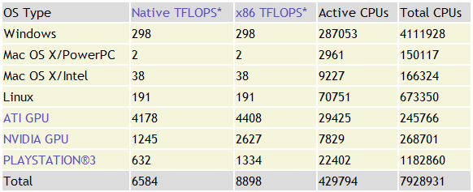

## Licencia {.nota-licencia visibility="uncounted"}

©2023  Micael Gallego, Francisco Gortázar, Michel Maes, Óscar Soto, Iván Chicano Algunos derechos reservados Este documento se distribuye bajo la licencia “Atribución-CompartirIgual 4.0 Internacional”  de Creative Comons Disponible en [https://creativecommons.org/licenses/by-sa/4.0/deed.es](https://creativecommons.org/licenses/by-sa/4.0/deed.es)

# Qué son las aplicación distribuidas

## ¿Qué es una aplicación distribuida?

- Una aplicación distribuida es un **conjunto de componentes independientes** que se ejecutan en **diferentes máquinas** y que dan al usuario la impresión de constituir **una única aplicación coherente**

---

- Ejemplos de aplicaciones distribuidas

---

- Ejemplos de aplicaciones distribuidas
  - Instagram
  - Twitter
  - Torrent
  - Correo electrónico (GMail, Hotmail, Yahoo, …)
  - Juegos en red
  - Comercio electrónico (Amazon, eBay, …)
  - …

## ¿Por qué construir apps distribuidas?

- Es más complicado…
  - Hay que pensar cómo partir la aplicación en partes autónomas
  - Aplicaciones corriendo en distintas máquinas se tienen que comunicar
    - ¿Protocolos?, ¿middleware?, ¿servicios web?
  - Puede haber problemas en la red
    - ¿No hay Internet? ¡Panic mode! 
- ¿Merece la pena?

---

- Soportar un número grande (y creciente) de datos
  - Instagram: 2.400.000.000 (2,4 mil millones) de usuarios activos
  - Cada usuario tiene un perfil con imágenes, videos, comentarios, mensajes directos…
  - Si cada usuario tuviera 1Mb de información (alcanzable con 2 ó 3 imágenes):
    - 1Mb x 2.400.000.000 = 2400Tb
    - Realidad: 1074 imágenes subidas por segundo (2024)
    - 4 millones de imágenes subidas por hora
    - Hay que repartir los datos entre diferentes máquinas

---

- Soportar un número grande (y creciente) de usuarios
  - Instagram: 2.400.000.000 (2,4 mil millones) de usuarios activos
  - 1074 imágenes subidas por segundo: +1000 peticiones por segundo
  - Sin contar ver posts, dar likes, ver y subir stories, Instagram Live...
    - Con picos de acceso mucho más
    - En 2015 reportan recibir más de 1 millón de peticiones por segundo 
    - ([https://instagram-engineering.com/instagration-pt-2-scaling-our-infrastructure-to-multiple-data-centers-5745cbad7834](https://instagram-engineering.com/instagration-pt-2-scaling-our-infrastructure-to-multiple-data-centers-5745cbad7834))
    - Imagináos actualmente (2024)
  - Hacen falta varios servidores atendiendo peticiones

---

- Elasticidad
  - La elasticidad se refiere a la forma en que una aplicación soporta el aumento y disminución de los recursos y usuarios del sistema
  - Al aumentar los recursos…
    - El servidor se puede quedar sin capacidad de almacenamiento
    - Las búsquedas son más costosas
  - Al aumentar los usuarios…
    - El servidor tiene que atender un mayor número de peticiones
    - Las peticiones tardan más
    - Los usuarios pueden estar más lejos geográficamente

## Caracterización

- Las aplicaciones distribuidas pueden ser de carácter muy diferente
  - Cómputo distribuido
    - Proyecto SETI@Home
    - Proyecto Folding@Home

{width=61%}

---

- Las aplicaciones distribuidas pueden ser de carácter muy diferente
  - Servicios
    - Correo electrónico
    - Listas de correo
    - Buscadores

---

- Las aplicaciones distribuidas pueden ser de carácter muy diferente
  - Redes sociales
    - Facebook
    - Twitter
    - Instagram

---

- Las aplicaciones distribuidas pueden ser de carácter muy diferente
- Sin embargo, en general comparten algunas propiedades

---

- Heterogeneidad
  - A nivel de red
    - Diferentes tipos de red (ethernet, 4G, satélite)
    - Diferentes velocidades
  - A nivel de hardware
    - Servidores, PCs, portátiles, consolas, móviles, …
    - Con arquitecturas x86, x86\_64, ARM, …
  - A nivel de sistema operativo
    - Linux, Windows, Mac, Android, iOS, …

---

- Heterogeneidad
  - A nivel del lenguaje de programación
    - Java, familia .NET, PHP, Ruby, Python, …
  - A nivel de las librerías/tecnologías involucradas
    - Tecnologías (sockets, RPC, middleware, …)
    - Librerías 

---

- Extensibilidad
  - Capacidad de añadir servicios (funcionalidades) nuevas al sistema
    - Chat en Facebook
    - Imágenes en las entradas de Twitter

---

- Seguridad
  - Seguridad en la comunicación (utilizando canales seguros)
    - Interacción en una venta electrónica
  - Capacidad de confirmar la identidad del otro extremo
    - Al acceder a servicios bancarios
  - Seguridad ante ataques
    - DoS, DDoS

---

- Escalabilidad
  - Una aplicación es escalable si sigue funcionando aunque aumenten:
    - El número de recursos que debe gestionar
    - El número de usuarios de la aplicación
  - La escalabilidad se puede conseguir de diferentes maneras
    - Aumentando el número de recursos (cpu, memoria, almacenamiento...)
    - Distribuyendo la carga de trabajo

---

- Escalabilidad
  - En general, hacer una aplicación escalable requiere un coste de desarrollo
  - Además, hay que sumar el coste económico
    - Más servidores → más inversión y mayor mantenimiento

---

- Tolerancia a fallos
  - Es la capacidad del sistema de enfrentarse a problemas que pueden suceder
    - Servidores que se caen
    - Enlaces de red que se interrumpen
    - Discos que se dañan
  - La detección de fallos permite aplicar estrategias para corregirlos
    - Informar al usuario o a los clientes
    - Replicación de datos
    - Enrutar peticiones por otro camino para evitar enlaces con problemas

---

- Concurrencia
  - Una aplicación distribuida es concurrente:

**“****conjunto de componentes independientes** que se ejecutan en **diferentes máquinas** y que dan al usuario la impresión de constituir **una única aplicación coherente”**

  - Pero además suelen ser concurrentes también “internamente”:
    - Un servidor web atiende numerosas peticiones concurrentemente
    - Una base de datos permite acceder concurrentemente a los datos

---

- Transparencia
  - Es la ocultación al usuario de los componentes y recursos de una aplicación distribuida
  - Existen distintos tipos de transparencia:
    - De acceso: los recursos se acceden igual sin importar si son locales o remotos
    - De ubicación: la localización de un recurso no se conoce al acceder al mismo
    - De concurrencia: oculta al usuario la posibilidad de que un recurso esté siendo accedido concurrentemente
    - De replicación: los recursos pueden estar replicados en múltiples servidores
    - Frente a fallos: se oculta el fallo de algún componente del sistema
    - De movilidad: los recursos se pueden mover mientras son accedidos sin que el usuario lo perciba
    - De prestaciones: el sistema escala según las necesidades de manera transparente

# Problemas propios de aplicaciones distribuidas

## Problemas

- Las 8 falacias de la construcción de aplicaciones distribuidas
  - La red es fiable
  - La latencia es cero
  - El ancho de banda es infinito
  - La red es segura
  - La topología no cambia
  - Sólo hay un administrador
  - El coste de transporte es cero
  - La red es homogénea

---

- Las 8 falacias de la construcción de aplicaciones distribuidas
  - La red es fiable
    - De vez en cuando una página no carga
    - En una aplicación distribuida el equivalente es que un servicio no está disponible

---

- Las 8 falacias de la construcción de aplicaciones distribuidas
  - La red es fiable
  - La latencia es cero
    - Pero en ocasiones una página tarda en cargar
    - Si los servidores están geográficamente muy alejados la latencia no es despreciable
    - O si están muy sobrecargados

---

- Las 8 falacias de la construcción de aplicaciones distribuidas
  - La red es fiable
  - La latencia es cero
  - El ancho de banda es infinito
    - A pesar de la brecha digital, casi todo el mundo tiene conexión de banda ancha (empresas, hogares, organizaciones públicas…)
    - Pero ahora disponemos de dispositivos móviles con acceso a Internet, que tienen poco ancho de banda

---

- Las 8 falacias de la construcción de aplicaciones distribuidas
  - La red es fiable
  - La latencia es cero
  - El ancho de banda es infinito
  - La red es segura
    - El envío de passwords por mail, o datos sensibles por conexiones no cifradas hace la red poco segura
    - El hecho de que tengamos cada vez más información personal en la “nube” (Facebook, Instagram, Dropbox) incrementa las necesidades de seguridad

---

- Las 8 falacias de la construcción de aplicaciones distribuidas
  - La red es fiable
  - La latencia es cero
  - El ancho de banda es infinito
  - La red es segura
  - La topología no cambia
    - Con una demanda creciente de datos/usuarios es necesario rediseñar la topología, mover recursos, habilitar nuevos servidores, proxys, cachés…

---

- Las 8 falacias de la construcción de aplicaciones distribuidas
  - La red es fiable
  - La latencia es cero
  - El ancho de banda es infinito
  - La red es segura
  - La topología no cambia
  - Sólo hay un administrador
    - Las aplicaciones se basan en servicios externos sobre los que no hay control

---

- Las 8 falacias de la construcción de aplicaciones distribuidas
  - La red es fiable
  - La latencia es cero
  - El ancho de banda es infinito
  - La red es segura
  - La topología no cambia
  - Sólo hay un administrador
  - El coste de transporte es cero
    - El tráfico de red cuesta dinero: en Gb transmitidos, en transacciones realizadas, …

---

- Las 8 falacias de la construcción de aplicaciones distribuidas
  - La red es fiable
  - La latencia es cero
  - El ancho de banda es infinito
  - La red es segura
  - La topología no cambia
  - Sólo hay un administrador
  - El coste de transporte es cero
  - La red es homogénea
    - En Internet podemos encontrar servicios de todo tipo, máquinas, arquitecturas…
    - Aunque en el contexto de proporcionar servicios se habla de un estándar de facto (servicios web con REST+JSON)

