## Licencia {.nota-licencia visibility="uncounted"}

©2023  Micael Gallego, Francisco Gortázar, Michel Maes, Óscar Soto, Iván Chicano Algunos derechos reservados Este documento se distribuye bajo la licencia “Atribución-CompartirIgual 4.0 Internacional”  de Creative Comons Disponible en [https://creativecommons.org/licenses/by-sa/4.0/deed.es](https://creativecommons.org/licenses/by-sa/4.0/deed.es)

## Introducción

- Introducción
  - Qué son las aplicación distribuidas
  - Problemas propios de aplicaciones distribuidas
  - **Patrones arquitectónicos**

## Patrones Arquitectónicos

- **Introducción**
- Patrones para Sistemas Distribuidos

---

- El concepto de arquitectura aplicado al desarrollo de software puede parecer difuso
- Si se observan las definiciones que diversos autores dan al concepto de “Arquitectura Software”, parece no haber un consenso claro sobre qué es la arquitectura del software
- Muchas veces se confunde con el diseño de ese software

---

- La definición del IEEE 1471
  - Incluye definiciones de los siguientes elementos relacionados con el concepto de arquitectura software
    - Sistema
      - Conjunto de componentes que cumplen una función o funciones específicas
    - Arquitectura
      - El mecanismo fundamental de organización de dichos componentes, las relaciones de esos componentes entre sí y con su entorno y los principios que guían el diseño y la evolución del sistema
    - Descripción arquitectónica
      - El conjunto de productos que documentan la arquitectura
    - Vista arquitectónica (architectural view)
      - Representación del sistema o de una parte de él desde una determinada perspectiva
    - Punto de vista arquitectónico (architectural viewpoint)
      - Plantilla que especifica cómo crear y usar una vista. Incluye el nombre, los actores involucrados, los aspectos cubiertos y las convenciones de modelado y análisis para su definición

---

- Software Engineering Institute at Carnegie-Mellon University
  - “The architecture of a software-intensive system is the structure or structures of the system, which comprise **software elements**, the **externally visible properties** of those elements, and the **relationships among them**”

---

“The software industry has a delight in taking words and stretching them into a myriad of subtly contradictory meanings. One of the biggest sufferers is "architecture". I tend to look at architecture as one of those impressive sounding words, used primarily to indicate that we are talking about is something that's important.”

						Martin Fowler

---

- Atributos de calidad de una arquitectura
  - Seguridad: prevenir accesos no autorizados
  - Integridad (o no) de los datos: ¿es aceptable proporcionar datos desactualizados? Evitar su corrupción
  - Mantenibilidad, a través de 
    - Portabilidad (de plataforma, SO, Cloud…)
    - Adaptabilidad al cambio: capacidad de añadir nueva funcionalidad.
      - Fragilidad: nuevas funcionalidades rompen otras ya existentes
      - Rigidez: es difícil incorporar cambios
      - Duplicación: los errores se multiplican, los cambios se hacen más difíciles porque no están localizados
    - Comprensión: el software es entendible por quien debe efectuar los cambios
    - Capacidad de depuración: el software puede depurarse a varios niveles incluso en producción
  - Testabilidad: pueden construirse tests para las nuevas funcionalidades
  - Usabilidad (UX): los usuarios pueden usarlo de forma eficiente y satisfactoria

---

- Atributos relacionados con la operación del sistema
  - Disponibilidad: porcentaje del tiempo que el sistema está disponible
  - Capacidad de gestión: capacidad de gestionar e inspeccionar sus componentes
  - Actualización: capacidad de actualizar el sistema en funcionamiento (en caliente)
  - Fiabilidad: capacidad del sistema de operar durante largos periodos de tiempo
  - Capacidad de recuperación: tiempo necesario para recuperar el sistema cuando se producen fallos

---

- Atributos relacionados con el rendimiento del sistema
  - Tiempo de respuesta
  - Elasticidad: capacidad del sistema para aumentar o disminuir su capacidad en función de la carga
  - Capacidad/throughput: capacidad de soportar cargas extremas sin dejar de dar servicio
- Seguridad física: el sistema no produce daños en el mundo físico (p. ej., sistema de control de un avión)

---

- Definición de algunos términos  usados en arquitectura software
  - Patrón arquitectónico: define un conjunto de componentes y sus interacciones. Algunos ejemplos son Pipes and Filters o Model-View-Controller
  - Estilo arquitectónico: similar a un idiom en diseño, a nivel de arquitectura: una forma común de resolver un determinado problema. Muchos de ellos se acaban convirtiendo en patrones, formalizándose
  - Componente Commercial Off-the-Shelf (COTS): componentes que son comprados a terceros u obtenidos como software libre y que se usan e integran sin modificación en el sistema
  - Componente: una parte del sistema con interfaces bien definidas con el exterior que realiza algún tipo de acción.Eso los convierte en fácilmente reemplazables. 
  - Dominio: representa un área de conocimiento. Permite pensar en las arquitecturas desde diferentes puntos de vista como el dominio del problema o el dominio de la seguridad
  - Modelo: una representación para mostrar o documentar algún aspecto del problema o de la solución (arquitectura)

---

- Algunos libros pueden llevar a confusión: hablan de arquitecturas pero en términos de diseño de clases
- El diseño se centra en la implementación de las funcionalidades (requisitos) del sistema en términos de clases, sus relaciones, datos que manejan, casos de uso, etc
- La arquitectura se centra en los diferentes componentes del sistema, sus interfaces y sus interacciones entre ellos y con el exterior
  - No especifica nada acerca de la implementación
  - No especifica nada acerca del diseño o de la aplicación de patrones de diseño

---

- Sin embargo, cuando definimos o hablamos de arquitectura software, a veces se emplean términos que aparecen en lo que entendemos como diseño software:
  - Patrones
  - Diagramas
  - Principios

## Introducción

- Los patrones arquitectónicos se dividen tradicionalmente en cuatro categorías
- Un patrón se incluye en la categoría para la que está especialmente pensado
- Puede darse el caso de que el patrón aborde también propiedades de otras categorías
- Generalmente hay una categoría “principal”

---

- Las cuatro grandes categorías
  - Estructurales
  - Sistemas Distribuidos
  - Sistemas Interactivos
  - Sistemas Adaptables

---

- Sistemas distribuidos
  - Patrones especialmente diseñados para un entorno distribuido
  - Se asume un entorno altamente distribuido
    - Cliente servidor no entraría en teoría aquí
  - Se proponen soluciones para un universo de componentes distribuidos

# Arquitectura por capas

## Arquitectura por Capas

- Es una de las más antiguas y conocidas
  - Torre OSI
  - Aplicaciones cliente/servidor
- La aplicación se descompone en capas
  - Cada capa da servicio a la capa de nivel superior
  - Cada capa usa los servicios de la capa inmediatamente por debajo

---

::: {.columns}
::: {.column width="71%"}
- Es una de las más antiguas y conocidas
  - Torre OSI
  - Aplicaciones cliente/servidor

- La aplicación se descompone en capas
  - Cada capa da servicio a la capa de nivel superior
  - Cada capa usa los servicios de la capa inmediatamente por debajo
:::
::: {.column width="29%"}
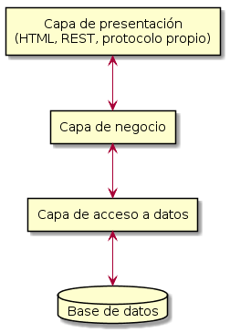{width=90%}
:::
:::

---

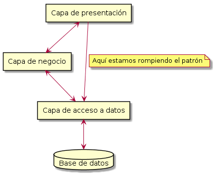{width=45%}

---

- Ejemplo
  - Torre OSI
- Contexto
  - Un sistema grande que necesita descomposición

---

- Problema
  - Características de alto y bajo nivel de abstracción
  - Características independientes en el mismo nivel
  - Difícil implementar directamente características de alto nivel encima de la plataforma para la que se va a desarrollar

---

- Solución
  - Descomposición en capas
  - Tantas como sea necesario
  - Comenzar por abajo (bajo nivel)
  - Ir añadiendo capas hasta llegar a la funcionalidad requerida
  - Todos los componentes de una capa deben estar al mismo nivel de abstracción
  - Cada capa compone los servicios de la capa inferior para dar servicio a la capa superior

---

- Estructura
  - Cada capa puede tener uno o varios componentes
  - Las relaciones de dependencia de los componentes de una capa sólo pueden cruzar a  componentes de la capa anterior o siguiente

---

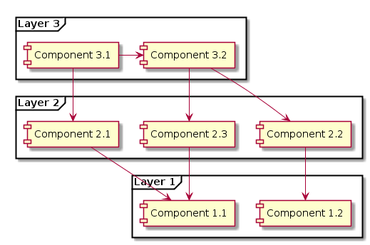{width=80%}

---

- Comportamiento
  - Escenario I: 
    - Una petición se inicia en la capa superior
    - Dicha capa no puede procesarla por lo que la pasa a la capa inferior
    - Al llegar a la capa de abajo, se procesa
    - El resultado se propaga hacia arriba capa a capa
    - El procesamiento de una petición en la capa J, proveniente de la capa J+1, puede involucrar múltiples peticiones a la capa J-1

---

- Comportamiento
  - Escenario II: 
    - De abajo hacia arriba
    - La capa 1 recibe una notificación/evento
    - Lo pasa a la capa 2 para que lo procese
    - La notificación se trasmite capa por capa hasta llegar a la capa superior
    - En una determinada capa, varias notificaciones podrían agruparse en una sola

---

- Comportamiento
  - Escenario III: 
    - Una petición se propaga sólo hasta aquella capa donde pueda ser procesada
    - No necesita llegar hasta la capa inferior
    - Requiere de estado en las capas
    - La presencia de estado complica las capas

---

- Comportamiento
  - Escenario IV: 
    - Similar al III para notificaciones
    - Una notificación sólo se transmite hasta una capa donde pueda ser atendida
  - Escenario V
    - Involucra dos pilas de capas que se comunican
    - Torre TCP/IP

---

- Usos conocidos
  - Comunicación de red (TCP/IP, OSI)

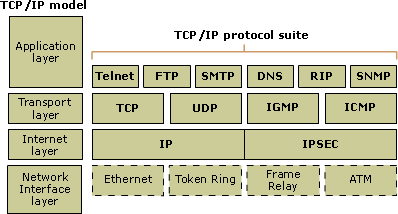{width=64%}

---

- Usos conocidos
  - Sistemas de información

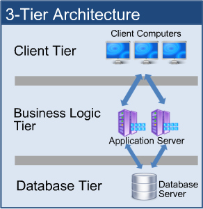{width=30%}

---

- Ventajas
  - Reutilización de capas
  - Capacidad de estandarización
  - Dependencias locales: un cambio afecta como mucho a las capas adyacentes
  - Cambio de implementaciones

---

- Inconvenientes
  - Cambios de comportamiento en una capa pueden implicar cambios en todas las superiores
  - Menor eficiencia
  - Trabajo innecesario: dos peticiones pueden requerir obtener la misma información varias veces
  - Dificultad de establecer la correcta granularidad de capas (por exceso o por defecto) 

# Broker

## Broker

- Permite desarrollar sistemas distribuidos mediante componentes desacoplados que responden a invocaciones remotas
- Un componente broker es responsable de las comunicaciones, de hacer forwarding de peticiones si es preciso y de devolver los resultados y errores que se produzcan

---

- Contexto
  - El sistema a desarrollar es distribuido, heterogéneo con componentes independientes que cooperan entre sí

---

- Problema
  - Útil cuando no queremos hacer una aplicación monolítica
  - Permite construir aplicaciones potencialmente escalables
  - Requiere comunicación entre procesos y si los procesos son responsables de esta comunicación introduce dependencias entre componentes
  - Hacen falta servicios para localizar componentes
  - Requiere poder añadir, eliminar o modificar componentes
  - Idealmente para un desarrollador no debería haber diferencia entre utilizar un componente distribuido o uno local

---

- Solución
  - Introducir un componente broker para desacoplar clientes y servidores
  - Los servidores se registran en el broker y exponen servicios en base a interfaces
  - Los clientes utilizan la funcionalidad ofrecida por los servidores comunicándose con ellos a través del broker

---

- Solución
  - Las tareas del broker incluyen
    - Localizar los servicios requeridos por los clientes
    - Enviar las peticiones de los clientes al servidor correspondiente
    - Devolver los resultados y los errores al cliente que realizó la petición

---

- Estructura
  - Este patrón incluye 6 componentes
    - Clientes
    - Servidores
    - Brokers
    - Proxies del lado del cliente
    - Proxies del lado del servidor

---

- Estructura
  - Servidores
    - Exponen su funcionalidad mediante interfaces
    - Puede usar IDL o protocolo propio
    - Pueden ofrecer servicios comunes a varias aplicaciones
    - Pueden ofrecer un servicio muy concreto para un dominio particular

---

- Estructura
  - Clientes
    - Aplicaciones que requieren los servicios de al menos un servidor
    - Para comunicarse con el servidor envían las peticiones al broker
    - Los clientes no conocen la ubicación de los servidores
    - Un cliente puede actuar como servidor de otro componente y viceversa

---

- Estructura
  - Broker
    - Envía peticiones de los clientes a los servidores
    - Devuelve resultados y errores de los servidores a los clientes
    - Responsable de localizar el servidor que debe atender una petición en base a Ids únicos
    - Ofrece APIs para
      - Registrar servidores
      - Invocar métodos sobre servicios

---

- Estructura
  - Broker
    - Puede haber varios brokers en el sistema
    - Si un servicio pedido a un broker lo proporciona un servidor asociado a otro broker, los brokers establecerán una comunicación entre ellos para poder llevar a cabo la petición

---

- Estructura
  - Proxies del lado del cliente
    - Se utilizan para independizar la llamada al servicio de los detalles de invocación de dicho servicio
    - El proxy ofrece una capa que independiza al componente de detalles como
      - Marshalling
      - Copia de bloques de memoria
      - Localización del broker

---

- Estructura
  - Proxies del lado del servidor
    - Su funcionalidad es análoga a la de los proxies del lado del cliente
    - Independizan el código del servidor de los detalles de comunicación con el broker

---

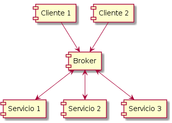{width=55%}

---

- Comportamiento
  - Escenario I: registro de un servidor
    - El broker espera comunicaciones entrantes en un bucle
    - Un servidor es iniciado y se registra con el broker
    - El broker guarda la información proporcionada por el servidor al registrarse
    - Esta información es utilizada para determinar a qué servidor enviar peticiones, así como su localización
    - El servidor queda en un bucle esperando peticiones

---

- Comportamiento
  - Escenario II: petición de un cliente (síncrona)
    - Un cliente invoca una operación sobre un servidor remoto
    - El proxy del lado del cliente empaqueta toda la información de la petición y la envía al broker
    - El broker mira en su estado la localización del servidor para la petición, y envía la información al proxy del lado del servidor
    - El proxy del lado del servidor desempaqueta la información y se la pasa al servidor para que la procese
    - Cuando el servidor ha terminado pasa la información del resultado y los posibles errores al proxy de su lado
    - El proxy empaqueta la información y se la envía al broker
    - El broker reenvía la información al proxy del cliente
    - El proxy del cliente la desempaqueta y se la pasa al cliente

---

- Variantes
  - Comunicación directa
    - El broker se utiliza para iniciar una comunicación con un servidor proporcionando transparencia de localización
    - El resto de la comunicación se realiza directamente entre cliente y servidor sin la intervención del broker
    - Requiere más trabajo por parte de los proxies

---

- Variantes
  - Paso de mensajes
    - Esta variante se utiliza cuando la información a intercambiar son datos
    - No se utiliza el enfoque de llamada a procedimiento remoto del patrón
    - En esta variante el tipo de mensaje indica la acción a realizar
    - Los servidores no exponen una API, sino que escuchan mensajes que ellos pueden procesar
    - Los clientes envían (encolan) mensajes para que sean procesados por los servidores

---

- Usos conocidos
  - Colas de mensajes
  - Cualquier aplicación de tipo publish/subscribe

---

- Ventajas
  - Transparencia de localización
  - Extensibilidad
  - Posibilidad de cambiar la implementación de servidores y servicios
  - Portabilidad
  - Reusabilidad

---

- Inconvenientes
  - Eficiencia
  - Tolerancia a fallos
  - Complicado de testear
  - Complicado de depurar

---

- Patrones de diseño relacionados
  - Forwarder-Receiver
  - Proxy
  - Client-Dispatcher-Server
  - Mediator

# Microservicios

## Microservicios

{width=35%}

[https://github.com/microservices-patterns/ftgo-application](https://github.com/microservices-patterns/ftgo-application)

[https://microservices.io/](https://microservices.io/)

---

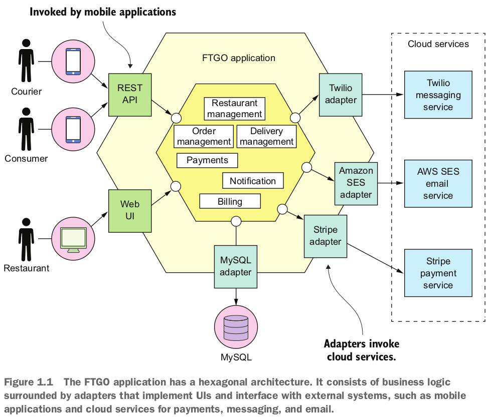{width=70%}

---

- Beneficios de la arquitectura monolítica
  - Simple de desarrollar
  - Fácil hacer cambios radicales (grandes refactorizaciones)
  - Tests sencillos
  - Despliegue sencillo
  - Fácil de escalar (escalado horizontal del monolito)

---

- Problemas de un monolito grande
  - La complejidad intimida a los desarrolladores
  - El desarrollo es lento
  - El camino del commit al despliegue es largo y arduo
  - El escalado es difícil: Cada módulo tiene requisitos de memoria y CPU diferentes
  - Es un reto que el monolitio sea fiable
  - Anclado a una tecnología obsoleta

---

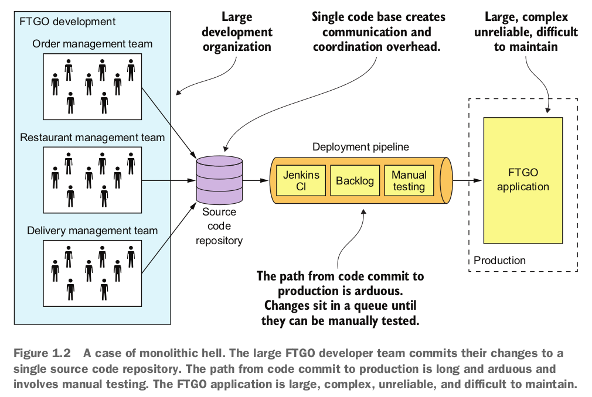{width=88%}

---

Los **microservicios** son servicios pequeños y autónomos que colaboran entre sí

---

- Arquitectura de microservicios al rescate
  - En cualquier arquitectura se pueden implementar cualquier conjunto de requisitos funcionales
  - La arquitectura es importante para los requisitos no funcionales: mantenibilidad, extensibilidad y testeabilidad.
  - Por muy disciplinado que sea el equipo manteniendo la modularidad del monolito, es complejo de gestionar

---

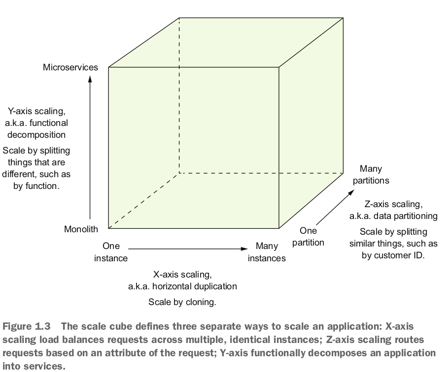{width=73%}

---

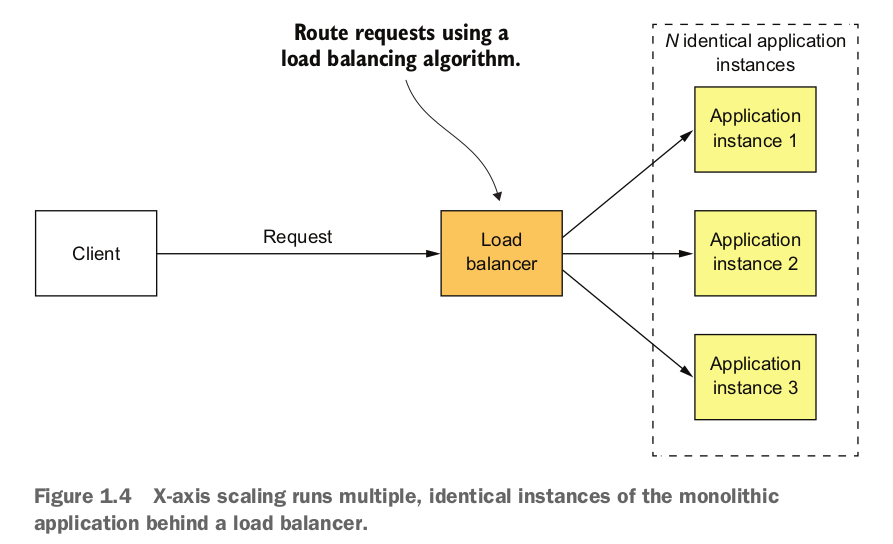{width=94%}

---

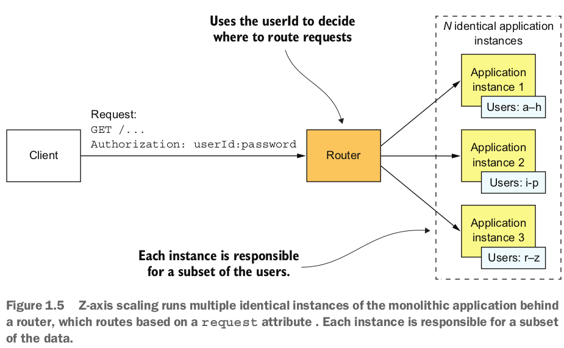{width=94%}

---

{width=94%}

---

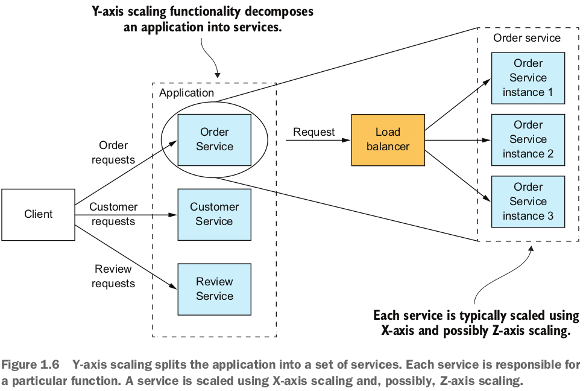{width=88%}

---

- Qué son los microservicios?
  - Estilo arquitectónico que descompone la aplicación en un conjunto de servicios.
  - No importa el tamaño de los servicios
  - Pero cada servicio tiene un conjunto de **responsabilidades cohesivas y focalizadas**
  - La arquitectura de microservicios es una forma de **modularidad**

---

- La modularidad permite gestionar la complejidad 
- En los monolitos los módulos se implementan con herramientas de la tecnología (clases, paquetes, módulos, librerías…)
  - Pero al final es complicado mantener el aislamiento y los monolitos degeneran en una **gran bola de barro (****big ball of mud****)**

---

- Los microservicios implementan la **modularidad con los servicios**
  - Los microservicios encapsulan mediante su **API**
  - Es mucho más sencillo preservar la modularidad a lo largo del tiempo
  - Se pueden **desplegar** y **escalar** de forma independiente

---

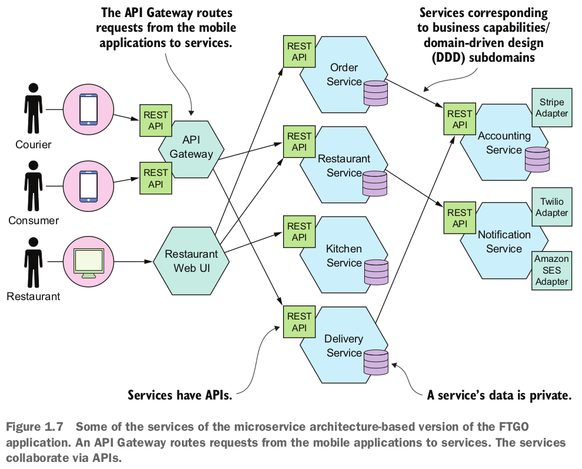{width=74%}

## Microservicios - Ventajas

- Permite la entrega y despliegue continuo de aplicaciones grandes y complejas
- Servicios pequeños y con fácil mantenimientos
- Servicios que se pueden desplegar de forma independiente
- Servicios que se pueden escalar de forma independiente
- Permite equipos autónomos
- Fácil experimentar nuevas tecnologías
- Los fallos se aislan mejor

## Microservicios

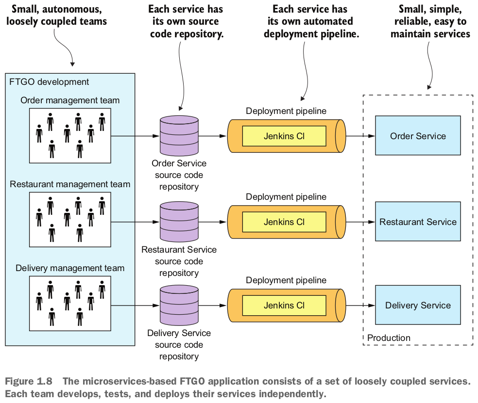{width=70%}

## Microservicios - Inconvenientes

- Es un reto encontrar el conjunto adecuado de servicios
- Los sistemas distribuidos son complejos
- Implementar funcionalidades que involucran varios servicios requiere coordinación
- Decidir en qué momento la arquitectura microservicios es más adecuada que el monolito, es complejo

## Microservicios

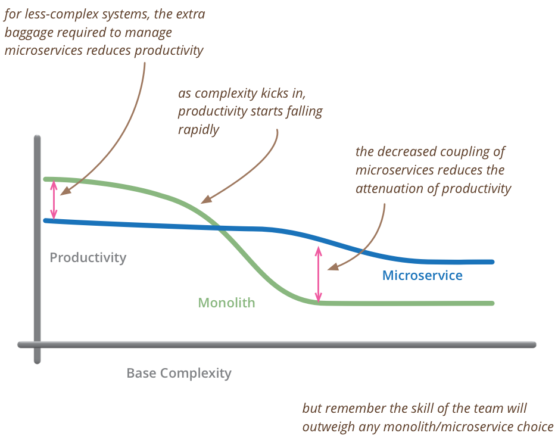{width=75%}

