## Contenidos

1. ¿Por qué Domain-Driven Design?
2. Diseño estratégico
    - Lenguaje ubicuo, subdominios, *bounded contexts*, *context mapping*
3. Diseño táctico
    - Entidades, *value objects*, agregados, eventos de dominio, repositorios, servicios
4. Arquitectura: capas y hexagonal
5. Descubrir el dominio: *Event Storming*
6. DDD y aplicaciones distribuidas
7. Ejercicio

::: {.ejemplo}
**Código de los ejemplos**: carpeta [`parte_1/tema_1.3_ddd`](https://github.com/codeurjc/dad/tree/main/parte_1/tema_1.3_ddd) del repositorio de la asignatura.
:::

# ¿Por qué Domain-Driven Design? {background-color="#1f4e79"}

## El problema: la complejidad está en el dominio

* Las aplicaciones de empresa no suelen ser complejas por la tecnología, sino por el **negocio**:
    - reglas que cambian, excepciones a las reglas, vocabulario propio...
* Síntomas habituales cuando el código no refleja el negocio:
    - **Modelo anémico**: clases con *getters/setters* y la lógica dispersa en "servicios" enormes
    - **Big ball of mud**: todo depende de todo, nadie se atreve a cambiar nada
    - **Traducciones constantes** entre lo que dice negocio y lo que hay en el código
* Cambiar una regla de negocio obliga a tocar 15 ficheros... y romper 3 cosas

## ¿Qué es DDD?

> *"Domain-Driven Design is an approach to software development that centers the development on programming a domain model that has a rich understanding of the processes and rules of a domain."*
>
> --- Martin Fowler

* Propuesto por **Eric Evans** en *Domain-Driven Design: Tackling Complexity in the Heart of Software* (2003)
* No es una tecnología ni un framework: es una **forma de diseñar**
* Ideas clave:
    - El **modelo de dominio** es el corazón del software
    - Desarrolladores y **expertos de dominio** colaboran continuamente
    - El modelo se expresa **en el código** con el mismo lenguaje que usa negocio

## Dos niveles de diseño

{fig-align="center" width="95%"}

* El **estratégico** es el más importante (y el que más se olvida)
* El **táctico** son patrones de código para implementar un modelo rico

# Diseño estratégico {background-color="#1f4e79"}

## Lenguaje ubicuo (*Ubiquitous Language*)

* Un **vocabulario común** entre expertos de negocio y desarrolladores
* Se usa en **todas partes**: conversaciones, documentación, tests... y **en el código**
* Si negocio dice *"el socio **devuelve** un **ejemplar**"*, el código no debería decir `updateBookStatus(userId, 2)`

::: columns
::: {.column width="50%"}
**Sin lenguaje ubicuo** ✘

```java
user.setStatus(3);
order.setFlag(true);
dao.update(order);
```
:::
::: {.column width="50%"}
**Con lenguaje ubicuo** ✔

```java
member.giveBack(copyId, today);
order.place();
orders.save(order);
```
:::
:::

* Cuando el lenguaje cambia, **el código cambia** con él (refactorizar nombres es diseño)

## Subdominios

El **dominio** es el área de negocio. Se descompone en **subdominios**:

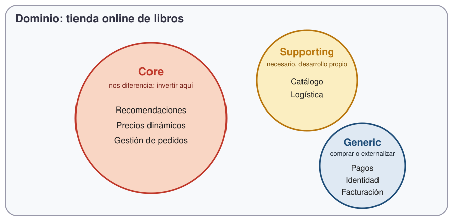{fig-align="center" width="80%"}

## Tipos de subdominio

| Tipo | Qué es | Estrategia |
|---|---|---|
| **Core** | Lo que diferencia a la empresa de su competencia | Desarrollo propio, el mejor equipo, DDD táctico completo |
| **Supporting** | Necesario para el negocio pero no diferenciador | Desarrollo propio más sencillo (CRUD puede bastar) |
| **Generic** | Problema resuelto, igual para todas las empresas | Comprar, SaaS, librería *open source* |

::: {.aviso}
No tiene sentido aplicar todos los patrones tácticos en un subdominio genérico. **Invierte el esfuerzo donde está la ventaja competitiva.**
:::

## El problema del modelo único

* ¿Qué es un **Producto**? Depende de a quién le preguntes...

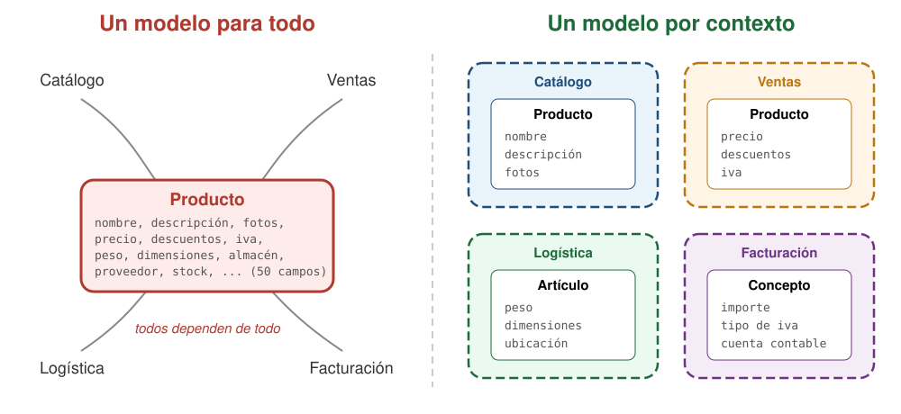{fig-align="center" width="95%"}

## *Bounded Context*

> Un **bounded context** es una frontera explícita dentro de la cual un modelo de dominio es consistente y el lenguaje ubicuo tiene un significado preciso.

* Cada contexto tiene **su propio modelo** y **su propio lenguaje**
    - "Cliente" en Ventas ≠ "Destinatario" en Logística, aunque sean la misma persona
* Duplicar conceptos entre contextos **no es un error**: es desacoplamiento
* Un contexto suele corresponder a **un equipo** y a **una unidad de despliegue** (un servicio, un módulo)
* Subdominio (espacio del **problema**) ≠ bounded context (espacio de la **solución**), aunque lo ideal es que se alineen 1:1

## *Context Mapping*

Los contextos no viven aislados: un **context map** documenta cómo se relacionan.

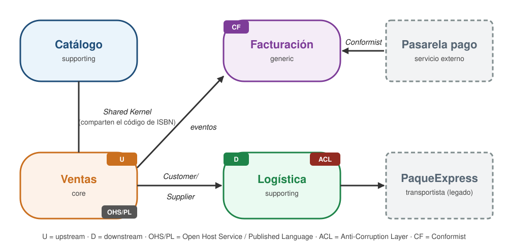{fig-align="center" width="92%"}

## Patrones de relación entre contextos (I)

* **Upstream / Downstream (U/D)**: el de arriba influye en el de abajo, pero no al revés
* **Customer / Supplier**: el *downstream* (cliente) negocia sus necesidades con el *upstream* (proveedor), que las tiene en cuenta en su planificación
* **Conformist**: el *downstream* adopta tal cual el modelo del *upstream* (p. ej. una API externa que no podemos cambiar y que nos vale)
* **Shared Kernel**: dos contextos comparten un trozo de modelo (y de código). Muy acoplado: cualquier cambio requiere acuerdo de ambos equipos

## Patrones de relación entre contextos (II)

* **Open Host Service (OHS)**: el *upstream* ofrece un protocolo/API bien definido para cualquier consumidor
* **Published Language (PL)**: un lenguaje de intercambio documentado (JSON Schema, Avro, eventos...) independiente del modelo interno
* **Anti-Corruption Layer (ACL)**: el *downstream* construye una capa de traducción para que el modelo externo **no contamine** el suyo
* **Separate Ways**: no integrar; cada contexto resuelve su problema por su cuenta
* **Partnership**: dos equipos con éxito o fracaso ligado coordinan su evolución

## Ejemplo 3: contextos y ACL

::: {.ejemplo}
**[ddd-ejem3](https://github.com/codeurjc/dad/tree/main/parte_1/tema_1.3_ddd/ddd-ejem3)**: monolito modular con los contextos *Ventas* y *Logística* y un transportista externo (*PaqueExpress*).
:::

```{.default}
es.codeurjc.dad.ddd.ejem3
├── sales                      ← contexto Ventas (upstream)
│   ├── api/OrderPlacedEvent   ← lenguaje publicado: lo ÚNICO que ven los demás
│   └── application/SalesService
└── shipping                   ← contexto Logística (downstream)
    ├── domain/                ← Shipment, Recipient, CarrierGateway (puerto)...
    ├── application/ShippingService
    ├── integration/           ← traduce OrderPlacedEvent al lenguaje de Logística
    ├── infrastructure/        ← repositorios en memoria, pesos de productos
    └── acl/paqueexpress/      ← Anti-Corruption Layer con el transportista
```

* Ventas habla de **clientes, productos y precios**. Logística, de **destinatarios y gramos**
* El peso **no** viaja en el evento: es un dato propio de Logística

## La API "legada" del transportista

El sistema externo tiene un modelo muy distinto al nuestro:

```java
/** claves: DEST_NOM, DEST_DIR, DEST_POB, DEST_CP, PESO_KG, TIPO_SRV, REF_CLI
 *  respuesta: COD_RES ("00" OK, "17" CP no servido, "23" peso excesivo), NUM_EXP */
public Map<String, String> altaExpedicion(Map<String, String> datos)
```

Nuestro dominio define el puerto **en su propio lenguaje**:

```java
public interface CarrierGateway {
    TrackingNumber book(Shipment shipment);
}
```

## La *Anti-Corruption Layer*

```java
public class PaqueExpressCarrierAdapter implements CarrierGateway {

    @Override
    public TrackingNumber book(Shipment shipment) {
        Map<String, String> respuesta = client.altaExpedicion(toPaqueExpress(shipment));
        return switch (respuesta.get("COD_RES")) {
            case "00" -> new TrackingNumber(respuesta.get("NUM_EXP"));
            case "17" -> throw new CarrierException("No da servicio en el CP " + ...);
            case "23" -> throw new CarrierException("Peso excesivo para el servicio contratado");
            default   -> throw new CarrierException("Error desconocido: " + ...);
        };
    }

    static Map<String, String> toPaqueExpress(Shipment shipment) {
        String kilos = String.format(Locale.of("es", "ES"), "%.2f", shipment.weightGrams() / 1000.0);
        return Map.of("DEST_NOM", shipment.recipient().name().toUpperCase(Locale.ROOT),
                      "PESO_KG", kilos,
                      "TIPO_SRV", shipment.requiresFreightService() ? "C" : "N", ...);
    }
}
```

* Cambiar de transportista = escribir otro adaptador. **El dominio no se entera**

# Diseño táctico {background-color="#ca6f1e"}

## Bloques de construcción

{fig-align="center" width="85%"}

## *Value Objects*

* Representan un **valor**, no tienen identidad: `10 €` es igual a cualquier otro `10 €`
* **Inmutables**: las operaciones devuelven un objeto nuevo
* **Autovalidados**: es imposible construir uno inválido
* Encapsulan comportamiento → evitan la *primitive obsession* (`BigDecimal`, `String` sueltos)
* Ejemplos: dinero, email, dirección, rango de fechas, coordenadas, identificadores...

::: {.ejemplo}
**[ddd-ejem1](https://github.com/codeurjc/dad/tree/main/parte_1/tema_1.3_ddd/ddd-ejem1)**: `Money`, `EmailAddress`, `Address`, `CustomerId` y la entidad `Customer`.
:::

## *Value Objects* con records de Java

```java
public record Money(BigDecimal amount, Currency currency) {

    public Money {                                       // constructor compacto: validación
        Objects.requireNonNull(amount, "amount");
        if (amount.signum() < 0) {
            throw new IllegalArgumentException("Una cantidad de dinero no puede ser negativa");
        }
        amount = amount.setScale(currency.getDefaultFractionDigits(), RoundingMode.HALF_EVEN);
    }

    public Money plus(Money other) {                     // devuelve un objeto nuevo
        checkSameCurrency(other);
        return new Money(amount.add(other.amount), currency);
    }
    ...
}
```

```java
Money.euros("10").equals(Money.euros("10.00"))   // true: igualdad por valor
new EmailAddress("esto-no-es-un-email")           // IllegalArgumentException
```

* Los `record` generan `equals`/`hashCode` por valor y tienen campos `final`

## Entidades

* Tienen **identidad** que perdura en el tiempo aunque cambien sus atributos
* Dos entidades son iguales si tienen **el mismo id**
* Su estado cambia mediante **métodos con significado de negocio**, no *setters*

```java
public class Customer {
    private final CustomerId id;
    private EmailAddress email;
    private Money totalSpent;

    public void changeEmail(EmailAddress newEmail) { ... }
    public void registerPurchase(Money amount) { totalSpent = totalSpent.plus(amount); }
    public boolean isVip() { return totalSpent.isGreaterThan(VIP_THRESHOLD); }

    @Override
    public boolean equals(Object o) {
        return o instanceof Customer other && id.equals(other.id);
    }
}
```

* Identificadores **tipados** (`CustomerId`, `OrderId`): el compilador impide mezclarlos

## ¿Entidad o *value object*?

| Pregunta | Entidad | Value object |
|---|---|---|
| ¿Me importa *cuál* es o solo *cómo* es? | *Cuál* | *Cómo* |
| ¿Cambia con el tiempo? | Sí, mediante comportamiento | No, se sustituye |
| Igualdad | Por identificador | Por todos sus atributos |
| Ejemplo | Cliente, Pedido, Socio | Dinero, Email, Dirección |

::: {.aviso}
Depende del **contexto**: una dirección es un *value object* en una tienda, pero puede ser una **entidad** en el catastro o en una compañía eléctrica.
:::

::: {.callout-tip}
Regla práctica: **prefiere value objects**. Son más fáciles de probar, de compartir y de razonar.
:::

## Agregados

> Un **agregado** es un grupo de entidades y *value objects* que se tratan como **una unidad de consistencia**. Se accede a él siempre a través de su **raíz**.

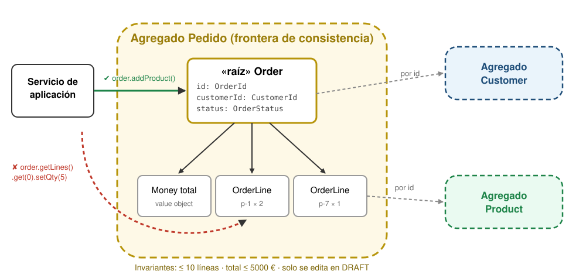{fig-align="center" width="85%"}

## Reglas de diseño de agregados

1. **Protege las invariantes** dentro de la frontera: al terminar cada método todas se cumplen
2. **Diseña agregados pequeños**: solo lo que necesita ser consistente *inmediatamente*
3. **Referencia otros agregados por identidad** (`CustomerId`), nunca por objeto
4. **Modifica un solo agregado por transacción**; entre agregados usa **consistencia eventual** (eventos de dominio)

::: {.small}
*Vaughn Vernon, "Effective Aggregate Design" (2011)*
:::

* Un agregado grande = más conflictos de concurrencia y peor rendimiento
* El agregado es también la **unidad de persistencia**: se carga y se guarda entero

## Ejemplo 2: el agregado `Order`

::: {.ejemplo}
**[ddd-ejem2](https://github.com/codeurjc/dad/tree/main/parte_1/tema_1.3_ddd/ddd-ejem2)**: agregado `Order`, eventos de dominio, repositorio JPA, servicio de aplicación y API REST con arquitectura hexagonal.
:::

```java
public void addProduct(ProductId productId, int quantity, Money unitPrice) {
    requireDraft("añadir productos");
    List<OrderLine> candidate = ... // estado tras añadir la línea (o acumular unidades)

    // Comprobamos las invariantes sobre el estado candidato ANTES de aplicarlo
    if (candidate.size() > MAX_LINES) {
        throw new DomainException("Un pedido no puede tener más de " + MAX_LINES + " productos");
    }
    if (totalOf(candidate).isGreaterThan(MAX_TOTAL)) {
        throw new DomainException("El pedido superaría el importe máximo de " + MAX_TOTAL);
    }
    lines.clear();
    lines.addAll(candidate);
}

public List<OrderLine> lines() {
    return Collections.unmodifiableList(lines);    // nadie puede saltarse la raíz
}
```

## Ciclo de vida del pedido

{fig-align="center" width="85%"}

* Las transiciones son **métodos del agregado**, no un `setStatus()`
* Cada transición relevante genera un **evento de dominio**

## Eventos de dominio

* Algo **relevante para negocio** que **ya ha ocurrido** → se nombran en **pasado**
    - `OrderPlaced`, `CopyReturned`, `PenaltyImposed`
* Son **inmutables** y contienen los datos necesarios para reaccionar
* Permiten **desacoplar**: el agregado no sabe quién reacciona
* Son la base de la consistencia eventual entre agregados... y entre **contextos** (tema 3)

```java
public record OrderPlaced(OrderId orderId, CustomerId customerId, Money total,
                          int units, Instant occurredOn) implements DomainEvent { }

public void place() {
    requireDraft("confirmar el pedido");
    if (lines.isEmpty()) throw new DomainException("No se puede confirmar un pedido vacío");
    status = OrderStatus.PLACED;
    domainEvents.add(new OrderPlaced(id, customerId, total(), units(), Instant.now(clock)));
}
```

## Publicación de eventos de dominio

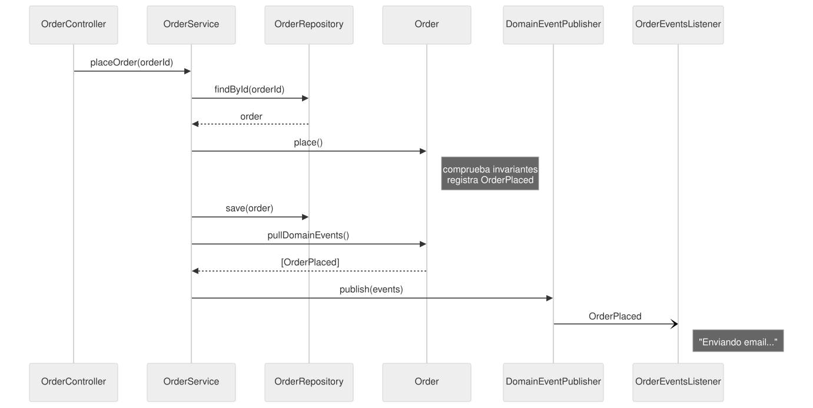{fig-align="center" width="88%"}

## Repositorios

* Dan la **ilusión de una colección en memoria** de agregados
* **Un repositorio por agregado** (no por tabla): no hay `OrderLineRepository`
* La **interfaz** pertenece al dominio; la **implementación** a la infraestructura

```java
public interface OrderRepository {          // dominio: habla el lenguaje del dominio
    OrderId nextId();
    Optional<Order> findById(OrderId id);
    void save(Order order);
}
```

```java
@Repository                                  // infraestructura: JPA
public class JpaOrderRepository implements OrderRepository {
    private final SpringDataOrderRepository jpa;

    @Override
    public Optional<Order> findById(OrderId id) {
        return jpa.findById(id.value()).map(JpaOrderRepository::toDomain);
    }
    ...
}
```

## Modelo de dominio vs modelo de persistencia

* En el ejemplo 2 el dominio **no tiene anotaciones JPA**: `OrderJpaEntity` es otra clase y el repositorio traduce
    - ✔ El dominio es Java puro, fácil de probar y de evolucionar
    - ✘ Hay que mantener el *mapping* a mano
* Alternativa pragmática: anotar las clases del dominio con JPA (`@Entity`, `@Embeddable`...)
    - Menos código, pero JPA impone restricciones (constructor vacío, *proxies*...)

::: {.callout-note}
No es un dogma: elige según la complejidad del subdominio. En un **core** suele compensar la separación; en un **supporting** probablemente no.
:::

## Servicios

::: columns
::: {.column width="50%"}
**Servicio de dominio**

* Lógica de negocio que **no encaja** en una entidad o *value object*
* Suele coordinar **varios agregados**
* Sin estado, sin infraestructura
* Ej.: `LendingPolicy` en el ejercicio, cálculo de precios con reglas de varios agregados
:::
::: {.column width="50%"}
**Servicio de aplicación**

* Implementa los **casos de uso**
* Carga agregados → invoca comportamiento → guarda → publica eventos
* Gestiona **transacciones** y seguridad
* **No contiene reglas de negocio**
* Ej.: `OrderService`
:::
:::

```java
@Service @Transactional
public class OrderService {
    public void placeOrder(OrderId orderId) {
        Order order = load(orderId);
        order.place();                              // las reglas están en el agregado
        orders.save(order);
        events.publish(order.pullDomainEvents());
    }
}
```

## Factorías

* Encapsulan la **creación** de agregados complejos y garantizan que nacen válidos
* Pueden ser **métodos estáticos** en la raíz o clases independientes

```java
public static Order create(OrderId id, CustomerId customerId) {   // pedido nuevo
    return new Order(id, customerId, OrderStatus.DRAFT, List.of(), Clock.systemUTC());
}

public static Order rehydrate(OrderId id, CustomerId customerId,  // desde la BD:
                              OrderStatus status, List<OrderLine> lines) {  // no genera eventos
    return new Order(id, customerId, status, lines, Clock.systemUTC());
}
```

* El constructor es privado: **no hay forma** de crear un `Order` sin pasar por la factoría

# Arquitectura {background-color="#148f77"}

## Arquitectura en capas

{fig-align="center" width="45%"}

* La capa de dominio no depende de ninguna otra (**inversión de dependencias**)

## Arquitectura hexagonal (puertos y adaptadores)

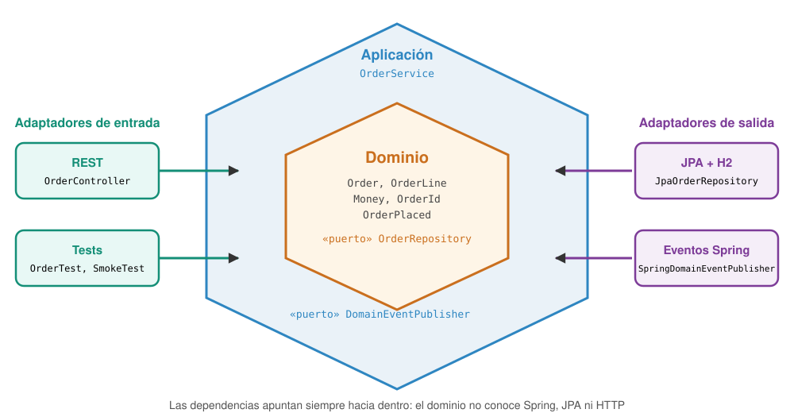{fig-align="center" width="92%"}

::: {.small}
Alistair Cockburn (2005). Variantes muy parecidas: *Onion Architecture*, *Clean Architecture*.
:::

## Ejemplo 2: estructura del proyecto

```{.default}
es.codeurjc.dad.ddd.ejem2
├── domain                  ← Java puro: ni Spring ni JPA
│   ├── Order, OrderLine, OrderStatus, Money, OrderId, CustomerId, ProductId
│   ├── DomainEvent, OrderPlaced, OrderCancelled, DomainException
│   └── OrderRepository                 ← puerto
├── application
│   ├── OrderService                    ← casos de uso
│   └── DomainEventPublisher            ← puerto
└── infrastructure
    ├── web/OrderController             ← adaptador de entrada (REST)
    ├── persistence/JpaOrderRepository  ← adaptador de salida (JPA + H2)
    └── events/SpringDomainEventPublisher, OrderEventsListener
```

```bash
curl -X POST localhost:8080/orders -H 'Content-Type: application/json' -d '{"customerId":"c-1"}'
curl -X POST localhost:8080/orders/{id}/lines -H 'Content-Type: application/json' \
     -d '{"productId":"p-1","quantity":2,"unitPrice":9.95}'
curl -X POST localhost:8080/orders/{id}/place
```

## Probar el dominio sin infraestructura

Las reglas de negocio se prueban **sin Spring, sin base de datos y sin HTTP**:

```java
@Test
void noSePuedeSuperarElImporteMaximo() {
    order.addProduct(new ProductId("p-1"), 1, Money.euros("4999"));

    assertThrows(DomainException.class,
            () -> order.addProduct(new ProductId("p-2"), 1, Money.euros("2")));
    assertEquals(1, order.lines().size(), "si se viola una invariante el agregado no cambia");
}

@Test
void confirmarGeneraElEventoOrderPlaced() {
    order.addProduct(new ProductId("p-1"), 2, Money.euros("10"));
    order.place();

    OrderPlaced placed = assertInstanceOf(OrderPlaced.class, order.pullDomainEvents().get(0));
    assertEquals(Money.euros("20"), placed.total());
}
```

* Los tests son rápidos, deterministas y **documentan las reglas de negocio**

# Descubrir el dominio {background-color="#7d3c98"}

## *Event Storming*

* Taller colaborativo (Alberto Brandolini) con **expertos de negocio y técnicos**
* Una pared larga, *post-its* de colores y una línea temporal
* Se empieza por los **eventos de dominio** (naranja) y se va enriqueciendo

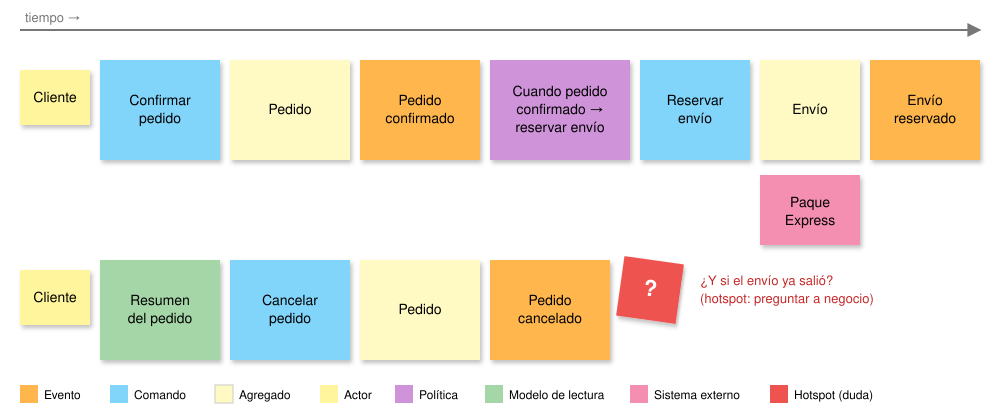{fig-align="center" width="88%"}

## *Event Storming*: del taller al diseño

1. **Caos**: todo el mundo escribe eventos relevantes en pasado
2. **Línea temporal**: ordenarlos y detectar huecos y *hotspots* (dudas, conflictos)
3. **Comandos y actores**: ¿qué o quién provoca cada evento?
4. **Políticas**: reacciones automáticas *"cuando X, entonces Y"*
5. **Agregados**: ¿qué recibe el comando y garantiza las reglas?
6. **Bounded contexts**: agrupar por lenguaje y por cambios de responsabilidad

::: {.callout-tip}
Los eventos que descubres en el taller acaban siendo **eventos de dominio en el código** y, muchas veces, **mensajes entre servicios** (tema 3).
:::

# DDD y aplicaciones distribuidas {background-color="#1f4e79"}

## Bounded contexts y microservicios

* Un bounded context es un **candidato natural** a servicio independiente
    - Modelo propio → **base de datos propia**
    - Lenguaje publicado → **API o eventos** como contrato
    - Un equipo → despliegue independiente
* Pero **no al revés**: un contexto puede tener varios servicios
* Empezar con un **monolito modular** (como `ddd-ejem3`) es una buena opción:
    - Fronteras claras entre paquetes/módulos
    - Si se necesita, extraer un contexto a un servicio es mucho más fácil

::: {.aviso}
Partir un sistema en microservicios **sin** fronteras de dominio claras produce un **monolito distribuido**: todos los problemas de los dos mundos.
:::

## Del monolito modular a servicios

{fig-align="center" width="80%"}

* El **contrato** (`OrderPlacedEvent`) no cambia: cambia el **transporte**
* Aparecen nuevos problemas: entrega de mensajes, duplicados, orden, consistencia eventual... → **Tema 3: arquitecturas dirigidas por eventos**

## Errores habituales al aplicar DDD

* Aplicar **todos los patrones tácticos en todas partes** (incluido el CRUD de "tipos de IVA")
* Ignorar el diseño estratégico y quedarse solo en "*entities* y *repositories*"
* **Agregados gigantes** que cargan medio sistema
* Modelos **anémicos** con lógica en servicios (DDD solo de nombre)
* Inventar el lenguaje ubicuo **sin hablar con negocio**
* Compartir entidades entre contextos "para no duplicar"

## Resumen

* DDD pone el **modelo de dominio** y el **lenguaje de negocio** en el centro del software
* **Diseño estratégico**: subdominios, bounded contexts y context map → dónde están las fronteras
* **Diseño táctico**: value objects, entidades, agregados, eventos, repositorios y servicios → cómo se implementa un modelo rico
* **Arquitectura hexagonal**: el dominio no depende de la infraestructura
* Los bounded contexts y los eventos de dominio son el puente hacia las **aplicaciones distribuidas**

## Ejemplos del tema

| Proyecto | Contenido |
|---|---|
| [ddd-ejem1](https://github.com/codeurjc/dad/tree/main/parte_1/tema_1.3_ddd/ddd-ejem1) | *Value objects* (`Money`, `EmailAddress`, `Address`) y entidad `Customer` |
| [ddd-ejem2](https://github.com/codeurjc/dad/tree/main/parte_1/tema_1.3_ddd/ddd-ejem2) | Agregado `Order`, eventos de dominio, repositorio JPA, arquitectura hexagonal, API REST |
| [ddd-ejem3](https://github.com/codeurjc/dad/tree/main/parte_1/tema_1.3_ddd/ddd-ejem3) | Bounded contexts Ventas/Logística, lenguaje publicado y *Anti-Corruption Layer* |
| [ddd-ejer1](https://github.com/codeurjc/dad/tree/main/parte_1/tema_1.3_ddd/ddd-ejer1) | Solución del ejercicio 1 |

: {tbl-colwidths="[18,82]"}

```bash
cd parte_1/tema_1.3_ddd/ddd-ejem2
mvn spring-boot:run      # o: mvn test para ejecutar solo las pruebas
```

# Ejercicio {background-color="#ca6f1e"}

## Ejercicio 1: préstamos de una biblioteca (I)

::: {.ejercicio}
La biblioteca de la universidad quiere un servicio para gestionar **préstamos**. En una sesión con la bibliotecaria se han identificado estas reglas:
:::

1. Un **socio** puede tener como máximo **3 préstamos activos**
2. Un préstamo dura **14 días** desde que se presta el **ejemplar**
3. Un socio con algún **préstamo vencido** o con una **penalización pendiente** de pago no puede pedir más préstamos
4. Si un ejemplar se **devuelve** con retraso, el socio recibe una **penalización de 0,50 € por día** de retraso
5. Un ejemplar solo puede estar prestado a **un socio a la vez**
6. Un préstamo puede **renovarse una sola vez** (14 días más) si no está vencido

## Ejercicio 1: préstamos de una biblioteca (II)

Se pide:

1. Identifica el **lenguaje ubicuo** y clasifica cada concepto como **entidad** o ***value object***
2. Diseña los **agregados**. Justifica sus fronteras: ¿qué reglas protege cada uno? ¿Dónde va la regla 5?
3. Define los **eventos de dominio** relevantes
4. Implementa el modelo en Java **sin dependencias de Spring** y con **tests unitarios** para cada regla
5. Implementa un **servicio de aplicación** y una **API REST** con Spring Boot (repositorios en memoria):

```{.default}
GET  /members/{memberId}                          consultar socio, préstamos y penalización
POST /members/{memberId}/loans                    {"copyId":"c-1"}   prestar
POST /members/{memberId}/returns                  {"copyId":"c-1"}   devolver
POST /members/{memberId}/loans/{copyId}/renewal                      renovar
POST /members/{memberId}/penalty-payments         {"amount":1.50}    pagar penalización
```

::: {.small}
**Pista**: la fecha de "hoy" no debería obtenerse dentro del dominio con `LocalDate.now()`: pásala como parámetro o inyecta un `Clock`. ¿Por qué?
:::

## Ejercicio 1: preguntas para la discusión

* Prestar un ejemplar modifica el socio **y** el ejemplar. ¿Viola eso la regla de *"un agregado por transacción"*? ¿Qué alternativas hay?
* ¿Qué pasaría si `Loan` fuese un agregado independiente? ¿Cómo garantizarías entonces la regla 1?
* Si el catálogo de libros lo gestiona otro contexto, ¿qué datos del libro necesita el contexto de Préstamos?

::: {.ejemplo}
**Solución**: [ddd-ejer1](https://github.com/codeurjc/dad/tree/main/parte_1/tema_1.3_ddd/ddd-ejer1) (inténtalo antes de mirarla)
:::

## Referencias

* Eric Evans. *Domain-Driven Design: Tackling Complexity in the Heart of Software*. Addison-Wesley, 2003
* Vaughn Vernon. *Implementing Domain-Driven Design*. Addison-Wesley, 2013
* Vaughn Vernon. *Domain-Driven Design Distilled*. Addison-Wesley, 2016
* Vlad Khononov. *Learning Domain-Driven Design*. O'Reilly, 2021
* Alberto Brandolini. *Introducing EventStorming*. Leanpub
* Martin Fowler. [BoundedContext](https://martinfowler.com/bliki/BoundedContext.html), [AnemicDomainModel](https://martinfowler.com/bliki/AnemicDomainModel.html)
* DDD Crew. [Context Mapping](https://github.com/ddd-crew/context-mapping)
