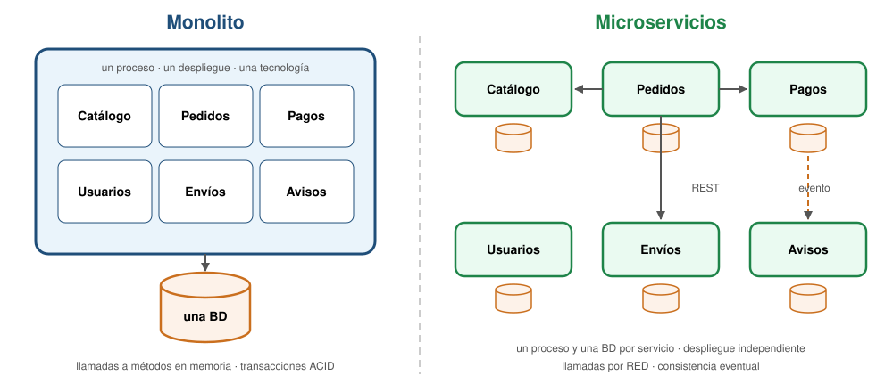
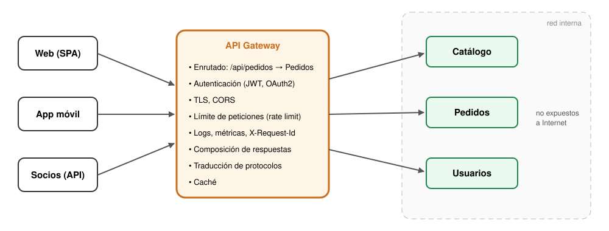
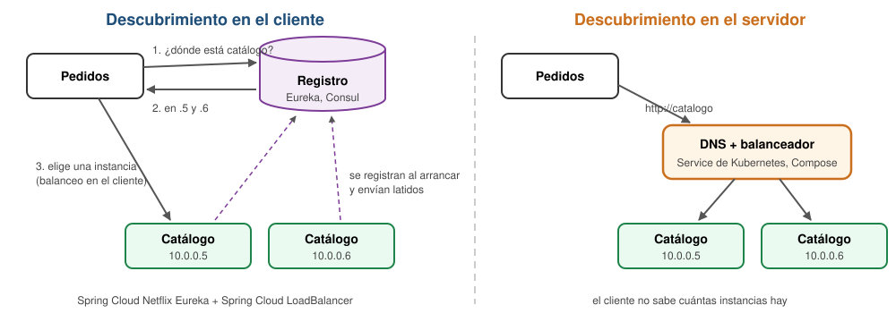
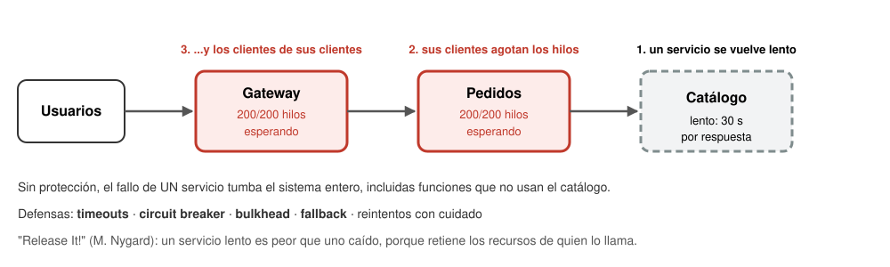
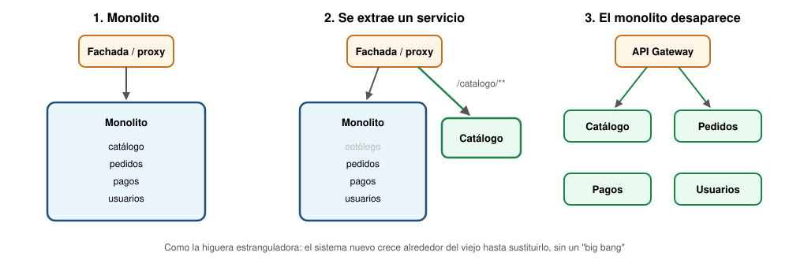

## Contenidos

1. Del monolito a los microservicios
2. Ventajas, costes y cuándo usarlos
3. Cómo dividir: capacidades de negocio y *bounded contexts*
4. Datos: una base de datos por servicio
5. Comunicación entre servicios
6. API Gateway y descubrimiento de servicios
7. Resiliencia: *timeouts*, reintentos, *circuit breaker*, *bulkhead*
8. Migrar un monolito: *strangler fig*
9. Despliegue, pruebas y organización
10. Ejercicio

::: {.ejemplo}
**Código de los ejemplos**: carpeta [`parte_1/tema_1.4_microservicios`](https://github.com/codeurjc/dad/tree/main/parte_1/tema_1.4_microservicios) del repositorio de la asignatura.
:::

# Del monolito a los microservicios

## Monolito vs microservicios

{fig-align="center" width="95%"}

## ¿Qué es un microservicio?

> *"The microservice architectural style is an approach to developing a single application as a suite of small services, each running in its own process and communicating with lightweight mechanisms, often an HTTP resource API. These services are built around business capabilities and independently deployable by fully automated deployment machinery."*
>
> --- James Lewis y Martin Fowler (2014)

Características:

* Organizados alrededor de **capacidades de negocio** y **desplegables de forma independiente**
* Cada uno es **dueño de sus datos**; se comunican por **red** ("*smart endpoints and dumb pipes*")
* **Gobierno descentralizado** y diseñados para **tolerar fallos** de los demás

## El monolito no es el enemigo

* Un monolito **bien modularizado** es sencillo de desarrollar, probar, desplegar y depurar
* Muchos sistemas grandes son monolitos y funcionan bien
* Problemas cuando el monolito crece **sin fronteras internas**:
    - Cualquier cambio requiere coordinar a muchos equipos y redesplegar todo
    - Un fallo (fuga de memoria) tumba todas las funciones
    - Se escala todo junto aunque solo una parte tenga carga
    - Tecnología congelada: cambiar de versión de Java afecta a todo

::: {.callout-tip}
**Monolith first** (Fowler): empieza con un monolito modular (como `ddd-ejem3` del tema 1.3) y extrae servicios cuando las fronteras estén claras y haya una razón concreta.
:::

## Ventajas y costes

::: columns
::: {.column width="50%"}
**Ventajas** ✔

* **Despliegue independiente**: cada equipo publica cuando quiere
* **Escalado independiente**: solo lo que tiene carga
* **Aislamiento de fallos** (si se diseña bien)
* **Equipos autónomos** y pequeños
* **Heterogeneidad tecnológica**
* Código más pequeño y fácil de entender **por servicio**
:::
::: {.column width="50%"}
**Costes** ✘

* **Sistema distribuido**: latencia, fallos parciales, red
* **Consistencia eventual**: no hay transacciones entre servicios
* **Operación**: muchos procesos, despliegues, configuraciones
* **Observabilidad** imprescindible (tema 5.8)
* **Pruebas de integración** más difíciles
* Cambios que cruzan servicios = coordinar APIs
:::
:::

::: {.aviso}
Las **falacias de la computación distribuida**: la red es fiable, la latencia es cero, el ancho de banda es infinito, la red es segura, la topología no cambia... Con microservicios, **todas** te afectan.
:::

## ¿Cuándo tiene sentido?

* Organización **grande**, con varios equipos que se estorban en el mismo código
* Partes del sistema con necesidades **muy distintas** de escalado, disponibilidad o tecnología
* Necesidad de **desplegar a menudo** partes del sistema de forma independiente
* Dominio con **fronteras claras** (*bounded contexts*) y estables

**Probablemente no**:

* Equipo pequeño, producto nuevo cuyo dominio aún no se entiende
* Sin automatización de despliegue (CI/CD) ni monitorización
* "Porque lo hace Netflix"

# Cómo dividir

## Descomposición

* **Por capacidad de negocio**: lo que la empresa *hace* (catálogo, pedidos, pagos, envíos)
* **Por subdominio / *bounded context*** (DDD, tema 1.3): cada contexto con su modelo y su lenguaje
* **No por capas técnicas** (servicio de "base de datos", servicio de "lógica"): todo cambio tocaría todos

Señales de una buena frontera:

* **Alta cohesión**: lo que cambia junto, está junto
* **Bajo acoplamiento**: un cambio en un servicio rara vez obliga a cambiar otro
* Pocas llamadas síncronas entre servicios para atender una petición
* Se puede **explicar** qué hace el servicio en una frase con el lenguaje de negocio

::: {.aviso}
Si para cada funcionalidad nueva hay que desplegar cinco servicios a la vez, tienes un **monolito distribuido**: los costes de los microservicios sin sus ventajas.
:::

## Ley de Conway

> *"Any organization that designs a system will produce a design whose structure is a copy of the organization's communication structure."*
>
> --- Melvin Conway (1968)

* La arquitectura acaba reflejando cómo se organizan y comunican los equipos
* **Maniobra inversa de Conway**: organizar los equipos según la arquitectura que se quiere conseguir
    - Equipos **pequeños** ("*two-pizza teams*") y **multidisciplinares**
    - Cada equipo es dueño de uno o varios servicios: "*you build it, you run it*"

# Datos

## Una base de datos por servicio

* Cada servicio es el **único** que lee y escribe sus datos; los demás usan su **API**
    - No tiene por qué ser un servidor de BD distinto: puede ser un esquema propio
* Permite cambiar el esquema y la tecnología (SQL, documentos, grafos...) sin afectar a nadie

::: columns
::: {.column width="50%"}
**BD compartida** ✘

* Acoplamiento oculto a través de las tablas
* Un cambio de esquema rompe a otros servicios
* No se sabe quién escribe qué
* No se puede desplegar ni escalar por separado
:::
::: {.column width="50%"}
**BD por servicio** ✔

* Contrato explícito (la API)
* Autonomía del equipo
* ✘ No hay JOIN ni transacción entre servicios
* ✘ Datos duplicados (copias locales)
:::
:::

## Ejemplo 1: dos servicios, dos bases de datos

::: {.ejemplo}
**[micro-ejem1](https://github.com/codeurjc/dad/tree/main/parte_1/tema_1.4_microservicios/micro-ejem1)**: `catalogo` (8081) y `pedidos` (8082), cada uno con su base de datos H2. Pedidos consulta el catálogo por REST.
:::

```java
@Component
public class RestCatalogClient implements CatalogClient {

    private final RestClient http;

    public RestCatalogClient(@Value("${catalogo.url}") String catalogUrl) {
        this.http = RestClient.builder().baseUrl(catalogUrl).build();
    }

    @Override
    public Optional<ProductInfo> findProduct(Long productId) {
        try {
            return Optional.ofNullable(
                http.get().uri("/products/{id}", productId).retrieve().body(ProductInfo.class));
        } catch (HttpClientErrorException.NotFound e) {
            return Optional.empty();
        }
    }
}
```

## Copias locales de datos de otros servicios

```java
@Entity
@Table(name = "orders")
public class Order {
    @Id @GeneratedValue
    private Long id;
    private Long productId;      // referencia al catálogo (por identificador)
    private String productName;  // COPIA del nombre en el momento de la compra
    private BigDecimal unitPrice;// COPIA del precio: si cambia mañana, el pedido no cambia
    private int quantity;
}
```

```java
@JsonIgnoreProperties(ignoreUnknown = true)                 // su propia vista del producto
public record ProductInfo(Long id, String name, BigDecimal price, int stock) { }
```

* Pedidos **no comparte clases** con Catálogo: comparte un **contrato** (JSON)
* La copia hace que mostrar un pedido **no dependa** de que el catálogo esté disponible

## Consultas y transacciones que cruzan servicios

* **Consultas**: "pedidos con el nombre actual del cliente y el estado del envío"
    - **Composición de APIs**: un servicio (o el gateway) llama a varios y combina
    - **CQRS / réplicas de lectura**: mantener una vista combinada alimentada por **eventos** (tema 3.3)
* **Transacciones**: "crear el pedido **y** reservar el stock **y** cobrar"
    - Sin transacciones distribuidas (2PC): **sagas** con compensaciones (tema 3.3)
    - Mientras dura, el sistema es **eventualmente consistente**

::: {.callout-note}
Si dos servicios necesitan una transacción ACID común **muy a menudo**, quizá la frontera está mal puesta y deberían ser uno.
:::

# Comunicación

## Síncrona vs asíncrona

::: {.small}

| | Síncrona (REST, gRPC) | Asíncrona (mensajes, eventos) |
|---|---|---|
| El cliente... | espera la respuesta | sigue trabajando |
| Acoplamiento temporal | **Sí**: el otro debe estar disponible | No: el broker guarda el mensaje |
| Latencia de la petición | Suma la de todas las llamadas | No depende de los consumidores |
| Modelo mental | Sencillo (como llamar a un método) | Más complejo (consistencia eventual) |
| Uso típico | Consultas, el usuario necesita la respuesta | Notificar cambios, procesos largos, integrar |

:::

* **REST/JSON**: universal y sencillo. **gRPC/Protobuf**: contratos tipados, binario, *streaming*
* **Eventos** entre servicios: ver tema 3.3 (RabbitMQ, *outbox*, sagas)

::: {.callout-tip}
Regla práctica: **consultas síncronas, cambios de estado asíncronos**. Y cuidado con las **cadenas** de llamadas síncronas: A → B → C → D.
:::

## Contratos y versionado de APIs

* La API de un servicio es su **contrato público**: no se rompe sin avisar
* Cambios **compatibles**: añadir campos, añadir *endpoints*, campos opcionales
* Cambios **incompatibles**: quitar o renombrar campos, cambiar tipos o significados
    - Versionar: `/v2/products`, o cabecera `Accept: application/vnd.tienda.v2+json`
    - Mantener las dos versiones mientras los clientes migran
* Clientes tolerantes (*tolerant reader*): ignorar los campos que no conocen
* Documentar: OpenAPI (REST), AsyncAPI (mensajes), `.proto` (gRPC)
* **Pruebas de contrato** (*consumer-driven contracts*, Spring Cloud Contract, Pact): el consumidor publica lo que espera; el proveedor lo verifica en su CI

# API Gateway y descubrimiento

## API Gateway

{fig-align="center" width="92%"}

* **Backend for Frontend (BFF)**: un gateway específico por tipo de cliente (web, móvil)

## Ejemplo 2: Spring Cloud Gateway

::: {.ejemplo}
**[micro-ejem2](https://github.com/codeurjc/dad/tree/main/parte_1/tema_1.4_microservicios/micro-ejem2)**: gateway delante de los servicios del ejemplo 1. Las rutas se configuran, no se programan.
:::

::: columns
::: {.column width="62%"}
```yaml
spring:
  cloud:
    gateway:
      server:
        webmvc:
          routes:
            - id: catalogo
              uri: ${CATALOGO_URL:http://localhost:8081}
              predicates:
                - Path=/api/catalogo/**
              filters:
                - StripPrefix=2
                - AddResponseHeader=X-Served-By, catalogo
            - id: pedidos
              uri: ${PEDIDOS_URL:http://localhost:8082}
              predicates:
                - Path=/api/pedidos/**
              filters:
                - StripPrefix=2
```
:::
::: {.column width="38%"}
::: {.small}
Dependencia: `spring-cloud-starter-gateway-server-webmvc`
:::

```bash
curl -i \
 localhost:8080/api/catalogo/products/1
# -> catalogo:8081/products/1
X-Served-By: catalogo
X-Request-Id: 3f9c…
```

* Filtro propio (`RequestIdFilter`): identificador y tiempo de cada petición
* Solo el gateway publica un puerto
:::
:::

## Descubrimiento de servicios

Las instancias aparecen y desaparecen (escalado, fallos, despliegues): ¿cómo encuentra Pedidos al Catálogo?

{fig-align="center" width="92%"}

* Con Docker Compose o Kubernetes, el **DNS interno** (`http://catalogo:8081`) ya resuelve este problema

## Configuración externalizada

* El mismo artefacto (imagen) en todos los entornos; cambia la **configuración**
* Variables de entorno (`CATALOGO_URL`), ficheros montados, ConfigMaps y Secrets de Kubernetes
* Servidor de configuración centralizado (Spring Cloud Config, Consul)
* **Secretos** fuera del código y del repositorio: Vault, gestores de secretos de la nube

```yaml
# docker-compose.yml de micro-ejem2
pedidos:
  build: ../micro-ejem1/pedidos
  environment:
    - CATALOGO_URL=http://catalogo:8081    # sobrescribe catalogo.url de application.properties
```

# Resiliencia

## Fallos en cascada

{fig-align="center" width="95%"}

## Patrones de resiliencia

::: {.small}

| Patrón | Qué hace | Protege de |
|---|---|---|
| ***Timeout*** | No esperar más de X | Servicios lentos que retienen hilos |
| **Reintento** | Repetir con espera exponencial y *jitter* | Fallos transitorios |
| ***Circuit breaker*** | Dejar de llamar a un servicio que falla mucho | Sobrecargar a quien ya está mal; esperas inútiles |
| ***Bulkhead*** | Limitar las llamadas concurrentes a cada dependencia | Que una dependencia acapare todos los recursos |
| ***Fallback*** | Respuesta alternativa (caché, valor por defecto) | Que el usuario vea un error |
| ***Rate limiter*** | Limitar peticiones por unidad de tiempo | Abusos y picos (en el servidor) |

:::

::: {.small}
En producción: [Resilience4j](https://resilience4j.readme.io) (con Spring Cloud Circuit Breaker), o `@Retryable` y `@ConcurrencyLimit` de Spring Framework 7. En el ejemplo 3 los implementamos en Java puro para ver cómo funcionan.
:::

## *Circuit breaker*

{fig-align="center" width="90%"}

* Abierto, falla **al instante**: el usuario no espera y el servicio enfermo tiene tiempo de recuperarse
* Semiabierto: se deja pasar **una** llamada de prueba

## Ejemplo 3: un cliente resiliente

::: {.ejemplo}
**[micro-ejem3](https://github.com/codeurjc/dad/tree/main/parte_1/tema_1.4_microservicios/micro-ejem3)**: `catalogo` permite inyectar latencia y fallos (`PUT /chaos`); `pedidos` lo llama protegido con todas las capas.
:::

```java
SimpleClientHttpRequestFactory requestFactory = new SimpleClientHttpRequestFactory();
requestFactory.setConnectTimeout(connectTimeout);                  // 500 ms
requestFactory.setReadTimeout(readTimeout);                        // 1 s
this.http = RestClient.builder().baseUrl(url).requestFactory(requestFactory).build();
```

```java
public Optional<Lookup> findProduct(Long id) {
    try {
        ProductInfo product =
            retry.call(() -> circuitBreaker.call(() -> bulkhead.call(() -> fetch(id))));
        lastKnown.put(id, product);                      // para el fallback
        return Optional.of(new Lookup(product, false));
    } catch (HttpClientErrorException.NotFound e) {
        return Optional.empty();                         // un 404 no es un fallo
    } catch (RuntimeException e) {
        ProductInfo cached = lastKnown.get(id);
        if (cached != null) {
            return Optional.of(new Lookup(cached, true)); // fallback: último precio
        }
        throw new CatalogUnavailableException("El catálogo no está disponible", e); // 503
    }
}
```

## El *circuit breaker* por dentro

```java
private synchronized void acquirePermission() {
    if (state == State.OPEN) {
        if (clock.instant().isBefore(openedAt.plus(openDuration))) {
            throw new CallNotPermittedException();        // abierto: ni lo intentamos
        }
        state = State.HALF_OPEN;                          // ya ha pasado el tiempo: probamos
    }
    if (state == State.HALF_OPEN) {
        if (trialInProgress) throw new CallNotPermittedException();
        trialInProgress = true;
    }
}

private synchronized void onResult(boolean success) {
    if (state == State.HALF_OPEN) {
        trialInProgress = false;
        if (success) { state = State.CLOSED; window.clear(); } else { open(); }
        return;
    }
    window.addLast(success);                              // ventana deslizante de N resultados
    if (window.size() > windowSize) window.removeFirst();
    if (window.size() == windowSize && failureRate() >= failureThreshold) open();
}
```

## Reintentos: con cuidado

```java
// Solo fallos que pueden ir bien la próxima vez: red, timeouts y 5xx
static boolean isTransient(RuntimeException e) {
    return e instanceof ResourceAccessException || e instanceof HttpServerErrorException;
}
```

* Solo errores **transitorios**: un 400 o un 404 fallarán igual
* **Espera exponencial con *jitter***: 100 ms, 200 ms, 400 ms... con algo de azar para que los clientes no reintenten a la vez
* **Pocas veces**: 3 reintentos en cada uno de 4 niveles de llamadas = 4⁴ = 256 peticiones
* **Solo operaciones idempotentes**: reintentar un `POST /pagos` cuya respuesta se perdió puede cobrar dos veces
    - Solución: **clave de idempotencia** en la petición, que el servidor recuerda

## Probar la resiliencia

```bash
J='Content-Type: application/json'
curl -X POST localhost:8082/orders -H "$J" -d '{"productId":1,"quantity":1}'
#   {"id":1,"productName":"Domain-Driven Design","total":54.90,"priceFromCache":false}

curl -X PUT localhost:8081/chaos -H "$J" -d '{"latencyMs":3000,"failureRate":0}'
curl -X POST localhost:8082/orders -H "$J" -d '{"productId":1,"quantity":1}'
#   tras ~3 s (timeouts y reintentos): {"id":2,...,"priceFromCache":true}   <- fallback
curl -X POST localhost:8082/orders -H "$J" -d '{"productId":2,"quantity":1}'
#   503 El catálogo no está disponible...                                  <- sin caché

curl localhost:8082/resilience      # tras varios fallos: {"circuitBreaker":"OPEN",...}
#   ahora las peticiones fallan al instante, sin esperar al timeout
```

::: {.small}
*Chaos engineering*: provocar fallos a propósito (latencia, caídas, red) para comprobar que el sistema los tolera. Netflix Chaos Monkey, Chaos Mesh, Toxiproxy.
:::

# Migrar un monolito

## *Strangler fig*

{fig-align="center" width="95%"}

* Se pone una **fachada** (proxy, gateway) delante del monolito
* Se extrae una funcionalidad a un servicio y la fachada le envía sus rutas
* Se repite hasta que el monolito desaparece (o queda pequeño y estable)
* Empezar por algo con **fronteras claras** y **valor** de independizar

# Despliegue, pruebas y organización

## Despliegue

* **Contenedores** (Docker): cada servicio con sus dependencias, igual en todos los entornos (tema 4)
* **Orquestador** (Kubernetes): despliegue, escalado, reinicio, descubrimiento, configuración
* **Un *pipeline* de CI/CD por servicio**: compilar, probar, construir imagen, desplegar
* Despliegues sin parada: *rolling update*, *blue/green*, *canary*
* ***Service mesh*** (Istio, Linkerd): TLS mutuo, reintentos, métricas y trazas en la red, sin tocar el código

::: {.callout-note}
Sin **automatización** (CI/CD) y **observabilidad** (logs, métricas, trazas: tema 5.8), los microservicios son inmanejables.
:::

## Pruebas

* **Unitarias** del dominio de cada servicio (sin red ni BD)
* **De componente**: un servicio entero con sus dependencias **simuladas**
    - En el ejemplo 1, `SmokeTest` sustituye el catálogo por un doble con `@TestConfiguration`
    - WireMock para simular APIs HTTP; Testcontainers para BD y brokers reales
* **De contrato**: el consumidor y el proveedor están de acuerdo en la API, sin desplegarlos juntos
* **De extremo a extremo**: pocas, lentas y frágiles; solo los flujos críticos

```java
@TestConfiguration
static class FakeCatalog {
    @Bean @Primary
    CatalogClient fakeCatalogClient() {
        return id -> id == 1 ? Optional.of(new ProductInfo(1L, "Libro", new BigDecimal("10.00"), 5))
                             : Optional.empty();
    }
}
```

## Antipatrones

* **Monolito distribuido**: servicios que hay que desplegar juntos
* **BD compartida** entre servicios
* **Nanoservicios**: tantos servicios que el coste de comunicación supera al beneficio
* **Cadenas largas de llamadas síncronas**: latencia y fragilidad multiplicadas
* **Librería común "de dominio"** compartida por todos: acopla sus versiones
* **Sin observabilidad**: imposible saber dónde falla una petición que cruza 8 servicios
* **Microservicios desde el día uno** sin entender el dominio

## Resumen

* Microservicios: servicios **pequeños**, **independientes**, alrededor de **capacidades de negocio**, cada uno **dueño de sus datos**
* Aportan autonomía de equipos, despliegue y escalado independientes...
* ...a cambio de la complejidad de un **sistema distribuido**
* Dividir por **bounded contexts**; evitar el monolito distribuido
* **API Gateway** como punto de entrada; **descubrimiento** por registro o DNS
* Diseñar para el fallo: ***timeouts***, **reintentos**, ***circuit breaker***, ***bulkhead***, ***fallback***
* Migrar poco a poco con ***strangler fig***

## Ejemplos del tema

| Proyecto | Contenido |
|---|---|
| [micro-ejem1](https://github.com/codeurjc/dad/tree/main/parte_1/tema_1.4_microservicios/micro-ejem1) | `catalogo` y `pedidos`: una base de datos por servicio, comunicación REST y copias locales de datos |
| [micro-ejem2](https://github.com/codeurjc/dad/tree/main/parte_1/tema_1.4_microservicios/micro-ejem2) | API Gateway con Spring Cloud Gateway delante de los servicios del ejemplo 1 |
| [micro-ejem3](https://github.com/codeurjc/dad/tree/main/parte_1/tema_1.4_microservicios/micro-ejem3) | Resiliencia: *timeouts*, reintentos, *circuit breaker*, *bulkhead* y *fallback* frente a un servicio con fallos inyectados |
| [micro-ejer1](https://github.com/codeurjc/dad/tree/main/parte_1/tema_1.4_microservicios/micro-ejer1) | Solución del ejercicio 1: biblioteca con `libros`, `prestamos` y gateway |

: {tbl-colwidths="[20,80]"}

# Ejercicio

## Ejercicio 1: biblioteca en microservicios (I)

::: {.ejercicio}
Diseña e implementa la gestión de préstamos de una biblioteca con **tres** aplicaciones Spring Boot, cada una con **su propia base de datos** (H2), y un `docker-compose.yml` que las arranque.
:::

* **libros** (8081): catálogo de libros con número de ejemplares totales y disponibles
    - `GET /books`, `GET /books/{isbn}`, `POST /books/{isbn}/checkout` (409 si no quedan), `POST /books/{isbn}/return`
    - Dos préstamos simultáneos del último ejemplar no pueden salir bien los dos
* **prestamos** (8082): préstamos de los socios
    - `POST /loans {"isbn","memberId"}`, `POST /loans/{id}/return`, `GET /loans?memberId=`
    - Un socio puede tener como mucho **3** préstamos activos
    - Guarda una copia del título: consultar los préstamos **no** debe depender de libros
* **gateway** (8080): `/api/libros/**` y `/api/prestamos/**`. Solo él publica un puerto

## Ejercicio 1: biblioteca en microservicios (II)

**Requisitos de resiliencia y consistencia**

* Llamadas de prestamos a libros con ***timeouts*** y ***circuit breaker***; si libros no responde, `503` rápido. Pruebas de prestamos **sin** arrancar libros (doble de prueba)
* Si se reserva el ejemplar en libros pero falla el guardado del préstamo, hay que **compensar** (devolver el ejemplar)

**Para pensar**

* ¿Se pueden **reintentar** `checkout` y `return`? ¿Por qué? ¿Qué harías para poder hacerlo?
* Para libros (`docker compose stop libros`). ¿Qué funciones siguen funcionando?
* ¿Y si avisáramos a libros con un **evento** `prestamo.creado` en lugar de llamarlo por REST?
* ¿Merece la pena que sean dos servicios y no uno?

::: {.ejemplo}
**Solución**: [micro-ejer1](https://github.com/codeurjc/dad/tree/main/parte_1/tema_1.4_microservicios/micro-ejer1) (inténtalo antes de mirarla)
:::

## Referencias

* James Lewis y Martin Fowler. [Microservices](https://martinfowler.com/articles/microservices.html) (2014) y [MonolithFirst](https://martinfowler.com/bliki/MonolithFirst.html)
* Sam Newman. *Building Microservices*, 2.ª ed. O'Reilly, 2021
* Sam Newman. *Monolith to Microservices*. O'Reilly, 2019
* Chris Richardson. *Microservices Patterns*. Manning, 2018 — y [microservices.io](https://microservices.io/patterns/)
* Michael T. Nygard. *Release It!*, 2.ª ed. Pragmatic Bookshelf, 2018
* [Spring Cloud Gateway](https://docs.spring.io/spring-cloud-gateway/reference/) y [Resilience4j](https://resilience4j.readme.io)
* [The Twelve-Factor App](https://12factor.net/)
