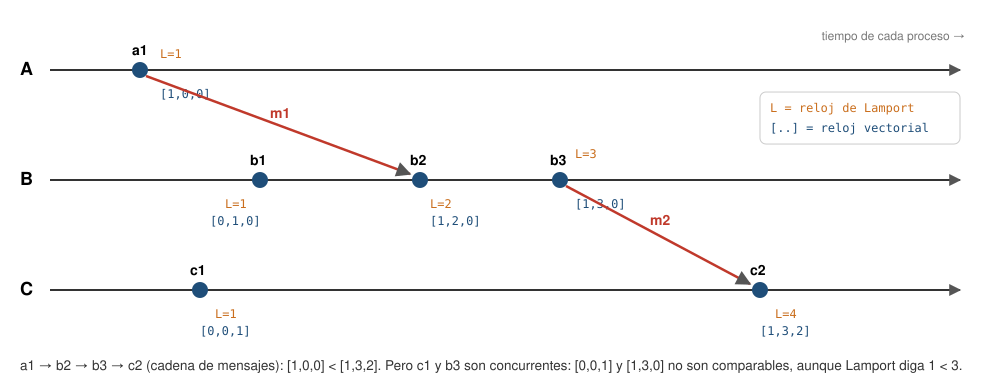
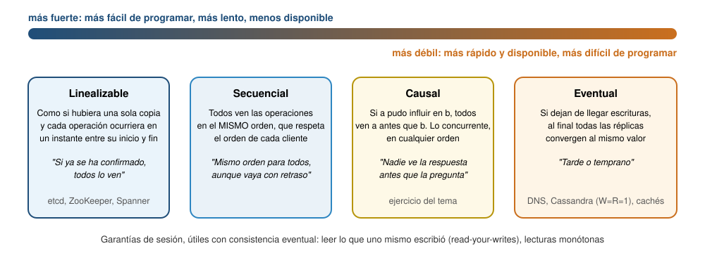
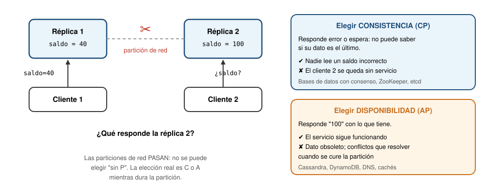
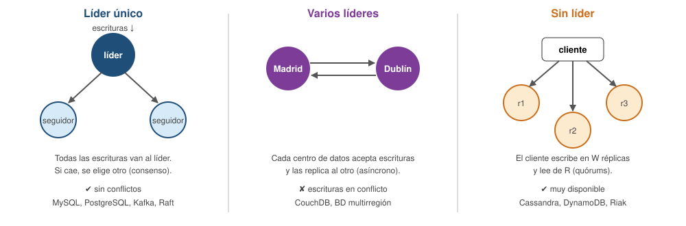
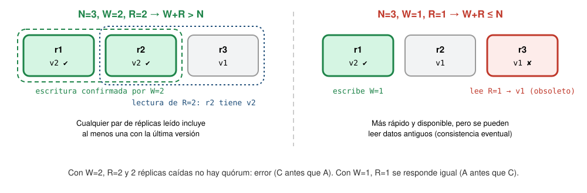
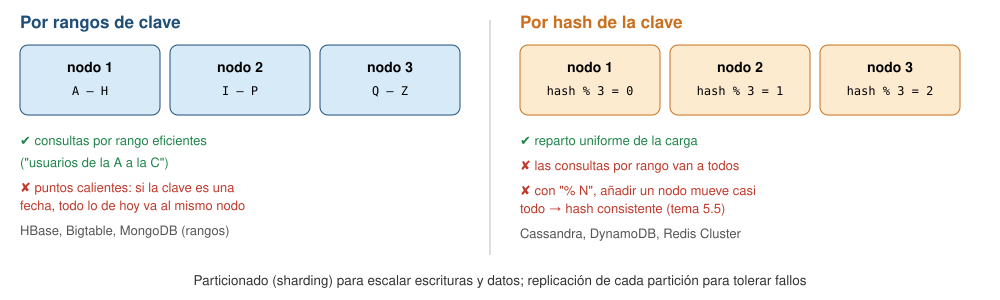
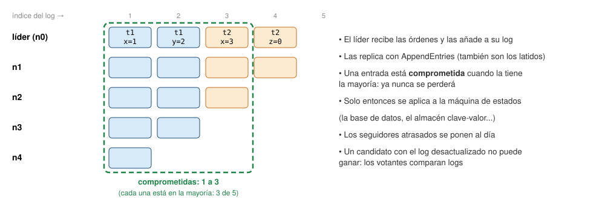

## Contenidos

1. ¿Por qué es difícil un sistema distribuido?
2. Modelos de fallo y de red
3. Tiempo y orden: relojes físicos, de Lamport y vectoriales
4. Modelos de consistencia
5. Teorema CAP y PACELC
6. Replicación: con líder, multilíder y sin líder (quórums)
7. Particionado
8. Consenso: Raft
9. Ejercicio

::: {.ejemplo}
**Código de los ejemplos**: carpeta [`parte_1/tema_1.5_fundamentos`](https://github.com/codeurjc/dad/tree/main/parte_1/tema_1.5_fundamentos). Son **simulaciones en Java puro**: se ejecutan y se prueban sin red, sin Docker y sin Spring.
:::

# ¿Por qué es difícil?

## Qué es un sistema distribuido

> *"A distributed system is one in which the failure of a computer you didn't even know existed can render your own computer unusable."*
>
> --- Leslie Lamport (1987)

Varios procesos en máquinas distintas que **solo se comunican por mensajes** y cooperan para parecer un único sistema.

Tres diferencias fundamentales con un programa en una sola máquina:

* **No hay memoria compartida**: lo que sabe cada nodo es lo que le han contado (y puede estar desactualizado)
* **No hay reloj global**: cada máquina tiene su hora y no coinciden exactamente
* **Fallos parciales**: una parte falla y el resto sigue... y a menudo **no se sabe** qué ha fallado

## Las falacias de la computación distribuida

L. Peter Deutsch y otros (Sun Microsystems, 1994): suposiciones **falsas** que todo el mundo hace al principio.

::: columns
::: {.column width="50%"}
1. La red es fiable
2. La latencia es cero
3. El ancho de banda es infinito
4. La red es segura
:::
::: {.column width="50%"}
5. La topología no cambia
6. Hay un único administrador
7. El coste de transporte es cero
8. La red es homogénea
:::
:::

::: {.aviso}
Todo lo que veremos en el tema (relojes lógicos, quórums, consenso...) existe porque **estas suposiciones son falsas**.
:::

# Modelos de fallo y de red

## Modelos de fallo

| Modelo | Qué hace el nodo que falla | Ejemplo |
|---|---|---|
| **Parada** (*crash-stop*) | Se para y no vuelve | Máquina destruida |
| **Parada y recuperación** (*crash-recovery*) | Se para y vuelve más tarde (pierde la memoria, conserva el disco) | Reinicio, despliegue |
| **Omisión** | Pierde algunos mensajes | Cola llena, red saturada |
| **Temporización** | Responde, pero demasiado tarde | Pausa larga del GC, máquina sobrecargada |
| **Bizantino** | Cualquier cosa, incluso mentir | Error de memoria, nodo atacado |

* En aplicaciones de empresa se suele asumir **crash-recovery** con nodos honestos
* Los algoritmos **tolerantes a fallos bizantinos** (blockchain) son mucho más costosos

## ¿Caído o lento?

Envías una petición y no llega respuesta. ¿Qué ha pasado?

* La petición se perdió
* El servidor está caído
* El servidor está procesando (lento, pausa del GC...)
* La respuesta se perdió
* La respuesta llegará... dentro de un rato

**Es imposible distinguirlos** en una red **asíncrona** (sin límite al retardo de los mensajes).

* En la práctica: *timeouts* → **detectores de fallos imperfectos** que a veces se equivocan
* *Timeout* corto: declaras muerto a un nodo lento (y quizá haya **dos** que se creen líderes). Largo: tardas en reaccionar a un fallo real

::: {.small}
**Imposibilidad FLP** (1985): en un sistema asíncrono, ningún algoritmo determinista garantiza el consenso si puede fallar un solo nodo. Los algoritmos reales lo esquivan con *timeouts* y aleatoriedad.
:::

# Tiempo y orden

## Relojes físicos

* Cada máquina tiene un oscilador de cuarzo que **deriva** (decenas de ms al día)
* **NTP** sincroniza con servidores de referencia: error típico de milisegundos, a veces mucho más
* El reloj puede **saltar hacia atrás** al sincronizar
* Ordenar eventos de **máquinas distintas** por su hora es peligroso: *last-writer-wins* puede **descartar** la escritura que de verdad fue la última
* Para medir duraciones, reloj **monótono** (`System.nanoTime()`), no `currentTimeMillis()`

::: {.callout-note}
Google Spanner usa relojes atómicos y GPS (TrueTime) con un intervalo de incertidumbre explícito... y **espera** a que pase esa incertidumbre antes de confirmar.
:::

## La relación "ocurre antes" (Lamport, 1978)

a → b ("a ocurre antes que b") si:

* a y b ocurren en el **mismo proceso** y a va antes, o
* a es el **envío** de un mensaje y b su **recepción**, o
* hay una **cadena** a → c → b (transitividad)

Si ni a → b ni b → a, los eventos son **concurrentes** (a ∥ b): ninguno pudo influir en el otro.

::: {.callout-tip}
No importa la hora a la que pasaron: importa **si uno pudo saber del otro**. Esta es la noción de orden que necesitan los sistemas distribuidos.
:::

## Relojes de Lamport y relojes vectoriales

{fig-align="center" width="95%"}

## Ejemplo 1: los dos relojes en Java

::: {.ejemplo}
**[fund-ejem1](https://github.com/codeurjc/dad/tree/main/parte_1/tema_1.5_fundamentos/fund-ejem1)**: `LamportClock`, `VectorClock` y la simulación del diagrama anterior.
:::

::: columns
::: {.column width="45%"}
```java
// Lamport: un contador por proceso
public synchronized long receive(long remote) {
    time = Math.max(time, remote) + 1;
    return time;
}
```

* a → b ⇒ L(a) < L(b)
* Pero L(a) < L(b) **no** implica a → b
* Útil para un **orden total** coherente (desempatando por id de proceso)
:::
::: {.column width="55%"}
```java
// Vectorial: un contador por CADA proceso
public VectorClock merge(int i, VectorClock remote) {
    long[] c = new long[counters.length];
    for (int k = 0; k < c.length; k++) {
        c[k] = Math.max(counters[k], remote.counters[k]);
    }
    c[i]++;
    return new VectorClock(c);
}
```

* a → b ⇔ V(a) < V(b)
* Si no son comparables: **concurrentes**
* Detecta **conflictos** de escritura (Dynamo, Riak)
:::
:::

```text
a1 vs c2: BEFORE      -> a1 ocurre antes que c2 (a través de m1 y m2)
c1 vs b3: CONCURRENT  -> aunque Lamport dé 1 < 3: Lamport ordena, pero no detecta la concurrencia
```

# Consistencia

## Modelos de consistencia

Con varias copias de un dato, ¿qué puede ver un cliente que lee?

{fig-align="center" width="95%"}

## Linealizabilidad: un ejemplo

```{.default}
Cliente A:  ──[ escribe x=1 ]──────────────────────────────▶
Cliente B:                     ──[ lee x → 1 ]─────────────▶
Cliente C:                                      ──[ lee x → 0 ]──▶   ✘ NO linealizable
```

* La lectura de C **empieza después** de que la de B haya devuelto 1: si C ve 0, el sistema ha "viajado atrás en el tiempo"
* Con réplicas asíncronas es lo que pasa si B lee de una réplica actualizada y C de una atrasada
* Necesaria cuando hay que garantizar **unicidad** o **exclusión**: el último asiento, un nombre de usuario libre, el líder de un clúster, un cerrojo distribuido

::: {.small}
No confundir con la "C" de ACID (respetar las invariantes de la base de datos) ni con el aislamiento *serializable* (transacciones que parecen ejecutarse una tras otra).
:::

## Teorema CAP

{fig-align="center" width="95%"}

::: {.small}
Eric Brewer (2000); demostrado por Gilbert y Lynch (2002). **C** = linealizabilidad, **A** = toda petición a un nodo vivo recibe respuesta, **P** = tolerar particiones de red.
:::

## PACELC

CAP solo habla de lo que pasa **durante una partición**. Daniel Abadi (2012) lo completa:

> Si hay **P**artición, elegir entre **A** y **C**; **E**n otro caso (*else*), elegir entre **L**atencia y **C**onsistencia.

Incluso sin fallos, esperar a que varias réplicas confirmen **cuesta latencia**.

::: {.small}
| Sistema | Con partición | Sin partición |
|---|---|---|
| DynamoDB, Cassandra (por defecto) | A | L |
| etcd, ZooKeeper, Spanner | C | C |
| MongoDB (por defecto) | C | L |
| Cassandra con `QUORUM` | C | C |
:::

::: {.callout-tip}
Muchas bases de datos permiten **elegir por operación**: lecturas baratas y eventuales para el catálogo, lecturas de quórum para el saldo.
:::

# Replicación

## Tres formas de replicar

{fig-align="center" width="95%"}

## Replicación síncrona y asíncrona

::: columns
::: {.column width="50%"}
**Síncrona**

* El líder espera a que las réplicas confirmen antes de responder
* ✔ No se pierde nada si cae el líder
* ✘ Más lenta; si una réplica no responde, el líder se bloquea
:::
::: {.column width="50%"}
**Asíncrona**

* El líder responde y replica después
* ✔ Rápida y sin bloqueos
* ✘ Si el líder cae, se pierden las últimas escrituras
* ✘ Las lecturas en réplicas pueden estar **atrasadas** (*replication lag*)
:::
:::

Problemas típicos de leer de réplicas atrasadas y sus soluciones:

* No ver lo que acabo de escribir → ***read-your-writes***: leer del líder justo después de escribir
* Ver un dato y luego uno más antiguo → **lecturas monótonas**: leer siempre de la misma réplica

## Quórums

{fig-align="center" width="95%"}

## Ejemplo 2: un almacén sin líder

::: {.ejemplo}
**[fund-ejem2](https://github.com/codeurjc/dad/tree/main/parte_1/tema_1.5_fundamentos/fund-ejem2)**: almacén clave-valor con N réplicas, quórums W y R configurables, *read repair* y entrega diferida a réplicas caídas.
:::

```java
public Optional<String> get(String key) {
    List<Replica> alive = alive(readOffset++);
    if (alive.size() < r) throw new QuorumException("leer", r, alive.size());
    List<Replica> asked = alive.subList(0, r);
    Optional<Versioned> newest = asked.stream()
            .map(rep -> rep.read(key)).flatMap(Optional::stream)
            .max(Comparator.comparingLong(Versioned::version));      // gana la versión más alta
    newest.ifPresent(v -> asked.forEach(rep -> rep.write(key, v)));  // read repair
    return newest.map(Versioned::value);
}
```

```text
N=3, W=1, R=1 (W+R ≤ N)                 N=3, W=2, R=2 (W+R > N)
  lectura 1: 40                           lectura 1: 40
  lectura 2: 100   ← dato antiguo         lectura 2: 40
  lectura 3: 100                          lectura 3: 40
  con 2 réplicas caídas: lectura OK       con 2 réplicas caídas: No hay quórum para leer
```

## Particionado

{fig-align="center" width="95%"}

# Consenso

## El problema del consenso

Que varios nodos se pongan **de acuerdo** en un valor, aunque algunos fallen:

* **Quién es el líder** (y que nunca haya dos a la vez)
* **El orden** de las operaciones de un log replicado (*state machine replication*)
* Si una transacción distribuida se confirma o se aborta
* Quién tiene un **cerrojo** distribuido

Propiedades: **acuerdo** (todos deciden lo mismo), **validez** (se decide algo que alguien propuso), **terminación** (los nodos vivos acaban decidiendo).

* **Paxos** (Lamport, 1989): el clásico, famoso por difícil de entender
* **Raft** (Ongaro y Ousterhout, 2014): diseñado para ser **comprensible**. Lo usan etcd (y por tanto Kubernetes), Consul, CockroachDB, Kafka (KRaft)...
* Necesita una **mayoría** (quórum): con 5 nodos tolera 2 fallos; con 3, tolera 1

## Raft: elección de líder

{fig-align="center" width="85%"}

* El tiempo se divide en **mandatos** (*terms*) numerados. En cada mandato hay como mucho **un** líder
* Cada nodo vota **una vez** por mandato, y solo a un candidato cuyo log esté al menos tan actualizado como el suyo
* Un mensaje con un mandato mayor hace que cualquiera (incluso un líder) vuelva a ser seguidor

## Raft: replicación del log

{fig-align="center" width="95%"}

## Ejemplo 3: Raft en una simulación

::: {.ejemplo}
**[fund-ejem3](https://github.com/codeurjc/dad/tree/main/parte_1/tema_1.5_fundamentos/fund-ejem3)**: Raft simplificado sobre una red simulada (retardos aleatorios reproducibles, particiones). Los tests comprueban sus garantías con varias semillas.
:::

```text
Durante la partición:
  nodo 0  LEADER    mandato 2  log [x=1@1, x=3 (mayoría)@2]  comprometido [x=1, x=3 (mayoría)]
  nodo 1  FOLLOWER  mandato 2  log [x=1@1, x=3 (mayoría)@2]  comprometido [x=1, x=3 (mayoría)]
  nodo 2  FOLLOWER  mandato 2  log [x=1@1, x=3 (mayoría)@2]  comprometido [x=1, x=3 (mayoría)]
  nodo 3  LEADER    mandato 1  log [x=1@1, x=2 (minoría)@1]  comprometido [x=1]
  nodo 4  FOLLOWER  mandato 1  log [x=1@1, x=2 (minoría)@1]  comprometido [x=1]

Tras recuperar la red:
  nodo 3  FOLLOWER  mandato 2  log [x=1@1, x=3 (mayoría)@2]  comprometido [x=1, x=3 (mayoría)]
  nodo 4  FOLLOWER  mandato 2  log [x=1@1, x=3 (mayoría)@2]  comprometido [x=1, x=3 (mayoría)]
```

* Durante la partición hay **dos nodos que se creen líderes**... pero de **mandatos distintos**, y el de la minoría **no puede comprometer** nada
* Al curarse, el antiguo líder ve el mandato 2, se convierte en seguidor y su entrada no comprometida se **descarta**

## Raft en el código

```java
private void onAppendResult(int from, AppendResult r) {
    ...
    matchIndex[from] = Math.max(matchIndex[from], r.matchIndex());
    nextIndex[from] = matchIndex[from] + 1;
    // Una entrada está COMPROMETIDA cuando está en la mayoría de los nodos
    for (int n = log.size(); n > commitIndex; n--) {
        final int candidate = n;
        long replicas = Arrays.stream(matchIndex).filter(m -> m >= candidate).count();
        if (log.get(n - 1).term() == currentTerm && replicas > clusterSize / 2) {
            commitIndex = n;
            break;
        }
    }
}
```

```java
@ParameterizedTest
@ValueSource(longs = { 1, 2, 3, 42, 2026 })
void nuncaHayDosLideresEnElMismoMandato(long seed) {
    Cluster cluster = new Cluster(5, seed);
    cluster.runFor(1_000);
    cluster.partition(Set.of(0, 1));
    cluster.runFor(2_000);
    cluster.heal();
    cluster.runFor(2_000);
    cluster.leadersByTerm().forEach((term, leaders) -> assertEquals(1, leaders.size()));
}
```

## ¿Y yo para qué necesito esto?

Casi nunca se implementa consenso a mano, pero **se usa constantemente**:

* **Kubernetes** guarda todo su estado en **etcd** (Raft): por eso el *control plane* tiene 3 o 5 nodos
* **Kafka** (KRaft), **Consul**, **CockroachDB**, **Zookeeper** (ZAB, parecido)
* **Elección de líder** en tus servicios: "solo una instancia ejecuta la tarea programada" → un cerrojo en etcd, Consul o la base de datos, no un `@Scheduled` en cada réplica
* Entender sus límites: **sin mayoría no hay progreso** (CP); 2 nodos no toleran ningún fallo; un clúster repartido en 2 centros de datos no sobrevive a perder el mayor

::: {.aviso}
**Cerrojos distribuidos**: un proceso con una pausa larga del GC puede creer que sigue teniendo el cerrojo cuando ya ha expirado. Solución: ***fencing tokens*** (un número que crece con cada concesión y que el recurso comprueba).
:::

## Resumen

* Sin memoria compartida, sin reloj global y con **fallos parciales**: lo que sabe un nodo puede ser falso
* No se distingue **caído** de **lento**: *timeouts* y detectores de fallos imperfectos
* El orden importante es **"ocurre antes"**: relojes de **Lamport** (orden) y **vectoriales** (concurrencia)
* **Modelos de consistencia**: de linealizable a eventual, con distinto coste
* **CAP**: durante una partición, consistencia o disponibilidad. **PACELC**: y sin partición, latencia o consistencia
* **Replicación** con líder, multilíder o sin líder; **quórums** W + R > N
* **Consenso** (Raft): mayoría, mandatos y log replicado; la base de etcd, Kafka o Kubernetes

## Ejemplos del tema

| Proyecto | Contenido |
|---|---|
| [fund-ejem1](https://github.com/codeurjc/dad/tree/main/parte_1/tema_1.5_fundamentos/fund-ejem1) | Relojes de Lamport y vectoriales, con la simulación del diagrama del tema |
| [fund-ejem2](https://github.com/codeurjc/dad/tree/main/parte_1/tema_1.5_fundamentos/fund-ejem2) | Almacén replicado sin líder con quórums, *read repair* y réplicas caídas |
| [fund-ejem3](https://github.com/codeurjc/dad/tree/main/parte_1/tema_1.5_fundamentos/fund-ejem3) | Raft simplificado: elección, replicación del log y particiones de red |
| [fund-ejer1](https://github.com/codeurjc/dad/tree/main/parte_1/tema_1.5_fundamentos/fund-ejer1) | Solución del ejercicio 1: chat de grupo con entrega causal |

: {tbl-colwidths="[20,80]"}

```bash
cd fund-ejem3
mvn test                                                                   # las garantías de Raft
mvn -q compile exec:java -Dexec.mainClass=es.codeurjc.dad.fund.ejem3.Demo  # la simulación
```

# Ejercicio

## Ejercicio 1: chat con entrega causal (I)

::: {.ejercicio}
Un chat de grupo envía cada mensaje a todos los participantes por una red que **entrega todos los mensajes, pero desordenados**. Ana pregunta "¿Quedamos a las 5?", Luis lo lee y responde "¡Vale!". Eva recibe primero la respuesta y luego la pregunta: no entiende nada.
:::

Implementa en Java (sin Spring) un chat con **entrega causal**:

1. `Participant`: escribe y recibe mensajes, que llevan el **reloj vectorial** del emisor
2. Un mensaje solo se **entrega** (se muestra) cuando se han entregado todos los que **causalmente lo preceden**; si no, espera en un búfer
3. `UnreliableNetwork`: entrega en orden aleatorio (con semilla, para tests reproducibles)
4. Tests: la respuesta nunca se ve antes que la pregunta (con cientos de semillas); todos los mensajes acaban entregándose; los de un mismo emisor se ven en orden

## Ejercicio 1: chat con entrega causal (II)

**Pista**: un mensaje `m` de `j` se puede entregar en `i` cuando

* `m.clock[j] == local[j] + 1` (es el siguiente mensaje de `j` que me falta), y
* `m.clock[k] <= local[k]` para todo `k ≠ j` (ya he visto todo lo que `j` había visto)

Para pensar:

* Si Eva escribe "Hoy no puedo" a la vez que Luis responde, ¿en qué orden lo verá cada uno? ¿Es un problema?
* ¿Qué cambiaría para conseguir **orden total** (todos ven todos los mensajes en el mismo orden)? ¿Te sirve un reloj de Lamport? ¿Y un líder?
* ¿Qué pasa con los relojes vectoriales si el grupo tiene 10 000 participantes?

::: {.ejemplo}
**Solución**: [fund-ejer1](https://github.com/codeurjc/dad/tree/main/parte_1/tema_1.5_fundamentos/fund-ejer1) (inténtalo antes de mirarla)
:::

## Referencias

* Martin Kleppmann. *Designing Data-Intensive Applications*. O'Reilly, 2017 (cap. 5, 6, 8 y 9)
* Maarten van Steen y Andrew S. Tanenbaum. [*Distributed Systems*](https://www.distributed-systems.net/), 4.ª ed., 2023 (gratuito)
* Leslie Lamport. *Time, Clocks, and the Ordering of Events in a Distributed System*. CACM, 1978
* Diego Ongaro y John Ousterhout. [*In Search of an Understandable Consensus Algorithm (Raft)*](https://raft.github.io/raft.pdf). USENIX ATC, 2014 — y la [visualización de Raft](https://raft.github.io/)
* Seth Gilbert y Nancy Lynch. *Brewer's Conjecture and the Feasibility of Consistent, Available, Partition-Tolerant Web Services*. 2002
* Daniel Abadi. *Consistency Tradeoffs in Modern Distributed Database System Design*. IEEE Computer, 2012
* Martin Kleppmann. [Curso de sistemas distribuidos (Cambridge)](https://www.cl.cam.ac.uk/teaching/2122/ConcDisSys/), vídeos y apuntes
