## Licencia {.nota-licencia visibility="uncounted"}

©2023 Micael Gallego, Francisco Gortázar, Michel Maes, Óscar Soto, Iván Chicano Algunos derechos reservados Este documento se distribuye bajo la licencia “Atribución-CompartirIgual 4.0 Internacional” de Creative Comons Disponible en [https://creativecommons.org/licenses/by-sa/4.0/deed.es](https://creativecommons.org/licenses/by-sa/4.0/deed.es)

## Java EE y Spring

- **Java Enterprise Edition (Java EE)** apareció a finales de los 90 para el desarrollo de aplicaciones web con **Java**
- Soportada por **Oracle**, **IBM**, **RedHat**, etc..
- Este estándar ha evolucionado mucho en los últimos años y actualmente se desarrolla bajo la fundación Eclipse y se llama **Jackarta EE**

{width=66%}

[https://jakarta.ee/](https://jakarta.ee/)

## Spring

- Spring es un framework de desarrollo de **aplicaciones** **empresariales** basado en tecnologías Java
- Partes del framework están implementadas sobre **Java Enterprise Edition**
- Desarrollado por **VMWare**

{width=42%}

{width=34%}

[http://spring.io/](http://spring.io/)

---

- **Spring** permite el desarrollo de **aplicaciones de servidor:**
  - **Aplicaciones web, servicios REST** y websockets
  - Análisis de datos big data
  - Procesado de tareas por lotes (Batch)
  - Integración de sistemas

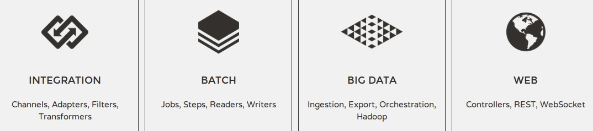{width=83%}

---

- Tiene un completo soporte de **acceso a bases** **de datos** de diferentes tipos:
  - Relacionales (SQL)
  - No relacionales (No SQL)

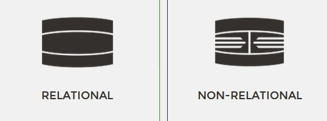{width=56%}

---

- **Spring Boot**
  - Es una librería basada en Spring que **facilita** el desarrollo de aplicaciones
  - **Integra el servidor web** (Tomcat, Jetty, etc.)
  - **Simplifica la configuración** y acelera el desarrollo
  - Se pueden desarrollar aplicaciones **directamente** **Spring**

---

- **Spring Boot**

```{dot}
//| fig-width: 8.6
//| fig-height: 3.3
// Las capas sobre las que se apoya una aplicacion web con Spring Boot.
// En el original es un dibujo de cajas y el extractor solo recupera el
// texto, asi que se rehace aqui. Para editarlo: cada fila es una capa, y
// el COLSPAN sobre 12 columnas es lo ancho que se ve.
digraph capas {
  bgcolor="transparent";
  node [shape=plaintext, fontname="Lato", fontsize=15];
  pila [label=<
    <TABLE BORDER="0" CELLBORDER="0" CELLSPACING="0" CELLPADDING="0">
      <TR>
        <TD WIDTH="40" HEIGHT="1"></TD><TD WIDTH="40"></TD><TD WIDTH="40"></TD>
        <TD WIDTH="40"></TD><TD WIDTH="40"></TD><TD WIDTH="40"></TD>
        <TD WIDTH="40"></TD><TD WIDTH="40"></TD><TD WIDTH="40"></TD>
        <TD WIDTH="40"></TD><TD WIDTH="40"></TD><TD WIDTH="40"></TD>
      </TR>
      <TR><TD COLSPAN="12" BGCOLOR="#c0e3a7" HEIGHT="40">Aplicación web</TD></TR>
      <TR>
        <TD COLSPAN="4" BGCOLOR="#4c4c4c" BORDER="1" COLOR="#ffffff" HEIGHT="40"><FONT COLOR="white"><B>Spring Boot 2.4</B></FONT></TD>
        <TD COLSPAN="8" BGCOLOR="#c0e3a7"></TD>
      </TR>
      <TR>
        <TD COLSPAN="6" BGCOLOR="#ffffff" BORDER="1" COLOR="#a6a6a6" HEIGHT="40"><B>Spring 5.3</B></TD>
        <TD COLSPAN="6" BGCOLOR="#c0e3a7"></TD>
      </TR>
      <TR>
        <TD COLSPAN="9" BGCOLOR="#465d14" BORDER="1" COLOR="#ffffff" HEIGHT="40"><FONT COLOR="white"><B>Tomcat 9 (Java EE 8)</B></FONT></TD>
        <TD COLSPAN="3" BGCOLOR="#c0e3a7"></TD>
      </TR>
      <TR><TD COLSPAN="12" BGCOLOR="#65a535" BORDER="1" COLOR="#ffffff" HEIGHT="40"><FONT COLOR="white"><B>Java SE 11</B></FONT></TD></TR>
    </TABLE>
  >];
}
```

Para implementar la **aplicación web** se pueden usar librerías de **Java SE**

**11**, las librerías de **Java EE 8** proporcionadas por **Tomcat 9**,la librería

**Spring 5.3 y** la librería **Spring Boot 2.4**

## Maven

- Sistema de **gestión de dependencias** (**librerías**) con descarga automática
- Sistema de **construcción de proyectos** (de código a paquete entregable y ejecutable)
- Estructura única de proyecto compatible con todos los **entornos de desarrollo** y sistemas de **CI**

{width=40%}

[https://maven.apache.org/](https://maven.apache.org/)

---

- Maven gestiona muchos aspectos de la **construcción** de la aplicación
  - Descarga automática de dependencias
  - Compilación
  - Ejecución de tests
  - Publicación de la aplicación construida (binarios)
  - Documentación
  - …

---

- **¿Cómo usar Maven?**
  - **Desde el entorno de desarrollo:** Maven está integrado en los IDEs Java más importantes (Eclipse, IntelliJ, Visual Studio Code…)
  - **Desde la línea de comandos:** Sin necesidad de usar un IDE. Ideal para construcción de proyectos de forma automatizada

---

- **Spring Tool Suite (STS)**
  - En la asignatura usaremos una versión de **Eclipse** diseñada por VMWare para desarrollo de aplicaciones **Spring**

{width=78%}

[http://spring.io/tools](http://spring.io/tools)

---

- **Cómo crear un proyecto Maven en Eclipse**
  - Nuevo proyecto \> Maven \> Maven Project
  - Dejar la plantilla que aparece por defecto seleccionada (**maven-archetype-quickstart**)
  - Indicar el nombre del proyecto:
    - GroupId: **es.codeurjc**
    - ArtifactId: **holamundo**

---

::: {.columns}
::: {.column width="63%"}
- La mayoría de los proyectos Maven tienen la siguiente **estructura**
  - **src/main/java:** Código de la aplicación
  - **src/test/java:** Código de los tests
  - **pom.xml:** Fichero de descripción del proyecto (nombre, dependencias, configuraciones, etc…)
:::
::: {.column width="37%"}
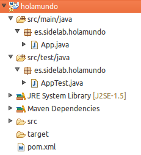{width=86%}
:::
:::

---

- **pom.xml:** Configuración del proyecto

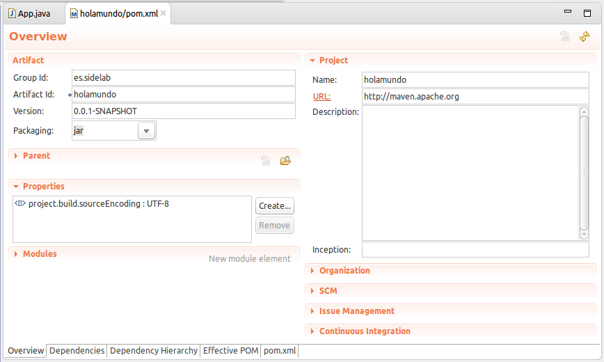{width=73%}

---

- **pom.xml:** Configuración del proyecto

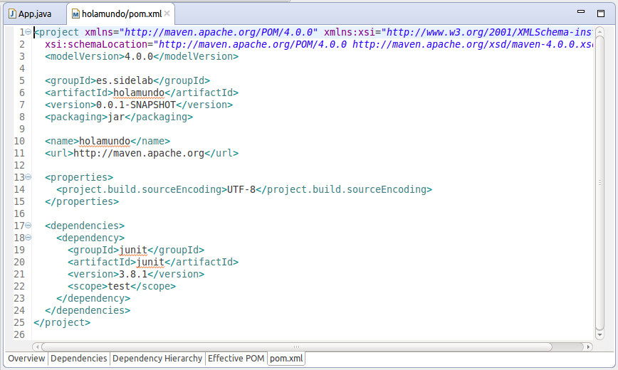{width=73%}

Poner la vista de código fuente

---

- **pom.xml:** Configuración del proyecto
  - **groudId:** Organización, familia
  - **artifcatId:** Nombre del proyecto
  - **version:** Versión del proyecto (especialmente útil para librerías
  - **packaging:** Tipo de aplicación (jar es una applicación normal)
  - **name:** Nombre “bonito” del proyecto (para documentación)
  - **url:** Web del proyecto (para documentación)

```xml
<groupId>es.codeurjc</groupId>
<artifactId>holamundo</artifactId>
<version>0.0.1-SNAPSHOT</version>
<packaging>jar</packaging>
<name>holamundo</name>
<url>http://maven.apache.org</url>
```

---

- **pom.xml:** Configuración del proyecto
  - **properties:**
    - Configuraciones generales del proyecto
    - Versión de Java (Si no se pone nada es la 1.5)
    - Codificación de los ficheros fuente

```xml
<properties>
  <project.build.sourceEncoding>UTF-8</project.build.sourceEncoding>
  <maven.compiler.source>1.8</maven.compiler.source>
  <maven.compiler.target>1.8</maven.compiler.target>
</properties>
```

---

- **pom.xml:** Configuración del proyecto
  - **dependencies:**
    - Dependencias (**librerías**)
    - Cada librería está identificada por su **groupId**, **artifactId** y **versión** (coordenadas)
    - Se pueden poner tantas dependencias como se quiera

```xml
<dependencies>
  <dependency>
    <groupId>junit</groupId>
    <artifactId>junit</artifactId>
    <version>3.8.1</version>
    <scope>test</scope>
  </dependency>
</dependencies>
```

---

- **pom.xml:** Configuración del proyecto
  - **Cuidado!** Algunos cambios en el fichero pom.xml no se reflejan el eclipse de forma automática
  - Cuando se hace un cambio y eclipse no se actualiza con esos cambios, se tiene que indicar explícitamente
    - Botón derecho proyecto \> Maven \> Update Project…

---

- **Compilar un proyecto Maven**
  - **De forma automática:**
    - Eclipse se descarga las librerías y compila el código.
    - Eclipse no empaqueta la aplicación en un .jar
  - **De forma manual:**
    - Se pueden ejecutar operaciones Maven desde eclipse o desde la línea de comandos (si está maven instalado en el sistema)

## Crear proyecto Spring

- **Eclipse STS**
  - File \> New project \> Spring Starter Project
  - Selecciona la versión de Java (8, 11 o 15)
  - Indicar el nombre del proyecto:
    - GroupId: es.codeurjc
    - ArtifactId: helloworld-spring
  - Se seleccionan las librerías que se quieren usar

---

- **Eclipse STS**

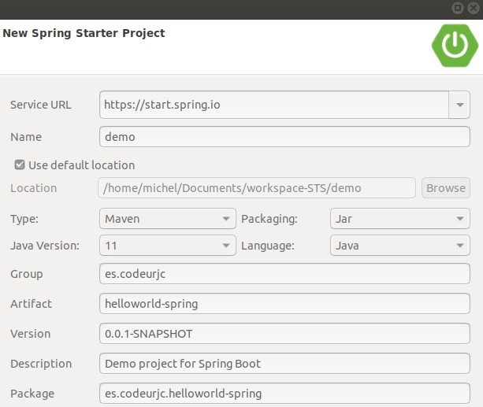{width=57%}

---

- **Eclipse STS**

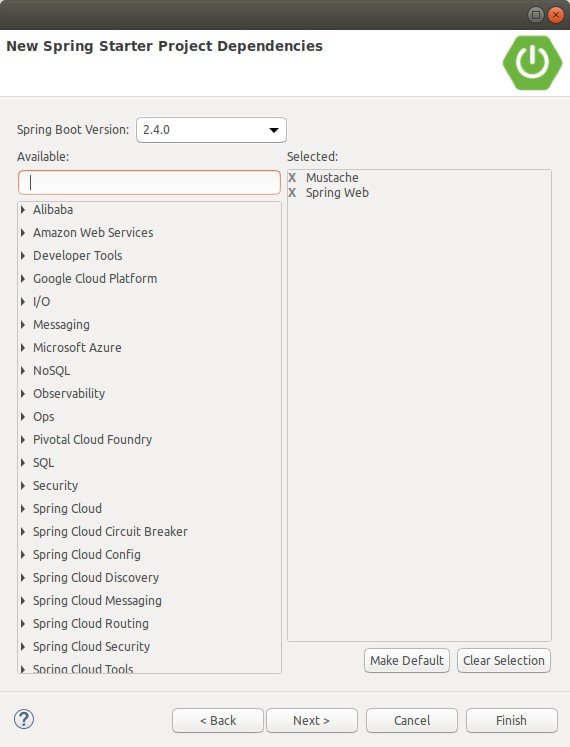{width=63%}

---

- **Desde la web**

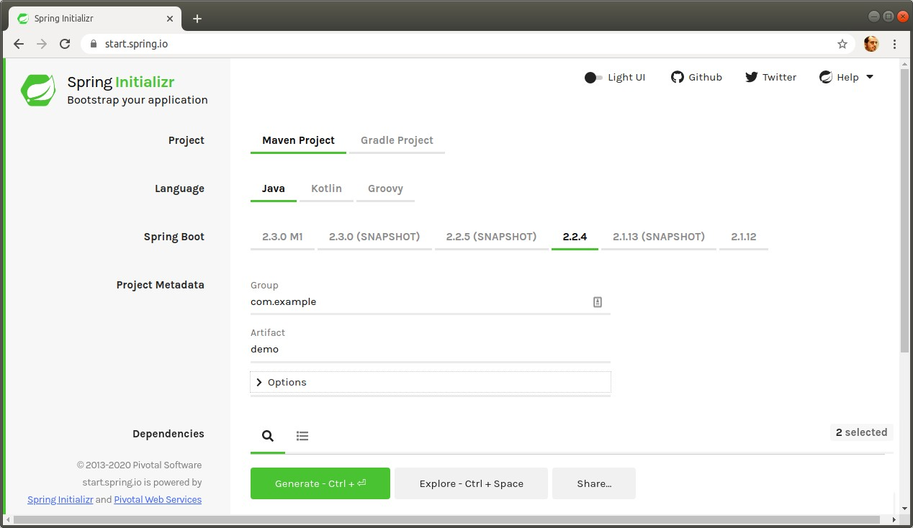{width=69%}

[https://start.spring.io](https://start.spring.io/)

---

- **Visual Studio Code**

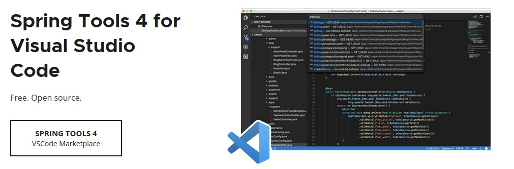{width=97%}

Instalamos las extensiones de Spring en nuestro VSCode

[https://marketplace.visualstudio.com/items?itemName=Pivotal.vscode-boot-dev-pack](https://marketplace.visualstudio.com/items?itemName=Pivotal.vscode-boot-dev-pack)

---

- **Visual Studio Code**

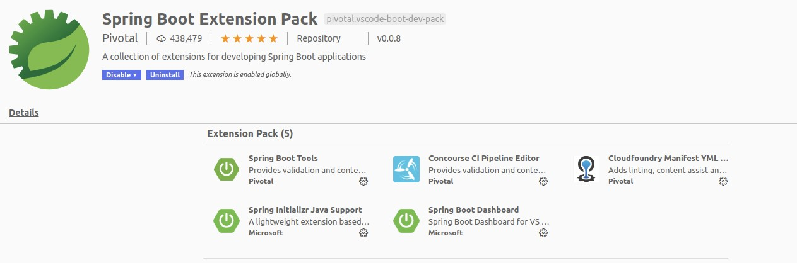{width=100%}

---

- **Visual Studio Code**
  - View \> Command Palette (o Ctrl + Shift + P)
  - Introducimos “Spring” y seleccionamos “Create a Maven Project”
  - Nos pedirá incluir información adicional:
    - Versión de Spring Boot: 2.3.4
    - Lenguaje: Java
    - GroupId: es.codeurjc y ArtifactId: helloword-vscode
    - Empaquetamiento: JAR
    - Versión: 1.8 u 11

---

- **Visual Studio Code**
  - Nos permite, además, seleccionar las dependencias básicas

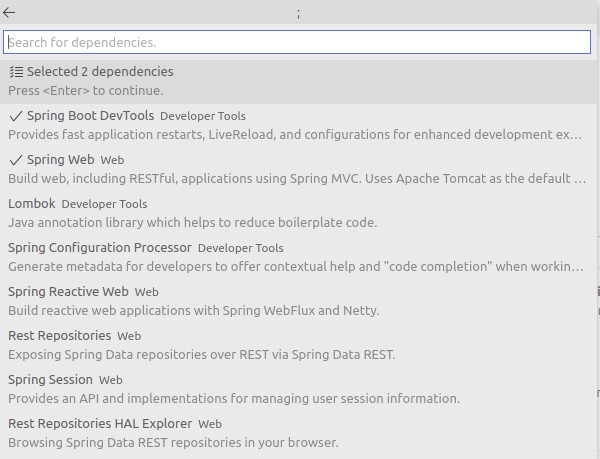{width=50%}

Tras crear el proyecto, podremos añadir nuevas

dependencias al pom.xml

de forma manual

---

- **Visual Studio Code**
  - El pack de extensiones incluye numerosas funcionalidades, como **Spring Dashboard**, que nos permite visualizar las aplicaciones en el entorno y lanzarlas de forma sencilla.
  - Es muy recomendable tener instalada la extensión de **Java** **Extension Pack** (desde esta extensión, también pueden instalarse las de Spring Boot).

{width=60%}

---

- **Visual Studio Code**

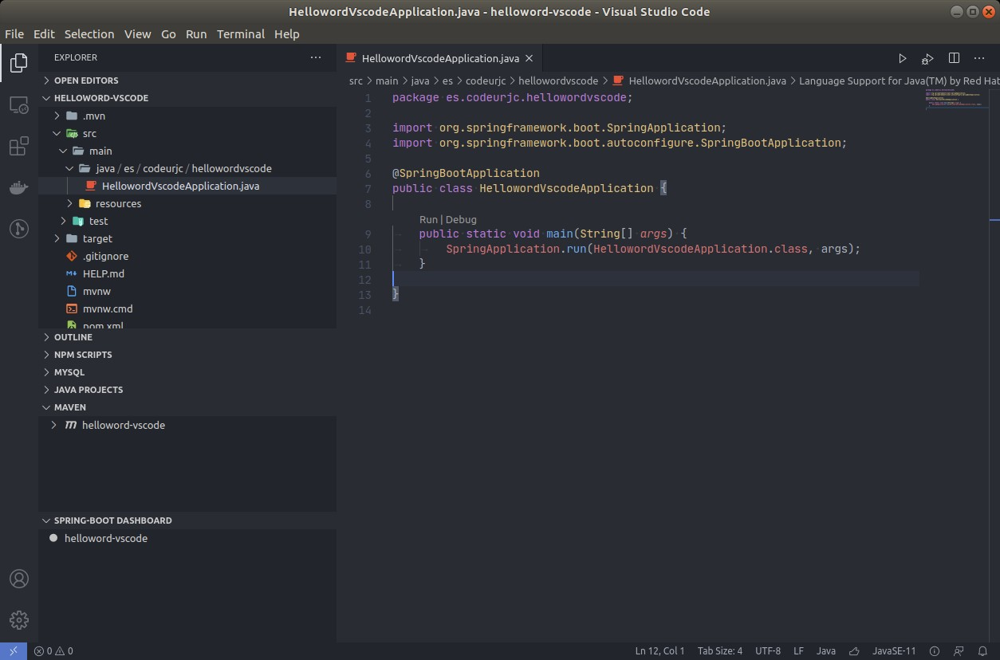{width=68%}

Desde este menu, podemos Desde este menu, podemos realizar acciones de Maven realizar acciones de Maven

rápidamente: clean, install, test ...rápidamente: clean, install, test ... Desde **SpringBoot Dashborad**

podemos lanzar rápidamente

nuestras aplicaciones

