## Licencia {.nota-licencia visibility="uncounted"}

©2023  Micael Gallego, Francisco Gortázar, Michel Maes, Óscar Soto, Iván Chicano Algunos derechos reservados Este documento se distribuye bajo la licencia “Atribución-CompartirIgual 4.0 Internacional”  de Creative Comons Disponible en [https://creativecommons.org/licenses/by-sa/4.0/deed.es](https://creativecommons.org/licenses/by-sa/4.0/deed.es)

# Spring MVC

## Spring MVC

- **Spring MVC** es una parte de Spring para la construcción de aplicaciones web 
- Sigue la arquitectura **MVC (****Model View Controller****)**
- **Permite estructurar la aplicación en:**
  - **Model:** Modelos de datos (objetos Java)
  - **View:** Plantilla que genera la página HTML
  - **Controller:** Controlador que atiende las peticiones http que llegan del navegador

---

- **Aplicación web básica Spring MVC**

```{dot}
//| fig-width: 9.2
//| fig-height: 2.8
// El recorrido de una peticion en Spring MVC: del navegador al controlador,
// del controlador al modelo, del modelo a la plantilla y de vuelta al
// navegador. Para editarlo, cambia las etiquetas de los nodos.
digraph mvc {
  rankdir=TB; bgcolor="transparent"; splines=ortho; nodesep=0.55; ranksep=0.55;
  node [fontname="Lato", fontsize=13, shape=box, style="filled", color="#808080"];
  edge [color="#333333", arrowsize=0.8];

  peticion [shape=plaintext, style="", label="Petición\nURL desde\nel Navegador"];
  pagina   [shape=plaintext, style="", label="Página\nHTML"];
  controlador [fillcolor="#c5d9a5", label=<<FONT POINT-SIZE="10" COLOR="#555555">Controlador</FONT><BR/>GreetingController.java>];
  modelo      [fillcolor="#ffff00", label="Modelo"];
  vista       [fillcolor="#cfd9e5", label=<<FONT POINT-SIZE="10" COLOR="#555555">Vista (Plantilla)</FONT><BR/>greeting_template.html>];

  { rank=same; peticion; controlador; modelo }
  { rank=same; pagina; vista }

  peticion -> controlador;
  controlador -> modelo;
  modelo -> vista;
  pagina -> vista [dir=back];
}
```

[http://spring.io/guides/gs/serving-web-content/](http://spring.io/guides/gs/serving-web-content/)

---

- **Controlador:** Clase encargada de atender peticiones web
  - 1) **Manipulan los datos** que llegan con la petición (hacen peticiones a la BBDD, utilizan servicios externos...)
  - 2) **Obtienen los datos** que se visualizará en la página **(modelo)**
  - 3) Deciden qué **plantilla generará el HTML** partiendo de esos datos **(vista)**

---

::: {.etiqueta-ejemplo}
ejem1
:::

- **Controlador**

```
GreetingController.java
```

```{.java data-lineas="3,5,6"}
@Controller
public class GreetingController {
    @GetMapping("/greeting")
    public String greeting(Model model) {
        model.addAttribute("name", "World");
        return "greeting_template";
    }
}
```

::: {.nota-codigo}
Se indica qué **URL** debe llevar la petición para **ejecutar el controlador**
:::

::: {.nota-codigo}
Se añade al parámetro model **la información** que será visualizada en la página web
:::

::: {.nota-codigo}
El método devuelve el **nombre de la plantilla** que será usada para generar el HTML partiendo del modelo
:::

---

::: {.etiqueta-ejemplo}
ejem1
:::

- **Vista (Plantillas,** **Templates****)**
  - Las vistas en **Spring MVC** se implementan como plantillas HTML definidas en base a la información del modelo
  - Existen diversas tecnologías de plantillas: **JSP (estándar), Mustache**, Thymeleaf, FreeMarker, etc…
  - Nosotros usaremos **Mustache**

---

::: {.etiqueta-ejemplo}
ejem1
:::

- **Vista (Plantillas)**

```
greeting_template.html
```

```{.html data-lineas="3"}
<html>
<body>
    <p>Hello, {{name}}</p>
</body>
</html>
```

::: {.nota-codigo}
En las plantillas se indican los elementos del modelo para que sean sustituidos por sus valores al generar el HTML
:::

::: {.nota-codigo}
Plantilla implementada con la librería **Mustache**

[https://mustache.github.io/](https://mustache.github.io/) 
:::

---

- Para poder usar la **extensión .html** en las plantillas lo tenemos que configurar 

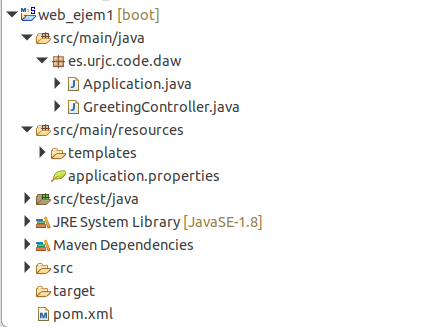{width=34%}

```
application.properties
```

```properties
spring.mustache.suffix=.html
```

- Si no se configura, las plantillas deberían tener la **extensión .mustache**.

---

```xml
<?xml version="1.0" encoding="UTF-8"?>
<project xmlns="http://maven.apache.org/POM/4.0.0" xmlns:xsi="http://www.w3.org/2001/XMLSchema-instance"
	xsi:schemaLocation="http://maven.apache.org/POM/4.0.0 http://maven.apache.org/xsd/maven-4.0.0.xsd">
	<modelVersion>4.0.0</modelVersion>
	<groupId>es.urjc.code.daw</groupId>
	<artifactId>ejem1</artifactId>
	<version>0.0.1-SNAPSHOT</version>
	<packaging>jar</packaging>
	<parent>
		<groupId>org.springframework.boot</groupId>
		<artifactId>spring-boot-starter-parent</artifactId>
		<version>2.4.0</version>
		<relativePath/>
	</parent>
	<properties>
		<project.build.sourceEncoding>UTF-8</project.build.sourceEncoding>
		<java.version>1.8</java.version>
	</properties>
	<dependencies>
		<dependency>
			<groupId>org.springframework.boot</groupId>
			<artifactId>spring-boot-starter-mustache</artifactId>
		</dependency>
		<dependency>
			<groupId>org.springframework.boot</groupId>
			<artifactId>spring-boot-starter-web</artifactId>
		</dependency>		
	</dependencies>
</project>
```

- **pom.xml**

Proyecto **padre** para aplicaciones **SpringBoot**

**Dependencias** necesarias para implementar aplicaciones web **Spring MVC** con **Mustache** y **SpringBoot**

---

::: {.etiqueta-ejemplo}
ejem1
:::

- **Aplicación principal**
  - La aplicación se ejecuta como una **app Java normal**
  - Botón derecho proyecto  \> Run as… \> Java Application…

```java
@SpringBootApplication
public class Application {
    public static void main(String[] args) {
        SpringApplication.run(Application.class, args);
    }
}
```

---

::: {.etiqueta-ejemplo}
ejem1
:::

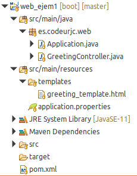{width=40%}

- **Estructura de la aplicación**

---

::: {.etiqueta-ejemplo}
ejem1
:::

- **Ejecución de la applicación**

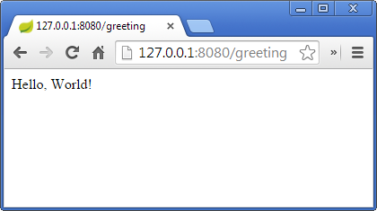{width=63%}

```html
<html>
<body> 
<p>Hello, World!</p>
</body>
</html>
```

---

::: {.etiqueta-ejemplo}
ejem1
:::

- **Código de ejemplos y ejercicios**

{width=91%}

parte_2 / tema_2.2_web

[https://github.com/codeurjc/dad/tree/main/parte_2/tema_2.2_web](https://github.com/codeurjc/dad/tree/main/parte_2/tema_2.2_web) 

---

::: {.etiqueta-ejemplo}
ejem2
:::

- **Técnicas para facilitar la depuración**
  - Mostrar información detallada de las peticiones web en el log

```
application.properties
```

```properties
logging.level.org.springframework.web=DEBUG
```

---

::: {.etiqueta-ejemplo}
ejem2
:::

- **Técnicas para facilitar la depuración**
  - Usar el log de Spring

```java
@Controller
public class SampleLogController {
  private Logger log = LoggerFactory.getLogger(SampleLogController.class);
  @GetMapping("/page_log")
  public String page(Model model) {
    log.trace("A TRACE Message");
    log.debug("A DEBUG Message");
    log.info("An INFO Message");
    log.warn("A WARN Message");
    log.error("An ERROR Message");
    return "page";
  }	
}
```

---

::: {.etiqueta-ejemplo}
ejem2
:::

- **Técnicas para facilitar la depuración**
  - Usar el log de Spring
    - Por defecto los niveles de DEBUG y TRACE no se muestran

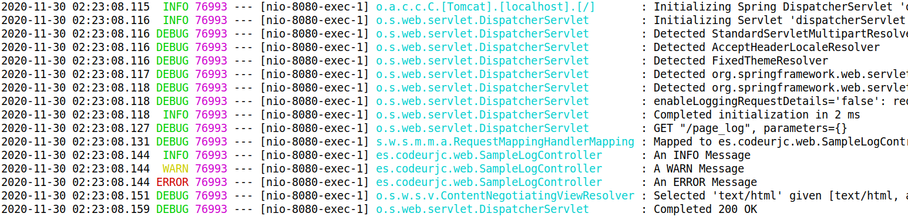{width=95%}

[https://www.baeldung.com/spring-boot-logging](https://www.baeldung.com/spring-boot-logging) 

[https://docs.spring.io/spring-boot/docs/2.4.0/reference/htmlsingle/#boot-features-logging](https://docs.spring.io/spring-boot/docs/2.4.0/reference/htmlsingle/#boot-features-logging) 

# Generación de HTML con Mustache

## Generación de HTML con Mustache

- Con **SpringMVC** pueden usarse diversas tecnologías de generación de páginas HTML

{width=22%}

{width=35%}

[http://freemarker.org/](http://freemarker.org/) 

[http://www.oracle.com/technetwork/java/javaee/jsp/](http://www.oracle.com/technetwork/java/javaee/jsp/) 

{width=39%}

{width=39%}

[http://velocity.apache.org/](http://velocity.apache.org/) 

[http://www.thymeleaf.org/](http://www.thymeleaf.org/) 

{width=21%}

[http://mustache.github.io/](http://mustache.github.io/) 

---

- **Mustache**
  - Un formato de plantillas para generar contendo HTML muy sencillo
  - Existen implementaciones para diferentes lenguajes: Java, JavaScript, Ruby, C++, Rust, ASP, C…

{width=32%}

[http://mustache.github.io/](http://mustache.github.io/) 

---

- **Documentación**

**Tutorial sobre Mustache**

[https://mustache.github.io/mustache.5.html](https://mustache.github.io/mustache.5.html) 

**Documentación de Mustache en Java** 

[https://github.com/samskivert/jmustache](https://github.com/samskivert/jmustache) 

**Tutorial de uso en Spring**

[https://spring.io/blog/2016/11/21/the-joy-of-mustache-server-side-templates-for-the-jvm](https://spring.io/blog/2016/11/21/the-joy-of-mustache-server-side-templates-for-the-jvm)  

---

- Los **controladores** generan los datos que las **plantillas** usan para generar el **HTML final**

```
GreetingController.java
```

```java
@Controller
public class GreetingController {
  @GetMapping("/greeting")
  public String greeting(Model model) {
    model.addAttribute("name", "World");
    return "greeting_template";
  }
}
```

```
greeting_template.html
```

```html
<html>
<body>
    <p>Hello, {{name}}</p>
</body>
</html>
```

---

- Los **controladores** generan los datos que las **plantillas** usan para generar el **HTML final**

```
GreetingController.java
```

```java
@Controller
public class GreetingController {
  @GetMapping("/greeting")
  public String greeting(Model model) {
    model.addAttribute("name", "World");
    return "greeting_template";
  }
}
```

```
greeting_template.html
```

```html
<html>
<body>
    <p>Hello, {{name}}</p>
</body>
</html>
```

---

- Los **controladores** generan los datos que las **plantillas** usan para generar el **HTML final**

```
GreetingController.java
```

```java
@Controller
public class GreetingController {
  @GetMapping("/greeting")
  public String greeting(Model model) {
    model.addAttribute("name", "World");
    return "greeting_template";
  }
}
```

```
greeting_template.html
```

```html
<html>
<body>
    <p>Hello, {{name}}</p>
</body>
</html>
```

---

- **Funcionalidades básicas**
  - Uso de atributos del modelo
  - Generación de HTML si una expresión es true
  - Generación de listas o tablas HTML con el contenido de objetos del modelo de tipo lista
  - Uso de cabecera y pie comunes a varias páginas

---

::: {.etiqueta-ejemplo}
ejem2
:::

```java
@GetMapping("/basic")
public String basic(Model model) {
   model.addAttribute("name", "World");
   model.addAttribute("hello", true);
   return "basic_template";
}
```

```{.html data-lineas="3-8"}
<html>
<body>
	{{#hello}}
	<p>Hello,</p>
	{{/hello}}
	{{^hello}}
	<p>Goodbye,</p>
	{{/hello}}
	<p>{{name}}</p>
</body>
</html>
```

```html
<html>
<body>
	<p>Hello,</p>
	<p>World</p>
</body>
</html>
```

::: {.nota-codigo}
**Generación condicional**

Si **hello=true** se mostrará Hello.

Si **hello=false** se mostrará Goodbay.

También se puede usar para detectar una **lista vacía**  
 o un **objeto=null**
:::

---

::: {.etiqueta-ejemplo}
ejem2
:::

```java
@GetMapping("/list")
public String iteration(Model model) {
   List<String> colors = Arrays.asList("Red","Blue","Green");
   model.addAttribute("colors", colors);
   return "list_template";
}
```

```{.html data-lineas="5,6,11,13,14"}
<html>
<body>
	<p>Colors in list:</p>
	<ul>
	{{#colors}}
		<li>{{.}}</li>
	{{/colors}}
	</ul>
	<p>Colors in table:</p>
	<table>
	{{#colors}}
   		<tr>
        	<td>{{-index}}</td>
        	<td>{{.}}</td>
      	</tr>
     	{{/colors}}	
   	</table>
</body>
</html>
```

::: {.nota-codigo}
**Repite** la etiqueta por cada elemento de la lista 
:::

::: {.nota-codigo}
El **punto** hace referencia al objeto en esa iteración
:::

::: {.nota-codigo}
Se pueden usar variables especiales como **-index** que tienen el índice de la iteración
:::

---

::: {.etiqueta-ejemplo}
ejem2
:::

::: {.columns}
::: {.column width="54%"}
```html
<html>
<body>
	<p>Colors in list:</p>
	<ul>
	{{#colors}}
		<li>{{.}}</li>
	{{/colors}}
	</ul>
	<p>Colors in table:</p>
	<table>
	{{#colors}}
   		<tr>
        	<td>{{-index}}</td>
        	<td>{{.}}</td>
      	</tr>
     {{/colors}}	
   	</table>
</body>
</html>
```
:::
::: {.column width="46%"}
```html
<html>
   <body>
   <p>Colors in list:</p>
   <ul>
       <li>Red</li>
       <li>Blue</li>
       <li>Green</li>
   </ul>
   <p>Colors in table:</p>
   <table>
      <tr>
          <td>1</td>
          <td>Red</td>
     </tr>
     <tr>
         <td>2</td>
         <td>Blue</td>
     </tr>
     <tr>
         <td>3</td>
         <td>Green</td>
     </tr> 
   </table>
</body>
</html>
```
:::
:::

---

::: {.etiqueta-ejemplo}
ejem2
:::

::: {.columns}
::: {.column width="58%"}
```java
@GetMapping("/list_objects")
public String iterationObj(Model model) {
  List<Person> people = new ArrayList<>();
  people.add(new Person("Pepe","Pérez"));
  people.add(new Person("Juan","González"));
  people.add(new Person("Romón","Lucas"));
  model.addAttribute("people", people);
  return "list_obj_template";
}
```

```{.html data-lineas="6"}
<html>
<body>
	<p>People in list:</p>
	<ul>
	{{#people}}
		<li>{{name}} {{surname}}</li>
	{{/people}}
	</ul>
</body>
</html>
```
:::
::: {.column width="42%"}
```java
public class Person {
    private String name;
    private String surname;
    public Person(String name, 
        String surname){
        this.name = name;
        this.surname = surname;
    }
    public String getName() {
        return name;
    }
    public String getSurname() {
        return surname;
    }
}
```
:::
:::

::: {.nota-codigo}
Se puede acceder a getter de los objetos en las iteraciones
:::

---

::: {.etiqueta-ejemplo}
ejem2
:::

- **Cabecera y pie común en todas las plantillas**
  - Las plantillas pueden incluir el contenido de otras plantillas con {{\>plantilla}}

```
header.html
```

```html
<html>
<body>
<h1>Welcome {{userName}}</h1>
```

```
page.html
```

```json
{{>header}}
<p>Main content</p>
{{>footer}}
```

```
footer.html
```

```html
<p>Footer</p>
</body>
</html>
```

---

::: {.etiqueta-ejemplo}
ejem2
:::

- **Cabecera y pie común en todas las plantillas**
  - Los atributos del modelo se definen en un @ControllerAdvice con @ModelAttribute

```java
@ControllerAdvice
public class DefaultModelAttributes {
	@ModelAttribute("userName")
	public String userName() {
		return "Juan";
	}
}
```

# Proceso de formularios y enlaces

## Proceso de formularios y enlaces

- **Formas de enviar información del navegador al servidor**
  - **Mediante formularios HTML:** La información la introduce manualmente el usuario
  - **Insertando información en la URL de enlaces:** La información la incluye el desarrollador para que esté disponible cuando el usuario pulse el enlace

---

- **Acceso a la información en el servidor**
  - La información se envía como **pares clave=valor**
  - Se accede a la información como **parámetros** en los métodos del controlador

---

- **Creación de formularios en HTML**
  - La etiqueta **\<form\>** contiene los elementos del formulario
  - Puede contener otros elementos HTML

```xml
<form action='url_controlador'>
</form>
```

::: {.desde-nivel-2}
- **action:** URL del controlador que será ejecutado al enviar los datos al servidor pulsando el botón de enviar (submit)
:::

---

- **Creación de formularios en HTML**

```html
<html>
<body>
<form action="greeting">
  <p>Saludar a:</p>
  <input type='text' name='userName'/>
  <input type='submit' value='Enviar'/>
</form>
</body>
</html>
```

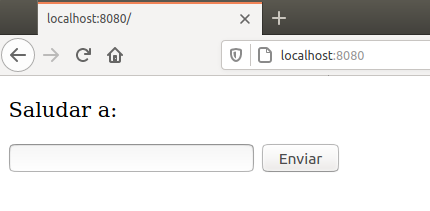{width=43%}

---

- **Creación de formularios en HTML**
  - Tiene que existir al menos un **botón para enviar** los datos del formulario

```xml
<form action='url_controlador'>
  ...
  <input type='submit' value='Enviar'> 
</form>
```

Botón con texto

```xml
<form action='url_controlador'>
  ...
  <input type='image' src='imagen.png'>
</form>
```

Botón gráfico

---

- **Creación de formularios en HTML**
  - Campo de texto

```xml
<input type='text' name='nombreParametro'>
```

::: {.desde-nivel-2}
- Área de texto
:::

```xml
<textarea name='nombreParametro' rows=5 cols=40> Texto del cuadro de texto </textarea>
```

::: {.desde-nivel-2}
- Casilla de verificación (checkbox)
:::

```xml
<input type='checkbox' name='nombreParametro' value='valorOpcion'>Texto Opción
```

---

::: {.etiqueta-ejemplo}
ejem3
:::

- **Acceso a los datos desde el controlador**
  - Los valores se recogen con parámetros del método del controlador con anotaciones **@RequestParam**

```
src/main/resources/static/index.html
```

```html
<form action="greeting">
  <p>Saludar a :</p>
  <input type='text' name='userName'/> 
  <input type='submit' value='Enviar'/>
</form>
```

```{.java data-lineas="2"}
@RequestMapping("/greeting")
public String greeting(Model model, @RequestParam String userName) {
  model.addAttribute("name", userName);
  return "greeting_template";
}
```

::: {.nota-codigo}
Parámetro con el valor del campo de texto del formulario
:::

---

::: {.etiqueta-ejemplo}
ejem3
:::

- **Acceso a los datos desde el controlador**

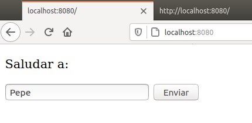{width=45%}

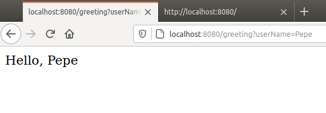{width=56%}

## Ejercicio 1

- Crear una página **html estática** que muestre un **formulario** para enviar al servidor información de nuevos anuncios.
- En el formulario debe aparecer:
  - Campo de texto para el **nombre** del usuario
  - Campo de texto para el **asunto** del mensaje
  - Área de texto para el **cuerpo** del mensaje
  - **Botón de envío**
- Implementar un **controlador** que sea ejecutado al pulsar el botón de envío del formulario y recoja los datos del formulario
- Diseñar una **plantilla** que muestre el anuncio que se ha enviado al servidor

---

nuevoAnuncio.html

::: {.columns}
::: {.column width="74%"}
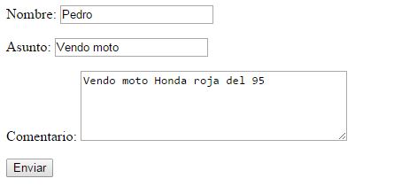{width=34%}

Controlador

Plantilla

**AnuncioController.java**

**anuncio.html**
:::
::: {.column width="26%"}
Página generada

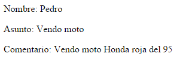{width=93%}
:::
:::

## Proceso de formularios y enlaces

- **Existen dos formas de enviar la información de un formulario al servidor**
  - **Método GET (Por defecto)**

```xml
<form method='get' action='url_controlador'>
...
</form>
```

::: {.desde-nivel-2}
- **Método POST**
:::

```xml
<form method='post' action='url_controlador'>
...
</form>
```

---

- **Existen dos formas de enviar la información de un formulario al servidor**
  - **Método GET**  **(por defecto)**
    - Se usa el método GET del protocolo http
    - El navegador incluye la información del formulario en la URL que solicita al servidor
  - **Método POST**
    - Se usa el método POST del protocolo http
    - El navegador incluye la información del formulario en el cuerpo de la petición (no es visible por el usuario)

---

- **Se recomienda usar el método POST en formularios**
  - Las URLs quedan más limpias (porque no incluyen los parámetros)
  - La página que aparece al enviar el formulario se puede añadir a la lista de marcadores del navegador

---

- **Se recomienda usar el método POST en formularios**
  - Si se intenta recargar la página que aparece al enviar el formulario, el navegador muestra un aviso al usuario de que es posible que recargar la página tenga efectos no deseados

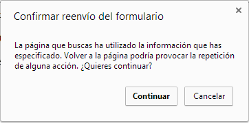{width=51%}

---

- **Formas de enviar información del navegador al servidor**
  - **Mediante formularios HTML:** La información la introduce manualmente el usuario
  - **Insertando información en la URL de enlaces:** La información la incluye el desarrollador para que esté disponible cuando el usuario pulse el enlace

---

- **Insertando información en la URL de los enlaces**
  - Es habitual que los desarrolladores incluyan información en la URL para que esté disponible en el servidor cuando el usuario pulsa el enlace
  - Formato:

**URL con parámetros**

```
http://www.traumainforma.com/nuevoUsuario?option=com_weblinks&view=category&lang=es
```

::: {.desde-nivel-3}
- Los parámetros se incluyen al final de la URL separados con ? (query)
- Los parámetros se separan entre sí con &
- Cada parámetro se codifica como nombre=valor 
:::

---

- **Insertando información en la URL de los enlaces**
  - Formato: Codificación de los nombres y los valores
    - Los caracteres alfanuméricos "a" hasta "z", "A" hasta "Z" y "0" hasta "9" se quedan igual 
    - Los caracteres especiales ".", "-", "\*", y "\_" se quedan igual 
    - El carácter espacio " " es convertido al signo "+" 
    - Todos los otros caracteres son codificados en uno o más bytes. Después cada byte es representado por la cadena de 3 caracteres “%xy”, donde  xy es la representación en hexadecimal del byte 

---

- **Insertando información en la URL de los enlaces**

**Parámetros:**

     Nombre: direccion 

     Valor: C**\** Pepe**,** **nº** 3

     Nombre: poblacion

      Valor: Madrid

**URL con parámetros:**

http://www.micasa.com/nueva?direccion=C**%5C**+Pepe**%2C**+n**%BA**+3&poblacion=Madrid

---

- **Insertando información en la URL de los enlaces**
  - Para acceder a la información se usa el mismo mecanismo que para leer los campos del formulario

```
http://www.micasa.com/ofertas?poblacion=Madrid
```

```java
@GetMapping("/ofertas")
public String ofertas(Model model, @RequestParam String poblacion){
   ...
}
```

## Ejercicio 2

- Crear una página **html** con cuatro enlaces
- Todos los enlaces hacen referencia a un mismo controlador
- En la URL de cada enlace incluimos un parámetro llamado “**nenlace**” con valores 1,2,3 y 4
- Implementar un **controlador** que sea llamado al pulsar cualquiera de los enlaces
- Diseñar una **plantilla** que muestre el número del enlace que ha sido pulsado

---

{width=91%}

**Servidor**

## Proceso de formularios y enlaces

- **Insertando información en la URL de los enlaces**
  - La información también se pueden incluir como parte de la propia URL, en vez de cómo parámetros
  - La anotación es @PathVariable

```
http://www.micasa.com/ofertas/Madrid/
```

```java
@RequestMapping("/ofertas/{poblacion}")
public String ofertas(Model model, @PathVariable String poblacion) {
   ...
}
```

## Ejercicio 3

- Implementa la misma funcionalidad que el ejercicio 2 pero incluye la información en la propia URL en vez de cómo parámetros

## Ejercicio 4 – Tablón de mensajes

- Crear una aplicación web para gestionar un tablón de anuncios con varias páginas
- La página principal muestra los anuncios existentes (sólo nombre y asunto) y un enlace para insertar un nuevo anuncio
- Si pulsamos en la cabecera de un anuncio se navegará a una página nueva que muestre el contenido completo del anuncio

---

- Si se pulsa el enlace para añadir el anuncio se navegará a una nueva página que contenga un formulario
- Al enviar el formulario se guardará el nuevo anuncio y se mostrará una página indicando que se ha insertado correctamente y un enlace para volver
- En la página del anuncio se podrá borrar

---

- **Implementación**
  - Se recomienda usar un único controlador con varios métodos (cada uno atendiendo una URL diferente)
  - El controlador tendrá como atributo una lista de objetos Post
  - Ese atributo será usado desde los diferentes métodos

---

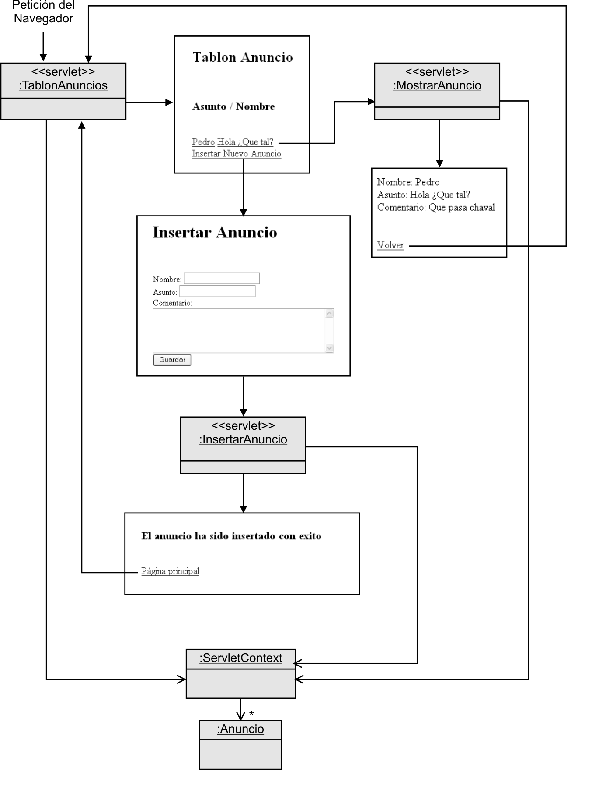{width=12%}

{width=13%}

{width=20%}

{width=20%}

# Inyección de dependencias

## Inyección de dependencias

- Las aplicaciones se suelen dividir en **módulos de alto nivel** 
- Algunos **módulos** ofrecen servicios a otros módulos
- **Ejemplo:** Diseño modular de una aplicación web con SpringMVC

```{dot}
//| fig-width: 6.4
//| fig-height: 2.2
// Diseno modular de una aplicacion web: los controladores usan un servicio,
// y el servicio usa el repositorio y el envio de correos.
digraph modulos {
  rankdir=LR; bgcolor="transparent"; nodesep=0.35; ranksep=0.7;
  node [fontname="Lato", fontsize=12, shape=box, style="filled",
        fillcolor="#e2efd9", color="#70ad47"];
  edge [color="#333333", arrowsize=0.8];

  web1 [label="Controlador\nWeb 1"];
  web2 [label="Controlador\nWeb 2"];
  servicios [label="Servicios\nUsuarios"];
  repo [label="Repositorio\n(Base de\ndatos)"];
  correos [label="Sistema\nenvío de\ncorreos"];

  web1 -> servicios;
  web2 -> servicios;
  servicios -> repo;
  servicios -> correos;
}
```

---

- ¿Cómo se **implementa un módulo**?
- ¿Cómo se **conecta un módulo** a otro módulo?
- La **inyección de dependencias** es una técnica que permite especificar un módulo y sus dependencias
- Cuando se inicia la aplicación, el framework crea todos los módulos e **inyecta las dependencias** en los módulos que las necesitan
- **Spring** dispone de un sistema de inyección de dependencias interno

---

::: {.etiqueta-ejemplo}
ejem4
:::

```{dot}
//| fig-width: 5.0
//| fig-height: 0.8
// El controlador depende del servicio: es la dependencia que Spring inyecta.
digraph dependencia {
  rankdir=LR; bgcolor="transparent"; ranksep=0.9;
  node [fontname="Lato", fontsize=13, shape=box, style="filled",
        fillcolor="#e2efd9", color="#70ad47", height=0.5];
  edge [color="#333333", arrowsize=0.8];

  controlador [label="GreetingController"];
  servicio    [label="UserService"];
  controlador -> servicio;
}
```

```java
@Controller
public class GreetingController {
  @Autowired
  private UsersService usersService;
  @GetMapping("/greeting")
  public String greeting(Model model) {
    model.addAttribute("name",
       usersService.getNumUsers()+" users");
    return "greeting_template";
  }
}
```

```java
@Component
public class UsersService {
  public int getNumUsers(){
    return 5;
  }
}
```

---

::: {.etiqueta-ejemplo}
ejem4
:::

```{dot}
//| fig-width: 5.0
//| fig-height: 0.8
// El controlador depende del servicio: es la dependencia que Spring inyecta.
digraph dependencia {
  rankdir=LR; bgcolor="transparent"; ranksep=0.9;
  node [fontname="Lato", fontsize=13, shape=box, style="filled",
        fillcolor="#e2efd9", color="#70ad47", height=0.5];
  edge [color="#333333", arrowsize=0.8];

  controlador [label="GreetingController"];
  servicio    [label="UserService"];
  controlador -> servicio;
}
```

```java
@Controller
public class GreetingController {
  @Autowired
  private UsersService usersService;
  @GetMapping("/greeting")
  public String greeting(Model model) {
    model.addAttribute("name",
       usersService.getNumUsers()+" users");
    return "greeting_template";
  }
}
```

```java
@Component
public class UsersService {
  public int getNumUsers(){
    return 5;
  }
}
```

---

- A los módulos de la aplicación Spring se los denomina **beans** o **componentes**
- Para que una clase se considere un componente, tiene que anotarse con **@Component @Controller o @Service**
- Si un componente depende otro, puede poner la anotación **@Autowired** (auto enlazado) en un atributo, un constructor o un método setter

[https://docs.spring.io/spring-framework/docs/5.3.0/reference/html/core.html#beans](https://docs.spring.io/spring-framework/docs/5.3.0/reference/html/core.html#beans) 

---

```java
@Controller
public class GreetingController {
  @Autowired
  private UsersService usersService;
  @GetMapping("/greeting")
  public String greeting(Model model) { ... }
}
```

```java
@Controller
public class GreetingController {
  private UsersService usersService;
  public GreetingController(UsersService usersService){
    this.usersService = usersService;
  }
  @GetMapping("/greeting")
  public String greeting(Model model) { ... }
}
```

---

- Existen casos en los que los componentes de una aplicación vienen en librerías (no los podemos modificar) pero tienen que ser **configurados** **en la aplicación**
- Existen otros casos en los que existen **varias implementaciones** disponibles de un componente y la aplicación tiene que **seleccionar** la implementación concreta
- En estos casos, la aplicación puede **configurar los componentes** de la aplicación

---

- En las aplicaciones **SpringBoot**, la clase principal de la aplicación se utiliza para **configurar los componentes**
- Por cada componente que se quiera **configurar**:
  - Se **quita la anotación** @Component del componente
  - Se **añade un método** en la clase principal anotado con **@Bean** que devuelva un nuevo componente con la configuración requerida

---

::: {.etiqueta-ejemplo}
ejem5
:::

```{dot}
//| fig-width: 5.0
//| fig-height: 0.8
// El controlador depende del servicio: es la dependencia que Spring inyecta.
digraph dependencia {
  rankdir=LR; bgcolor="transparent"; ranksep=0.9;
  node [fontname="Lato", fontsize=13, shape=box, style="filled",
        fillcolor="#e2efd9", color="#70ad47", height=0.5];
  edge [color="#333333", arrowsize=0.8];

  controlador [label="GreetingController"];
  servicio    [label="UserService"];
  controlador -> servicio;
}
```

```java
@Controller
public class GreetingController {
  @Autowired
  private UsersService usersService;
  @GetMapping("/greeting")
  public String greeting(Model model) {
    model.addAttribute("name",
       usersService.getNumUsers()+" users");
    return "greeting_template";
  }
}
```

```java
public class UserService {
  private int numUsers;
  public UserService(int numUsers){
    this.numUsers = numUsers;
  }
  public int getNumUsers() {
    return numUsers;
  }	
}
```

---

::: {.etiqueta-ejemplo}
ejem5
:::

```{.java data-lineas="3-6"}
@SpringBootApplication
public class Application {
	@Bean
	public UserService usersService(){
		return new UserService(10);
	}
	public static void main(String[] args) {
		SpringApplication.run(Application.class, args);
	}
}
```

::: {.nota-codigo}
En la clase de la aplicación se configura el componente

Se implementa un método anotado con **@Bean** que devuelve el componente ya configurado
:::

## Ejercicio 5

- Estructura el tablón **de mensajes** para que el código esté separado en dos clases principales (beans):
  - **PostController:** Gestión de peticiones web
  - **PostService:** Gestión de los mensajes
- Implementa una gestión de alumnos que evite problemas de accesos simultáneos (dos usuarios quieren borrar el mismo mensaje)

# Sesión: Datos de cada usuario

## Sesión: Datos de cada usuario

- Es habitual que las aplicaciones web gestionen **información diferente para cada usuario** que está navegando:
  - Amigos en Facebook
  - Lista de correos en Gmail
  - Carrito de la compra en Amazon

---

- Aunque un usuario no se identifique en la página (no haya hecho **login**) es posible gestionar información específica para él que los demás usuarios no podrán consultar
- En la mayoría de las ocasiones, si el usuario se **identifica en la página**, puede disfrutar de más funcionalidades:
  - Carga de sus datos que están en el servidor
  - Guardado de información: Carrito de la compra, lista de deseos, mensajes leídos…

---

- Se puede gestionar la información del usuario en dos ámbitos diferentes:
  - Información que se utiliza durante la navegación del usuario, durante la **sesión** actual
  - Información que se guarda mientras que el usuario no está navegando y que se recupera cuando el usuario vuelve a visitar la página web (**información persistente**)

---

- **Sesión:** Mantener información mientras el usuario navega por la web 
  - Cuando el usuario pasa cierto tiempo sin realizar peticiones a la web, la sesión finaliza automáticamente (la sesión **caduca**).
  - El tiempo de caducidad es configurable (los bancos suelen tener un tiempo muy pequeño por seguridad)
  - La información de sesión (generalmente) se guarda en memoria del servidor web

---

- **Información persistente:** Guardar información entre distintas navegaciones por la web 
  - Para que podamos guardar información del usuario en el servidor, es necesario que el usuario se identifique al acceder a la página (nombre y clave)
  - La información se suele guardar en el servidor web en una BBDD
  - La lógica de la aplicación determina a qué información de la BBDD puede acceder cada usuario

---

- **Gestión de la sesión en Spring**
  - Existen dos técnicas principales
    - Objeto HttpSession
    - Una instancia de un componente específica para cada usuario
  - Se pueden combinar estas dos técnicas en una misma aplicación

---

- **Gestión de la sesión en Spring**
  - Objeto HttpSession
    - Es la forma básica de gestión de sesiones en Java EE
    - Existe un objeto HttpSession por cada usuario que navega por la web
    - Se puede almacenar información en una petición y recuperar la información en otra petición posterior
    - Es de más bajo nivel

[http://docs.oracle.com/javaee/7/api/javax/servlet/http/HttpSession.html](http://docs.oracle.com/javaee/7/api/javax/servlet/http/HttpSession.html) 

---

- **Gestión de la sesión en Spring**
  - Componente específico para cada usuario
    - Cada usuario guarda su información en uno o varios componentes Spring
    - Existe una instancia por cada usuario (cuando lo habitual es tener una única instancia por componente en toda la aplicación, singleton)
    - Es de más alto nivel

## Objeto HttpSession

- La sesión se representa como un objeto del interfaz **javax.servlet.http.HttpSession**
- El framework Spring es el encargado de crear un **objeto de la sesión** diferente para cada **usuario**
- Para acceder al **objeto de la sesión** del usuario que está haciendo una petición, basta incluirlo como parámetro en el método del controlador

```java
@GetMapping("/ruta_controlador")
public String procesarFormulario(HttpSession sesion, ...) {
    Object info = ...;
    sesion.setAttribute("info", info);
    return "template";
}
```

---

::: {.etiqueta-ejemplo}
ejem6
:::

- **Ejemplo**

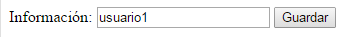{width=36%}

Guarda la información en un **atributo de la sesión** y en un **atributo del controlador**

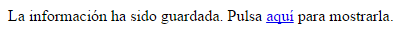{width=42%}

Recupera la información de la **sesión (usuario)** y del **controlador (compartida)**

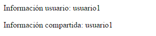{width=32%}

---

::: {.etiqueta-ejemplo}
ejem6
:::

- **Ejemplo**
  - Una aplicación recoge la información de un formulario y la guarda en dos lugares: 
    - **Atributo del controlador (compartida)** 
    - **Atributo de la sesión** **(usuario)**.
  - Una vez guardada la información, se puede acceder a ella y generar una página
  - Si **dos usuarios** visitan esta página a la **misma vez**, se puede ver cómo la información del controlador es compartida (la que guarda el último usuario es la que se muestra), pero la que se guarda en la sesión es diferente para cada usuario
  - Para simular dos usuarios en el mismo ordenador, se puede usar el **modo normal** y el **modo incógnito** de Google Chrome.

---

::: {.etiqueta-ejemplo}
ejem6
:::

```{.java data-lineas="5,11"}
@Controller
public class SesionController {
	private String infoCompartida;
	@PostMapping("/procesarFormulario")
	public String procesarFormulario(@RequestParam String info, HttpSession sesion) {
		sesion.setAttribute("infoUsuario", info);
		infoCompartida = info;
		return "resultado_formulario";
	}
	@GetMapping("/mostrarDatos")
	public String mostrarDatos(Model model, HttpSession sesion) {
		String infoUsuario = (String) sesion.getAttribute("infoUsuario");
		model.addAttribute("infoUsuario", infoUsuario);
		model.addAttribute("infoCompartida", infoCompartida);
		return "datos";
	}
}
```

::: {.nota-codigo}
**HttpSession** como parámetro
:::

---

- **Métodos de HttpSession**
  - **void setAttribute(String name, Object value):** Asocia un objeto a la sesión identificado por un nombre
  - **Object getAttribute(String name):** Recupera un objeto previamente asociado a la sesión
  - **boolean isNew():** Indica si es la primera página que solicita el usuario. Si la sesión es nueva.
  - **void invalidate():** Cierra la sesión del usuario borrando todos sus datos. Si visita nuevamente la página, será considerado como un usuario nuevo.
  - **void setMaxInactiveInterval(int segundos):** Configura el tiempo de inactividad para cerrar automáticamente la sesión del usuario. 

## Componente específico para cada usuario

- En Spring existe una forma de más **alto nivel** para asociar información al **usuario**
- Consiste en crear un **@Component** especial que se asociará a cada usuario y hacer **@Autowire** del mismo en el controlador que se utilice
- Internamente Spring hace bastante **magia** para que la información se gestione de forma adecuada

---

::: {.etiqueta-ejemplo}
ejem7
:::

- Componente para el usuario

```{.java data-lineas="2"}
@Component
@SessionScope
public class Usuario {
   private String info;
   public void setInfo(String info) {
      this.info = info;
   }
   public String getInfo() {
      return info;
   }
}
```

::: {.nota-codigo}
La anotación **@SessionScope**  hace que haya **una instancia del componente** por cada usuario
:::

---

::: {.etiqueta-ejemplo}
ejem7
:::

```{.java data-lineas="3,4,8,14"}
@Controller
public class SesionController {
	@Autowired
	private Usuario usuario;
	private String infoCompartida;
	@PostMapping("/procesarFormulario")
	public String procesarFormulario(@RequestParam String info) {
		usuario.setInfo(info);
		infoCompartida = info;
		return "resultado_formulario";
	}
	@GetMapping("/mostrarDatos")
	public String mostrarDatos(Model model) {
		String infoUsuario = usuario.getInfo();
		model.addAttribute("infoUsuario", infoUsuario);
		model.addAttribute("infoCompartida", infoCompartida);
		return "datos";
	}
}
```

::: {.nota-codigo}
Se accede al objeto usuario con **@Autowired** (inyección de dependencias)
:::

::: {.nota-codigo}
Se utilizan métodos del objeto 
:::

## Sesión: Datos de cada usuario

- **Gestión de la sesión en Spring**
  - Ambas técnicas se pueden combinar
  - El objeto **HttpSession** se utilizará para controlar el ciclo de vida de la sesión (si es nueva, invalidarla, etc…) 
  - El **componente** se usará para gestionar la información asociada al usuario

## Ejercicio 6 – Tablón mejorado

- Modificar el Tablón de mensajes (ejercicio 5)  para que la primera vez que un usuario acceda a la página principal le salga un mensaje de Bienvenida (creación de la sesión)
- En las siguientes visitas a la página principal no tiene que aparecer el mensaje

---

- Cuando el usuario cree un anuncio por primera vez en la sesión, introducirá su nombre. 
- Cuando vaya a crear más anuncios durante la sesión, el nombre le debe aparecer ya escrito (aunque con la posibilidad de modificarlo) 
- Además, cada vez que vaya a incluir un anuncio se le debe indicar cuántos anuncios que lleva creados en la sesión

# Imágenes

## Imágenes

- En las aplicaciones web el usuario puede **subir imágenes** y cualquier otro tipo de fichero
- Esas imágenes se **guardan en el disco** duro (fuera de la carpeta static) o en la **base de datos**
- La **carpeta static** no está disponible cuando la aplicación está en producción (fuera del IDE)

---

::: {.etiqueta-ejemplo}
ejem8
:::

- **Formulario para subir imágenes**

```html
<form action="/upload_image" method="post" enctype="multipart/form-data">
  <p>Image name: </p>
  <input type='text' name='imageName'/>
  <p>Image file:</p><input type='file' name='image' accept=".jpg, .jpeg"/>		
  <input type='submit' value='Save'/>
</form>
```

---

::: {.etiqueta-ejemplo}
ejem8
:::

- **Controlador para subir imágenes**

```java
@PostMapping("/upload_image")
public String uploadImage(@RequestParam String imageName, 
	@RequestParam MultipartFile image) throws IOException {
	this.imageName = imageName;
	Files.createDirectories(IMAGES_FOLDER);
	Path imagePath = IMAGES_FOLDER.resolve("image.jpg");
	image.transferTo(imagePath);
	return "uploaded_image";
}
```

---

::: {.etiqueta-ejemplo}
ejem8
:::

- **Plantilla para mostrar la imagen**

```html
<html>
<body>
<h1>{{imageName}}</h1>
</img>
</body>
</html>
```

---

::: {.etiqueta-ejemplo}
ejem8
:::

- **Controlador para mostrar la imagen**

```java
@GetMapping("/image")
public String viewImage(Model model) {
	model.addAttribute("imageName", imageName);
	return "view_image";
}
@GetMapping("/download_image")	
public ResponseEntity<Object> downloadImage(Model model) 
	throws MalformedURLException {
	Path imagePath = IMAGES_FOLDER.resolve("image.jpg");
	Resource image = new UrlResource(imagePath.toUri());
	return ResponseEntity.ok()
		.header(HttpHeaders.CONTENT_TYPE, "image/jpeg")
		.body(image);		
}
```

## Ejercicio 7 – Tablón con imágenes

- Añade imágenes al tablón de mensajes
- Sólo habrá una imagen por anuncio
- Se puede usar el id del anuncio como parte del nombre del fichero de la imagen para evitar colisiones y facilitar el acceso

