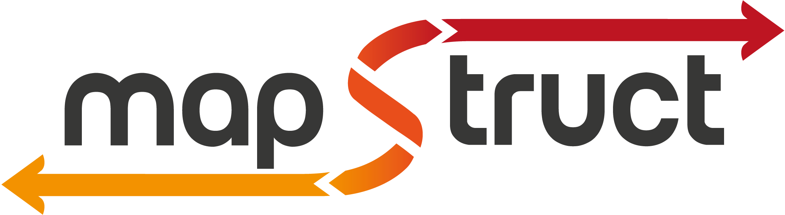
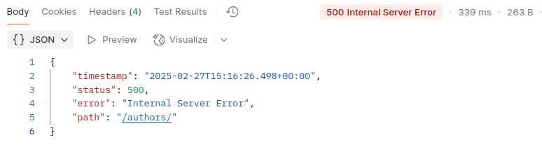
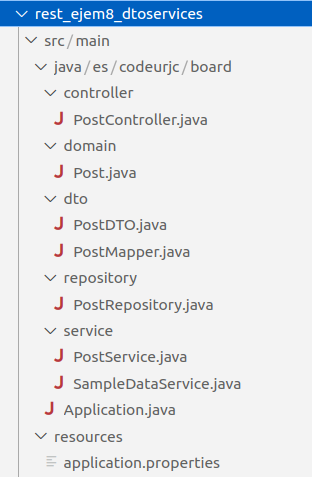

## Licencia {.nota-licencia visibility="uncounted"}

©2025  Micael Gallego, Francisco Gortázar, Michel Maes, Óscar Soto, Iván Chicano Algunos derechos reservados Este documento se distribuye bajo la licencia “Atribución-CompartirIgual 4.0 Internacional”  de Creative Comons Disponible en [https://creativecommons.org/licenses/by-sa/4.0/deed.es](https://creativecommons.org/licenses/by-sa/4.0/deed.es)

## Conversión entre objetos y JSON

- Cuando se implementa una API REST es deseable controlar cómo se **convierten los objetos Java a JSON** (y viceversa)
- Spring utiliza la librería **Jackson** en modo **data binding** para hacer esta tarea
- Para ajustes básicos se pueden utilizar anotaciones
  - Por ejemplo si se pone **@JsonIgnore** en un atributo es ignorado completamente en la conversión

[https://github.com/FasterXML/jackson](https://github.com/FasterXML/jackson) 

---

- Por seguridad y para tener más control sobre las conversiones se utiliza el patrón **Data Transfer Object** **(DTO)** 
- En este patrón se usan clases específicas para transferir información entre **procesos** o **capas** de una aplicación
- Descrito en 2002 por Martin Fowler en el libro [Patterns of Enterprise Application Architecture](https://martinfowler.com/books/eaa.html)

[https://martinfowler.com/eaaCatalog/dataTransferObject.html](https://martinfowler.com/eaaCatalog/dataTransferObject.html) 

## Patrón DTO en APIs REST

- Es un patrón muy utilizado al implementar una API REST
- En vez de usar el modelo del dominio (entidades) en la API REST, se crean clases específicas para la respuesta y la petición (body) de las operaciones
- Permite más flexibilidad para definir el formato de las operaciones al desacoplar dominio y API REST (pueden evolucionar de forma independiente)

[https://www.baeldung.com/java-dto-pattern](https://www.baeldung.com/java-dto-pattern) 

[https://www.baeldung.com/entity-to-and-from-dto-for-a-java-spring-application](https://www.baeldung.com/entity-to-and-from-dto-for-a-java-spring-application) 

[https://thorben-janssen.com/dont-expose-entities-in-api/](https://thorben-janssen.com/dont-expose-entities-in-api/) 

---

- Ventajas de DTO en APIs REST:
  - Mayor control de qué campos se convierten a JSON
  - Cuando hay relaciones, se puede especificar qué campos de las entidades relacionadas se convierten a JSON (por eficiencia y para evitar ciclos)
  - Se puede evolucionar el código interno sin afectar a los clientes (ya que el JSON queda igual)
  - No se devuelven inadvertidamente campos sensibles (encodedPassword)
  - Al crear un recurso se controla qué datos llegan en el cuerpo de la petición (no se permiten datos de entrada inadvertidos)

---

**rest\_ejem4**

- **Implementación básica:**
  - Se crea una clase PostDTO con los mismos atributos que Post
  - En el controlador, para el body y la resupuesta se usa PostDTO
  - En cada método se convierte entre PostDTO y Post usando métodos privados

---

**rest\_ejem4**

**record** PostDTO(

        Long id,

        String username,

        String title,

        String text) {

}

Los **records** son ideales para definir DTOs porque los **getters**, **setters**, **constructor** y **toString** se crean de forma automática

[https://www.baeldung.com/java-record-keyword](https://www.baeldung.com/java-record-keyword) 

---

**rest\_ejem4**

- Métodos de conversión entre dominio y DTO

```java
@RestController
@RequestMapping("/posts")
public class PostController {
...
private PostDTO toDTO(Post post){
return new PostDTO(post.getId(), post.getUsername(),
   post.getTitle(), post.getText());
}
private Post toDomain(PostDTO postDTO){
return new Post(postDTO.id(), postDTO.username(), 
   postDTO.title(), postDTO.text());
}
}
```

---

**rest\_ejem4**

- **Consulta**

```java
@GetMapping("/")
public Collection<PostDTO> getPosts() {
  return postRepository.findAll().stream().map(this::toDTO).toList();
}
```

```java
@GetMapping("/{id}")
public PostDTO getPost(@PathVariable long id) {
	return toDTO(postRepository.findById(id).orElseThrow());
}
```

---

**rest\_ejem4**

- **Creación**

```java
@PostMapping("/")
public ResponseEntity<PostDTO> createPost(@RequestBody PostDTO postDTO) {
	Post post = toDomain(postDTO);
	postRepository.save(post);
	URI location = fromCurrentRequest().path("/{id}")
		.buildAndExpand(post.getId()).toUri();
	return ResponseEntity.created(location).body(toDTO(post));
}
```

---

**rest\_ejem4**

- **Reemplazo**

```java
@PutMapping("/{id}")
public PostDTO replacePost(@PathVariable long id, 
	@RequestBody PostDTO newPostDTO) {
	if (postRepository.existsById(id)) {
		Post newPost = toDomain(newPostDTO);
		newPost.setId(id);
		postRepository.save(newPost);
		return toDTO(newPost);
	} else {
		throw new NoSuchElementException();
	}
}
```

---

**rest\_ejem4**

- **Borrado**

```java
@DeleteMapping("/{id}")
public PostDTO deletePost(@PathVariable long id) {
	Post post = postRepository.findById(id).orElseThrow();
	postRepository.deleteById(id);
	return toDTO(post);
}
```

---

- Para APIs complejas es posible crear DTOs diferentes para la misma entidad en las peticiones de creación, actualización, respuestas, etc…
- Ejemplo: **PostCreateRequest**, **PostReplaceRequest**, **PostResource**…

## Map Struct

- Con muchas entidades la implementación de los métodos **toDTO(...)** y **toDomain(...)** es tedioso y requiere actualización por cada nuevo atributo
- Existen librerías denominadas **mappers** que te permiten crear un objeto partiendo de los atributos de otro

[https://simpleprogrammer.com/java-bean-mapping-frameworks/](https://simpleprogrammer.com/java-bean-mapping-frameworks/) 

[https://www.baeldung.com/java-performance-mapping-frameworks](https://www.baeldung.com/java-performance-mapping-frameworks) 

## MapStruct

{width=77%}

Uno de los mappers más eficientes para Java con buena integración en Spring

[https://mapstruct.org/](https://mapstruct.org/)

[https://www.baeldung.com/mapstruct](https://www.baeldung.com/mapstruct) 

---

**rest\_ejem5**

- Dependencia Maven

```xml
<dependency>
	<groupId>org.mapstruct</groupId>
	<artifactId>mapstruct</artifactId>
	<version>1.6.3</version>
</dependency>
```

---

**rest\_ejem5**

- Plugin para generación de mappers en código

```xml
<build>
	<plugins>
		<plugin>
			<groupId>org.apache.maven.plugins</groupId>
			<artifactId>maven-compiler-plugin</artifactId>
			<version>3.8.1</version>
			<configuration>
				<source>17</source>
				<target>17</target>
				<annotationProcessorPaths>
					<path>
						<groupId>org.mapstruct</groupId>
						<artifactId>mapstruct-processor</artifactId>
						<version>1.6.3</version>
					</path>
				</annotationProcessorPaths>
			</configuration>
		</plugin>
	</plugins>
</build>
```

---

**rest\_ejem5**

- **Interfaz el Mapper (Conversor)**
  - Se genera la implementación automáticamente

@Mapper(componentModel = "spring")

**public** **interface** PostMapper {

    PostDTO toDTO(Post post);

    List\<PostDTO\> toDTOs(Collection\<Post\> posts);

    Post toDomain(PostDTO postDTO);

}

---

**rest\_ejem5**

- **Uso del Mapper**

```java
@RestController
@RequestMapping("/posts")
public class PostController {
	@Autowired
	private PostMapper mapper;
	... 
	private PostDTO toDTO(Post post){
		return mapper.toDTO(post);
	}
	private Post toDomain(PostDTO postDTO){
		return mapper.toDomain(postDTO);
	}
	private Collection<PostDTO> toDTOs(Collection<Post> posts){
		return mapper.toDTOs(posts);
	}
}
```

---

**rest\_ejem5**

- **Consulta**

```java
@GetMapping("/")
public Collection<PostDTO> getPosts() {
  return postRepository.findAll().stream().map(this::toDTO).toList();
}
```

```java
@GetMapping("/")
public Collection<PostDTO> getPosts() {
	return toDTOs(posts.findAll());
}
```

## Referencias circulares en entidades

**rest\_ejem6**

- Modelo para gestionar libros y autores

```{dot}
//| fig-width: 6.2
//| fig-height: 1.8
// Modelo de libros y autores: una relacion muchos a muchos navegable por los
// dos extremos, que es de donde salen las referencias circulares.
digraph libros_autores {
  rankdir=LR; bgcolor="transparent"; nodesep=0.5; ranksep=1.4;
  node [fontname="Lato", fontsize=14, shape=box, style=filled,
        fillcolor="#c5e8a0", color="#70ad47", width=1.6, height=0.7];
  edge [color="#333333", arrowsize=0.7, fontname="Lato", fontsize=11];

  book [label="Book"]; author [label="Author"];
  book -> author [label="authors", headlabel="*", labeldistance=1.8];
  author -> book [label="books", headlabel="*", labeldistance=1.8];
}
```

@Entity

public class Book {

    @Id

    @GeneratedValue(...)

    private Long id;

    private String title;

    private int price;

    @ManyToMany

    private List\<Author\> authors = ...  
  
}

@Entity

public class Author {

    @Id

    @GeneratedValue(...)

    private Long id;

    private String name;

    private String nationality;

    @ManyToMany(mappedBy = "authors")

    private List\<Book\> books = …

}

---

**rest\_ejem6**

- ¿Qué ocurre si tenemos esta API REST?

```java
@RestController
@RequestMapping("/authors")
public class AuthorController {
  @Autowired
  private AuthorRepository authorRepository;
  @Autowired
  private AuthorMapper mapper;
  @GetMapping("/")
  public Collection<AuthorDTO> getAllAuthors() {
    return mapper.toDTOs(authorRepository.findAll());
  }
  ...
}
```

---

**rest\_ejem6**

- ¿Qué ocurre si tenemos esta API REST?

```
at es.codeurjc.library.dto.AuthorMapperImpl.toDTO(AuthorMapperImpl.java:33) ~[classes/:na]
at es.codeurjc.library.dto.AuthorMapperImpl.toDTOs(AuthorMapperImpl.java:48) ~[classes/:na]
at es.codeurjc.library.dto.AuthorMapperImpl.bookToBookDTO(AuthorMapperImpl.java:85) ~[classes/:na]
at es.codeurjc.library.dto.AuthorMapperImpl.bookListToBookDTOList(AuthorMapperImpl.java:99) ~[classes/:na]
at es.codeurjc.library.dto.AuthorMapperImpl.toDTO(AuthorMapperImpl.java:33) ~[classes/:na]
at es.codeurjc.library.dto.AuthorMapperImpl.toDTOs(AuthorMapperImpl.java:48) ~[classes/:na]
at es.codeurjc.library.dto.AuthorMapperImpl.bookToBookDTO(AuthorMapperImpl.java:85) ~[classes/:na]
at es.codeurjc.library.dto.AuthorMapperImpl.bookListToBookDTOList(AuthorMapperImpl.java:99) ~[classes/:na]
at es.codeurjc.library.dto.AuthorMapperImpl.toDTO(AuthorMapperImpl.java:33) ~[classes/:na]
at es.codeurjc.library.dto.AuthorMapperImpl.toDTOs(AuthorMapperImpl.java:48) ~[classes/:na]
at es.codeurjc.library.dto.AuthorMapperImpl.bookToBookDTO(AuthorMapperImpl.java:85) ~[classes/:na]
at es.codeurjc.library.dto.AuthorMapperImpl.bookListToBookDTOList(AuthorMapperImpl.java:99) ~[classes/:na]
at es.codeurjc.library.dto.AuthorMapperImpl.toDTO(AuthorMapperImpl.java:33) ~[classes/:na]
at es.codeurjc.library.dto.AuthorMapperImpl.toDTOs(AuthorMapperImpl.java:48) ~[classes/:na]
```

{width=79%}

---

**rest\_ejem6**

- ¿Qué ocurre si tenemos esta API REST?

Al intentar convertir los objetos a DTOs, se produce un **ERROR** **por StackOverflow**

Como un libro tiene un autor y un autor tiene también un libro existe una referencia circular.

---

**rest\_ejem7**

- **Se pueden definir DTOs distintos para cada operación REST**

```
GET /authors/
```

```
GET /authors/1
```

\[

  {

    "id": 1,

    "name": "Antonio",

    "nationality": "Español"

  },

  {

    "id": 2,

    "name": "Gerard",

    "nationality": "Frances"

  }

\]

{

  "id": 1,

  "name": "Antonio",

  "nationality": "Español",

  "books": \[

    {

      "id": 1,

      "title": "Bambi",

      "price": 3

    }

  \]

}

---

::: {.columns}
::: {.column width="30%"}
DTOs para autor y sus  libros (sin autor)
:::
::: {.column width="70%"}
**rest\_ejem7**

public record **AuthorDTO**(

  Long id, String name, String nationality,   

  List\<**BookBasicDTO**\> books) {

}

public record **BookBasicDTO**(

  Long id, String title, int price) {

}
:::
:::

public record **AuthorBasicDTO**(

  Long id, String name, String nationality) {

}

DTO para autor sin libros 

DTOs diferentes en el mismo mapper

```java
@Mapper(componentModel = "spring")
public interface AuthorMapper {
  AuthorDTO toDTO(Author author);
  List<AuthorBasicDTO> toDTOs(Collection<Author> authors);
  @Mapping(target = "books", ignore = true)
  Author toDomain(AuthorBasicDTO authorDTO);
}
```

---

**rest\_ejem7**

```{.java data-lineas="9,13"}
@RestController
@RequestMapping("/authors")
public class AuthorController {
  @Autowired
  private AuthorRepository authorRepository;
  @Autowired
  private AuthorMapper mapper;
  @GetMapping("/")
  public Collection<AuthorBasicDTO> getAllAuthors() {
    return mapper.toDTOs(authorRepository.findAll());
  }
  @GetMapping("/{id}")
  public AuthorDTO getAuthorById(@PathVariable Long id) {
    return mapper.toDTO(authorRepository.findById(id).orElseThrow());
  }
}
```

::: {.nota-codigo}
Cada método devuelve un DTO diferente
:::

## DTOs y servicios

- En los ejemplos el controlador usa directamente los repositorios para mantener el **código sencillo y conciso**
- Una aplicación debería desacoplar la **lógica de negocio** de la capa de **presentación**
- Se debería crear una **capa de servicios** que albergue la lógica de negocio y desacople la presentación (controlador) y la persistencia (repositorio)

## Arquitectura

**rest\_ejem8**

```{dot}
//| fig-width: 9.2
//| fig-height: 2.2
// Las tres capas del ejemplo: el controlador usa el servicio y el servicio el
// repositorio.
digraph arquitectura {
  rankdir=LR; bgcolor="transparent"; nodesep=0.35; ranksep=1.3;
  node [fontname="Lato", fontsize=12, shape=box, style=filled,
        fillcolor="#c5e8a0", color="#70ad47", width=1.9, height=0.6];
  edge [color="#333333", arrowsize=0.8];

  subgraph cluster_c {
    label="Controladores\n(Presentación)"; labelloc=b; fontsize=11;
    fontcolor="#333333"; color="#bbbbbb"; style=dashed;
    pc [label="PostsController"];
  }
  subgraph cluster_s {
    label="Servicios\n(Lógica de negocio)"; labelloc=b; fontsize=11;
    fontcolor="#333333"; color="#bbbbbb"; style=dashed;
    ps [label="PostsService"];
  }
  subgraph cluster_r {
    label="Repositorios\n(Persistencia)"; labelloc=b; fontsize=11;
    fontcolor="#333333"; color="#bbbbbb"; style=dashed;
    pr [label="PostsRepository"];
  }

  pc -> ps; ps -> pr;
}
```

## DTOs y servicios

- ¿Dónde se convierte entre entidades y DTOs?
  - ¿Controladores?
  - ¿Servicios?
  - ¿Ambos?

---

- Existe cierta controversia porque cada opción tiene sus ventajas e enconvenientes
  - DTOs en Servicios
  - DTOs en Controllers

[Conferencia Spring I/O 2023](https://youtu.be/mbNzUkNjrnA?si=3tuRNk8sF5e-iSuw&t=2113)

[https://stackoverflow.com/questions/47822938/which-layer-should-be-used-for-conversion-to-dto-from-domain-object](https://stackoverflow.com/questions/47822938/which-layer-should-be-used-for-conversion-to-dto-from-domain-object) 

[https://www.baeldung.com/entity-to-and-from-dto-for-a-java-spring-application](https://www.baeldung.com/entity-to-and-from-dto-for-a-java-spring-application) 

[https://www.baeldung.com/java-dto-pattern](https://www.baeldung.com/java-dto-pattern) 

[https://stackoverflow.com/questions/76888527/where-is-the-best-place-to-convert-entity-to-dto](https://stackoverflow.com/questions/76888527/where-is-the-best-place-to-convert-entity-to-dto) 

---

**rest\_ejem8**

Salvo que exista algún motivo de peso, lo habitual es que la conversión entre entidades y DTOs se realice en los **servicios**

---

**rest\_ejem8**

```{dot}
//| fig-width: 9.6
//| fig-height: 2.2
// Que viaja entre capas: el controlador habla con el servicio en PostDTO y el
// servicio con el repositorio en Post.
digraph dtos {
  rankdir=LR; bgcolor="transparent"; nodesep=0.35; ranksep=0.55;
  node [fontname="Lato", fontsize=12, shape=box, style=filled,
        fillcolor="#c5e8a0", color="#70ad47", width=1.9, height=0.6];
  edge [color="#333333", arrowsize=0.8];

  subgraph cluster_c {
    label="Controladores\n(Presentación)"; labelloc=b; fontsize=11;
    fontcolor="#333333"; color="#bbbbbb"; style=dashed;
    pc [label="PostsController"];
  }
  dto [label="PostDTO", shape=box, fillcolor="#d9d9d9", color="#808080",
       width=1.1, height=0.5, fontsize=11];
  subgraph cluster_s {
    label="Servicios\n(Lógica de negocio)"; labelloc=b; fontsize=11;
    fontcolor="#333333"; color="#bbbbbb"; style=dashed;
    ps [label="PostsService"];
  }
  post [label="Post", shape=box, fillcolor="#d9d9d9", color="#808080",
        width=1.1, height=0.5, fontsize=11];
  subgraph cluster_r {
    label="Repositorios\n(Persistencia)"; labelloc=b; fontsize=11;
    fontcolor="#333333"; color="#bbbbbb"; style=dashed;
    pr [label="PostsRepository"];
  }

  pc -> dto [arrowhead=none]; dto -> ps;
  ps -> post [arrowhead=none]; post -> pr;
}
```

---

{width=38%}

**rest\_ejem8**

---

**rest\_ejem8**

@Service

public class PostService {

  @Autowired

  private PostRepository postRepository;

  @Autowired

  private PostMapper mapper;

  public Collection\<PostDTO\> getPosts() {

    return toDTOs(postRepository.findAll());

  }

  public PostDTO getPost(long id) {

    return toDTO(

      postRepository.findById(id).orElseThrow()

    );

  }

  ...

}

```java
@RestController
@RequestMapping("/posts")
public class PostController {
  @Autowired
  private PostService postService;
  @GetMapping("/")
  public Collection<PostDTO> getPosts() {
    return postService.getPosts();
  }
  @GetMapping("/{id}")
  public PostDTO getPost(
    @PathVariable long id) {
    return getPost(id);
  }
  ... 
}
```

---

**rest\_ejem8**

@RestController

@RequestMapping("/posts")

public class PostController {

  ...

  @PostMapping("/")

  public ResponseEntity\<PostDTO\> createPost(@RequestBody PostDTO postDTO) {

    postDTO = postService.createPost(postDTO);

    URI location =

      fromCurrentRequest().path("/{id}").buildAndExpand(postDTO.id()).toUri();

    return ResponseEntity.created(location).body(postDTO);

  }

  @PutMapping("/{id}")

  public PostDTO replacePost(@PathVariable long id, @RequestBody PostDTO updatedPostDTO) {

    return postService.replacePost(id, updatedPostDTO);

  }

  @DeleteMapping("/{id}")

  public PostDTO deletePost(@PathVariable long id) {

    return postService.deletePost(id);

  }

}

## 

@Service

public class PostService {

  ...

  public PostDTO createPost(PostDTO postDTO) {

    Post post = toDomain(postDTO);

    postRepository.save(post);

    return toDTO(post);

  }

  public PostDTO replacePost(long id, PostDTO updatedPostDTO) {

    if (postRepository.existsById(id)) {

      Post updatedPost =  toDomain(updatedPostDTO);  
      updatedPost.setId(id);  


      postRepository.save(updatedPost);

      return toDTO(updatedPost);

    } else {

      throw new NoSuchElementException();

    }

  }

  public PostDTO deletePost(long id) {

    Post post = postRepository.findById(id).orElseThrow();

    postRepository.deleteById(id);

    return toDTO(post);

  }

  ...

}

**rest\_ejem8**

## DTOs y aplicaciones web

- Los DTOs también pueden usarse en aplicaciones web
- Tienen las mismas ventajas que en APIs REST
  - Desacoplan lógica de negocio de presentación
  - Mayor control de captura de datos de formularios

## DTOs y servicios

**rest\_ejem9**

```{dot}
//| fig-width: 9.6
//| fig-height: 2.8
// Dos controladores -el web y el REST- comparten servicio, y cada uno le pasa
// su propio PostDTO.
digraph dtos_dos {
  rankdir=LR; bgcolor="transparent"; nodesep=0.35; ranksep=0.55;
  node [fontname="Lato", fontsize=12, shape=box, style=filled,
        fillcolor="#c5e8a0", color="#70ad47", width=2.1, height=0.6];
  edge [color="#333333", arrowsize=0.8];

  subgraph cluster_c {
    label="Controladores\n(Presentación)"; labelloc=b; fontsize=11;
    fontcolor="#333333"; color="#bbbbbb"; style=dashed;
    web  [label="PostsWebController"];
    rest [label="PostsRestController"];
  }
  dto1 [label="PostDTO", shape=box, fillcolor="#d9d9d9", color="#808080",
        width=1.1, height=0.5, fontsize=11];
  dto2 [label="PostDTO", shape=box, fillcolor="#d9d9d9", color="#808080",
        width=1.1, height=0.5, fontsize=11];
  subgraph cluster_s {
    label="Servicios\n(Lógica de negocio)"; labelloc=b; fontsize=11;
    fontcolor="#333333"; color="#bbbbbb"; style=dashed;
    ps [label="PostsService", width=1.9];
  }
  post [label="Post", shape=box, fillcolor="#d9d9d9", color="#808080",
        width=1.1, height=0.5, fontsize=11];
  subgraph cluster_r {
    label="Repositorios\n(Persistencia)"; labelloc=b; fontsize=11;
    fontcolor="#333333"; color="#bbbbbb"; style=dashed;
    pr [label="PostsRepository", width=1.9];
  }

  web  -> dto1 [arrowhead=none]; dto1 -> ps;
  rest -> dto2 [arrowhead=none]; dto2 -> ps;
  ps -> post [arrowhead=none]; post -> pr;
}
```

