## Licencia {.nota-licencia visibility="uncounted"}

©2023  Micael Gallego, Francisco Gortázar, Michel Maes, Óscar Soto, Iván Chicano Algunos derechos reservados Este documento se distribuye bajo la licencia “Atribución-CompartirIgual 4.0 Internacional”  de Creative Comons Disponible en [https://creativecommons.org/licenses/by-sa/4.0/deed.es](https://creativecommons.org/licenses/by-sa/4.0/deed.es)

# Introducción

## Introducción

- En una aplicación web, el cliente (**navegador**) se comunica con el servidor (**servidor web**) usando el protocolo **http**
- En una aplicación web las peticiones **http**  devuelven un **documento HTML** que será **visualizado** por el navegador
- En las aplicaciones con **AJAX** y las aplicaciones **SPA**, las peticiones http se pueden usar intercambiar **información** **estructurada** entre el navegador y el servidor (pero no HTML)

---

- Ejemplo de aplicación SPA haciendo peticiones **http** a un servidor para obtener **información**

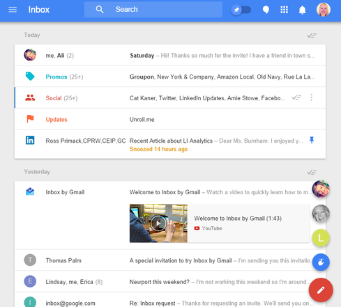{width=28%}

{width=24%}

```
http://www.miweb.com/users/34
```

**{** 

  **"name": "Pepe",**

  **"surname": "López",**

  **"age": 45,**

  **"email": "pepe@miweb.com",**

  **"friends": \[ "María", "Juan" \]**

**}**

---

- Además de un **navegador web**, otros tipos de aplicaciones támbién usan las **APIs REST**
  - **Otros clientes:** Apps móviles, TVs, consolas…
    - Ejemplo: La aplicación de **Google Maps** para Android es un cliente de la misma **API REST** de la web SPA

{width=17%}

{width=24%}

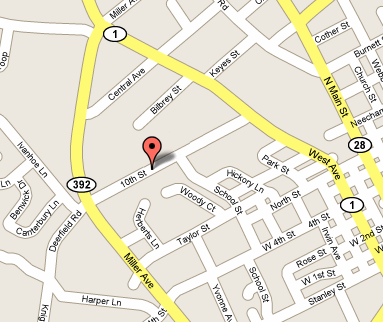{width=14%}

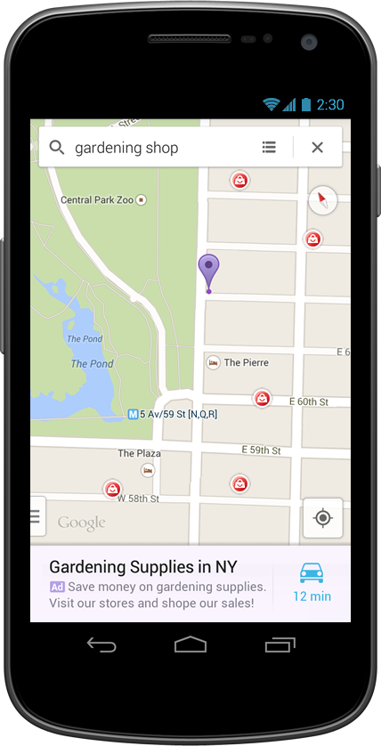{width=12%}

API REST

Google Maps

---

- Además de un **navegador web**, otros tipos de aplicaciones támbién usan las **APIs REST**
  - **Otros servidores:** El backend de una aplicación web puede usar APIs REST además de sus bases de datos para ofrecer sus servicios
    - Ejemplo: El Aula Virtual de la URJC podría usar la API REST de Google Calendar para publicar eventos

{width=15%}

{width=15%}

{width=14%}

API REST

Google  
Calendar

Aula Virtual URJC

## APIs REST

- Una API REST es un tipo de servicio web que se basa en los **elementos del protocolo http**
- REST es acrónimo de **REpresentational State Transfer**, Transferencia de Estado Representacional.
- El término se acuñó en el año 2000, en la tesis doctoral de **Roy Fielding**, uno de los principales autores de la especificación del protocolo **HTTP**

[https://www.ics.uci.edu/~fielding/pubs/dissertation/top.htm](https://www.ics.uci.edu/~fielding/pubs/dissertation/top.htm) 

---

- **REST vs SOAP (****Simple Object Access Protocol)**
  - SOAP es otro protocolo para implementar servicios web
  - Usa http como transporte, pero no aprovecha muchas de sus características como hace REST
  - Es más complejo de implementar que REST (clientes y servidores)
  - Se usaba antes de que se popularizaran las APIs REST

[https://en.wikipedia.org/wiki/SOAP](https://en.wikipedia.org/wiki/SOAP) 

## Características de una API REST

- Existen **muchas formas** de implementar un protocolo sobre http
- Hay enfoques **más** **puristas** y otros **más** **prácticos**
- A lo largo de los años se han ido definiendo un **conjunto de buenas prácticas**
- Existen aspectos bastante **consensuados** y otros en los que se admiten **diversas variantes**

---

- Estudiaremos las **buenas prácticas básicas** más usadas en la actualidad

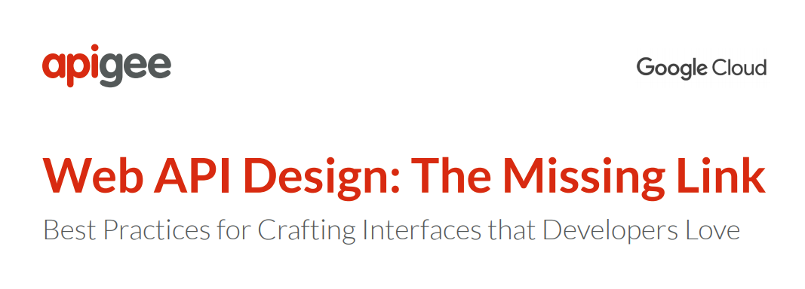{width=76%}

https://cloud.google.com/files/apigee/apigee-web-api-design-the-missing-link-ebook.pdf

[https://www.vinaysahni.com/best-practices-for-a-pragmatic-restful-api](https://www.vinaysahni.com/best-practices-for-a-pragmatic-restful-api) 

---

- Niveles de cumplimiento de los principios REST

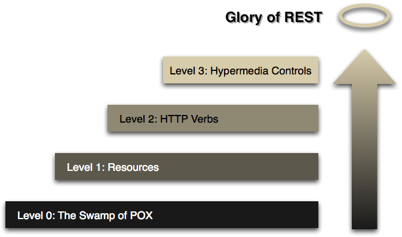{width=81%}

[http://martinfowler.com/articles/richardsonMaturityModel.html](http://martinfowler.com/articles/richardsonMaturityModel.html) 

---

- Una **API** **REST** es un servicio de red que ofrece operaciones **CRUD** **(creación, lectura, actualización y borrado)** sobre recursos (items de información)
- Se aprovecha de todos los aspectos del **protocolo http:** URL, métodos, códigos de estado, cabeceras...
- Los recursos se **representan** en un formato estructurado (campos), habitualmente **JSON** (aunque puede ser XML, Protocol Buffers, …)

---

- Estudiaremos el **nivel 2** de API REST (el más extendido):
  - La **URI** referencia a uno o más recursos
  - Las **operaciones** que se quieren realizar con ese recurso son los **métodos del protocolo HTTP**
  - Se usan los códigos de **estado http** para notificar errores (p.e. 404 Not found)
  - Los recursos se **representan** en JSON, un **formato estructurado**

---

- **La URI referencia a uno o más recursos**
  - Deben seguir un **formato** muy concreto
  - Parte de la URL indentifica el **tipo de recurso** (en plural) y otra parte es el **identificador** del recurso concreto
  - Ejemplos:
    - https://server/posts/vendo-moto-23-10-2014
    - https://server/cars/fpx-4567-x
    - http://server/posts/453
    - http://server/users/bob

---

- **La URI referencia a uno o más recursos**
  - Cuando un recurso está asociado a otro recurso se pueden poner ambos en la URL  
  - Ejemplos:
    - http://server/users/bob/posts/comparto-piso 
    - http://server/users/bob/posts/44 
    - http://server/posts/542/comments/74   
http://server/sessions/563664/streams/AVXX

---

- **La URI referencia a uno o más recursos**
  - A veces las URLs hacen referencia a varios recursos  
  - Los parámetros de la URL se pueden usar para filtrar el conjunto total
  - Ejemplos:
    - http://server/users/  
http://server/users/?active=true  
http://server/users/bob/posts/?visibility=public
    - http://server/posts/542/comments/  
http://server/sessions/563664/streams/

---

- **La URI referencia a uno o más recursos**
  - La URI está formada por nombres, no verbos
  - Ejemplos:
    - http://server/create/user/
    - http://server/deleteUser/345
    - http://server/addNewPost
    - http://server/startRecording
    - http://server/stopRecording

**URLs NO adecuadas para una API REST**

---

- **Las operaciones se codifican como métodos http**
  - **GET:** Devuelve el recurso (o recursos) identificado en la URI
  - **DELETE:** Borra el recurso identificado en la URI
  - **POST:** Añade un nuevo recurso. El recurso se envía en el cuerpo de la petición
  - **PUT:** Reemplaza el recurso identificado en la URI. El nuevo recurso se envía en el cuerpo de la petición
  - **PATCH:** Actualizar el recurso identificado en la URI. Los cambios se envían en el cuerpo de la petición
  - Existen más...

---

- **Se usan los códigos de estado http para notificar el resultado de la operación:**
  - **100-199:** No están definidos. Describen fases de ejecución de la petición.
  - **200-299:** La petición fue procesada correctamente.
  - **300-399:** El cliente debe hacer acciones adicionales para completar la petición, por ejemplo, una redirección a otra página.
  - **400-499:** Se usa en casos en los que el cliente ha realizado la petición incorrectamente (404 No existe).
  - **500-599:** Se usa cuando se produce un error procesando la petición.

[https://github.com/for-GET/http-decision-diagram](https://github.com/for-GET/http-decision-diagram) 

---

{width=13%}

- **Los recursos se representan en JSON**

::: {.desde-nivel-2}
- Acrónimo de **JavaScript Object Notation**
- Es fácil de mapear a objetos en memoria
- Representa **objetos del dominio** del servicio
:::

```json
{
    "id": 147633,
    "name": "John Ronald Reuel Tolkien",
    "enabled": true,
    "books": [
        {"title": "El Silmarillion", "year": 1936 },
        {"title": "El hobbit", "year": 1932 },
        {"title": "El Señor de los Anillos", "year": 1954}
    ]
}
```

[http://www.json.org/](http://www.json.org/)

---

- **Los recursos se representan en JSON**
  - Petición: 
    - **URL:** http://server/bookmarks/6
    - **Método:** GET
  - Respuesta:
    - **Header:** content-Type:application/json
    - **Body:**

```json
{ 
  "id":6, 
  "uri": "http://bookmark.com/web",   
  "description": "A description" 
}
```

---

- **Los recursos se representan en JSON**
  - Se pueden usar otros formatos, pero son menos comunes

\<author\>

    \<id\>147633\</id\>

    \<name\>John Ronald Reuel Tolkien\</name\>

    \<enabled\>true\</enabled\>

    \<books\>

        \<book\>

             \<title\>"El Silmarillion"\</title\>

             \<year\>1936\</year\>

        \</book\>

        \<book\>

             \<title\>"El hobbit"\</title\>

             \<year\>1932\</year\>

        \</book\>

        \<book\>

             \<title\>"El Señor de los Anillos"\</title\>

             \<year\>1954\</year\>

        \</book\>

    \</books\>

\</author\>

{width=28%}

[https://www.w3.org/XML/](https://www.w3.org/XML/)

{width=30%}

[https://developers.google.com/protocol-buffers/](https://developers.google.com/protocol-buffers/)

# Clientes de APIs REST

## Clientes de APIs REST

- Las APIs REST están diseñadas para ser utilizadas por **aplicaciones** (no por humanos)
- Todos los **lenguajes de programación** disponen de librerías para uso de APIs REST (**JavaScript**, Java...)
- Como desarrolladores podemos usar **herramientas interactivas** para hacer pruebas (hacer peticiones y ver las respuestas)

---

- Vamos a familiarizarnos con las herramientas interactivas de acceso a APIs REST
- Haremos una petición GET a una API REST pública y analizaremos la información obtenida
- Usaremos la API REST de libros de Google Play
  - Documentación de la API REST
    - https://developers.google.com/books/docs/v1/using

```
https://www.googleapis.com/books/v1/volumes?q=intitle:javascript
```

---

- **Cliente JavaScript**
  - Las aplicaciones web con **AJAX** o con arquitectura **SPA,** implementadas con **JavaScript**, usan servicios **REST** desde el **navegador**
  - Se pueden usar APIs REST usando la **API estándar** del browser o **librerías externas (jQuery)**

---

**front-ejem1**

- **Cliente JavaScript: jQuery**
  - Muestra en la consola el resultado de la API REST

```
script.js
```

$(document).ready(function(){

  $.ajax({

    url:"https://www.googleapis.com/books/v1/volumes?q=intitle:java"

  }).done(function(data) {

    console.log(data);

  });

});

[http://api.jquery.com/jquery.ajax/](http://api.jquery.com/jquery.ajax/) 

---

**front-ejem1**

- **Cliente JavaScript: jQuery**

```html
<!DOCTYPE html>
<html>
  <head>
    <script src="https://code.jquery.com/jquery-3.5.1.min.js">
    </script>
    <script src="script.js"></script>
  </head>
  <body>    
  </body>
</html>
```

---

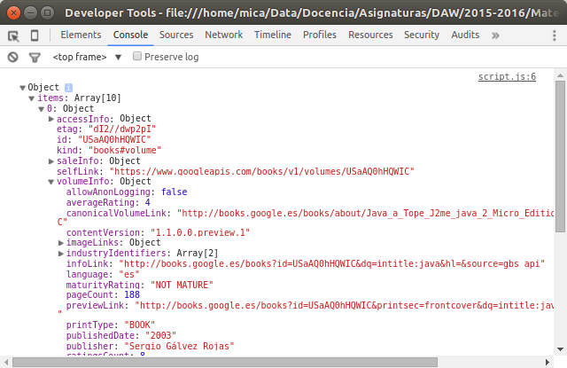{width=84%}

---

**front-ejem2**

- **Cliente JavaScript: jQuery**
  - Muestra en la página los títulos de los libros

```
script.js
```

$(document).ready(function(){

  $.ajax({

    url:"https://www.googleapis.com/books/v1/volumes?q=intitle:java"

  }).done(function(data) {

    for(var i=0; i\<data.items.length; i++){

      $("body").append(

        "\<p\>"+data.items\[i\].volumeInfo.title+"\</p\>");

    }

  });

});

[http://api.jquery.com/jquery.ajax/](http://api.jquery.com/jquery.ajax/) 

---

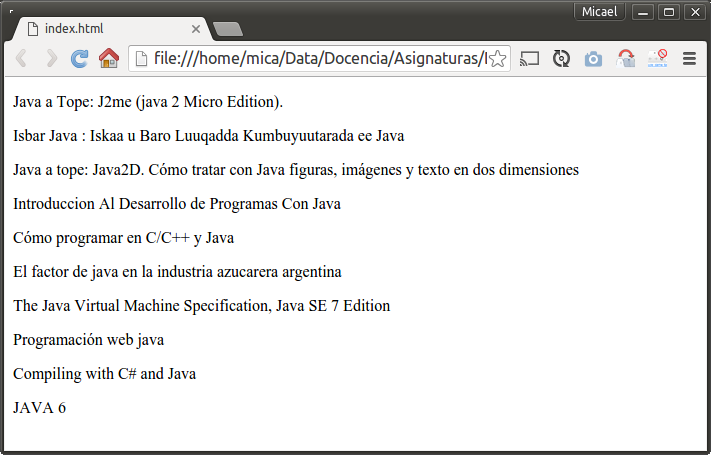{width=85%}

---

- **Herramientas interactivas**
  - El navegador web es una herramienta básica que se puede usar para hacer peticiones GET a APIs REST

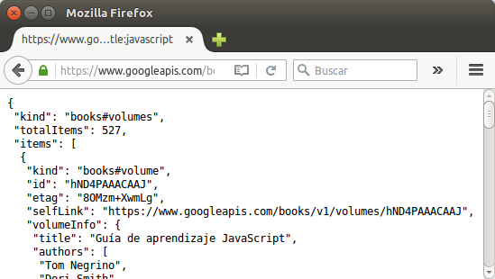{width=57%}

---

- **Herramientas interactivas**
  - Tipos
    - Integradas en el entorno de desarrollo
    - Extensiones del navegador
  - Permiten
    - Realizar peticiones REST con cualquier método (GET, POST, PUT…)
    - Especificar URL, cabeceras (headers)…
    - Analizar la respuesta: Cuerpo, status http...

---

- **Postman - REST Client** 

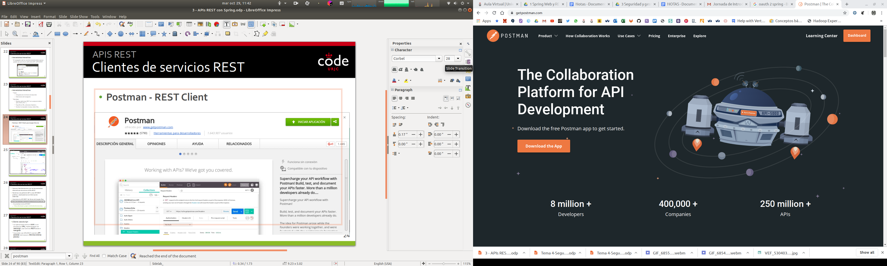{width=91%}

[https://www.getpostman.com/](https://www.getpostman.com/) 

---

APIs REST

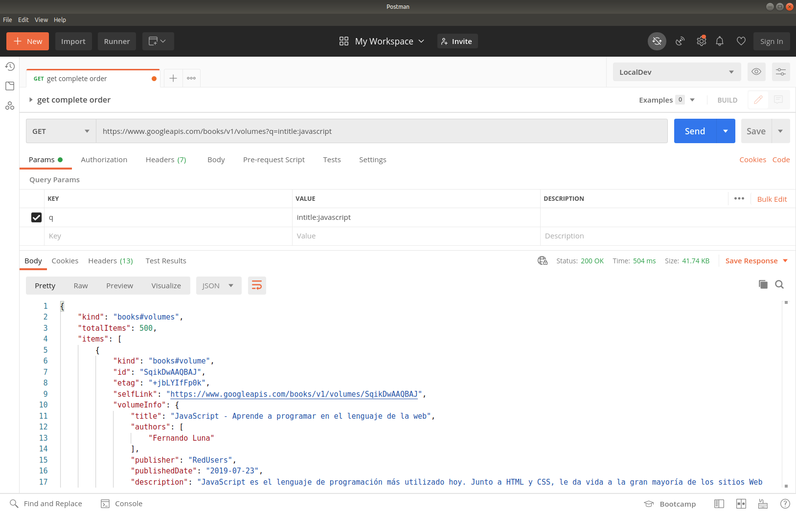{width=100%}

---

::: {.etiqueta-ejemplo}
ejem1
:::

- **API REST Posts**
  - Ofrece de operaciones de consulta, creacion, modificación y borrado
  - Las propiedades de un post son: user, title y text
  - La API rest está implementada en el proyecto **ejem1**

{width=93%}

[https://github.com/codeurjc/dad/tree/main/parte_2/tema_2.3_rest/rest\_ejem1](https://github.com/codeurjc/dad/tree/main/parte_2/tema_2.3_rest/rest_ejem1)

---

::: {.etiqueta-ejemplo}
ejem1
:::

- **API REST Posts**
  - Consulta de posts
    - Method: GET
    - URL: http://127.0.0.1:8080/posts/
    - Result:
    - Status code: 200 (OK)

\[

  { "id": 0, "user": "Pepe", "title": "Vendo moto", "text": "Barata, barata"},

  { "id": 1, "user": "Juan", "title": "Compro coche", "text": "Pago bien"}

\]

---

::: {.etiqueta-ejemplo}
ejem1
:::

- **GET /posts/**

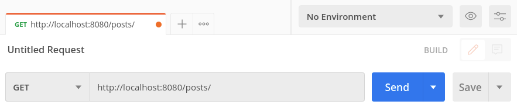{width=80%}

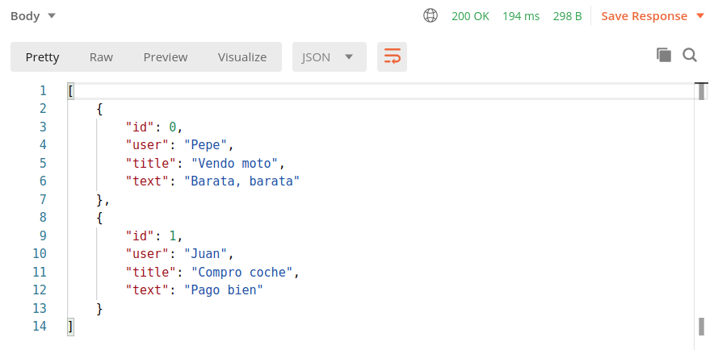{width=58%}

Status de la petición 

---

::: {.etiqueta-ejemplo}
ejem1
:::

- **API REST Posts**
  - Consulta de un post concreto
    - Method: GET
    - URL: http://127.0.0.1:8080/posts/1
    - Result:
    - Status code: 200 (OK)

```json
{ "id": 1, "user": "Pepe", "title": "Vendo moto", "text": "Barata, barata"}
```

---

::: {.etiqueta-ejemplo}
ejem1
:::

- **API REST Posts**
  - Creación de un post
    - Method: POST
    - URL: http://127.0.0.1:8080/posts/
    - Headers: Content-Type: application/json
    - Body:
    - Result:
    - Status code: 201 (Created)
    - Headers: Location: http://127.0.0.1:8080/posts/2

```json
{ "user": "Alberto", "title": "Cambio bici", "text": "MTB por carretera"}
```

```json
{"id":2, "user": "Alberto", "title": "Cambio bici", "text": "MTB por carretera"}
```

---

::: {.etiqueta-ejemplo}
ejem1
:::

Para POST y PUT es necesario especificar que el cuerpo (**body**) es de tipo **raw** y en concreto, **JSON**

- **POST /posts/**

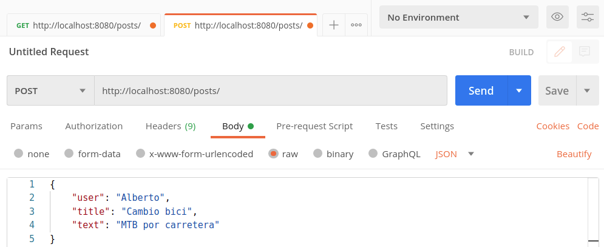{width=65%}

Es status code es **201**

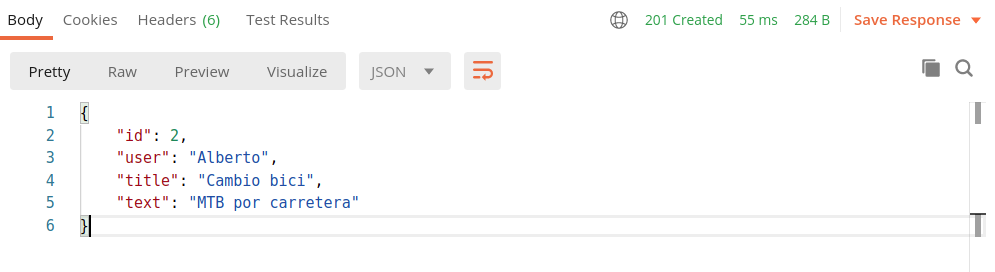{width=65%}

---

::: {.etiqueta-ejemplo}
ejem1
:::

- **API REST Posts**
  - Reemplazo de posts
    - Method: PUT
    - URL: http://127.0.0.1:8080/posts/0
    - Headers: Content-Type: application/json
    - Body: 
    - Result:
    - Status code: 200 (OK)

```json
{ "id": 0, "user": "Pepe", "title": "Vendo moto", "text": "Regalada"}
```

```json
{ "id": 0, "user": "Pepe", "title": "Vendo moto", "text": "Regalada"}
```

---

::: {.etiqueta-ejemplo}
ejem1
:::

- **API REST Posts**
  - Borrado de posts
    - Method: DELETE
    - URL: http://127.0.0.1:8080/posts/1
    - Result:
    - Status code: 200 (OK)

```json
{ "id": 0, "user": "Pepe", "title": "Vendo moto", "text": "Regalada"}
```

[https://stackoverflow.com/questions/6439416/deleting-a-resource-using-http-delete](https://stackoverflow.com/questions/6439416/deleting-a-resource-using-http-delete) 

# APIs REST con Spring

## APIs REST con Spring

- Para implementar una **API REST** con **Spring** se puede usar:
  - **JAX-RS**
    - Estandar Java Enterprise Edition
    - Java API for RESTful Web Services
    - [https://jersey.java.net/](https://jersey.java.net/)
  - **Spring MVC**
    - Framework Spring (no estandar)
    - Mismo sistema usado para generar páginas web

---

- **Spring MVC** es una parte de Spring para la construcción de aplicaciones web  
- Sigue la arquitectura **MVC (****Model View Controller****)**
- **Permite estructurar la aplicación en:**
  - **Model:** Modelos de datos (objetos Java)
  - **View:** 
    - **Web**: Plantilla que genera la página HTML. 
    - **REST**: Conversión del modelo a JSON (automático)
  - **Controller:** Controlador que atiende las peticiones HTTP que llegan del navegador

---

::: {.etiqueta-ejemplo}
ejem1
:::

- **Ciclo de vida completa de un recurso** 
  - **Endpoints REST**
    - Creación: POST
    - Consulta un recurso: GET
    - Consulta de varios recursos: GET
    - Borrado: DELETE
    - Actualización: PUT
  - **Gestión de recursos**
    - PostService: Mapa en memoria indexado por id

---

::: {.etiqueta-ejemplo}
ejem1
:::

- **Aplicación principal**
  - La aplicación se ejecuta como una **app Java normal**
  - Botón derecho proyecto  \> Run as… \> Java Application…

```java
@SpringBootApplication
public class Application {
    public static void main(String[] args) {
        SpringApplication.run(Application.class, args);
    }
}
```

## Spring REST

```xml
<?xml version="1.0" encoding="UTF-8"?>
<project xmlns="http://maven.apache.org/POM/4.0.0" xmlns:xsi="http://www.w3.org/2001/XMLSchema-instance"
	xsi:schemaLocation="http://maven.apache.org/POM/4.0.0 http://maven.apache.org/xsd/maven-4.0.0.xsd">
	<modelVersion>4.0.0</modelVersion>
	<groupId>es.codeurjc</groupId>
	<artifactId>rest_ejer1</artifactId>
	<version>0.0.1-SNAPSHOT</version>
	<packaging>jar</packaging>
	<parent>
		<groupId>org.springframework.boot</groupId>
		<artifactId>spring-boot-starter-parent</artifactId>
		<version>2.4.0</version>
		<relativePath/>
	</parent>
	<properties>
		<project.build.sourceEncoding>UTF-8</project.build.sourceEncoding>
		<java.version>11</java.version>
	</properties>
	<dependencies>
		<dependency>
			<groupId>org.springframework.boot</groupId>
			<artifactId>spring-boot-starter-web</artifactId>
		</dependency>		
	</dependencies>
</project>
```

- **pom.xml**

Proyecto **padre** para aplicaciones **SpringBoot**

**Dependencias** necesarias para implementar aplicaciones web **Spring MVC** y **SpringBoot**

::: {.enlace-repo}
[`rest_ejer1`](https://github.com/codeurjc/dad/tree/main/parte_2/tema_2.3_rest/rest_ejer1)
:::

## APIs REST con Spring

::: {.etiqueta-ejemplo}
ejem1
:::

::: {.columns}
::: {.column width="36%"}
- **Estructura de la aplicación**
:::
::: {.column width="64%"}
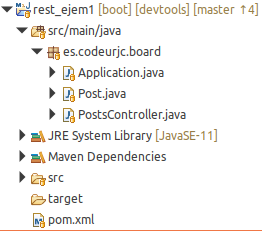{width=77%}
:::
:::

---

::: {.etiqueta-ejemplo}
ejem1
:::

- **Devolver un recurso concreto (GET)**
  - Con **@GetMapping** se indica que el método atiende peticiones **GET**
  - Se devuelve un array con todos los recursos
  - Si no hay recursos, el array se devuelve vacío

---

::: {.etiqueta-ejemplo}
ejem1
:::

- **Devolver todos los recursos (GET)**

@RestController

public class PostController {

  @Autowired

  private PostService posts;

  @GetMapping("/posts/")

  public Collection\<Post\> getPosts() {

    return posts.findAll();

  }

  ...

}

---

::: {.etiqueta-ejemplo}
ejem1
:::

- **Devolver un recurso concreto (GET)**
  - Con **@GetMapping** se indica que el método atiende peticiones **GET**
  - El id del recurso se condifica en la URL y se accede a él usando un **@PathVariable**
  - Si el recurso existe se devuelve, y si no, se devuelve **404 NOT FOUND**. Por eso el método devuelve un **ResponseEntity**

---

::: {.etiqueta-ejemplo}
ejem1
:::

- **Devolver un recurso concreto (GET)**

```{.java data-lineas="1,2,5,7"}
@GetMapping("/posts/{id}")
public ResponseEntity<Post> getPost(@PathVariable long id) {
	Post post = posts.findById(id);
	if (post != null) {
		return ResponseEntity.ok(post);
	} else {
		return ResponseEntity.notFound().build();
	}
}
```

::: {.nota-codigo}
El id está en la **URL** y se accede con **@PathVariable**
:::

::: {.nota-codigo}
Se devuelve el **objeto** o **NOT FOUND**
:::

---

::: {.etiqueta-ejemplo}
ejem1
:::

- **Nuevo recurso (POST)**
  - Con **@PostMapping** se indica que el método atiende peticiones **POST**
  - El cuerpo de la petición se obtiene con un parámetro anotado con **@RequestBody**
  - Se **devuelve el nuevo objeto** al cliente (con un id)

---

::: {.etiqueta-ejemplo}
ejem1
:::

- **Nuevo recurso (POST)**

```{.java data-lineas="4-6"}
@PostMapping("/posts/")
public ResponseEntity<Post> createPost(@RequestBody Post post) {
  posts.save(post);
  URI location = fromCurrentRequest().path("/{id}")
     .buildAndExpand(post.getId()).toUri();
  return ResponseEntity.created(location).body(post);
}
```

::: {.nota-codigo}
Se define la cabecera **Location**
:::

---

::: {.etiqueta-ejemplo}
ejem1
:::

- **Borrar un recurso (DELETE)**
  - Con **@DeleteMapping** se indica que el método atiende peticiones **DELETE**
  - El id del recurso se codifica en la URL y se accede a él usando un **@PathVariable**
  - Si el recurso existe se borra y opcionalmente se devuelve
  - Si no existe, se devuelve **404 NOT FOUND**. Por eso el método devuelve un **ResponseEntity**

---

::: {.etiqueta-ejemplo}
ejem1
:::

- **Borrar un recurso (DELETE)**

```java
@DeleteMapping("/posts/{id}")
public ResponseEntity<Post> deletePost(@PathVariable long id) {
	Post post = posts.findById(id);
	if (post != null) {
		posts.deleteById(id);
		return ResponseEntity.ok(post);
	} else {
		return ResponseEntity.notFound().build();
	}
}
```

---

::: {.etiqueta-ejemplo}
ejem1
:::

- **Reemplazar un recurso (PUT)**
  - Con **@PutMapping** se indica que el método atiende peticiones **PUT**
  - El id del recurso se condifica en la URL y se accede a él usando un **@PathVariable**
  - El nuevo anuncio se envía en el body y se accede con **@RequestBody**
  - Si el recurso existe se actualiza y se devuelve de nuevo
  - Si no existe, se devuelve **404 NOT FOUND**. Por eso el método devuelve un **ResponseEntity**

---

::: {.etiqueta-ejemplo}
ejem1
:::

- **Reemplazar un recurso (PUT)**

```{.java data-lineas="6"}
@PutMapping("/posts/{id}")
public ResponseEntity<Post> replacePost(@PathVariable long id, 	
	@RequestBody Post newPost) {
	Post post = posts.findById(id);
	if (post != null) {
		newPost.setId(id);
		posts.save(newPost);
		return ResponseEntity.ok(post);
	} else {
		return ResponseEntity.notFound().build();
	}
}
```

::: {.nota-codigo}
En caso de discrepancia prevalece el id de la URL
:::

---

::: {.etiqueta-ejemplo}
ejem2
:::

- **Factorizar URL mapping en el controller**
  - Cuando **todas las URLs** de un controlador empiezan de forma **similar**, se puede poner la anotación **@RequestMapping** a nivel de **clase** con la parte común
  - Cada **método** sólo tiene que incluir la **parte propia** (si existe)

---

::: {.etiqueta-ejemplo}
ejem2
:::

- **Factorizar URL mapping en el controller**

```java
@RestController
@RequestMapping("/posts")
public class PostController {
  @GetMapping("/")
  public Collection<Post> getPosts() {...}
  @GetMapping("/{id}")
  public ResponseEntity<Post> getPost(@PathVariable long id) {...}
  @PostMapping("/")
  public ResponseEntity<Post> createPost(@RequestBody Post post) {...}
  @PutMapping("/{id}")
  public ResponseEntity<Post> replacePost(@PathVariable long id, @RequestBody Post newPost) {...}
  @DeleteMapping("/{id}")
  public ResponseEntity<Post> deletePost(@PathVariable long id) {…}
}
```

---

- **Acceso a los parámetros de la URL** 
  - Filtros, definición de propiedades, términos de búsqueda, etc.. 
    - http://portal.com/anuncios?poblacion=Madrid

@GetMapping("/anuncios")

**public** List\<Anuncio\> anuncios(@RequestParam String poblacion) {

  **...**

}

## Ejercicio 1

- Implementa una **API REST** en el servidor para gestionar **Items**
- Los items se gestionarán en **memoria** (como en el ejemplo de los posts)

---

- **API REST Items**
  - Consulta de items
    - Method: GET
    - URL: http://127.0.0.1:8080/items/
    - Result:
    - Status code: 200 (OK)

\[

  { "id": 1, "description": "Leche", "checked": false },

  { "id": 2, "description": "Pan", "checked": true }

\]

---

- **API REST Items**
  - Consulta de un item concreto
    - Method: GET
    - URL: http://127.0.0.1:8080/items/1
    - Result:
    - Status code: 200 (OK)

```json
{ "id": 1, "description": "Leche", "checked": false }
```

---

- **API REST Items**
  - Creación de un item
    - Method: POST
    - URL: http://127.0.0.1:8080/items/
    - Headers: Content-Type: application/json
    - Body: 
    - Result:
    - Status code: 201 (Created)
    - Header: Location=http://127.0.0.1:8080/items/2

```json
{ "description" : "Galletas", "checked": true }
```

```json
{ "id": 2, "description" : "Galletas", "checked": true }
```

---

- **API REST Items**
  - Reemplazo de un item
    - Method: PUT
    - URL: http://127.0.0.1:8080/items/1
    - Headers: Content-Type: application/json
    - Body: 
    - Result:
    - Status code: 200 (OK)

```json
{ "id": 1, "description" : "Leche", "checked": true }
```

```json
{ "id": 1, "description" : "Leche", "checked": true }
```

---

- **API REST Items**
  - Borrado de un item
    - Method: DELETE
    - URL: http://127.0.0.1:8080/items/1
    - Result:
    - Status code: 200 (OK)

```json
{ "id": 1, "description" : "Leche", "checked": true }
```

