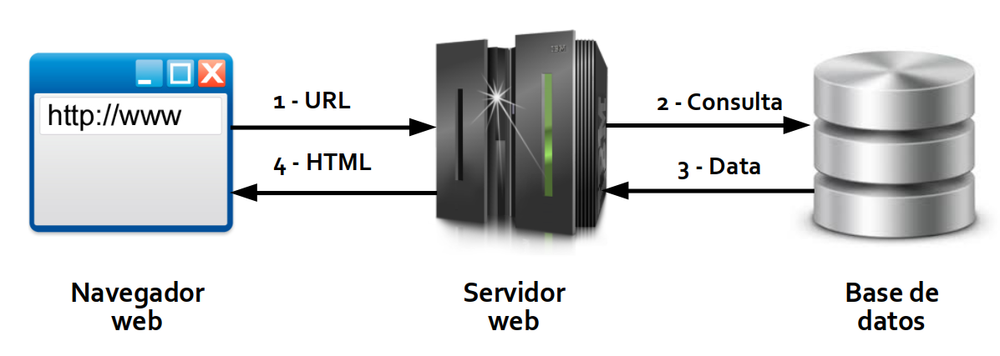
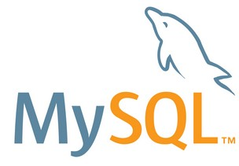
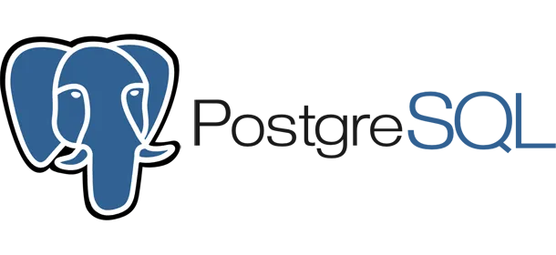
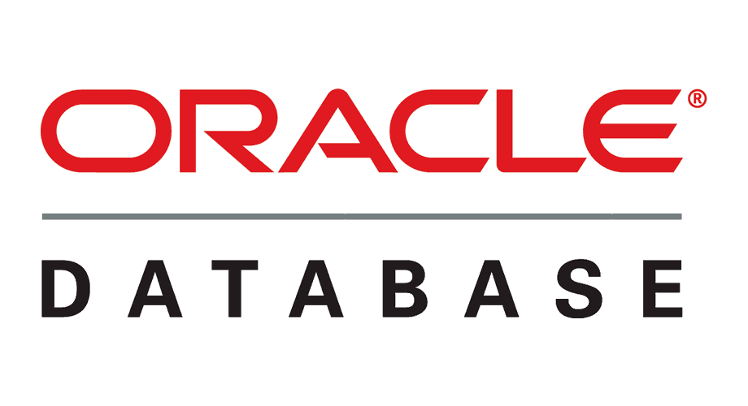
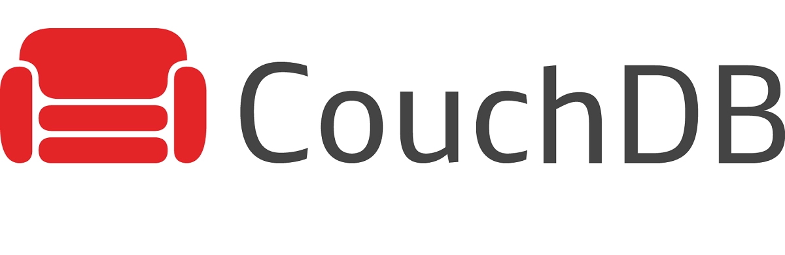
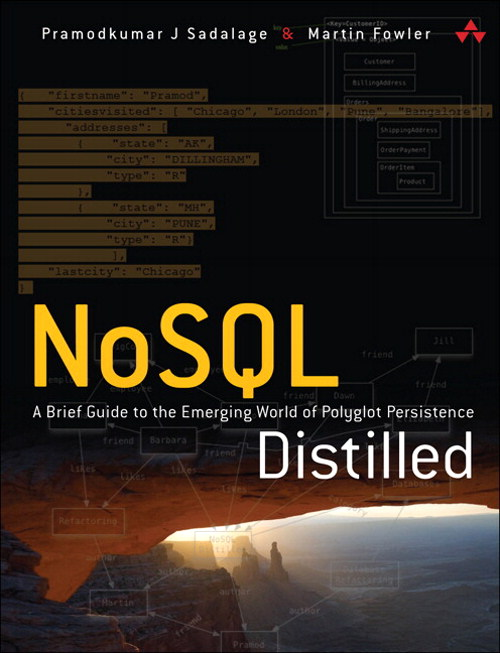

## Licencia {.nota-licencia visibility="uncounted"}

©2023  Micael Gallego, Francisco Gortázar, Michel Maes, Óscar Soto, Iván Chicano Algunos derechos reservados Este documento se distribuye bajo la licencia “Atribución-CompartirIgual 4.0 Internacional”  de Creative Comons Disponible en [https://creativecommons.org/licenses/by-sa/4.0/deed.es](https://creativecommons.org/licenses/by-sa/4.0/deed.es)

## Introducción a las bases de datos

- **Bases de datos (****Database systems****)**
  - Son programas utilizados para **almacenar (persistir)** información y permitir un acceso posterior a ella
  - Ofrecen mecanismos avanzados de **consultas** sobre la información
  - **Varios servicios y varios hilos** desde el mismo servicio pueden acceder a la base de datos forma **concurrente** sin interferencias entre ellos

---

- **Bases de datos (****Database systems****)**
  - La información está **centralizada**, **actualizada** y es más sencillo realizar **copias de seguridad**
  - La información puede estar en forma de texto, números, información binaria, XML, JSON, etc...

---

- Despliegue típico de una aplicación web con base de datos

{width=88%}

---

- **Tipos de bases de datos**
  - **Bases de datos relacionales:** Son bases de datos que estructuran la información en **tablas (relaciones)** y ofrecen el lenguaje de consulta SQL. 
  - **Bases de datos NoSQL:** Son bases de datos que no estructuran la información como las relacionales y están diseñadas para ofrecer una mejor escalabilidad.

## Bases de datos relacionales

- Una base de datos **relacional** almacena la información en tablas\* con filas y columnas (campo)

Tabla Autores

| idAutor | nombre | nacionalidad |
|---|---|---|
| 1 | Antonio | Español |
| 2 | Gerard | Frances |

Tabla Libros

| idLibro | titulo | precio |
|---|---|---|
| 1 | Bambi | 3 |
| 2 | Batman | 4 |
| 3 | Spiderman | 2 |

Tabla RelacionLibroAutor

| idLibro | idAutor |
|---|---|
| 1 | 1 |
| 2 | 2 |
| 3 | 2 |

\* A las tablas se las denominaba “relaciones”, de ahí el nombre de base de datos relacional

---

- Una base de datos **relacional** almacena la información en tablas\* con filas y columnas (campo)

Tabla Autores

::: {.columns}
::: {.column width="52%"}
Tabla Libros

| idLibro | titulo | precio |
|---|---|---|
| 1 | Bambi | 3 |
| 2 | Batman | 4 |
| 3 | Spiderman | 2 |

La información se relaciona mediante identificadores (id)
:::
::: {.column width="48%"}
| idAutor | nombre | nacionalidad |
|---|---|---|
| 1 | Antonio | Español |
| 2 | Gerard | Frances |

Tabla RelacionLibroAutor

| idLibro | idAutor |
|---|---|
| 1 | 1 |
| 2 | 2 |
| 3 | 2 |
:::
:::

---

- **SQL (****Standard Query Language****):** Lenguaje de consulta estándar que permite:
  - Consulta de los datos seleccionanos con diferentes criterios y realizando operaciones (medias, sumas,…)
  - Inserción, Actualización y borrado de la información
  - Creación, alteración y borrado de las tablas y sus campos
  - Gestión de usuarios y sus privilegios de acceso

**\<number\>**

## Sentencia SQL SELECT

- También conocido como **statement** **o** **query** (consulta) 
- Permite **recuperar** la información de una o varias tablas
- Especifica uno o más **campos**, una o más **tablas** y un **criterio** de selección
- La base de datos devuelve los campos indicados de aquellas **filas** que cumplan el **criterio** de selección

---

Situación en la 

base de datos

Consulta

```sql
SELECT titulo, precio 
FROM Libros 
WHERE precio > 2
```

Tabla Libros

| idLibro | titulo | precio |
|---|---|---|
| 1 | Bambi | 3 |
| 2 | Batman | 4 |
| 3 | Spiderman | 2 |

Conjunto de resultados (ResultSet)

| titulo | precio |
|---|---|
| Bambi | 3 |
| Batman | 4 |

## Cláusula WHERE

- Operador LIKE (Comparación de cadenas)

```sql
SELECT titulo, precio
FROM Libros
WHERE titulo LIKE 'Ba%'
```

- Operadores relacionales (\<,=,…) lógicos (AND, OR)

```sql
SELECT titulo, precio 
FROM Libros 
WHERE precio > 3 AND titulo LIKE '%Man'
```

## Uniones (JOINs)

- Se pueden unir varias tablas en una consulta

Tabla Autores

::: {.columns}
::: {.column width="52%"}
Tabla Libros

| idLibro | titulo | precio |
|---|---|---|
| 1 | Bambi | 3 |
| 2 | Batman | 4 |
| 3 | Spiderman | 2 |
:::
::: {.column width="48%"}
| idAutor | nombre | nacionalidad |
|---|---|---|
| 1 | Antonio | Español |
| 2 | Gerard | Frances |

Tabla RelacionLibroAutor

| idLibro | idAutor |
|---|---|
| 1 | 1 |
| 2 | 2 |
| 3 | 2 |
:::
:::

---

- Se pueden unir varias tablas en una consulta

Tabla Autores

::: {.columns}
::: {.column width="52%"}
Tabla Libros

| idLibro | titulo | precio |
|---|---|---|
| 1 | Bambi | 3 |
| 2 | Batman | 4 |
| 3 | Spiderman | 2 |
:::
::: {.column width="48%"}
| idAutor | nombre | nacionalidad |
|---|---|---|
| 1 | Antonio | Español |
| 2 | Gerard | Frances |

Tabla RelacionLibroAutor

| idLibro | idAutor |
|---|---|
| 1 | 1 |
| 2 | 2 |
| 3 | 2 |
:::
:::

---

```sql
SELECT titulo, precio, nombre 
FROM Libros, Autores, RelacionLibroAutor
WHERE Libros.idLibro = RelacionLibroAutor.idLibro
   AND Autores.idAutor = RelacionLibroAutor.idAutor
```

| titulo | precio | nombre |
|---|---|---|
| Bambi | 3 | Antonio |
| Batman | 4 | Gerard |
| Spiderman | 2 | Gerard |

## Bases de datos relacionales

::: {.columns}
::: {.column width="33%"}
{width=67%}
:::
::: {.column width="67%"}
{width=59%}

{width=28%}
:::
:::

::: {.columns}
::: {.column width="53%"}
{width=77%}
:::
::: {.column width="47%"}
{width=61%}
:::
:::

## MySQL

{width=24%}

- [http://www.mysql.org/](http://www.mysql.org/)
- Sistema gestor de base de datos multiplataforma
- Licencia código abierto GPL
- Soporte de un subconjunto de SQL 99
- Herramienta interactiva para hacer consultas y crear bases de datos
- Desarrollado por 

{width=44%}

## H2 Database

{width=29%}

- [http://www.h2database.com/](http://db.apache.org/derby) 
- Sistema gestor de base de datos multiplataforma
- Implementado en **Java**
- Licencia **código abierto** MPL 2.0 y EPL 1.0
- Soporte de un subconjunto de SQL 99 y 2003
- Se puede usar **en memoria**, ideal para desarrollo y testing
- Ofrece un cliente web cuando se usa en una aplicación Spring

## Bases de datos NoSQL

- Las bases de datos NoSQL son bases de datos con **modelos de datos** **diferentes al relacional**
- **NoSQL** es un término que referencia a esta diferencia con las BBDD relacionales, pero no hay una definición formal
- Actualmente se entiende NoSQL como **“Not Only SQL”**

---

- **Características comunes**
  - Ofrecen lenguajes de consulta, pero la mayoría no tiene la potencia de relacionar datos de SQL
  - Son escalables horizontalmente (clusterización)
  - Están pensadas para las necesidades de las aplicaciones web actuales
  - La mayoría no tienen esquema de datos. La estructura de los datos se define en cada inserción
  - La mayoría son open-source

---

- **¿Por qué existen las bases de datos NoSQL?**
  - Las bases de datos **relacionales** son mucho más difíciles de escalar porque cuando se **clusterizan** tienen muchas **limitaciones**
  - Algunos lenguajes requieren otros tipos de datos en vez de los usados en las BBDD relacionales (**impedance mismatch**)
  - La necesidad de **crear un esquema antes de guardar datos** dificulta el desarrollo

---

::: {.columns}
::: {.column width="54%"}
{width=84%}
:::
::: {.column width="46%"}
{width=89%}
:::
:::

::: {.columns}
::: {.column width="49%"}
{width=74%}
:::
::: {.column width="51%"}
{width=90%}
:::
:::

{width=42%}

{width=24%}

---

- **Persistencia políglota (****Polyglot persistence**)
  - Hay que **decidir** la base de datos a utilizar en cada aplicación
  - Diferentes aplicaciones tienen **diferentes necesidades**
  - Hay aplicaciones que pueden tener varias bases de datos a la misma vez
    - **Redis** para sesiones o colas de mensajes
    - **ElasticSearch** para logs
    - **MongoDB** para documentos

---

::: {.columns}
::: {.column width="48%"}
{width=65%}
:::
::: {.column width="52%"}
**NoSQL Distilled**

Pramod J. Sadalage & Martin Fowler

Addison-Wesley
:::
:::

