## Licencia {.nota-licencia visibility="uncounted"}

©2023  Micael Gallego, Francisco Gortázar, Michel Maes, Óscar Soto, Iván Chicano Algunos derechos reservados Este documento se distribuye bajo la licencia “Atribución-CompartirIgual 4.0 Internacional”  de Creative Comons Disponible en [https://creativecommons.org/licenses/by-sa/4.0/deed.es](https://creativecommons.org/licenses/by-sa/4.0/deed.es)

# Bases de datos SQL en Spring

## Bases de datos SQL en Spring

- El proyecto **Spring Data** ofrece mecanismos para el acceso a **Bases de datos relacionales** **y no relacionales**
  - **Creación del esquema** partiendo de las clases del código Java (o viceversa)
  - **Conversión automática** entre objetos Java y el formato propio de la base de datos
  - **Creación de consultas** en base a métodos en interfaces

[http://projects.spring.io/spring-data/](http://projects.spring.io/spring-data/)

[http://projects.spring.io/spring-data-jpa/](http://projects.spring.io/spring-data-jpa/)  

---

::: {.etiqueta-ejemplo}
ejem1
:::

- **Objeto de la base de datos (entidad)**

Anotaciones usadas para generar el esquema y para hacer la conversión entre objetos y filas

```java
@Entity
public class Customer {
  @Id
  @GeneratedValue(strategy = GenerationType.AUTO)
  private long id;
  private String firstName;
  private String lastName;
  // Constructor necesario para la carga desde BBDD
  protected Customer() {}
  public Customer(String firstName, String lastName) {
    this.firstName = firstName;
    this.lastName = lastName;
  }
  // Getter, Setters and toString
  ...
}
```

El atributo anotado con **@Id** es la clave primaria de la tabla. Lo habitual es que se genere de forma automática

---

::: {.etiqueta-ejemplo}
ejem1
:::

- **Repositorio**

```{.java data-lineas="1"}
public interface CustomerRepository extends JpaRepository<Customer, Long> {
   List<Customer> findByLastName(String lastName);
   List<Customer> findByFirstName(String firstName);
}
```

::: {.nota-codigo}
El interfaz padre **JpaRepository** dispone de métodos para **consultar**, **guardar**, **borrar** y **modificar** objetos de la base de datos.
:::

::: {.nota-codigo}
Clase de la **entidad** y clase de su identificador (generalmente **Integer** o **Long**)
:::

::: {.nota-codigo}
Métodos que se traducen automáticamente en **consultas a la BBDD** en base al nombre y los parámetros.

Si no se necesita ningún tipo de consulta especial, el **interfaz puede quedar vacío**
:::

---

::: {.etiqueta-ejemplo}
ejem1
:::

- **Uso de la base de datos**
  - Un componente **inyecta el repositorio** con @Autowired
  - Métodos disponibles:
    - Consultar todos (**findAll**)
    - Consulta por id (**findById**)
    - Guardar un nuevo objeto o actualizarlo (**save**)
    - Borrar un objeto (**delete**)
    - Consultas por cualquier criterio (métodos añadidos al interfaz)

---

::: {.etiqueta-ejemplo}
ejem1
:::

- **Uso de la BBDD**

```{.java data-lineas="2,6-13"}
@Controller
public class DataBaseUsage implements CommandLineRunner {
  @Autowired
  private CustomerRepository repository;
  @Override
  public void run(String... args) throws Exception {
     repository.save(new Customer("Jack", "Bauer"));
     repository.save(new Customer("Chloe", "O'Brian"));
     List<Customer> bauers = repository.findByLastName("Bauer");
     for (Customer bauer : bauers) {
          System.out.println(bauer);
     }
     repository.delete(bauers.get(0));
  }
}
```

::: {.nota-codigo}
Controlador especial que se ejecuta cuando se **inicia la aplicación**.

Puede leer los parámetros de la **línea de comandos**
:::

::: {.nota-codigo}
Código de ejemplo que usa el **repositorio** para guardar, consultar y borrar datos de la **BBDD**
:::

---

::: {.etiqueta-ejemplo}
ejem1
:::

- **pom.xml**

```{.xml data-lineas="11-18"}
<groupId>es.codeurjc</groupId>
<artifactId>bbdd_ejem1</artifactId>
<version>0.1.0</version>
<parent>
  <groupId>org.springframework.boot</groupId>
  <artifactId>spring-boot-starter-parent</artifactId>
  <version>2.4.0</version>
</parent>
...
<dependencies>
  <dependency>
    <groupId>org.springframework.boot</groupId>
    <artifactId>spring-boot-starter-data-jpa</artifactId>
  </dependency>
 <dependency>
    <groupId>com.h2database</groupId>
    <artifactId>h2</artifactId>
  </dependency>
</dependencies>
```

::: {.nota-codigo}
Dependencia a la **BBDD en memoria** **H2**. En las bases de datos en memoria, el esquema se genera de forma **automática** al iniciar la app
:::

::: {.nota-codigo}
Dependencia a **Spring Data** para BBDD **relacionales**
:::

---

::: {.etiqueta-ejemplo}
ejem2
:::

- Una aplicación web puede gestionar la información en una BBDD
  - Se añaden las dependencias de JPA y la BBDD en el **pom.xml**
  - En vez de usar una estructura en memoria se usa un **repositorio**
- Como ejemplo vamos a transformar la API REST de gestión de posts

---

::: {.etiqueta-ejemplo}
ejem2
:::

- **pom.xml**

```{.default data-lineas="11-14"}
...
<dependencies>
  <dependency>
    <groupId>org.springframework.boot</groupId>
    <artifactId>spring-boot-starter-web</artifactId>
  </dependency>
  <dependency>
    <groupId>org.springframework.boot</groupId>
    <artifactId>spring-boot-starter-data-jpa</artifactId>
  </dependency>
  <dependency>
    <groupId>com.h2database</groupId>
    <artifactId>h2</artifactId>
  </dependency>
</dependencies>
```

Dependencias **Web**

::: {.nota-codigo}
Dependencia a la **BBDD H2**
:::

---

::: {.etiqueta-ejemplo}
ejem2
:::

- **Objeto de la base de datos (entidad)**

```java
@Entity
public class Post {
	@Id
	@GeneratedValue(strategy = GenerationType.AUTO)
	private Long id;
	private String username;
	private String title;
	private String text;
	public Post() { }
	public Post(String username, String title, String text) {
		super();
		this.username = username;
		this.title = title;
		this.text = text;
	}
}
```

---

::: {.etiqueta-ejemplo}
ejem2
:::

- **Repositorio**

Entidad

```{.java data-lineas="1"}
public interface PostRepository extends JpaRepository<Post, Long> {
}
```

::: {.nota-codigo}
No se necesitan consultas especiales
:::

::: {.nota-codigo}
Tipo del id de la entidad
:::

---

::: {.etiqueta-ejemplo}
ejem2
:::

- **Controlador REST**

```{.java data-lineas="4,5,8,9,13"}
@RestController
@RequestMapping("/posts")
public class PostController {
  @Autowired
  private PostRepository posts;
  @PostConstruct
  public void init() {
    posts.save(new Post("Pepe", "Vendo moto", "Barata, barata"));
    posts.save(new Post("Juan", "Compro coche", "Pago bien"));
  }
  @GetMapping("/")
  public Collection<Post> getPosts() {
    return posts.findAll();
  }
...
```

::: {.nota-codigo}
Se pueden inyectar tantos repositorios como sea necesario
:::

::: {.nota-codigo}
Un método **@PostConstruct** se ejecutará después de haber inyectado las dependencias
:::

::: {.nota-codigo}
Desde los métodos se usa el repositorio
:::

---

::: {.etiqueta-ejemplo}
ejem2
:::

- **Consulta de un recurso (GET)**
  - Gestión de Optional con findById

```java
@GetMapping("/{id}")
public ResponseEntity<Post> getPost(@PathVariable long id) {
  Optional<Post> post = posts.findById(id);
  if (post.isPresent()) {
    return ResponseEntity.ok(post.get());
  } else {
    return ResponseEntity.notFound().build();
  }
}
```

---

::: {.etiqueta-ejemplo}
ejem2
:::

- **Consulta de un recurso (GET)**
  - Gestión de Optional con findById

```{.java data-lineas="4,5"}
@GetMapping("/{id}")
public ResponseEntity<Post> getPost(@PathVariable long id) {
  Optional<Post> post = posts.findById(id);
  if (post.isPresent()) {
    return ResponseEntity.ok(post.get());
  } else {
    return ResponseEntity.notFound().build();
  }
}
```

::: {.nota-codigo}
En un repositorio el método 

**findById** devuelve  Optional\<Post\>
:::

::: {.nota-codigo}
Si hay valor (**isPresent**) lo obtenemos (**get**) para devolverlo
:::

---

::: {.etiqueta-ejemplo}
ejem2
:::

- **Creación de recurso (POST)**

```java
@PostMapping("/")
public ResponseEntity<Post> createPost(@RequestBody Post post) {
  posts.save(post);
  URI location = fromCurrentRequest().path("/{id}")
    .buildAndExpand(post.getId()).toUri();
  return ResponseEntity.created(location).body(post);
}
```

---

::: {.etiqueta-ejemplo}
ejem2
:::

- **Reemplazo de recurso (PUT)**

```java
@PutMapping("/{id}")
public ResponseEntity<Post> replacePost(@PathVariable long id,
  @RequestBody Post newPost) {
  Optional<Post> post = posts.findById(id);
  if (post.isPresent()) {
    newPost.setId(id);
    posts.save(newPost);
    return ResponseEntity.ok(newPost);
  } else {
	return ResponseEntity.notFound().build();
  }
}
```

---

::: {.etiqueta-ejemplo}
ejem2
:::

- **Borrado de recurso (DELETE)**

```java
@DeleteMapping("/{id}")
public ResponseEntity<Post> deletePost(@PathVariable long id) {
  Optional<Post> post = posts.findById(id);
  if (post.isPresent()) {
    posts.deleteById(id);
    return ResponseEntity.ok(post.get());
  } else {
    return ResponseEntity.notFound().build();
  }
}
```

---

::: {.etiqueta-ejemplo}
ejem2
:::

- **Consola web de base de datos H2**
  - Si desarrollamos una **aplicación web** que use una **base de datos H2** podemos acceder a una consola web de la propia BBDD
  - La consola es accesible en 
    - [http://127.0.0.1:8080/h2-console](http://127.0.0.1:8080/h2-console) 
  - Para activar esa consola:
    - Usar las **devtools** en ese proyecto
    - O especificar en el fichero **application.properties**

```properties
spring.h2.console.enabled=true
```

---

::: {.etiqueta-ejemplo}
ejem2
:::

- **Consola web de base de datos H2**

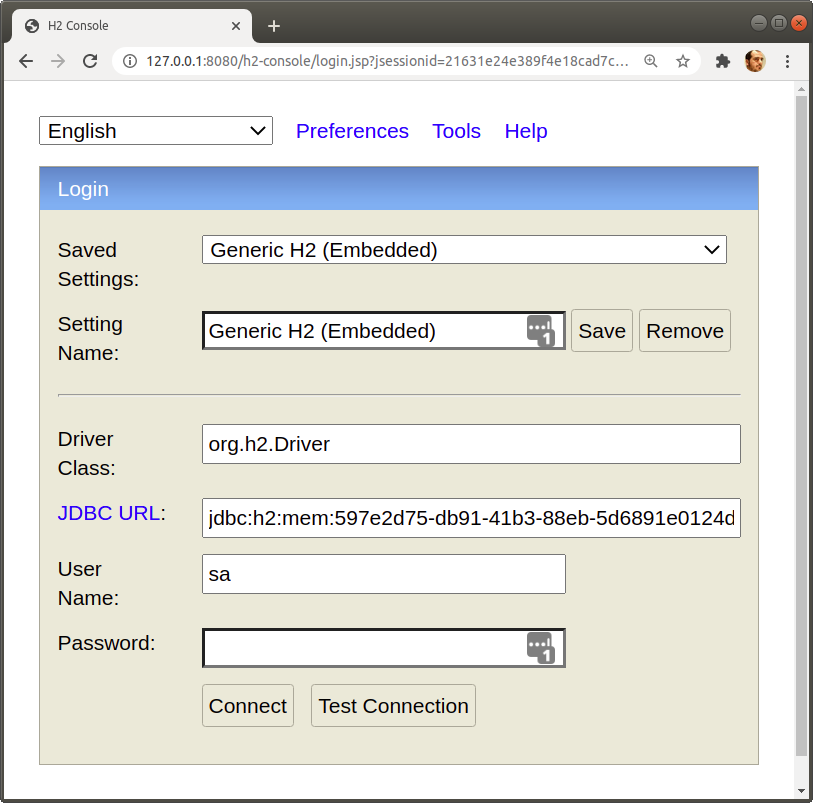{width=40%}

Hay que poner como JDBC URL la ruta que aparece en el log

```
H2 console available at '/h2-console'. Database available at 'jdbc:h2:mem:597e2d75-db91-41b3-88eb-5d6891e0124d'
```

Para simplificar podemos configurar una URL fija:

```properties
spring.datasource.url=jdbc:h2:mem:testdb
```

---

::: {.etiqueta-ejemplo}
ejem2
:::

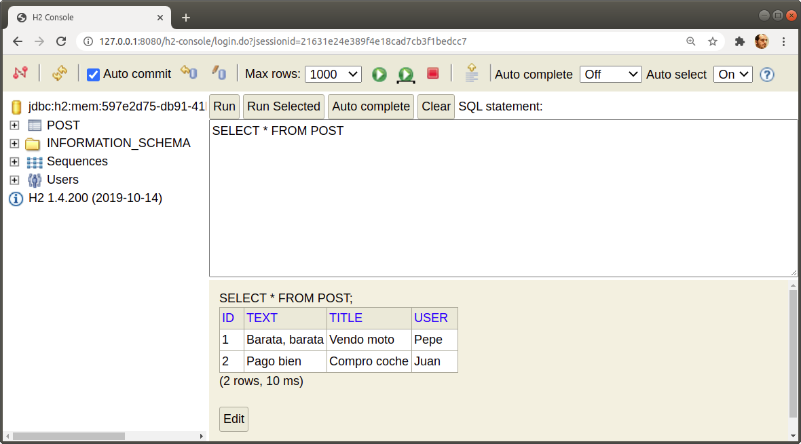{width=89%}

---

- **Manipulación de Optional**
  - Históricamente en Java cuando un método de consulta indica la **ausencia de valor** devolviendo **null**
  - Usar null es propenso a errores y puede provocar **NullPointerException**
  - **Optional** representa en el sistema de tipos que el valor es opcional y obliga al desarrollador a considerar cómo quiere gestionar la ausencia de valor

[https://blogs.oracle.com/javamagazine/12-recipes-for-using-the-optional-class-as-its-meant-to-be-used](https://blogs.oracle.com/javamagazine/12-recipes-for-using-the-optional-class-as-its-meant-to-be-used) 

---

- **Manipulación de Optional**
  - SpringBoot ofrece dos estrategias para gestionar mejor el Optional en una API REST:
    - **Optional.orElseThrow():** Se eleva una excepción NoSuchElementException si el recurso no existe. Esa excepción se puede convertir en un 404
    - **ResponseEntity.of(Optional resource):** Devuelve 404 si el recurso no existe.

---

::: {.etiqueta-ejemplo}
ejem3
:::

- **Manipulación de Optional**
  - Configuración de Spring para que las excepciones **NoSuchElementException** generadas en un controlador se conviertan en un 404

```java
@ControllerAdvice
class NoSuchElementExceptionControllerAdvice {
  @ResponseStatus(HttpStatus.NOT_FOUND)
  @ExceptionHandler(NoSuchElementException.class)
  public void handleNoTFound() {
  }
}
```

---

::: {.etiqueta-ejemplo}
ejem3
:::

::: {.etiqueta-ejemplo}
ejem4
:::

- **Manipulación de Optional**

**Elevando la excepción**

```{.java data-lineas="3"}
@GetMapping("/{id}")
public Post getPost(@PathVariable long id) {
  return posts.findById(id).orElseThrow();
}
```

**ResponseEntity.of(...)**

```{.java data-lineas="4"}
@GetMapping("/{id}")
public ResponseEntity<Post> getPost(@PathVariable long id) {
  Optional<Post> post = posts.findById(id);
  return ResponseEntity.of(post);
}
```

::: {.nota-codigo}
Método **ResponseEntity.of()** devuelve 404 si el post no está presente
:::

::: {.nota-codigo}
Si no hay post se eleva **NoSuchElementException**
:::

---

::: {.etiqueta-ejemplo}
ejem3
:::

::: {.etiqueta-ejemplo}
ejem4
:::

- **Manipulación de Optional**

**Elevando la excepción**

```{.java data-lineas="3"}
@DeleteMapping("/{id}")
public Post deletePost(@PathVariable long id) {
  Post post = posts.findById(id).orElseThrow();
  posts.deleteById(id);		
  return post;
}
```

**ResponseEntity.of(...)**

```{.java data-lineas="4"}
@DeleteMapping("/{id}")
public ResponseEntity<Post> deletePost(@PathVariable long id) {
  Optional<Post> post = posts.findById(id);
  post.ifPresent(p -> posts.deleteById(id));
  return ResponseEntity.of(post);
}
```

::: {.nota-codigo}
Sólo se ejecuta la operación de borrado si hay post: **ifPresent()**
:::

::: {.nota-codigo}
Si no hay post se eleva **NoSuchElementException**
:::

---

::: {.etiqueta-ejemplo}
ejem3
:::

- **Manipulación de Optional**

**Elevando la excepción**

```java
@PutMapping("/{id}")
public Post replacePost(@PathVariable long id, 
  @RequestBody Post newPost) {
  posts.findById(id).orElseThrow();
  newPost.setId(id);
  posts.save(newPost);
  return newPost;
}
```

---

::: {.etiqueta-ejemplo}
ejem4
:::

- **Manipulación de Optional**

**ResponseEntity.of(...)**

```{.java data-lineas="4-8"}
@PutMapping("/{id}")
public ResponseEntity<Post> replacePost(@PathVariable long id, @RequestBody Post newPost) {
  Optional<Post> post = posts.findById(id);
  return ResponseEntity.of(post.map(p -> {
    newPost.setId(id);
    posts.save(newPost);
    return newPost;
  }));
}
```

::: {.nota-codigo}
El método **map(...)** permite guardar el newPost y devolverlo si hay post
:::

## Ejercicio 1

- Transforma el ejercicio de la **gestión de Items** para que utilice una base de datos en vez de guardar la información en memoria

# Java Persistence API (JPA)

## Java Persistence API (JPA)

- **Las apps de base de datos en Spring usan dos librerías a la vez:**
  - **JPA (****Java Persistence API****)**
    - Estándar de Java EE para acceso a base de datos relacionales
  - **Spring Data**
    - Facilidades propias de Spring que facilitan el acceso a base de datos con JPA

---

- **Spring Data**
  - Permite la creación de **consultas partiendo de métodos** en los repositorios
  - Se puede usar con **cualquier** base de datos (relacional o NoSQL)
  - Los métodos pueden tener varios parámetros que forman **expresiones lógicas**: Y, O, No…
  - Los métodos se pueden anotar para definir la consulta de forma más precisa con **JPQL o SQL**

[https://docs.spring.io/spring-data/jpa/docs/current/reference/html/#repositories](https://docs.spring.io/spring-data/jpa/docs/current/reference/html/#repositories) 

---

- **JPA (****Java Persistence API****)**
  - Acceso a Bases de datos relacionales desde Java 
  - **JPA** forma parte del estándar **Java EE**
  - **Funcionalidades**
    - Generación del **esquema** de la base de datos partiendo de las entidades (clases Java)
    - **Conversión automática** entre objetos y filas de tablas 
    - Lenguaje de consulta de alto nivel **JPQL**

[http://www.oracle.com/technetwork/java/javaee/tech/persistence-jsp-140049.html](http://www.oracle.com/technetwork/java/javaee/tech/persistence-jsp-140049.html) 

---

- **JPA (****Java Persistence API****)**

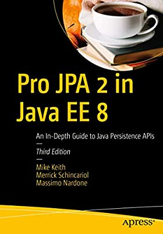{width=22%}

- **Pro JPA 2 in Java EE 8**
- By Mike Keith , Merrick Schincariol, Massimo Nardone

Apress

[https://learning.oreilly.com/library/view/pro-jpa-2/9781484234204/](https://learning.oreilly.com/library/view/pro-jpa-2/9781484234204/) 

[https://www.javacodegeeks.com/2015/02/jpa-tutorial.html](https://www.javacodegeeks.com/2015/02/jpa-tutorial.html) 

---

- **JPA (****Java Persistence API****)**
  - Para usar JPA es necesario usar una **librería** concreta que lo implemente
  - En Spring por defecto se usa la librería **Hibernate**

{width=67%}

http://www.hibernate.org

---

- **JPA (****Java Persistence API****)**
  - La técnica para convertir entre el modelo de objetos y el modelo relacional se conoce como “**mapeo objeto relacional**” (object relational mapping) u ORM
  - Un ORM realiza las **conversiones** pertinentes entre **objetos/clases** y **filas/tablas**
  - Modos de funcionamiento:
    - **Generación de tablas partiendo de clases\*** 
    - Generación de clases partiendo de tablas

## Generación de tablas desde entidades

::: {.etiqueta-ejemplo}
ejem4
:::

- **Mostrar las sentencias SQL**
  - Para aprender JPA y depurar los posibles errores es muy útil poder ver qué sentencias se ejecutan en la BBDD

```
application.properties
```

```properties
spring.jpa.properties.hibernate.format_sql=true
logging.level.org.hibernate.SQL=DEBUG
logging.level.org.hibernate.type.descriptor.sql.BasicBinder=TRACE
```

---

::: {.etiqueta-ejemplo}
ejem4
:::

- **Entidad con atributos básicos**
  - Se genera una tabla por cada entidad
  - Por cada atributo de la clase de un tipo simple (entero, float, String, boolean...), se crea un campo en la tabla

```java
@Entity
public class Post {
  @Id
  @GeneratedValue(strategy = GenerationType.AUTO)
  private long id;
  private String username;
  private String title;
  private String text;
}
```

```sql
create table post (
  id bigint not null,
  text varchar(255),
  title varchar(255),
  username varchar(255),
  primary key (id)
)
```

---

- **Relaciones entre entidades**
  - Existe una relación cuando una entidad tiene como **atributo otra entidad**
  - En memoria, un **objeto** está asociado a uno o más **objetos**
  - También es posible tener una colección de entidades (**List, Set, Map…**)
  - Las relaciones pueden ser **1:1, 1:N, M:N**

---

- **Relaciones entre entidades**
  - **1:1**
    - Unidireccional
    - Bidireccional
  - **1:N**
    - Unidireccional (1 → N y N → 1)
    - Bidireccional
  - **N:M**
    - Bidireccional

---

::: {.etiqueta-ejemplo}
ejem5
:::

- **Relación 1:1 unidireccional**
  - Una entidad tiene una referencia a otra entidad
  - El atributo que apunta a otro es anotado con **@OneToOne**
  - Cada objeto tiene que ser guardado en la base de datos de forma **independiente**
  - Al **cargar un objeto** de la BBDD podemos acceder al objeto **relacionado sin cargarlo explícitamente**

---

::: {.etiqueta-ejemplo}
ejem5
:::

- **Relación 1:1 unidireccional**

```java
@Entity
public class Student {
  @Id
  @GeneratedValue(...)
  private long id;
  private String name;
  private int year;
  @OneToOne
  private Project project;
}
```

```java
@Entity
public class Project {
  @Id
  @GeneratedValue(...)
  private long id;
  private String title;
  private int calification;
}
```

Entidades

---

::: {.etiqueta-ejemplo}
ejem5
:::

- **Relación 1:1 unidireccional**

```java
@Entity
public class Student {
  @Id
  @GeneratedValue(...)
  private long id;
  private String name;
  private int year;
  @OneToOne
  private Project project;
}
```

```java
@Entity
public class Project {
  @Id
  @GeneratedValue(...)
  private long id;
  private String title;
  private int calification;
}
```

Entidades

## Relación 1:1 unidireccional

::: {.etiqueta-ejemplo}
ejem5
:::

```java
@Entity
public class Student {
  @Id
  @GeneratedValue(...)
  private long id;
  private String name;
  private int year;
  @OneToOne
  private Project project;
}
```

Generación de tablas

```sql
create table project (
  id bigint not null,
  calification integer not null,
  title varchar(255),
  primary key (id)
)
create table student (
  id bigint not null,
  name varchar(255),
  year integer not null,
  project_id bigint,
  primary key (id)
)
alter table student 
  add constraint Fkr...
  foreign key (project_id) 
  references project
```

```java
@Entity
public class Project {
  @Id
  @GeneratedValue(...)
  private long id;
  private String title;
  private int calification;
}
```

## Generación de tablas desde entidades

::: {.etiqueta-ejemplo}
ejem5
:::

- **Relación 1:1 unidireccional**

```{.default data-lineas="2,6,7"}
Project p1 = new Project("TFG1", 8);
projectRepository.save(p1);
Student s1 = new Student("Pepe", 2010);
s1.setProject(p1);
Student s2 = new Student("Juan", 2011);
studentRepository.save(s1);
studentRepository.save(s2);
```

::: {.nota-codigo}
Cada objeto se tiene que guardar en su repositorio
:::

Inicialización de datos

---

::: {.etiqueta-ejemplo}
ejem5
:::

- **Relación 1:1 unidireccional**

```json
[ 
 {
  "id" : 1,
  "name" : "Pepe",
  "year" : 2010,
  "project" : {
    "id" : 1,
    "title" : "TFG1",
    "calification" : 8
  }
 },
 {
  "id" : 2,
  "name" : "Juan",
  "year" : 2011
 }
]
```

Consulta de datos

```
studentRepository.findAll();
```

---

::: {.etiqueta-ejemplo}
ejem6
:::

- **Operaciones en cascada**
  - Hay veces que un objeto **siempre está asociado** a otro objeto (relación de composición) 
  - Por ejemplo, un proyecto siempre está asociado a un estudiante
  - Cuando se **crea el estudiante**, **se crea el proyecto**, cuando se borra el estudiante, se borra el proyecto

---

::: {.etiqueta-ejemplo}
ejem6
:::

- **Operaciones en cascada**
  - Si la anotación @OneToOne se configura con **cascade = CascadeType.ALL** entonces ambos objetos de la relación tienen el mismo ciclo de vida
  - Al **guardar** el objeto principal, se **guarda** el asociado
  - Al **borrar** el objeto principal, se **borra** el asociado

---

::: {.etiqueta-ejemplo}
ejem6
:::

- **Operaciones en cascada**

```java
//Deleting a student delete her associated project
@DeleteMapping("/students/{id}")
public Student deleteStudent(@PathVariable Long id) {
	Student student = studentRepository.findById(id).get();		
	studentRepository.deleteById(id);
	return student;
}
//A project only can be deleted if it has no associated student.
@DeleteMapping("/projects/{id}")
public Project deleteProject(@PathVariable Long id) {
	Project project = projectRepository.findById(id).get();		
	projectRepository.deleteById(id);
	return project;
}
```

---

::: {.etiqueta-ejemplo}
ejem6
:::

- **Operaciones en cascada**

```{.java data-lineas="8"}
@Entity
public class Student {
	@Id
	@GeneratedValue(...)
	private long id;
	private String name;
	private int year;
	@OneToOne(cascade=CascadeType.ALL)
	private Project project;
}
```

```{.default data-lineas="2,3"}
Student s1 = new Student("Pepe", 2010);
s1.setProject(new Project("TFG1", 8));
studentRepository.save(s1);
```

::: {.nota-codigo}
Como la relación en **cascade=ALL**, no es necesario guardar el objeto project explícitamente. 

El **project** se guarda cuando el **student** se guarda
:::

---

::: {.etiqueta-ejemplo}
ejem7
:::

- **Relación 1:1 bidireccional**
  - Para facilitar el desarrollo, los **dos objetos de una relación** pueden tener un atributo apuntando al otro objeto
  - Ambas entidades tienen que anotarse con **@OneToOne**
  - Aunque en memoria ambos objetos se apunten entre sí, en la base de datos la relación se guarda en la **tabla de una entidad**

---

::: {.etiqueta-ejemplo}
ejem7
:::

- **Relación 1:1 bidireccional**
  - La entidad principal cuya tabla guarda la información anota el atributo con **@OneToOne**
  - El atributo debe apuntar al otro objeto de la otra entidad cuando se **guardar en la BBDD**
  - La otra entidad se anota con **@OneToOne(mappedby=”attr”)** indicando el nombre del atributo de la otra principal
  - Este atributo sólo se usa en lecturas

---

::: {.etiqueta-ejemplo}
ejem7
:::

- **Relación 1:1 bidireccional**

```java
@Entity
public class Student {
  @Id
  @GeneratedValue(...)
  private long id;
  private String name;
  private int year;
  @OneToOne(cascade=CascadeType.ALL)
  private Project project;
}
```

```java
@Entity
public class Project {
  @Id
  @GeneratedValue(...)
  private long id;
  private String title;
  private int calification;
  @OneToOne(mappedBy="project")
  private Student student;
}
```

```{.default data-lineas="2,3"}
Student s1 = new Student("Pepe", 2010);
s1.setProject(new Project("TFG1", 8));
studentRepository.save(s1);
```

::: {.nota-codigo}
Al guardar, la entidad principal debe apuntar a la otra entidad
:::

---

::: {.etiqueta-ejemplo}
ejem7
:::

- **Relación 1:1 bidireccional**

```{.sql data-lineas="11,14-17"}
create table project (
  id bigint not null,
  calification integer not null,
  title varchar(255),
  primary key (id)
)
create table student (
  id bigint not null,
  name varchar(255),
  year integer not null,
  project_id bigint,
  primary key (id)
)
alter table student 
  add constraint FKr6av6arpoy7wpbqipg41id1mn 
  foreign key (project_id) 
  references project
```

::: {.nota-codigo}
Como la entidad principal sigue siendo Student, las tablas son las mismas que con relación unidireccional
:::

---

- **Relaciones entre entidades**
  - **1:1**
    - Unidireccional
    - Bidireccional
  - **1:N**
    - Unidireccional (1 → N y N → 1)
    - Bidireccional
  - **N:M**
    - Bidireccional

---

::: {.etiqueta-ejemplo}
ejem8
:::

- **Relación 1:N**
  - Cuando existe una relación **1:N** entre entidades se usan las anotaciones **@OneToMany** y **@ManyToOne**
  - Puede ser **unidireccional** o **bidireccional**
  - Cualquier sentido de la relación puede ser **la entidad principal** (la que se usa para guardar los datos)
  - También se puede usar **cascade**

---

::: {.etiqueta-ejemplo}
ejem8
:::

- **Relación 1:N unidireccional**

```java
@Entity
public class Team {
  @Id
  @GeneratedValue(...)
  private long id;
  private String name;
  private int ranking;
  @OneToMany
  private List<Player> players;
}
```

```java
@Entity
public class Player {
  @Id
  @GeneratedValue(...)
  private long id;
  private String name;
  private int goals;
}
```

---

::: {.etiqueta-ejemplo}
ejem8
:::

- **Relación 1:N unidireccional**

```{.sql data-lineas="13-16"}
create table player (
  id bigint not null,
  goals integer not null,
  name varchar(255),
  primary key (id)
)
create table team (
  id bigint not null,
  name varchar(255),
  ranking integer not null,
  primary key (id)
)
create table team_players (
  team_id bigint not null,
  players_id bigint not null
)
```

```{.default data-lineas="1,2"}
alter table team_players 
  add constraint UK... unique (players_id)
alter table team_players 
  add constraint FK...
  foreign key (players_id) 
  references player
alter table team_players 
  add constraint FK...
  foreign key (team_id) 
  references team
```

::: {.nota-codigo}
Como es @OneToMany, un team sólo puede estar asociado a un equipo
:::

::: {.nota-codigo}
Tabla que relaciona Teams y Players
:::

---

::: {.etiqueta-ejemplo}
ejem8
:::

- **Relación 1:N unidireccional**

```
Player p1 = new Player("Torres", 10);
Player p2 = new Player("Iniesta", 10);
playerRepository.save(p1);
playerRepository.save(p2);
Team team = new Team("Selección", 1);
team.getPlayers().add(p1);
team.getPlayers().add(p2);
teamRepository.save(team);
```

---

::: {.etiqueta-ejemplo}
ejem8
:::

- **Relación 1:N unidireccional**
  - Sin cascase los objetos tienen ciclos de vida independientes (Un player puede estar sin team)

```java
//Deleting a team doesn't delete its associated players
@DeleteMapping("/teams/{id}")	
public Team deleteTeam(@PathVariable Long id) {
  Team team = teamRepository.findById(id).get();		
  //Force loading players from database to be returned as JSON
  Hibernate.initialize(team.getPlayers());		
  teamRepository.deleteById(id);
  return team;
}
```

---

::: {.etiqueta-ejemplo}
ejem9
:::

- **Relación 1:N unidireccional (cascade)**

```java
@Entity
public class Blog {
  @Id
  @GeneratedValue(...)
  private long id;
  private String title;
  private String text;
  @OneToMany(cascade=CascadeType.ALL)
  private List<Comment> comments;
}
```

```java
@Entity
public class Comment {
  @Id
  @GeneratedValue(...)
  private long id;
  private String author;
  private String message;
}
```

```
Blog blog = new Blog("New", "My new product");
blog.getComments().add(new Comment("Cool", "Pepe"));
blog.getComments().add(new Comment("Very cool", "Juan"));
repository.save(blog);
```

---

::: {.etiqueta-ejemplo}
ejem10
:::

- **Relación 1:N bidireccional**

```java
@Entity
public class Player {
  @Id
  @GeneratedValue(...)
  private long id;
  private String name;
  private int goals;
  @ManyToOne
  private Team team;
}
```

```java
@Entity
public class Team {
  @Id
  @GeneratedValue(...)
  private long id;
  private String name;
  private int ranking;
  @OneToMany(mappedBy="team")
  private List<Player> players;
}
```

---

::: {.etiqueta-ejemplo}
ejem10
:::

- **Relación 1:N bidireccional**

```{.sql data-lineas="5,14-17"}
create table player (
  id bigint not null,
  goals integer not null,
  name varchar(255),
  team_id bigint,
  primary key (id)
)
create table team (
  id bigint not null,
  name varchar(255),
  ranking integer not null,
  primary key (id)
)
alter table player 
  add constraint FK...
  foreign key (team_id) 
  references team
```

::: {.nota-codigo}
Ahora la entidad principal es **Player**, por eso tiene el atributo **team\_id** y no hay tabla de relación
:::

---

::: {.etiqueta-ejemplo}
ejem10
:::

- **Relación 1:N bidireccional**

```{.default data-lineas="5,6"}
Team team = new Team("Selección", 1);
teamRepository.save(team);
Player p1 = new Player("Torres", 10);
Player p2 = new Player("Iniesta", 10);
p1.setTeam(team);
p2.setTeam(team);
playerRepository.save(p1);
playerRepository.save(p2);
```

::: {.nota-codigo}
La **entidad principal** ahora es **Player**, por eso se configura el Team en el objeto Player antes de guardar (y no al revés)
:::

Un Player puede estar sin asociar a un Team

---

::: {.etiqueta-ejemplo}
ejem11
:::

- **Relación 1:N bidireccional (cascade)**
  - Cuando se configura una relación de composición en la BBDD se suele configurar **cascade** y **orphanRemoval**
  - Se suele configurar **cascade=ALL** para que no haya que guardar los objetos de forma independiente
  - Se suele configurar **orphanRemoval=true** para que no pueda haber una parte sin si todo

[https://vladmihalcea.com/orphanremoval-jpa-hibernate/](https://vladmihalcea.com/orphanremoval-jpa-hibernate/) 

---

::: {.etiqueta-ejemplo}
ejem11
:::

- **Relación 1:N bidireccional (cascade)**

```{.java data-lineas="11-18"}
@Entity
public class Post {
	@Id
	@GeneratedValue(...)
	private long id;
	private String username;
	private String title;
	private String text;
	@OneToMany(mappedBy="post", cascade=CascadeType.ALL, orphanRemoval=true)
	private List<Comment> comments = new ArrayList<>();
	public void addComment(Comment comment) {
        comments.add(comment);
        comment.setPost(this);
    }
    public void removeComment(Comment comment) {
        comments.remove(comment);
        comment.setPost(null);
    }
}
```

::: {.nota-codigo}
Mantiene los atributos sincronizados en ambos extremos (Post y Comment)
:::

---

::: {.etiqueta-ejemplo}
ejem11
:::

- **Relación 1:N bidireccional (cascade)**

```java
@Entity
public class Comment {
	@Id
	@GeneratedValue(...)
	private long id;
	private String username;
	private String comment;
	@ManyToOne
	@JsonIgnore
	private Post post;
}
```

---

::: {.etiqueta-ejemplo}
ejem11
:::

- **Relación 1:N bidireccional (cascade)**

```sql
create table comment (
  id bigint not null,
  comment varchar(255),
  username varchar(255),
  post_id bigint,
  primary key (id)
)
create table post (
  id bigint not null,
  text varchar(255),
  title varchar(255),
  username varchar(255),
  primary key (id)
)
alter table comment 
  add constraint FK..
  foreign key (post_id) 
  references post
```

---

::: {.etiqueta-ejemplo}
ejem11
:::

- **Relación 1:N bidireccional (cascade)**
  - **API REST**
    - Al obtener un post individual o en una colección (GET) se devolverán los comentarios
    - Los comentarios de un post se podrán consultar, borrar, actualizar y añadir de forma independiente
      - http://server/posts/6/comments/3 
    - Al reemplazar un post (PUT) no se verán afectados sus comentarios

---

- **Relaciones entre entidades**
  - **1:1**
    - Unidireccional
    - Bidireccional
  - **1:N**
    - Unidireccional (1 → N y N → 1)
    - Bidireccional
  - **N:M**
    - Bidireccional

---

::: {.etiqueta-ejemplo}
ejem12
:::

- **Relación M:N**
  - Cuando existe una relación M:N entre entidades se usa la anotación **@ManyToMany**
  - Estas relaciones son siempre **bidireccionales**
  - Cualquier sentido de la relación puede ser **la entidad principal** (la que se usa para guardar los datos)
  - También se puede usar **cascade**

---

::: {.etiqueta-ejemplo}
ejem12
:::

- **Relación M:N bidireccional**

```java
@Entity
public class Player {
  @Id
  @GeneratedValue(...)
  private long id;
  private String name;
  private int goals;
  @ManyToMany
  private List<Team> teams;
}
```

```java
@Entity
public class Team {
  @Id
  @GeneratedValue(...)
  private long id;
  private String name;
  private int ranking;
  @ManyToMany(mappedBy="teams")
  private List<Player> players;
}
```

---

::: {.etiqueta-ejemplo}
ejem12
:::

- **Relación M:N bidireccional**

```{.sql data-lineas="13-16"}
create table player (
  id bigint not null,
  goals integer not null,
  name varchar(255),
  primary key (id)
)
create table team (
  id bigint not null,
  name varchar(255),
  ranking integer not null,
  primary key (id)
)
create table player_teams (
  players_id bigint not null,
  teams_id bigint not null
)
```

```
alter table player_teams 
  add constraint FK...
  foreign key (teams_id) 
  references team
alter table player_teams 
  add constraint FK...
  foreign key (players_id) 
  references player
```

::: {.nota-codigo}
Como es @ManyToMany ya no está la restricción de que un player sólo pueda estar asociado a un team
:::

---

::: {.etiqueta-ejemplo}
ejem12
:::

- **Relación M:N bidireccional**

```
Team team1 = new Team("Selección", 1);
Team team2 = new Team("FC Barcelona", 1);
Team team3 = new Team("Atlético de Madrid", 2);
teamRepository.save(team1);
teamRepository.save(team2);
teamRepository.save(team3);
Player p1 = new Player("Torres", 10);
Player p2 = new Player("Iniesta", 10);
p1.getTeams().add(team1);
p1.getTeams().add(team3);
p2.getTeams().add(team1);
p2.getTeams().add(team2);
playerRepository.save(p1);
playerRepository.save(p2);
```

---

- **Herencia entre clases**
  - Existen varias estrategias

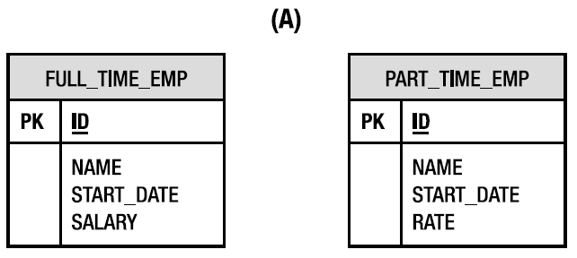{width=30%}

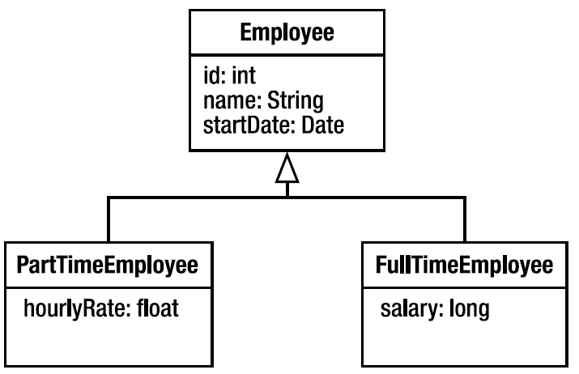{width=38%}

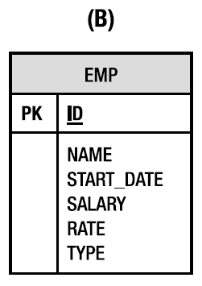{width=12%}

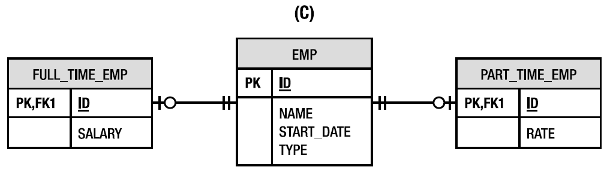{width=48%}

## Java Persistence API (JPA)

- **Spring Data**
  - [http://projects.spring.io/spring-data/](http://projects.spring.io/spring-data/) 
- **Spring Data Commons**
  - [http://docs.spring.io/spring-data/commons/docs/current/reference/html/](http://docs.spring.io/spring-data/commons/docs/current/reference/html/)
- **Spring Data JPA**
  - [http://docs.spring.io/spring-data/jpa/docs/current/reference/html/](http://docs.spring.io/spring-data/jpa/docs/current/reference/html/) 
- **Bases de datos SQL en Spring Boot**
  - [http://docs.spring.io/spring-boot/docs/current/reference/html/boot-features-sql.html](http://docs.spring.io/spring-boot/docs/current/reference/html/boot-features-sql.html)
- **Inicialización de bases de datos SQL en Spring Boot**
  - [http://docs.spring.io/spring-boot/docs/current/reference/html/howto-database-initialization.html](http://docs.spring.io/spring-boot/docs/current/reference/html/howto-database-initialization.html)
- **Tutorial Spring Data JPA**
  - [https://spring.io/guides/gs/accessing-data-jpa/](https://spring.io/guides/gs/accessing-data-jpa/) 

# Consultas

## Consultas

- Estrategias para especificación de consultas con SpringData:
  - **Métodos en los repositorios**
  - Java Persistence Query Language (JPQL)
  - QueryDSL

---

::: {.etiqueta-ejemplo}
ejem13
:::

- **Métodos en los repositorios**
  - En base al nombre del método y el tipo de retorno se construye la consulta a la BBDD

```{.java data-lineas="2,3"}
public interface PostRepository extends JpaRepository<Post, Long> {
	List<Post> findByUsername(String username);
	List<Post> findByTitle(String title);
}
```

::: {.nota-codigo}
Consultas con un único campo como criterio
:::

[http://docs.spring.io/spring-data/jpa/docs/current/reference/html/#repositories.query-methods.details](http://docs.spring.io/spring-data/jpa/docs/current/reference/html/#repositories.query-methods.details) 

---

- **Métodos en los repositorios**

```java
public interface PersonRepository extends Repository<Person, Long> {
	  List<Person> findByEmailAddressAndLastname(EmailAddress emailAddress, String lastname);
	  // Enables the distinct flag for the query
	  List<Person> findDistinctPeopleByLastnameOrFirstname(String lastname, String firstname);
	  List<Person> findPeopleDistinctByLastnameOrFirstname(String lastname, String firstname);
	  // Enabling ignoring case for an individual property
	  List<Person> findByLastnameIgnoreCase(String lastname);
	  // Enabling ignoring case for all suitable properties
	  List<Person> findByLastnameAndFirstnameAllIgnoreCase(String lastname, String firstname);
	  // Enabling static ORDER BY for a query
	  List<Person> findByLastnameOrderByFirstnameAsc(String lastname);
	  List<Person> findByLastnameOrderByFirstnameDesc(String lastname);
}
```

::: {.nota-codigo}
Consultas combinando varios campos
:::

::: {.nota-codigo}
Ordenación, IgnoreCase, Order...
:::

---

- **Métodos en los repositorios**
  - **Combinación lógica:** And, Or
  - **Comparadores:** Between, LessThan, GreatherThan
  - **Modificadores:** IgnoreCase
  - **Ordenación:** OrderBy...Asc / OrderBy...Desc

---

- **Métodos en los repositorios**
  - **Consulta**
    - List\<Elem\> find...By...(…)
    - List\<Elem\> read...By...(…)
    - List\<Elem\> query...By...(…)
    - List\<Elem\> get...By...(…)
  - **Número de elementos**
    - int count...By...(...)

---

- **Métodos en los repositorios**
  - Propiedades de los objetos relacionados
    - No sólo podemos filtrar por una propiedad de la entidad, también podemos filtrar por un **atributo de otra entidad** con la que esté relacionada

- **Person** con un atributo **address**
- **Address** tiene un atributo **zipCode**

```
List<Person> findByAddressZipCode(ZipCode zipCode);
```

```
List<Person> findByAddress_ZipCode(ZipCode zipCode);
```

---

- **Métodos en los repositorios**
  - Ordenación
    - Podemos pasar un parámetro Sort que controla la ordenación
    - Existe el método findAll(Sort sort)

```
repository.findAll(Sort.by("nombre")));
repository.findAll(Sort.by(Order.asc("nombre"))));
```

::: {.desde-nivel-3}
- Podemos añadir métodos personalizados
:::

```
List<User> findByLastname(String lastname, Sort sort);
```

---

- **Métodos en los repositorios**
  - Ordenación
    - El objeto Sort se puede crear desde la URL

```
http://server/anuncios/?sort=nombre,desc
```

```java
@GetMapping("/posts/")
public List<Post> getPosts(Sort sort) {
  return posts.findAll(sort);
}
```

---

- **Métodos en los repositorios**
  - Limitar los resultados

```
User findFirstBy...();
User findTopBy...();
User findTopDistinctBy...();
List<User> queryFirst10By...();
List<User> findTop3By...();
List<User> findFirst10By...();
```

---

- Estrategias para especificación de consultas con SpringData:
  - Métodos en los repositorios
  - **Java Persistence Query Language (JPQL)**
  - QueryDSL

---

::: {.etiqueta-ejemplo}
ejem14
:::

- **Java Persistence Query Language (JPQL)**
  - JPQL es un lenguaje similar a SQL pero referencia conceptos de las entidades JPA

```java
public interface TeamRepository extends JpaRepository<Team, Long> {
	@Query("select t from Team t where t.name = ?1")
	List<Team> findByName(String name);	
}
```

**NOTA:** En este ejemplo la query JPQL no sería necesaria porque el nombre del método define justo esa consulta

---

- **Java Persistence Query Language (JPQL)**
  - Estructura de sentencia SELECT

```sql
SELECT ... FROM ...
[WHERE ...]
[GROUP BY ... [HAVING ...]]
[ORDER BY ...]
```

::: {.desde-nivel-2}
- Actualización y borrado
:::

```sql
DELETE FROM ... [WHERE ...]
UPDATE ... SET ... [WHERE ...]
```

---

- **Java Persistence Query Language (JPQL)**
  - Ejemplos

```sql
SELECT e from Employee e 
WHERE e.salary BETWEEN 30000 AND 40000
```

```sql
SELECT e from Employee e WHERE e.name LIKE 'M%'
```

```sql
SELECT DISTINCT b FROM Blog b JOIN b.comments c WHERE c.author=?1
```

---

::: {.etiqueta-ejemplo}
ejem15
:::

- **Java Persistence Query Language (JPQL)**

```java
public interface PostRepository extends JpaRepository<Post, Long> {
  @Query("SELECT DISTINCT p FROM Post p JOIN p.comments c WHERE c.username=?1") 
  List<Post> findByCommentsUser(String user);	
}
```

NOTA: La query JPQL no sería necesaria porque el método del repositorio ejecuta justo esa consulta

---

- **Structured Query Language (SQL)**
  - Incluso podemos usar SQL nativo directamente

```java
public interface UserRepository extends JpaRepository<User, Long> {
  @Query(
     value = "SELECT * FROM USERS WHERE EMAIL_ADDRESS = ?1", 
     nativeQuery = true)
  User findByEmailAddress(String emailAddress);
}
```

---

::: {.etiqueta-ejemplo}
ejem16
:::

- Las consultas permiten relacionar varias entidades sin necesidad de tener atributos directos
  - **Modelo**
  - ¿Qué equipos juegan en un torneo?
  - ¿En qué torneos juega un equipo?

```{dot}
//| fig-width: 9.0
//| fig-height: 3.7
// Modelo del ejemplo: un torneo tiene partidos y cada partido enfrenta a dos
// equipos. Las etiquetas de los extremos son las multiplicidades.
digraph modelo {
  rankdir=LR; bgcolor="transparent"; nodesep=0.5; ranksep=1.1;
  node [fontname="Lato", fontsize=14, shape=box, style="filled",
        fillcolor="#e2efd9", color="#70ad47", height=0.65, width=1.6];
  edge [fontname="Lato", fontsize=11, color="#333333", arrowsize=0.8];

  Tournament; Match; Team;

  Match -> Tournament [label="*"];
  Match -> Team [label="*  team1"];
  Match -> Team [label="*  team2"];
}
```

---

::: {.etiqueta-ejemplo}
ejem16
:::

```java
@Entity
public class Tournament {
  @Id
  @GeneratedValue(...)
  private long id;
  private String data;
}
```

```java
@Entity
public class Match {
  @Id
  @GeneratedValue(...)
  private long id;
  private String data;
  @ManyToOne
  private Team team1;
  @ManyToOne
  private Team team2;
  @ManyToOne
  Tournament tournament;
}
```

```java
@Entity
public class Team {
  @Id
  @GeneratedValue(...)
  private long id;
  private String data;
}
```

---

::: {.etiqueta-ejemplo}
ejem16
:::

```java
public interface MatchRepository extends JpaRepository<Match, Long> {
  @Query("SELECT m FROM Match m WHERE m.tournament = :t")
  public List<Match> getMatches(Tournament t);
}
```

```java
public interface TeamRepository extends JpaRepository<Team, Long> {
  @Query("SELECT distinct team FROM Match m, Team team "
    + "WHERE (m.team1 = team OR m.team2 = team) AND  m.tournament = :t")
  public List<Team> getTeams(Tournament t);
}
```

```java
public interface TournamentRepository extends JpaRepository<Tournament, Long> {
  @Query("SELECT distinct t FROM Match m JOIN m.tournament t " 
    + "WHERE m.team1 = :team OR m.team2 = :team")
  public List<Tournament> getTournaments(Team team);
}
```

---

::: {.etiqueta-ejemplo}
ejem16b
:::

- Ejemplo de consultas avanzadas
  - ¿Qué jugadores juegan conmigo?

```{dot}
//| fig-width: 6.0
//| fig-height: 1.7
// Un equipo tiene dos jugadores, playerA y playerB: de ahi la consulta que
// busca con quien juega cada uno.
digraph pareja {
  rankdir=LR; bgcolor="transparent"; nodesep=0.45; ranksep=1.3;
  node [fontname="Lato", fontsize=14, shape=box, style=filled,
        fillcolor="#e2efd9", color="#70ad47", width=1.5, height=0.7];
  edge [color="#333333", arrowsize=0.7, fontname="Lato", fontsize=11];

  team [label="Team"]; player [label="Player"];
  team -> player [label="playerA", taillabel="*", labeldistance=1.6];
  team -> player [label="playerB", taillabel="*", labeldistance=1.6];
}
```

```java
public interface PlayerRepository extends JpaRepository<Player, Long> {

  @Query("""
    select distinct u from Player u, Team t 
    where (t.playerA = u and t.playerB = :player) or (t.playerB = u and t.playerA = :player)
  """)
  List<Player> findPairsOf(Player player);
}
```

---

- Estrategias para especificación de consultas con SpringData:
  - Métodos en los repositorios
  - Java Persistence Query Language (JPQL)
  - **QueryDSL**

---

- **QueryDSL**
  - Permite implementar las consultas usando código Java
  - A diferencia de JPQL, el **compilador** avisa de **errores** en la consulta
  - Favorece la **refactorización** y el **autocompletado** 
  - Se puede usar con **SpringData**

[http://www.querydsl.com/](http://www.querydsl.com/) 

---

- **QueryDSL**
  - Partiendo de las entidades se genera código que sirve para hacer las consultas
  - Uso en SpringData

```{.java data-lineas="2"}
public interface TodoRepository extends 
    Repository<Todo, Long>, QuerydslPredicateExecutor<Todo> {
}
```

::: {.nota-codigo}
Añadimos otro interfaz padre al repositorio
:::

---

- **QueryDSL**
  - La consulta se define Partiendo de la clase “Q” generada automáticamente
  - Se define el predicado (filtro)
  - Se usa el método findAll(…) del repositorio

```java
@GetMapping("/")
public Iterable<Todo> todos() {
    Predicate q = QTodo.todo.title.eq("Foo");
	return repository.findAll(page);
}
```

---

- **QueryDSL**

Con un static import de Qtodo.\* las sentencias son más concisas

```
todo.title.eq("Foo").and(todo.description.eq("Bar"));
```

```
todo.title.eq("Foo").or(todo.title.eq("Bar"));
```

```
todo.title.eq("Foo").and(todo.description.eq("Bar").not());
```

todo.description.containsIgnoreCase(searchTerm)                    .or(todo.title.containsIgnoreCase(searchTerm));

---

::: {.etiqueta-ejemplo}
ejem17
:::

- **QueryDSL**

```java
@GetMapping("/")
public Iterable<Post> getPosts(
  @RequestParam(required = false) String commentsUser) {
  if(commentsUser == null) {
    return posts.findAll();
  } else {
	return posts.findAll(post.comments.any().username.eq(commentsUser));
  }
}
```

---

::: {.etiqueta-ejemplo}
ejem17
:::

- **QueryDSL**
  - Dependencias

```xml
<dependencies>
  ...
  <dependency>
    <groupId>com.querydsl</groupId>
    <artifactId>querydsl-core</artifactId>
  </dependency>
  <dependency>
    <groupId>com.querydsl</groupId>
    <artifactId>querydsl-jpa</artifactId>
  </dependency>
</dependencies>
```

---

::: {.etiqueta-ejemplo}
ejem17
:::

- **QueryDSL**

```{.xml data-lineas="12-21"}
<plugin>
  <groupId>com.mysema.maven</groupId>
  <artifactId>apt-maven-plugin</artifactId>
  <version>1.1.3</version>
  <dependencies>
    <dependency>
      <groupId>com.querydsl</groupId>
      <artifactId>querydsl-apt</artifactId>
      <version>4.4.0</version>
    </dependency>
  </dependencies>
  <executions>
    <execution>
      <goals>
        <goal>process</goal>
      </goals>
	<configuration>
	  <outputDirectory>target/generated-sources</outputDirectory>
	  <processor>com.querydsl.apt.jpa.JPAAnnotationProcessor</processor>
      </configuration>
    </execution>
  </executions>
</plugin>
```

::: {.nota-codigo}
Tarea para generar las clases partiendo de las entidades
:::

# Paginación

## Paginación

- Con SpringData es muy sencillo que los resultados de las consultas se devuelvan **paginados**
- Basta poner el parámetro **Pageable** en el método del controlador y pasar ese parámetro al método del repositorio
- Cambiar el result de **List**\<Element\> a **Page**\<Element\>
- Una Page contiene la información de una **página** (info, nº pág, nº total elementos)
- Se integra con Spring MVC para las **webs** y **APIs REST**

---

::: {.etiqueta-ejemplo}
ejem18
:::

```{.java data-lineas="2,3"}
public interface PostRepository extends JpaRepository<Post, Long> {
	Page<Post> findByUsername(String username, Pageable page);
	Page<Post> findByTitle(String title, Pageable page);
}
```

```
Page<Post> a = repository.findByUsername(“pepe”, PageRequest.of(0, 50));
Page<Post> a = repository.findAll(PageRequest.of(3, 20));
```

::: {.nota-codigo}
En nuestros métodos podemos añadir un parámetro **Pageable**
:::

::: {.nota-codigo}
Devolvemos un objeto **Page\<Anuncio\>**
:::

::: {.nota-codigo}
Creamos un objeto **PageRequest** para indicar en num página y tamaño
:::

::: {.nota-codigo}
El método findAll también tiene versión **Paginable**
:::

---

::: {.etiqueta-ejemplo}
ejem18
:::

- En el controlador, podemos crear directamente el objeto Pageable como parámetro

```java
@RestController
@RequestMapping("/posts")
public class PostController {
  @Autowired
  private PostRepository posts;
  @GetMapping("/")
  public Page<Post> getPosts(
    @RequestParam(required = false) String user, Pageable page) {
    if (user != null) {
      return posts.findByUsername(user, page);
    } else {
      return posts.findAll(page);
    }
  }
}
```

---

::: {.etiqueta-ejemplo}
ejem18
:::

- Con la URL habitual se devuelve la **primera página** con **20 elementos**

```
http://server/posts/
```

- En las peticiones se pueden incluir **parámetros** para solicitar cualquier página

```
http://server/posts/?page=1&size=3
```

- Válido para **webs** y para **APIs REST**

---

::: {.etiqueta-ejemplo}
ejem18
:::

```json
{
    "content": [
        {
            "id": 1,
            "username": "Pepe",
            "title": "Hola caracola",
            "text": "XXXX"
        },
        {
            "id": 2,
            "username": "Juan",
            "title": "Hola caracola",
            "text": "XXXX"
        }
    ],
    "pageable": {
        "sort": {
            "sorted": false,
            "unsorted": true,
            "empty": true
        },
        "offset": 0,
        "pageNumber": 0,
        "pageSize": 20,
        "paged": true,
        "unpaged": false
    },
    "totalPages": 1,
    "totalElements": 2,
    "last": true,
    "size": 20,
    "number": 0,
    "sort": {
        "sorted": false,
        "unsorted": true,
        "empty": true
    },
    "first": true,
    "numberOfElements": 2,
    "empty": false
}
```

- En las APIs REST, el JSON de respuesta incluye información de paginación

---

```json
{
    "content": [
        {
            "id": 1,
            "username": "Pepe",
            "title": "Hola caracola",
            "text": "XXXX"
        },
        {
            "id": 2,
            "username": "Juan",
            "title": "Hola caracola",
            "text": "XXXX"
        }
    ],
    "first": true,
    "last": true,
    "totalPages": 1,
    "totalElements": 2,
    "numberOfElements": 2,
    "size": 20,
    "number": 0,
    "sort": []
}
```

- La serialización por defecto en SpringBoot \> 1 no es muy adecuada, se puede implementar un conversión a JSON personalizada

## 

::: {.etiqueta-ejemplo}
ejem19
:::

```java
@JsonComponent
public class PageImplJacksonSerializer extends JsonSerializer<PageImpl<?>> {

	@SuppressWarnings("rawtypes")
	@Override
	public void serialize(PageImpl page, JsonGenerator jsonGenerator, SerializerProvider serializerProvider)
			throws IOException {

		jsonGenerator.writeStartObject();
		
		jsonGenerator.writeFieldName("content");
		serializerProvider.defaultSerializeValue(page.getContent(), jsonGenerator);
		
		jsonGenerator.writeBooleanField("first", page.isFirst());
		jsonGenerator.writeBooleanField("last", page.isLast());
		jsonGenerator.writeNumberField("totalPages", page.getTotalPages());
		jsonGenerator.writeNumberField("totalElements", page.getTotalElements());
		jsonGenerator.writeNumberField("numberOfElements", page.getNumberOfElements());

		jsonGenerator.writeNumberField("size", page.getSize());
		jsonGenerator.writeNumberField("number", page.getNumber());

		Sort sort = page.getSort();

		jsonGenerator.writeArrayFieldStart("sort");

		for (Sort.Order order : sort) {
			jsonGenerator.writeStartObject();
			jsonGenerator.writeStringField("property", order.getProperty());
			jsonGenerator.writeStringField("direction", order.getDirection().name());
			jsonGenerator.writeBooleanField("ignoreCase", order.isIgnoreCase());
			jsonGenerator.writeStringField("nullHandling", order.getNullHandling().name());
			jsonGenerator.writeEndObject();
		}

		jsonGenerator.writeEndArray();
		jsonGenerator.writeEndObject();
	}
}
```

[https://www.wimdeblauwe.com/blog/2018/2018-06-10-pageimpl-json-serialization-with-spring-boot-2/](https://www.wimdeblauwe.com/blog/2018/2018-06-10-pageimpl-json-serialization-with-spring-boot-2/) 

## Consultas

- **Métodos en los repositorios**
  - Ordenación
    - El objeto Pageable incluye la información de ordenación de la URL

```
http://server/posts/?page=1&size=3&sort=username,desc
```

```java
  @GetMapping("/posts/")
  public Page<Post> getPost(Pageable page) {
	return posts.findAll(page);
  }
```

---

```json
{
    "content": [
        {
            "id": 1,
            "username": "Pepe",
            "title": "Hola caracola",
            "text": "XXXX"
        },
        {
            "id": 2,
            "username": "Juan",
            "title": "Hola caracola",
            "text": "XXXX"
        }
    ],
    "first": true,
    "last": true,
    "totalPages": 1,
    "totalElements": 2,
    "numberOfElements": 2,
    "size": 3,
    "number": 0,
    "sort": [
        {
            "property": "username",
            "direction": "DESC",
            "ignoreCase": false,
            "nullHandling": "NATIVE"
        }
    ]
}
```

- En las APIs REST, el JSON de respuesta incluye información de paginación y ordenación

## Ejercicio 2

- Añade paginación a la página web de gestión de **posts**, en la página principal

## Bases de datos SQL en Spring

- Bases de datos SQL en Spring
- Java Persistence API (JPA)
- Consultas
- Paginación
- **Gestión del esquema**
- Estructura de una aplicación con BBDD
- Imágenes
- Accesos concurrentes

## Gestión del esquema

- En las **Bases de datos SQL** es necesario **crear el** **esquema** antes de insertar los datos (crear tablas, relaciones, etc…)
- En las bases de **datos en memoria** (H2, Derby, HSQL…), el esquema siempre se construye de forma **automática** al iniciar la aplicación
- Cuando se usa una base de datos en producción los datos tienen que guardarse en disco y gestionar adecuadamente la **creación y actualización del esquema**

## MySQL

::: {.etiqueta-ejemplo}
ejem20
:::

- **Instalación en ubuntu**
- **Servidor**

{width=16%}

```
$ sudo apt-get install mysql-server
```

- **Herramienta interactiva**

```
$ sudo apt-get install mysql-workbench
```

- **Docker**

$ docker run --rm -e MYSQL\_ROOT\_PASSWORD=password \

  -e  MYSQL\_DATABASE=posts -p 3306:3306 -d mysql:8.0.22

[http://dev.mysql.com/downloads/](http://dev.mysql.com/downloads/) 

---

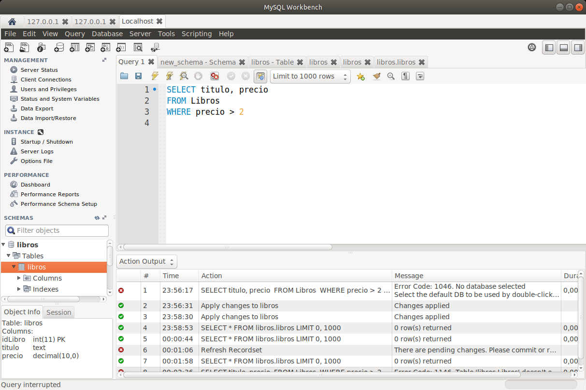{width=83%}

---

**Crear esquema**

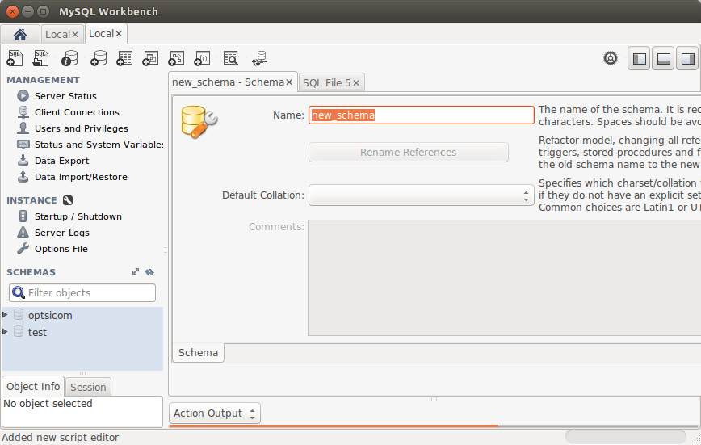{width=90%}

**posts**

---

::: {.etiqueta-ejemplo}
ejem20
:::

- **pom.xml**

```{.xml data-lineas="12-19"}
<groupId>es.codeurjc</groupId>
<artifactId>bbdd_ejem16</artifactId>
<version>0.1.0</version>
<parent>
  <groupId>org.springframework.boot</groupId>
  <artifactId>spring-boot-starter-parent</artifactId>
  <version>2.4.0</version>
</parent>
...
<dependencies>
  ...
  <dependency>
    <groupId>org.springframework.boot</groupId>
    <artifactId>spring-boot-starter-data-jpa</artifactId>
  </dependency>
  <dependency>
    <groupId>mysql</groupId>
    <artifactId>mysql-connector-java</artifactId>
  </dependency>
</dependencies>
```

::: {.nota-codigo}
Dependencia al driver **MySQL**
:::

::: {.nota-codigo}
Dependencia a **Spring Data** para BBDD relacionales
:::

---

::: {.etiqueta-ejemplo}
ejem20
:::

- **Datos de conexión a la BBDD**

```
application.properties
```

```{.properties data-lineas="1,2,3"}
spring.datasource.url=jdbc:mysql://localhost/posts
spring.datasource.username=root
spring.datasource.password=pass
spring.jpa.hibernate.ddl-auto=...
```

::: {.nota-codigo}
**Host** en el que está alojado el servidor MySQL
:::

::: {.nota-codigo}
**Usuario y contraseña**.   
En algunos SO estos datos se configuran al instalar MySQL
:::

::: {.nota-codigo}
Nombre del **esquema**. Este esquema tiene que ser creado manualmente por el desarrollador usando herramientas de MySQL
:::

::: {.nota-codigo}
Este fichero tiene que estar en el fichero **src/main/resources**
:::

## Gestión del esquema

::: {.etiqueta-ejemplo}
ejem20
:::

- **Propiedad de generación del esquema**
- **create-drop:** Crea el esquema al iniciar la aplicación y le borra al finalizar (ideal para programar como si la BBDD estuviera en memoria)
- **create:** Crea el esquema al iniciar la aplicación
- **update:** Añade al esquema actual las tablas y atributos necesarios para hacer el esquema compatible con las clases Java (no borra ningún elemento). Si el esquema está vacío, se genera completo.
- **validate:** Verifica que el esquema de la BBDD es compatible con las entidades de la aplicación y si no lo es genera un error.
- **none:** No hace nada con el esquema y asume que es correcto.

```
spring.jpa.hibernate.ddl-auto=...
```

---

- **Estrategia de desarrollo con BBDD**
  - **Fase 1:** Desarrollo
  - **Fase 2:** Despliegue 
  - **Fase 3:** Ejecución
  - **Fase 4:** Actualización de versión

---

- **Estrategia de desarrollo con BBDD**
  - **Fase 1:** **Desarrollo: ddl-auto=create-drop**
    - Cualquier cambio en las entidades se refleja de forma automática en la BBDD al arrancar la aplicación
    - Se suele trabajar con datos inciales de desarrollo para que reiniciar la aplicación no requiera la introducción manual de datos

---

- **Estrategia de desarrollo con BBDD**
  - **Fase 2:** **Despliegue****: ddl-auto=update**
    - Al iniciar la aplicación por primera vez se genera el esquema.
    - Al iniciar la aplicación por segunda vez el esquema no se modifica (porque la app no ha cambiado)
    - Si se quiere evitar el tiempo extra que requiere comprobar el esquema, se puede configurar la gestión del esquema a “none”

---

- **Estrategia de desarrollo con BBDD**
  - **Fase 3:** **Ejecución****: ddl-auto=none**
    - El esquema no debe modificarse en las siguientes ejecuciones de la aplicación

---

- **Estrategia de desarrollo con BBDD**
  - **Fase 4: Actualización: Usar herramientas específicas**
    - Si una nueva versión de la aplicación requiere cambios en las tablas es necesario **aplicar los cambios pero sin alterar los datos** **(migración del esquema)** antes de ejecutar la nueva versión
    - Para ello se utilizan herramientas específicas

---

- **Migración del esquema de la BBDD**
  - Cuando una aplicación con BBDD se usa en **producción** se **guardan datos** en la misma que se deben mantener
  - Es posible que la aplicación **evolucione**:
    - Incluyendo nuevas entidades
    - Modificando las entidades existentes
  - Para **actualizar** la aplicación en **producción**, antes hay que **migrar** la BBDD al nuevo esquema

---

**Refactoring Databases: Evolutionary Database Design**

by Scott W. Ambler and Pramod J. Sadalage

Addison Wesley Professional  (2006)

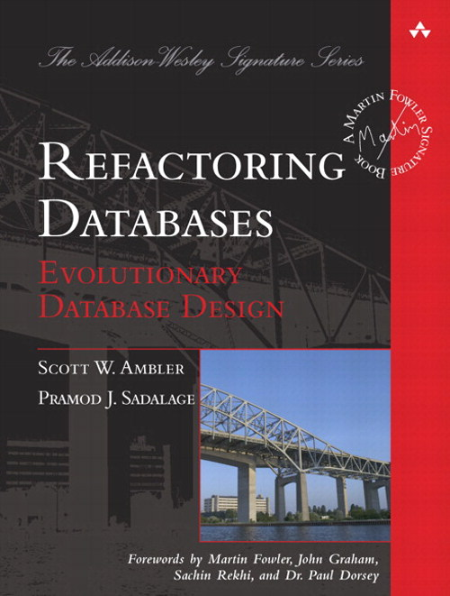{width=27%}

[http://www.ambysoft.com/books/refactoringDatabases.html](http://www.ambysoft.com/books/refactoringDatabases.html) 

---

- Existen dos herramientas externas que facilitan la evolución del esquema:

{width=22%}

[**http://flywaydb.org/**](http://flywaydb.org/)

**Database Migrations Made Easy**

Gestiona la migración con sentencias SQL específicas de la BBDD

[**http://www.liquibase.org/**](http://www.liquibase.org/)

**Source Control for your Database**

Gestiona la migración con XML genérico independiente de la de la BBDD

{width=31%}

---

- **Flyway y Liquibase** mantienen una **lista de cambios** que hay que hacer en el esquema para **evolucionar/migrar** de una versión a otra superior
- Cuando la aplicación **Spring** se **inicia**, se pueden ejecutar de forma **automática estos cambios** para convertir el esquema en la versión deseada

[https://www.baeldung.com/database-migrations-with-flyway](https://www.baeldung.com/database-migrations-with-flyway) 

[https://thorben-janssen.com/database-migration-with-liquibase-getting-started](https://thorben-janssen.com/database-migration-with-liquibase-getting-started) 

# Arquitectura

## Arquitectura

- La **arquitectura de software** define, de manera abstracta, los componentes que llevan a cabo alguna tarea de computación, sus interfaces y la comunicación entre ellos.
- Existen diferentes **estilos arquitectónicos** que pueden ser adecuados para diferentes tipos de aplicaciones

---

- Las aplicaciones Spring con BBDD suelen usar una arquitectura en la que las clases se agrupan por responsabilidades:
  - **Controladores:** Gestión de API REST
  - **Entidades:** Elementos básicos de información que se persisten en la BD. Modelo.
  - **Repositorios:** Guardar y consultar entidades
  - **Servicios:** Lógica de negocio que gestiona entidades
  - **Infraestructura:** Envío de mails
  - **Servicios de interconexión**

---

```{dot}
//| fig-width: 8.4
//| fig-height: 4.2
// Las tres capas de la aplicacion: controladores, servicios y, a la derecha,
// repositorios e infraestructura. Para anadir un modulo, basta con un nodo
// mas en su columna y la flecha correspondiente.
digraph arquitectura {
  rankdir=LR; bgcolor="transparent"; nodesep=0.18; ranksep=2.2;
  node [fontname="Lato", fontsize=11, shape=box, style="filled",
        fillcolor="#e2efd9", color="#70ad47", width=1.5, height=0.62];
  edge [color="#333333", arrowsize=0.7];

  subgraph cluster_c {
    label="Controladores\n(Interfaz)"; fontsize=10; fontcolor="#555555";
    color="#cccccc"; style=dashed;
    cu [label="Controlador\nUsuarios"]; cp [label="Controlador\nPedidos"];
    cpr [label="Controlador\nProductos"];
  }
  subgraph cluster_s {
    label="Servicios\n(Lógica de negocio)"; fontsize=10; fontcolor="#555555";
    color="#cccccc"; style=dashed;
    su [label="Servicio\nUsuarios"]; sp [label="Servicio\nPedidos"];
    spr [label="Servicio\nProductos"];
  }
  subgraph cluster_r {
    label="Repositorios (Persistencia)\ne infraestructura"; fontsize=10; fontcolor="#555555";
    color="#cccccc"; style=dashed;
    correos [label="Sistema envío\nde correos"];
    integracion [label="Módulo de\nIntegración con\notros sistemas"];
    ru [label="Repositorio\nUsuarios"]; rp [label="Repositorio\nPedidos"];
    rpr [label="Repositorio\nProductos"];
  }

  cu -> su; cp -> sp; cpr -> spr;
  su -> correos; su -> integracion; su -> ru;
  sp -> rp; sp -> integracion;
  spr -> rpr; spr -> ru;
}
```

---

- **Implementación**
  - **Controladores:** @Controller o @RestController
  - **Entidades:** @Entity
  - **Repositorios:** implements JpaRepository
  - **Servicios:** @Service
  - **Infraestructura:** @Service
  - **Servicios de interconexión:** @Service

---

- **Ventajas de esta arquitectura:**
  - Los **servicios** pueden testearse de forma unitaria (con dobles de repositorios y otros servicios)
  - Los **controladores** pueden testearse de forma unitaria (con doble del servidor web y de los servicios)
  - La **lógica de negocio** se puede reutilizar entre varios tipos de controladores (web, REST, línea de comandos...)

---

::: {.etiqueta-ejemplo}
ejem21
:::

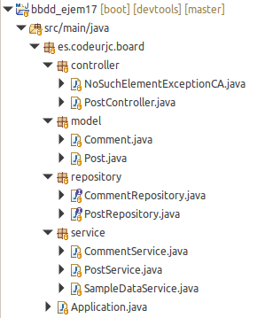{width=44%}

---

::: {.etiqueta-ejemplo}
ejem21
:::

```{dot}
//| fig-width: 9.6
//| fig-height: 2.7
// Las mismas tres capas en el ejemplo de posts y comentarios.
digraph posts {
  rankdir=LR; bgcolor="transparent"; nodesep=0.35; ranksep=1.1;
  node [fontname="Lato", fontsize=12, shape=box, style="filled",
        fillcolor="#e2efd9", color="#70ad47", width=1.9, height=0.6];
  edge [color="#333333", arrowsize=0.8];

  subgraph cluster_c {
    label="Controladores\n(Interfaz)"; fontsize=10; fontcolor="#555555";
    color="#cccccc"; style=dashed;
    pc [label="PostsController"];
  }
  subgraph cluster_s {
    label="Servicios\n(Lógica de negocio)"; fontsize=10; fontcolor="#555555";
    color="#cccccc"; style=dashed;
    ps [label="PostsService"]; cs [label="CommentsService"];
  }
  subgraph cluster_r {
    label="Repositorios\n(Persistencia)"; fontsize=10; fontcolor="#555555";
    color="#cccccc"; style=dashed;
    pr [label="PostsRepository"]; cr [label="CommentsRepository"];
  }

  pc -> ps; pc -> cs;
  ps -> pr; cs -> cr;
}
```

# Imágenes

## Imágenes

- En vez de guardar las **imágenes** en disco, se pueden **guardar en la BD**
- Eso favorece la **escalabilidad** porque las aplicaciones son **stateless** (no tienen estado) y se pueden replicar en **diferentes máquinas**
- Simplifica el despliegue en entornos en los que **no se tiene acceso al disco duro** de forma persistente (Heroku, Kubernetes…)
- Otra opción es usar **servicios de persistencia de ficheros** (S3, Minio...)

---

::: {.etiqueta-ejemplo}
ejem22
:::

- **Atributo Blob (****Binary Large Object****)**

```java
@Entity
public class Post {
	@Id
	@GeneratedValue(...)
	private long id;
	private String username;
	private String title;
	private String text;
	private String image;
	@Lob
	@JsonIgnore
	private Blob imageFile;
    ...
}
```

---

::: {.etiqueta-ejemplo}
ejem22
:::

- **Upload Image**

```java
@PostMapping("/{id}/image")
public ResponseEntity<Object> uploadImage(@PathVariable long id, 
  @RequestParam MultipartFile imageFile) throws IOException {
  Post post = posts.findById(id).orElseThrow();
  URI location = fromCurrentRequest().build().toUri();
  post.setImage(location.toString());
  post.setImageFile(BlobProxy.generateProxy(
    imageFile.getInputStream(), imageFile.getSize()));
  posts.save(post);
  return ResponseEntity.created(location).build();
}
```

---

::: {.etiqueta-ejemplo}
ejem22
:::

- **Subir un fichero con** **Postman**

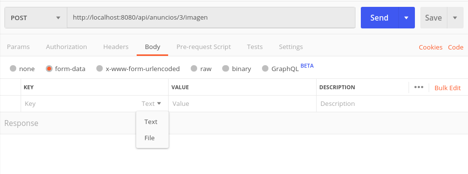{width=87%}

---

::: {.etiqueta-ejemplo}
ejem22
:::

- **Subir un fichero con** **Postman**

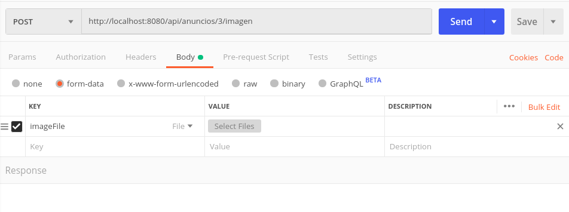{width=87%}

---

::: {.etiqueta-ejemplo}
ejem22
:::

- **Download Image**

```java
@GetMapping("/{id}/image")
public ResponseEntity<Object> downloadImage(@PathVariable long id) 
  throws SQLException {
  Post post = posts.findById(id).orElseThrow();
  if (post.getImageFile() != null) {
    Resource file = new InputStreamResource(
      post.getImageFile().getBinaryStream());
    return ResponseEntity.ok()
      .header(HttpHeaders.CONTENT_TYPE, "image/jpeg")
      .contentLength(post.getImageFile().length())
      .body(file);
  } else {
    return ResponseEntity.notFound().build();
  }
}
```

---

::: {.etiqueta-ejemplo}
ejem22
:::

- **Delete Image**

```java
@DeleteMapping("/{id}/image")
public ResponseEntity<Object> deleteImage(@PathVariable long id)
  throws IOException {
  Post post = posts.findById(id).orElseThrow();
  post.setImageFile(null);
  post.setImage(null);
  posts.save(post);
  return ResponseEntity.noContent().build();
}
```

# Accesos concurrentes

## Accesos concurrentes

- Es importante gestionar de forma adecuada qué ocurre cuando varios usuarios interactúan con una aplicación con base de datos **concurrentemente**
- Cuando los usuarios únicamente consultan información **no hay interferencias entre ellos**
- Cuando un usuario (o los dos) escriben, se pueden producir **interferencias no deseadas**

---

- **Ejemplos de situaciones problemáticas:**
  - Dos usuarios consultan un recurso desde la API REST a la misma vez.
    - Uno de ellos modifica una propiedad y reemplaza el recurso. 
    - El otro modifica otra propiedad y también reemplaza el recurso borrando los cambios de la modificación previa (lost updates)
  - Dos usuarios deciden comprar la última entrada de un concierto a la misma vez

---

- **Existen varias técnicas que nos ayudan a gestionar estas situaciones**
  - Transacciones de la base de datos
  - Cabeceras ETag e If-Match en la API REST
  - Sentencias SQL que verifican precondiciones

---

- **Transacciones de la base de datos** 
  - Varias sentencias se ejecutan dentro de una unidad lógica
  - Los cambios de todas ellas se aplican o se descartan. No es posible aplicar cambios parciales

[https://docs.oracle.com/javase/tutorial/jdbc/basics/transactions.html](https://docs.oracle.com/javase/tutorial/jdbc/basics/transactions.html) 

[https://docs.spring.io/spring-framework/docs/current/reference/html/data-access.html#transaction](https://docs.spring.io/spring-framework/docs/current/reference/html/data-access.html#transaction) 

---

- **Transacciones de la base de datos** 
  - El grado de aislamiendo de las transacciones es configurable (Isolation level)
  - Afecta a los datos que se pueden leer desde una transacción de otras transacciones que se ejecutan de forma concurrente.

## Transacciones de las base de datos

- **Isolation level:**
  - **READ\_UNCOMMITED:** Lectura de valores escritos por otras transacciones que todavía no han finalizado (y podrían abortarse finalmente) (Dirty reads)
  - **READ\_COMMITED:** Si durante la transacción se lee la misma fila dos veces y esa fila es modificada por otra transacción entre medias se leen valores diferentes (Non-repeatable reads)
  - **REPEATABLE\_READ:** Si se hace una consulta y se obtienen unas filas y otra transacción añade nuevas filas y se vuelve a hacer la misma consulta, aparecen filas nuevas (Phantom reads)
  - **SERIALIZABLE:** Las transacciones están aisladas entre sí. Su comportamiento es como si se ejecutaran secuencialmente.

## Accesos concurrentes

- **Cabeceras ETag e If-Match en la API REST**
  - **Problemática (****lost updates****):**
    - Dos usuarios consultan un recurso desde la API REST a la misma vez.
    - Uno de ellos modifica una propiedad y reemplaza el recurso. 
    - El otro modifica otra propiedad y también reemplaza el recurso (borrando los cambios de la modificacion previa)

[https://www.baeldung.com/etags-for-rest-with-spring](https://www.baeldung.com/etags-for-rest-with-spring) 

[https://dzone.com/articles/concurrency-control-in-rest-api-with-spring-framew](https://dzone.com/articles/concurrency-control-in-rest-api-with-spring-framew) 

---

- **Cabeceras ETag e If-Match en la API REST**
  - **Solución:** **Optimistic locking**
    - Cada recurso tiene asociada una versión
    - Cuando se lee un recurso se recibe la versión (**cabecera ETag**)
    - Cuando se quiere modificar el recurso (PUT o PATH) se tiene que enviar la versión recibida previamente (**cabecera** **If-Match**)
    - Si el recurso no ha sido modificado y sigue en esa versión, se acepta el cambio. Si no, error.

---

- **Sentencias SQL que verifican precondiciones**
  - **Problemática:**
    - Dos usuarios deciden comprar la última entrada de un concierto a la misma vez
    - Sólo uno de ellos debería poder comprar la entrada

---

- **Sentencias SQL que verifican precondiciones**
  - **Solución:**
    - Se podría usar un nivel de aislamiento de las transacciones SERIALIZABLE. Eso implica que la primera transacción consigue la entrada y la segunda detecta que ya no hay disponibles.
    - También se pueden ejecutar sentencias SQL atómicas que tengan la precondición de que queden plazas libres (más eficiente)

---

- **Sentencias SQL que verifican precondiciones**

```java
@Transactional
@Modifying
@Query("UPDATE Event e SET e.tickets=e.tickets+1 " + 
       "WHERE e.id = :id AND e.tickets+1 <= e.max_capacity")
public int reserveTicket(@Param("id") long id);
```

```
int rowsUpdated = eventRepository.reserveTicket(eventId);
if (rowsUpdated == 1) {
    //Ticket buy
} else {
    //Event full. No ticket
}
```

