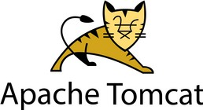

## Licencia {.nota-licencia visibility="uncounted"}

©2023  Micael Gallego, Francisco Gortázar, Michel Maes, Óscar Soto, Iván Chicano Algunos derechos reservados Este documento se distribuye bajo la licencia “Atribución-CompartirIgual 4.0 Internacional”  de Creative Comons Disponible en [https://creativecommons.org/licenses/by-sa/4.0/deed.es](https://creativecommons.org/licenses/by-sa/4.0/deed.es)

## Construcción en Spring Boot

::: {.columns}
::: {.column width="62%"}
- Antes de poder desplegarse una aplicación necesita ser **construida (build)** y **empaquetada (packaged)**
:::
::: {.column width="38%"}
{width=85%}
:::
:::

::: {.columns}
::: {.column width="57%"}
- En Java la construcción es realizada con **Maven** o **Gradle**
- El **empaquetado** depende del tipo de **aplicación** y la **tecnología**
:::
::: {.column width="43%"}
{width=92%}
:::
:::

---

::: {.columns}
::: {.column width="73%"}
- Las aplicaciones **Spring Boot** tienen dos formatos de empaquetado:

::: {.desde-nivel-2}
- **.jar:** Formato que necesita un Java Runtime Environment para ejecutarse
- **.war:** Formato que necesita un servidor de aplicaciones para ejecutarse
:::
:::
::: {.column width="27%"}
{width=81%}
:::
:::

[https://www.baeldung.com/java-jar-war-packaging](https://www.baeldung.com/java-jar-war-packaging) 

---

- **¿Cuándo usar war?**
  - Hay **administradores** que controlan el servidor y sólo permiten el despliegue así
    - **Ideal** cuando **varias aplicaciones** web están en el mismo servidor físico y el mismo dominio
    - **El inconvenientes** es que la app está **limitada** por la versión del servidor y sus librerías (es muy costoso de cambiar)
    - Algunos proveedores cloud ofrecen un **servidor**

---

- Actualmente se recomienda usar **.jar**
- Incluye un servidor web integrado (**Tomcat**, **Jetty**, **Undertow**, **Netty**…)
- Facilita la evolución de la aplicación (al no estar limitada por el servidor en el que se despliegan los .war)

{width=27%}

{width=25%}

{width=26%}

## Jar con Spring Boot

- **Añadir el plugin de Maven de Spring Boot encargado de empaquetar el .jar**
  - Crea un fichero .jar con todas las librerías de la aplicación y el servidor web en la carpeta **target**

```xml
<build>
	<plugins>
		<plugin>
			<groupId>org.springframework.boot</groupId>
			<artifactId>spring-boot-maven-plugin</artifactId>
		</plugin>
	</plugins>
</build>
```

---

- **¿Cómo generar el .jar?**
  - Desde eclipse
    - Botón derecho proyecto \> Run as…\> Maven install
  - Desde la línea de comandos
    - (en la raíz del proyecto) mvn package
- **Resultado**
  - Fichero \<nombreproyecto\>\_\<version\>.jar en la carpeta target

```
despliegue_ejem1-0.1.0.jar
```

::: {.enlace-repo}
[`despliegue_ejem1`](https://github.com/codeurjc/dad/tree/main/parte_2/tema_2.6_despliegue/despliegue_ejem1)
:::

---

- **Ejecutar la app web con el .jar**
  - Es requisito tener instalado un Java JRE
  - Ejecutamos el comando

```
$ java -jar despliegue_ejem1-0.1.0.jar
```

::: {.desde-nivel-2}
- Para finalizar la aplicación ejecutar **Ctrl+C** en la consola (se envía una señal de apagado **SIGTERM**)
- También se puede habilitar una **URL REST** para **apagar en remoto** (protegida por contraseña)
:::

::: {.enlace-repo}
[`despliegue_ejem1`](https://github.com/codeurjc/dad/tree/main/parte_2/tema_2.6_despliegue/despliegue_ejem1)
:::

---

- **Configuración de la aplicación**
  - Al ejecutar la aplicación se pueden sobreescribir las propiedades de configuración del fichero **application.properties** con:
    - 1) Parámetros de la línea de comandos
    - 2) Variables de entorno
    - 3) Fichero application.properties junto al fichero .jar

[http://docs.spring.io/spring-boot/docs/current/reference/html/boot-features-external-config.html](http://docs.spring.io/spring-boot/docs/current/reference/html/boot-features-external-config.html)

---

- **Configurar la app web con el .jar**
  - Configuración de puerto

```
$ java -jar despliegue_ejem1-0.1.0.jar --server.port=8081
```

::: {.desde-nivel-2}
- Configuración de base de datos
:::

```
$ java -jar despliegue_ejem2-0.0.1.jar \
  --spring.datasource.url=jdbc:mysql://localhost/test \
  --spring.datasource.username=root \
  --spring.datasource.password=pass \
  --spring.jpa.hibernate.ddl-auto=create-drop
```

::: {.enlace-repo}
[`despliegue_ejem1`](https://github.com/codeurjc/dad/tree/main/parte_2/tema_2.6_despliegue/despliegue_ejem1), [`despliegue_ejem2`](https://github.com/codeurjc/dad/tree/main/parte_2/tema_2.6_despliegue/despliegue_ejem2)
:::

---

- **Perfiles**
  - Es habitual que tengamos valores de propiedades diferentes en varios entornos (desarrollo y producción)
  - Podemos tener diferentes ficheros de configuración
    - application-prod.properties
    - application-dev.properties
  - Al ejecutar la aplicación se selecciona el perfil

```
$ java -jar -Dspring.profiles.active=prod despliegue_ejem2-0.0.1.jar
```

[http://docs.spring.io/spring-boot/docs/current/reference/html/boot-features-profiles.html](http://docs.spring.io/spring-boot/docs/current/reference/html/boot-features-profiles.html) 

::: {.enlace-repo}
[`despliegue_ejem2`](https://github.com/codeurjc/dad/tree/main/parte_2/tema_2.6_despliegue/despliegue_ejem2)
:::

## Otros formatos de empaquetado

- Existen **otros formatos** para desplegar aplicaciones Spring Boot
  - Docker
  - Imágenes nativas de GraalVM

---

- **Docker**
  - Formato genérico de empaquetado, distribución y ejecución de aplicaciones
  - Spring Boot permite el empaquetado en imágenes Docker de una forma muy sencilla (App + JRE)

{width=50%}

[https://spring.io/guides/topicals/spring-boot-docker/](https://spring.io/guides/topicals/spring-boot-docker/) 

---

- **Imágenes nativas de GraalVM**
  - GraamVM es una nueva tecnología que permite generar binarios de aplicaciones Java que se ejecutan sin JRE
  - El soporte de Spring Boot está en desarrollo

{width=54%}

[https://github.com/spring-projects-experimental/spring-graalvm-native](https://github.com/spring-projects-experimental/spring-graalvm-native) 

