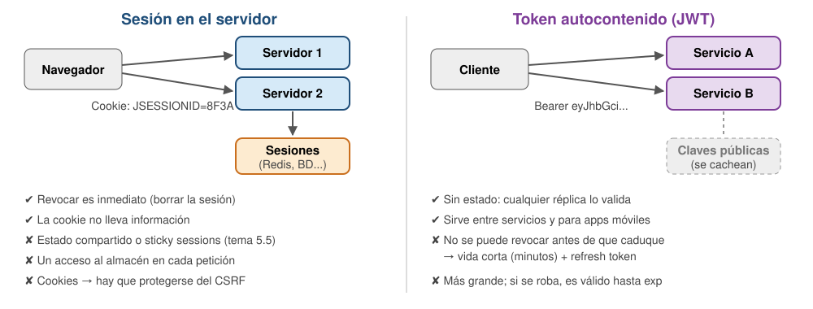
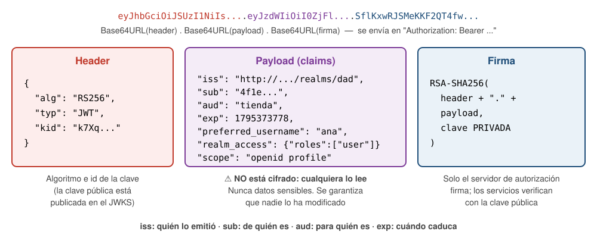
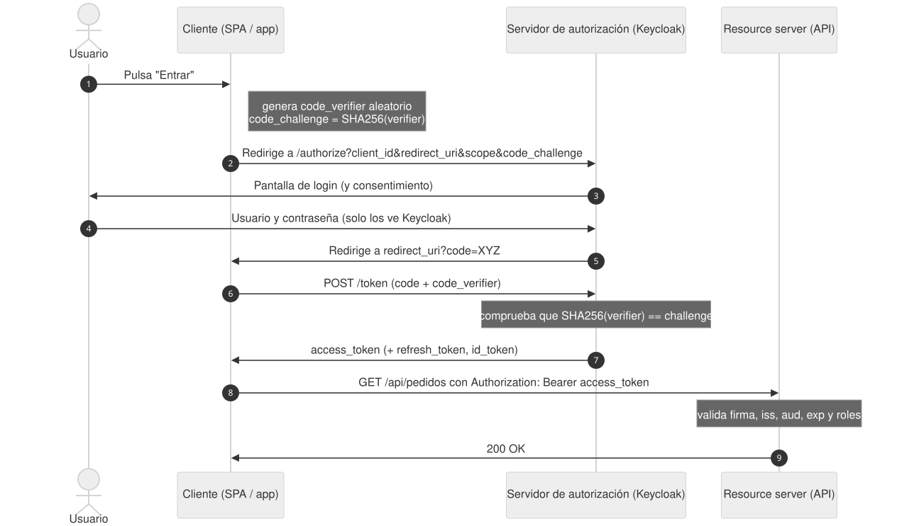
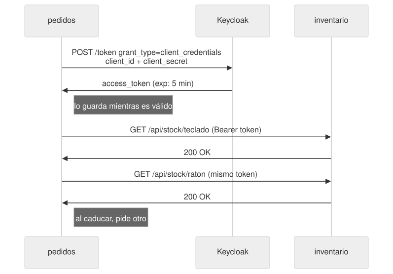
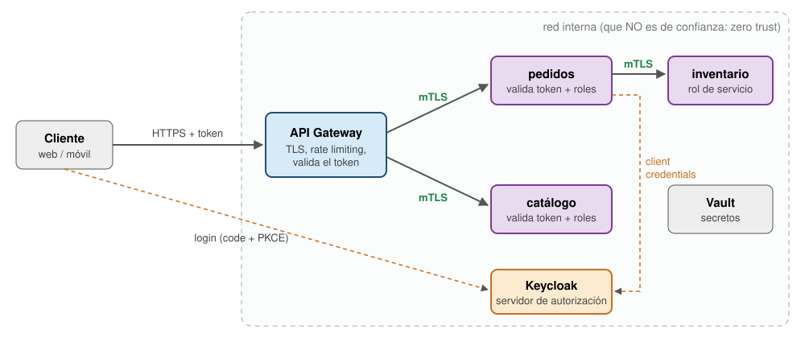

## Contenidos

1. Por qué la seguridad es más difícil en un sistema distribuido
2. Principios y riesgos más habituales en APIs (OWASP)
3. Autenticación: contraseñas, sesiones y tokens
4. JSON Web Tokens (JWT)
5. OAuth 2 y OpenID Connect con Keycloak
6. APIs protegidas con Spring Security
7. Seguridad entre servicios: *client credentials*, mTLS y *zero trust*
8. Secretos y otras defensas
9. Autorización a nivel de objeto · Ejercicio

::: {.ejemplo}
**Código de los ejemplos**: carpeta [`parte_2/tema_2.7_seguridad`](https://github.com/codeurjc/dad/tree/main/parte_2/tema_2.7_seguridad)
:::

# Seguridad en sistemas distribuidos {background-color="#1f4e79"}

## ¿Por qué es más difícil?

En un monolito hay **una puerta**. En un sistema distribuido hay muchas:

* **Más superficie de ataque**: cada servicio expone una API, cada uno con sus dependencias
* **La red no es segura** (la 4.ª falacia): el tráfico interno también se puede espiar o falsificar
* **¿Quién llama?** Ya no basta con saber qué usuario hay detrás: también **qué servicio**
* **La identidad tiene que viajar**: el usuario se autentica una vez, pero lo atienden cinco servicios
* **Secretos repartidos**: contraseñas de BD, claves de APIs, certificados... en muchas máquinas
* Un servicio comprometido no debería dar acceso a **todo** lo demás

::: {.aviso}
La seguridad no se "añade al final": condiciona la arquitectura (gateway, servidor de identidades, red, despliegue).
:::

## Principios

* **Defensa en profundidad**: varias capas; si una falla, la siguiente frena el ataque
* **Mínimo privilegio**: cada usuario, servicio y credencial tiene solo los permisos que necesita
* ***Zero trust***: no confiar en nada por estar "dentro de la red". Cada petición se autentica y autoriza
* **Fallar de forma segura**: ante la duda, denegar (`anyRequest().denyAll()`)
* **No inventar criptografía** ni protocolos: usar estándares (TLS, OAuth 2, OIDC) y bibliotecas probadas
* **Seguro por defecto**: lo que no se configura explícitamente, cerrado
* **Separar** autenticación (un servidor de identidades) de la lógica de negocio

## OWASP API Security Top 10 (2023)

::: {.small}
| | Riesgo | En pocas palabras |
|---|---|---|
| API1 | **Broken Object Level Authorization** (BOLA) | Pedir `/pedidos/42` y obtener el pedido de otro |
| API2 | Broken Authentication | Tokens mal validados, sin límite de intentos |
| API3 | Broken Object Property Level Authorization | Devolver o aceptar campos que no tocan (`"rol":"admin"` en el cuerpo) |
| API4 | Unrestricted Resource Consumption | Sin límites de peticiones, tamaño o paginación |
| API5 | Broken Function Level Authorization | Un usuario normal puede llamar a operaciones de administración |
| API6 | Unrestricted Access to Sensitive Business Flows | Automatizar compras o reservas sin control |
| API7 | Server Side Request Forgery (SSRF) | El servidor descarga una URL que pasa el atacante |
| API8 | Security Misconfiguration | CORS abierto, errores con trazas, TLS mal configurado |
| API9 | Improper Inventory Management | APIs viejas o de pruebas olvidadas |
| API10 | Unsafe Consumption of APIs | Fiarse de lo que devuelven otras APIs |

: {tbl-colwidths="[9,44,47]"}
:::

# Autenticación {background-color="#7d3c98"}

## Autenticación y autorización

::: columns
::: {.column width="50%"}
**Autenticación** (*authn*): ¿quién eres?

* Contraseña, segundo factor, *passkey*, certificado...
* Resultado: una **identidad** (y una credencial para no repetir el proceso: sesión o token)
* Respuesta si falla: **401 Unauthorized**
:::
::: {.column width="50%"}
**Autorización** (*authz*): ¿qué puedes hacer?

* Roles (RBAC), *scopes*, atributos (ABAC), propiedad del recurso
* Se decide **en cada petición**
* Respuesta si falla: **403 Forbidden** (o 404 si no se quiere revelar que existe)
:::
:::

::: {.aviso}
La mayoría de los fallos graves son de **autorización**: el usuario está bien autenticado, pero accede a algo que no es suyo.
:::

## Contraseñas

Si hay que guardarlas (mejor delegar en un servidor de identidades):

* **Nunca** en claro, ni **cifradas** (si se roba la clave se descifran todas)
* **Nunca** con un hash rápido (MD5, SHA-1, SHA-256): una GPU prueba miles de millones por segundo
* Función **lenta** y con **sal** aleatoria por usuario: **Argon2id**, **bcrypt**, **scrypt**, **PBKDF2**
* En Spring: `PasswordEncoderFactories.createDelegatingPasswordEncoder()` (guarda `{bcrypt}$2a$10$...`, lo que permite cambiar de algoritmo)

::: {.ejemplo}
**[seg-ejem1](https://github.com/codeurjc/dad/tree/main/parte_2/tema_2.7_seguridad/seg-ejem1)**: `PasswordHasher` con PBKDF2 hecho a mano (solo para entender la idea)
:::

```text
Contraseña almacenada (355 ms): pbkdf2$600000$2NiMsIfBDI6rz5EsAFjdQA==$gJN3U+M4h5MCs5O24howEvfUlNQkuZ92zpxqtJd4Jq8=
Misma contraseña, otro hash (otra sal): pbkdf2$600000$sg5EulxddSaz7HN20QVW8A==$L/eFWu+wmetlPN2IIVyadXEUUPOl1yBJvlEvSEzMK1w=
```

## Sesiones o tokens

{fig-align="center" width="95%"}

# JSON Web Tokens {background-color="#ca6f1e"}

## Anatomía de un JWT

{fig-align="center" width="95%"}

## Firma simétrica o asimétrica

::: columns
::: {.column width="50%"}
**HS256** (HMAC con un secreto compartido)

* El mismo secreto **firma y verifica**
* Todo servicio que verifica podría **fabricar** tokens
* Aceptable dentro de una única aplicación
:::
::: {.column width="50%"}
**RS256 / ES256** (clave pública/privada)

* Solo el servidor de autorización tiene la **privada**
* Los servicios verifican con la **pública**, que se descarga del **JWKS** (`/protocol/openid-connect/certs`)
* Las claves se pueden **rotar** (`kid`)
* Lo adecuado en sistemas distribuidos
:::
:::

Al validar un token hay que comprobar **siempre**:

* La **firma**, con un algoritmo **fijado** por el servidor (no el que diga el token)
* `iss` (emisor esperado), `exp` (no caducado) y `aud` (que el token es **para mí**)
* Después: roles / *scopes* para autorizar

## Ejemplo 1: un JWT hecho a mano

::: {.ejemplo}
**[seg-ejem1](https://github.com/codeurjc/dad/tree/main/parte_2/tema_2.7_seguridad/seg-ejem1)**: firma y verificación HS256 en Java puro. **Solo para entenderlo**: en una aplicación se usa Spring Security (Nimbus).
:::

```java
public static Map<String, Object> verify(String token, byte[] secret, Clock clock) {
    String[] parts = token.split("\\.", -1);
    Map<String, Object> header = parseJson(decode(parts[0]));
    // NUNCA aceptar el algoritmo que diga el token: "alg":"none" es un ataque clásico
    if (!"HS256".equals(header.get("alg"))) throw new InvalidTokenException("algoritmo");
    String expected = hmac(parts[0] + "." + parts[1], secret);
    // Comparación en tiempo constante (no filtrar información por los tiempos)
    if (!MessageDigest.isEqual(expected.getBytes(US_ASCII), parts[2].getBytes(US_ASCII)))
        throw new InvalidTokenException("firma incorrecta");
    Map<String, Object> claims = parseJson(decode(parts[1]));
    if (!(claims.get("exp") instanceof Long exp) || clock.instant().getEpochSecond() >= exp)
        throw new InvalidTokenException("caducado");
    return claims;
}
```

```text
Payload (lo puede leer cualquiera, NO está cifrado): {"sub":"ana","roles":"user","iat":1795373478,"exp":1795373778}
Token manipulado: firma incorrecta
```

## Problemas habituales con los JWT

* **No se pueden revocar**: un token robado vale hasta `exp`
    - *Access tokens* de **vida corta** (5-15 min) + ***refresh token*** para pedir otro
    - Si hace falta revocar ya: lista de revocados o *token introspection* (pero se pierde la ventaja de no tener estado)
* **Dónde guardarlo en el navegador**: `localStorage` es accesible desde cualquier script (XSS)
    - Patrón ***Backend for Frontend*** (BFF): el token se queda en el servidor y el navegador usa una cookie `HttpOnly; Secure; SameSite`
* **Tamaño**: viaja en cada petición; no meter cientos de permisos
* **Información sensible**: el payload es legible
* **Usarlo como sesión** para todo: no siempre es la mejor opción (una web monolítica va bien con sesiones)

# OAuth 2 y OpenID Connect {background-color="#1e8449"}

## OAuth 2: roles

**OAuth 2** (RFC 6749) es un estándar de **autorización delegada**: una aplicación obtiene un token para acceder a recursos **sin conocer la contraseña** del usuario.

| Rol | Qué es | Ejemplo |
|---|---|---|
| *Resource owner* | El usuario dueño de los datos | Ana |
| *Client* | La aplicación que quiere acceder | Frontend web, app móvil, otro servicio |
| *Authorization server* | Autentica y **emite tokens** | Keycloak, Auth0, Entra ID, Okta |
| *Resource server* | La API que **valida tokens** y sirve los datos | Nuestros servicios Spring |

* ***Access token***: credencial para llamar a la API (normalmente un JWT)
* ***Refresh token***: para obtener otro *access token* sin volver a pedir login
* ***Scopes***: permisos que pide el cliente (`pedidos.read`, `openid profile`)

## Authorization code + PKCE

{fig-align="center" width="100%"}

## Flujos (*grant types*)

::: {.small}
| Flujo | Cuándo | |
|---|---|---|
| ***Authorization code* + PKCE** | Un **usuario** entra en una aplicación (web, SPA, móvil) | ✔ El recomendado |
| ***Client credentials*** | Un **servicio** llama a otro, sin usuario | ✔ |
| ***Refresh token*** | Renovar un *access token* caducado | ✔ |
| *Device code* | Dispositivos sin teclado (TV, CLI) | ✔ |
| *Token exchange* | Cambiar un token por otro para llamar a otro servicio en nombre del usuario | ✔ Avanzado |
| *Implicit* | Antes, en SPAs | ✘ Eliminado en OAuth 2.1 |
| *Password* | La aplicación recibe la contraseña del usuario | ✘ Eliminado en OAuth 2.1 (aquí, solo para `curl`) |

: {tbl-colwidths="[28,47,25]"}
:::

::: {.small}
**PKCE** (*Proof Key for Code Exchange*): el cliente demuestra que es el mismo que inició el login. Evita que alguien que intercepte el `code` lo canjee. Obligatorio en OAuth 2.1 para todos los clientes.
:::

## OpenID Connect y Keycloak

**OpenID Connect** (OIDC) = OAuth 2 + **autenticación**:

* ***ID token*** (JWT) con la identidad del usuario: para el **cliente**, no para llamar a APIs
* Endpoint `/userinfo` y *scopes* estándar (`openid`, `profile`, `email`)
* ***Discovery***: `/.well-known/openid-configuration` describe todos los endpoints y el JWKS
* *Single sign-on* (SSO) entre aplicaciones

**Keycloak**: servidor de identidades de código abierto (CNCF)

* **Realm**: espacio aislado de usuarios, roles y clientes
* **Clients**: aplicaciones registradas (públicas o confidenciales, con *service account*)
* **Roles** de realm y de cliente, grupos, federación (LDAP, Google, GitHub...), 2FA, *passkeys*
* Se importa la configuración desde un JSON → entornos reproducibles

# APIs protegidas con Spring {background-color="#555"}

## Ejemplo 2: un *resource server*

::: {.ejemplo}
**[seg-ejem2](https://github.com/codeurjc/dad/tree/main/parte_2/tema_2.7_seguridad/seg-ejem2)**: API de productos que valida los JWT de Keycloak. Lectura pública, escritura solo para `admin`.
:::

```xml
<dependency>
  <groupId>org.springframework.boot</groupId>
  <artifactId>spring-boot-starter-security-oauth2-resource-server</artifactId>
</dependency>
```

```properties
# Firma (claves públicas del JWKS), emisor y caducidad
spring.security.oauth2.resourceserver.jwt.issuer-uri=http://localhost:8180/realms/dad
spring.security.oauth2.resourceserver.jwt.jwk-set-uri=${spring.security.oauth2.resourceserver.jwt.issuer-uri}/protocol/openid-connect/certs
```

* La aplicación **no** guarda usuarios ni contraseñas, ni habla con Keycloak en cada petición
* Descarga las claves públicas una vez (y cuando aparece un `kid` nuevo)
* Con `docker compose up` se arrancan Keycloak (con el realm importado) y la API

## Configuración de seguridad

```java
@Configuration
@EnableMethodSecurity
public class SecurityConfig {
    @Bean
    SecurityFilterChain securityFilterChain(HttpSecurity http) throws Exception {
        http.authorizeHttpRequests(auth -> auth
                .requestMatchers(HttpMethod.GET, "/api/productos/**").permitAll()
                .anyRequest().authenticated())
            .oauth2ResourceServer(o -> o.jwt(
                jwt -> jwt.jwtAuthenticationConverter(jwtAuthenticationConverter())))
            .sessionManagement(s -> s.sessionCreationPolicy(SessionCreationPolicy.STATELESS))
            .csrf(csrf -> csrf.disable());   // sin cookies de sesión no hay CSRF
        return http.build();
    }
    @Bean
    JwtAuthenticationConverter jwtAuthenticationConverter() {
        JwtAuthenticationConverter converter = new JwtAuthenticationConverter();
        converter.setJwtGrantedAuthoritiesConverter(new KeycloakRolesConverter()); // ROLE_xxx
        converter.setPrincipalClaimName("preferred_username");   // getName() = "ana"
        return converter;
    }
}
```

## Autorización en los métodos

::: columns
::: {.column width="50%"}
```java
@PostMapping
@PreAuthorize("hasRole('admin')")
public ResponseEntity<Producto> crearProducto(
        @RequestBody Producto producto) {
    ...
}

@GetMapping("/api/me")
public Map<String, Object> me(
        Authentication authentication,
        @AuthenticationPrincipal Jwt jwt) {
    // authentication.getName()
    // authentication.getAuthorities()
    // jwt.getClaimAsString("email")
}
```
:::
::: {.column width="50%"}
```java
// Keycloak: "realm_access":
//              {"roles": [...]}
public Collection<GrantedAuthority>
        convert(Jwt jwt) {
    Map<String, Object> ra =
        jwt.getClaimAsMap("realm_access");
    if (ra == null || !(ra.get("roles")
            instanceof List<?> roles)) {
        return List.of();
    }
    return roles.stream()
        .map(r -> (GrantedAuthority)
            new SimpleGrantedAuthority(
                "ROLE_" + r))
        .toList();
}
```
:::
:::

* Por URL en `SecurityFilterChain` (grueso) y por método con `@PreAuthorize` (fino)
* Sin conversor, Spring solo crea authorities `SCOPE_xxx` a partir del claim `scope`

## Probar la seguridad

Con Keycloak arrancado:

```bash
TOKEN=$(curl -s -d client_id=tienda-web -d grant_type=password -d username=ana -d password=ana \
  http://localhost:8180/realms/dad/protocol/openid-connect/token | jq -r .access_token)

curl -i -X POST localhost:8080/api/productos ...                             # 401
curl -i -H "Authorization: Bearer $TOKEN" -X POST localhost:8080/api/productos ...  # 403
```

En los tests, **sin Keycloak**: `jwt()` simula un token ya validado. Hay que probar sobre todo lo que **no** debe funcionar

```java
private static JwtRequestPostProcessor usuario(String nombre, String... roles) {
    return jwt().jwt(t -> t.subject(nombre).claim("preferred_username", nombre)
                    .claim("realm_access", Map.of("roles", List.of(roles))))
                .authorities(new KeycloakRolesConverter());   // el MISMO conversor
}

@Test
void unUsuarioNormalNoPuedeCrear403() throws Exception {
    mvc.perform(post("/api/productos").with(usuario("ana", "user"))
            .contentType(MediaType.APPLICATION_JSON).content(NUEVO))
        .andExpect(status().isForbidden());
}
```

# Seguridad entre servicios {background-color="#b03a2e"}

## ¿Cómo se identifica un servicio?

Cuando `pedidos` llama a `inventario`, ¿qué token envía?

* **Propagar el token del usuario**: `inventario` sabe quién es el usuario final
    - ✘ El token tiene que tener `aud` de todos los servicios; un servicio comprometido puede reutilizarlo
* ***Token exchange*** (RFC 8693): cambiar el token del usuario por otro limitado para `inventario`
* ***Client credentials***: `pedidos` tiene **su propia identidad** (`client_id` + secreto) y pide su token
    - ✔ Lo más sencillo cuando la operación no depende del usuario (tareas programadas, consultas internas)
* **mTLS**: los dos extremos presentan **certificado**. Autentica la conexión, no la petición
    - Lo hace automáticamente una ***service mesh*** (Istio, Linkerd) sin tocar el código

## Ejemplo 3: *client credentials*

{fig-align="center" width="46%"}

::: {.ejemplo}
**[seg-ejem3](https://github.com/codeurjc/dad/tree/main/parte_2/tema_2.7_seguridad/seg-ejem3)**: `pedidos` consulta el stock en `inventario`, que solo acepta tokens con el rol `inventario-lector`.
:::

```properties
spring.security.oauth2.client.registration.inventario.provider=keycloak
spring.security.oauth2.client.registration.inventario.client-id=pedidos-service
spring.security.oauth2.client.registration.inventario.client-secret=${PEDIDOS_CLIENT_SECRET}
spring.security.oauth2.client.registration.inventario.authorization-grant-type=client_credentials
spring.security.oauth2.client.provider.keycloak.token-uri=http://localhost:8180/realms/dad/protocol/openid-connect/token
```

## El token en cada petición

```java
@Bean  // Funciona fuera de una petición de un usuario: la adecuada entre servicios
OAuth2AuthorizedClientManager authorizedClientManager(ClientRegistrationRepository registrations,
        OAuth2AuthorizedClientService authorizedClients) {
    var manager = new AuthorizedClientServiceOAuth2AuthorizedClientManager(registrations,
            authorizedClients);
    manager.setAuthorizedClientProvider(
            OAuth2AuthorizedClientProviderBuilder.builder().clientCredentials().build());
    return manager;
}

static RestClient crearInventarioRestClient(RestClient.Builder builder,
        OAuth2AuthorizedClientManager manager, String url) {
    var interceptor = new OAuth2ClientHttpRequestInterceptor(manager);
    interceptor.setClientRegistrationIdResolver(request -> "inventario");
    return builder.baseUrl(url).requestInterceptor(interceptor).build();
}
```

```java
// Ni una línea de seguridad: el interceptor añade "Authorization: Bearer ..."
return inventario.get().uri("/api/stock/{producto}", producto)
        .retrieve().body(Stock.class).unidades();
```

* El token se **reutiliza** hasta que caduca (el test lo comprueba: 3 llamadas, 1 token)
* En `inventario`: `.requestMatchers("/api/stock/**").hasRole("inventario-lector")` y el nombre del llamante es el claim `azp`

## Arquitectura de referencia

{fig-align="center" width="95%"}

::: {.small}
El **gateway** centraliza TLS, límites de peticiones y un primer filtro de tokens, pero cada servicio **vuelve a validar** el token y aplica su autorización (defensa en profundidad, *zero trust*).
:::

# Secretos y otras defensas {background-color="#1f4e79"}

## Gestión de secretos

Contraseñas de BD, secretos de clientes OAuth, claves de APIs, certificados...

* **Nunca en el repositorio** (ni en el historial: un `git rm` no basta, hay que **rotar**)
    - Herramientas que lo detectan: *GitHub secret scanning*, `gitleaks`
* Inyectarlos en **tiempo de ejecución**: variables de entorno, ficheros montados
    - `client-secret=${PEDIDOS_CLIENT_SECRET}` en `application.properties`
* **Gestor de secretos**: HashiCorp Vault, AWS Secrets Manager, Azure Key Vault
    - Acceso auditado, **rotación**, secretos dinámicos (credenciales de BD que caducan)
* **Secrets de Kubernetes**: por defecto solo **base64** (no es cifrado); activar cifrado en reposo y limitar quién puede leerlos
* **Mínimo privilegio** también aquí: cada servicio con **su** usuario de BD y **sus** credenciales

## Otras defensas

* **TLS en todas partes**: HTTPS hacia fuera; dentro, mTLS o al menos TLS (tema 5.5: terminación y *passthrough*)
* **Limitar el consumo**: *rate limiting* en el gateway, tamaño máximo de peticiones, paginación obligatoria
* **Validar todas las entradas** (`@Valid`), y consultas parametrizadas (inyección SQL)
* **DTOs** de entrada y salida: no aceptar ni devolver campos que no tocan (asignación masiva)
* **Errores** sin trazas ni detalles internos hacia fuera
* **CORS** restringido a los orígenes conocidos; cabeceras de seguridad (HSTS, CSP...)
* **Dependencias** actualizadas: Dependabot, `mvn dependency-check:check`, escaneo de imágenes Docker (Trivy)
* **Logs y auditoría**: quién hizo qué (sin contraseñas ni tokens en los logs) y alertas ante patrones raros (tema 5.8)

# Autorización a nivel de objeto {background-color="#7d3c98"}

## BOLA: el fallo más común en APIs

```java
@GetMapping("/api/pedidos/{id}")
public Pedido ver(@PathVariable long id) {
    return repository.findById(id).orElseThrow();     // ✘ ¿Y si el pedido es de otro usuario?
}

@PostMapping("/api/pedidos")
public Pedido crear(@RequestBody Pedido pedido) {     // ✘ ¿Y si el cuerpo trae "propietario":"luis"?
    return repository.save(pedido);
}
```

* El usuario **está autenticado** y tiene el rol correcto... pero los ids son **predecibles**: `/api/pedidos/1`, `/2`, `/3`...
* Los roles (`hasRole`) no bastan: hay que comprobar la **relación** entre el usuario y **el recurso concreto**
* Usar UUIDs dificulta adivinar ids, pero **no sustituye** a la comprobación

::: {.aviso}
Comprobar la propiedad en **todas** las operaciones (leer, listar, modificar, borrar) y en un **único sitio**, y probar con tests los accesos que deben fallar.
:::

## Resumen

* Distribuido = más superficie de ataque y una red en la que **no se puede confiar** (*zero trust*)
* **Autenticación** ≠ **autorización**; la mayoría de los fallos graves son de autorización (BOLA)
* Contraseñas con hash **lento y con sal**; mejor aún, delegar en un servidor de identidades
* **JWT**: autocontenido, firmado (no cifrado), de vida corta; validar firma, `iss`, `aud` y `exp`
* **OAuth 2 + OIDC**: *authorization code* + PKCE para usuarios, *client credentials* entre servicios
* **Spring**: *resource server* con unas líneas de configuración, `@PreAuthorize` y tests con `jwt()`
* **Secretos** fuera del código, en un gestor y rotados; TLS/mTLS; límites; dependencias al día

## Ejemplos del tema

| Proyecto | Contenido |
|---|---|
| [seg-ejem1](https://github.com/codeurjc/dad/tree/main/parte_2/tema_2.7_seguridad/seg-ejem1) | JWT HS256 y hash de contraseñas con PBKDF2 hechos a mano, en Java puro, para entender cómo funcionan |
| [seg-ejem2](https://github.com/codeurjc/dad/tree/main/parte_2/tema_2.7_seguridad/seg-ejem2) | API REST como *resource server* OAuth 2, con Keycloak, roles y tests con `jwt()` |
| [seg-ejem3](https://github.com/codeurjc/dad/tree/main/parte_2/tema_2.7_seguridad/seg-ejem3) | Comunicación entre servicios con *client credentials* (`pedidos` → `inventario`) |
| [seg-ejer1](https://github.com/codeurjc/dad/tree/main/parte_2/tema_2.7_seguridad/seg-ejer1) | Solución del ejercicio 1: autorización a nivel de objeto |

: {tbl-colwidths="[20,80]"}

```bash
cd seg-ejem2
mvn test                     # sin Keycloak
docker compose up --build    # Keycloak en :8180 (admin/admin) y la API en :8080
```

# Ejercicio {background-color="#ca6f1e"}

## Ejercicio 1: cada uno sus pedidos (I)

::: {.ejercicio}
Una tienda tiene una API de pedidos protegida con Keycloak. Todos los usuarios tienen el rol `user` y los empleados de atención al cliente, además, `soporte`. Una auditoría ha encontrado que **cualquier usuario puede ver y cancelar los pedidos de los demás** cambiando el id de la URL.
:::

Implementa la API con Spring Boot como *resource server* (puedes partir de [seg-ejem2](https://github.com/codeurjc/dad/tree/main/parte_2/tema_2.7_seguridad/seg-ejem2)):

* `GET /api/pedidos`: los pedidos **del usuario**; `soporte` ve todos
* `GET /api/pedidos/{id}`: el pedido, si es suyo (o es `soporte`)
* `POST /api/pedidos`: crea un pedido **del usuario** con estado `PENDIENTE`
* `DELETE /api/pedidos/{id}`: cancela el pedido, solo si es suyo y está `PENDIENTE` (si no, 409)
* Todas las operaciones exigen el rol `user`

## Ejercicio 1: cada uno sus pedidos (II)

Requisitos:

1. Un pedido de otro usuario debe responder **igual que uno que no existe**. ¿404 o 403? Justifícalo
2. El propietario y el estado **no** se pueden fijar desde el cuerpo de la petición
3. La regla de autorización debe estar en **un único sitio**
4. Tests con `jwt()` que demuestren que **todos** los accesos indebidos fallan (sin token, sin rol, pedido ajeno al leer y al cancelar, propietario falsificado en el cuerpo)
5. Opcional: el realm de Keycloak (`ana`, `luis`, `soporte`) y un `docker-compose.yml` para probarlo con `curl`

Para pensar: ¿bastaría con usar UUIDs en lugar de ids numéricos? ¿Dónde pondrías esta comprobación si los pedidos estuvieran en una base de datos con millones de filas?

::: {.ejemplo}
**Solución**: [seg-ejer1](https://github.com/codeurjc/dad/tree/main/parte_2/tema_2.7_seguridad/seg-ejer1) (inténtalo antes de mirarla)
:::

## Referencias

* [OWASP API Security Top 10 (2023)](https://owasp.org/API-Security/editions/2023/en/0x11-t10/) y [OWASP Cheat Sheet Series](https://cheatsheetseries.owasp.org/)
* [Spring Security: OAuth2 Resource Server](https://docs.spring.io/spring-security/reference/servlet/oauth2/resource-server/index.html) y [OAuth2 Client](https://docs.spring.io/spring-security/reference/servlet/oauth2/client/index.html)
* [Documentación de Keycloak](https://www.keycloak.org/documentation)
* [The OAuth 2.1 Authorization Framework](https://datatracker.ietf.org/doc/draft-ietf-oauth-v2-1/) y [OAuth 2.0 for Browser-Based Applications](https://datatracker.ietf.org/doc/draft-ietf-oauth-browser-based-apps/) (IETF)
* RFC 7519 (JWT), RFC 7636 (PKCE), RFC 8693 (*Token Exchange*), [OpenID Connect Core](https://openid.net/specs/openid-connect-core-1_0.html)
* Justin Richer y Antonio Sanso. *OAuth 2 in Action*. Manning, 2017
* Prabath Siriwardena y Nuwan Dias. *Microservices Security in Action*. Manning, 2020
