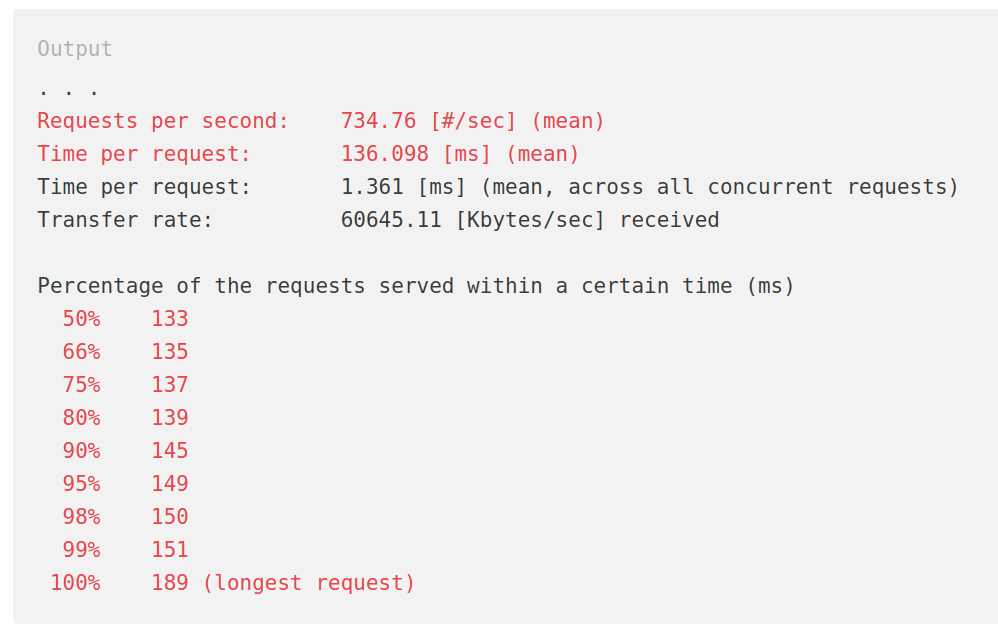
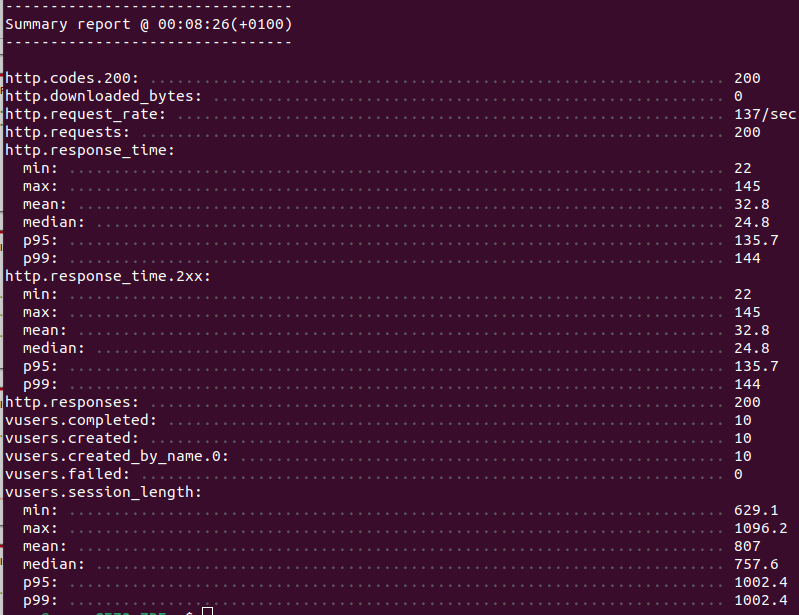
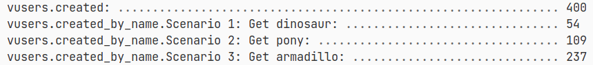
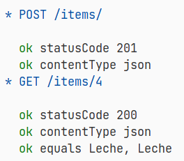

## Licencia {.nota-licencia visibility="uncounted"}

©2025  Micael Gallego, Francisco Gortázar, Michel Maes, Óscar Soto, Iván Chicano Algunos derechos reservados Este documento se distribuye bajo la licencia “Atribución-CompartirIgual 4.0 Internacional”  de Creative Comons Disponible en [https://creativecommons.org/licenses/by-sa/4.0/deed.es](https://creativecommons.org/licenses/by-sa/4.0/deed.es)

## Pruebas de carga

- **Introducción a pruebas de carga**
- Artillery

## Introducción a pruebas de carga

- Necesitamos herramientas que nos permitan ejercitar el SUT en **diferentes condiciones** y tomar las **medidas de su comportamiento**
- Hay que definir **qué métricas medir** y cómo hacerlo
- En ocasiones se definen **umbrales** sobre esas métricas, o se **compara** con los valores de una **versión previa** (para **evitar regresiones**)
- Se pueden hacer en **fases tempranas del desarrollo** para mantener los parámetros de rendimiento en valores aceptables en todo momento

---

- Medidas más utilizadas en aplicaciones web:
  - **Latencia de las peticiones http:** Tiempo desde que se envía una petición hasta que se empieza a recibir la respuesta
  - **Número / % de peticiones incorrectas:** Estado http diferente de 2xx
  - **Ancho de banda:** bytes por segundo
  - **Número de peticiones por segundo:** Depende del número de usuarios (hilos) en paralelo ejercitando el SUT

---

- Medidas estadísticas de la latencia:
  - **Min:** Mínima
  - **Max:** Máxima
  - **Median (p50):** Mediana. Si ordenamos los valores de menor a mayor, el que ocupa la posición central (No es el valor medio)
  - **p95:** La latencia máxima del 95% de las peticiones con menor latencia. Sólo el 5% está por encima de ese valor
  - **p99:** La latencia máxima del 99% de las peticiones con menor latencia. Sólo el 1% está por encima de ese valor

---

- Medidas estadísticas de la latencia:

```yaml
Complete report @ 2019-01-02T17:32:36.653Z
  Scenarios launched:  300
  Scenarios completed: 300
  Requests completed:  600
  RPS sent: 18.86
  Request latency:
    min: 52.1
    max: 11005.7
    median: 408.2
    p95: 1727.4
    p99: 3144
  Scenario counts:
    0: 300 (100%)
  Codes:
    200: 300
    302: 300
```

{width=32%}

---

{width=23%}

- Medidas estadísticas de la latencia:

{width=91%}

---

- El entorno debe ser **lo más parecido posible al de producción**
- No se deberían ejecutar otro tipo de procesos o pruebas en este entorno para no afectar a la **fiabilidad** de los resultados
- No se recomienda ejecutar la **herramienta de pruebas de carga** en la misma máquina del SUT
  - Pero, para aprender, a veces es inevitable

---

- La mayoría de las veces es necesario **ejecutar estas pruebas de forma distribuida**
  - Varios nodos realizan peticiones sobre el SUT
  - Se pueden simular cargas más parecidas a las reales
  - Vigilar los cuellos de botella
    - Nodos en la misma máquina
    - Ancho de banda de red

---

- **Metodología**
  -  Identificar el entorno de pruebas
    - Entorno físico o virtualizado de pruebas y de producción (hardware, software y red)
    - Herramientas disponibles para las pruebas
  -  Identificar los criterios de aceptación de rendimiento
  -  Planificar y diseñar las pruebas
    - Escenarios, variabilidad de usuarios y su simulación
    - Definir datos de prueba y métricas a recoger

---

- **Metodología**
- 4. Configurar el entorno de prueba
  - Preparar el entorno, las herramientas y los recursos
  - Monitorización para poder recoger datos que sirvan posteriormente para construir las métricas
- 5. Aplicar el diseño de la prueba
  - Desarrollar las pruebas de rendimiento: scripts, ficheros de datos, configuraciones…
- 6. Ejecutar la prueba
- 7. Analizar los resultados
- 8. Repetir

---

- Herramientas para realizar pruebas de carga
- **Open source**
  - JMeter
  - Gatling
  - **Artillery**
  - k6.io

- **Propietarias**
  - **Cloud**
    - BlazeMeter
    - Flood.io
    - CloudTest
    - Loader.io
  - **On premises**
    - LoadRunner
    - Rational Performance Tester

# Introducción a Artillery

## Introducción a Artillery

{width=17%}

- Artillery es un **toolkit** que nos permite realizar **pruebas de carga** de forma sencilla a través de una API.
- Esta escrita en Node.js y su instalación es muy sencilla.
- Cuenta con multitud de plugins para generar otras métricas e integrarlas con herramientas de visualización: StatsD, Graphana, Graphite, Datadog ..

$ npm install -g artillery

[https://artillery.io/](https://artillery.io/)

---

- **Public WebSites/APIs**
- En este tema veremos ejemplos de testing de carga con Artillery
  - Debemos evitar utilizar endpoints de web reales
  - Utilizaremos aplicaciones locales o webs especificamente pensadas para probar este tipo de herramientas

[https://github.com/BMayhew/awesome-sites-to-test-on?tab=readme-ov-file#performance-testing](https://github.com/BMayhew/awesome-sites-to-test-on?tab=readme-ov-file#performance-testing) 

---

- **Quick**
- Podemos hacer una prueba rápida y sencilla a través de la terminal de comandos usando **quick**:
  - Con --count \<users\> definimos el número de usuarios que van a realizar la conexión
  - Con -n \<requests\> definimos el número de conexiones/peticiones que realizará cada usuario.
  - Por defecto, realizará peticiones GET sobre la URL que le hemos proporcionado 

$ artillery quick --count 10 -n 20 https://www.demoblaze.com/

---

{width=83%}

---

{width=83%}

Recuento de códigos HTTP obtenidos

---

{width=83%}

Promedio de peticiones por segundo completadas

---

{width=83%}

Peticiones completadas

---

{width=83%}

Estadísticos de la latencia

---

Escenarios (usuarios) lanzados/completados

{width=83%}

---

{width=83%}

Escenarios/usuarios que fallaron

---

- **Quick**
- El comando quick nos ofrece una serie de “flags” (además de los vistos en el ejemplo) que nos permiten definir algunas características del test de carga:
  - -d, --duration \<seconds\>     		Duración del test
  - -r, --rate \<number\>          		         Tasa de llegada de peticiones (por segundo)
  - -p, --payload \<string\>       		Cuerpo de payload (para peticiones POST)
  - -t, --content-type \<string\>  		Tipo de contenido
  - -o, --output \<string\>        		         Fichero de salida
  - -k, --insecure               			         Desactiva la verificación del certificado TSL
  - -q, --quiet                  				Modo silencioso (solo resultado final)

# Test Scripts

## Artillery - Test Scripts

- **Artillery** cuenta con multitud de opciones que podrían ser tediosas de escribir en un solo script con quick.
- Nos ofrece un **archivo de configuración** (Test Script) con la extensión .yml dónde situar todas las propiedades que conformarán nuestro test de carga.
- Podemos lanzar este fichero de configuración utilizando el comando **run**.

$ artillery run myConfig.yml

---

- Los Test Scripts constan de dos secciones:
  - **config**: Incluye toda la configuración previa a la prueba de carga:
    - target
    - enviroments
    - phases
    - payloads
    - etc ..
  - **scenarios**: Incluye la descripción de las acciones que realizarán los usuarios.

---

- Ejemplo básico de un Test Script
  - Llegan 20 usuarios por segundo durante 20 segundos

**artillery\_ejem1** 

```yaml
config:
  target: 'https://www.demoblaze.com/'
  phases:
    - duration: 20
      arrivalRate: 20
scenarios:
  - flow:
    - get:
        url: "/prod.html?idp_=1"
```

---

- **Configuración**
  - target
    - La URI del recurso. 
      - Para HTTP(S) será la URL base de todas las request
      - Para WebSockets será el punto de conexión del socket.
  - enviroments
    - Podemos definir una serie de entornos (desarrollo, producción, etc) cada uno con su URL para ejecutar los test de carga.

---

- En los siguientes ejemplos utilizaremos una app Spring llamada **items\_app** disponible junto a los ejemplos 
  - API REST con operaciones CRUD sobre Item
  - Item tiene 2 atributos: 
    - description (String)
    - checked (boolean)
- Será necesario lanzarla **antes** de ejecutar las pruebas de Artillery 

---

- Ejemplo target/enviroments

**artillery\_ejem2** 

$ artillery run -e **staging** artillery\_ejem2/load-test.yml

```yaml
config:
  environments:
    production:
      target: "http://www.items.es"
      phases:
        - duration: 120
          arrivalRate: 10
    staging:
      target: "http://127.0.0.1:8080"
      phases:
        - duration: 20
          arrivalRate: 10
scenarios:
  - flow:
    - get:
        url: "/items/"
```

---

- **Configuración**
  - phases
    - Permite definir distintas fases, cada una de ellas con una duración y ratio de usuarios por segundo.

```yaml
config:
  target: "https://staging.example.com"
  phases:
    - duration: 120
      arrivalRate: 10
      rampTo: 50
      name: "Warm up the application"
    - pause: 60
    - duration: 600
      arrivalRate: 50
      name: "Sustained max load"
```

---

- **Configuración**
  - payload
    - Con esta opción podemos importar variables desde un CSV. 
  - variables
    - Podemos utilizar en los distintos escenarios las variables que obtengamos en el payload
  - defaults
    - Podemos definir las cabeceras por defecto que utilizarán nuestras peticiones

---

- Ejemplo payload/variables

**artillery\_ejem3** 

```yaml
config:
  target: "http://127.0.0.1:8080"
  phases:
    - duration: 20
      arrivalRate: 10
  payload:
    path: "items.csv"
    fields:
      - "description"
      - "checked"
scenarios:
  - flow:
    - post:
        url: "/items/"
        json:
          description: "{{ description }}"
          checked: "{{ checked }}"
```

---

- **Configuración**
  - ensure
    - Podemos realizar **aserciones**:
      - Comprobar si un % de las peticiones tiene menos de una **latencia** determinada.
      - Comprobar si las peticiones no sobrepasan una **tasa de error** determinada.
    - Es útil cuando integramos las pruebas de carga en un sistema de CI (Integración Continua).
      - El comando “artillery run” devolverá **distinto de cero** si no se cumple alguna de las condiciones. 

[https://www.artillery.io/docs/reference/extensions/ensure](https://www.artillery.io/docs/reference/extensions/ensure) 

---

- Ejemplo ensure

**artillery\_ejem4** 

```{.yaml data-lineas="3,15"}
config:
  plugins:
    ensure: {}
  target: "http://127.0.0.1:8080"
  phases:
    - duration: 20
      arrivalRate: 10
  payload:
    path: "items.csv"
    fields:
      - "description"
      - "checked"
  ensure:
    thresholds:
      - "http.response_time.p95": 2
scenarios:
  - flow:
    - post:
        url: "/items/"
        json:
          description: "{{ description }}"
          checked: "{{ checked }}"
```

::: {.nota-codigo}
Comprobamos que el 95% de las respuestas tegan una latencia menor a 2 segundos
:::

::: {.nota-codigo}
Ensure es un plugin que debemos incluir en la configuración para poder usarlo
:::

---

- **Escenarios**
- En esta sección se pueden declarar uno o más escenarios para los usuarios.
- Los escenarios se conforman de una secuencia de peticiones o mensajes enviados por el usuario.
- Cada escenario debe contener un atributo **flow**, un array de operaciones que realiza el usuario (POST, GET, etc).
- Podemos asignar una probabilidad de que un usuario escoja un escenario u otro a través de la propiedad **weight**.

---

- Ejemplo scenario

**artillery\_ejem5** 

```yaml
config:
  target: http://asciiart.artillery.io:8080
  phases:
    - duration: 20
      arrivalRate: 20
scenarios:

  - name: "Scenario 1: Get dinosaur"
    weight: 1 # 1/8 of the cases
    flow:
      - get:
          url: '/dino'
  - name: "Scenario 2: Get pony"
    weight: 2 # 2/8 of the cases
    flow:
      - get:
          url: '/pony'
  - name: "Scenario 3: Get armadillo"
    weight: 5 # 5/8 of the cases
    flow:
      - get:
          url: '/armadillo'
```

{width=66%}

# HTTP

## Artillery - HTTP

- Hasta ahora, hemos visto configuracion general para Artillery, pero usando ejemplos de HTTP.
- El framework cuenta con configuración específica para testing HTTP.
  - TLS/SSL
  - Request timeout
  - Fixed connection pool
  - Flow actions
  - Authentication
  - Otros:   

[https://www.artillery.io/docs/guides/guides/http-reference](https://www.artillery.io/docs/guides/guides/http-reference)   

---

- **TLS/SSL**
- Artillery rechaza por defecto los certificados que no pueda validar.
- Si nuestra app usa certificados autofirmados (para pruebas en local o staging) podemos decirle explicitamente que no lo rechace.
- En sistemas en producción, **debemos usar un certificado válido**.

```{.yaml data-lineas="4"}
config:
  target: "https://items.staging.com:8443"
  tls:
    rejectUnauthorized: false
```

::: {.nota-codigo}
El valor por defecto es true
:::

---

- **Request timeout**
- Podemos definir un tiempo de espera de la petición. Si no recibimos respuesta en ese tiempo, abortaremos la petición considerandola fallida. 

```{.yaml data-lineas="4"}
config:
  target: "http://localhost:8080"
  http:
    timeout: 10
```

::: {.nota-codigo}
Definimos un timeout de 10 segundos
:::

---

- **Fixed connection pool**
- Artillery genera por defecto una nueva conexión por cada usuario que definimos.
- Podemos reutilizar estas conexiónes entre distintos usuarios.
- Útil cuando hay un límite prefijado de conexiones a la aplicación (ej. load balancer).

```{.yaml data-lineas="7"}
config:
  target: "http://localhost:8080"
  phases:
    - duration: 20
      arrivalRate: 2
  http:
    pool: 10
```

::: {.nota-codigo}
Todos nuestros usuarios (40) utilizarán las mismas 10 conexiones
:::

---

- **Flow actions**
- En ejemplos anteriores ya hemos visto algunos de los atributos que tenía flow (recordemos que era el atributo básico de un escenario). 
- Dentro de un flow podemos encontrar las acciones propias de un HTTP (GET, POST, PUT  Y DELETE).
- Los atributos de estas acciones que tenemos disponibles son los siguientes:
  - url            →   Completa la URI proporcionada en el target
  - json         →   Podemos incluir el cuerpo de la petición en JSON
  - body       →   Datos enviados en el cuerpo de la petición
  - headers →   Cabeceras de la petición en formato JSON
  - cookie    →   Cookies de la petición en formato JSON
  - capture  → Nos permite capturar valores de la respuesta para realizar nuevas peticiones.

---

- Ejemplo flow actions

**artillery\_ejem6** 

```{.yaml data-lineas="18-22"}
config:
  target: "http://127.0.0.1:8080"
  phases:
    - duration: 20
      arrivalRate: 10
  payload:
    path: "items.csv"
    fields:
      - "description"
      - "checked"
scenarios:
  - flow:
    - post:
        url: "/items/"
        json:
          description: "{{ description }}"
          checked: "{{ checked }}"
        capture: 
          json: "$.id"
          as: "id"
    - get:
        url: "/items/{{ id }}"
```

::: {.nota-codigo}
Capturamos la variable **id** de la respuesta y la usamos para **encadenar** una nueva petición
:::

---

**artillery\_ejem7A** 

::: {.columns}
::: {.column width="55%"}
- Ejemplo Authentication
  - App: **books\_jwt\_app**
    - Gestiona libros (CRUD)
    - Solo usuarios logueados pueden crear libros (POST)
  - Utiliza JWT con cookie como mecanismo de seguridad
  - La cookie se conserva entre peticiones
:::
::: {.column width="45%"}
```{.yaml data-lineas="16-20"}
config:
  target: "https://127.0.0.1:8443/api"
  tls:
    rejectUnauthorized: false
  phases:
    - duration: 10
      arrivalRate: 5
  payload:
    - path: "books.csv"
      fields:
        - "title"
        - "description"
      order: "sequence"
scenarios:
  - flow:
      - post:
          url: "/auth/login"
          json:
            username: "user"
            password: "pass"
      - post:
          url: "/books/"
          json:
            title: "{{ title }}"
            description: "{{ description }}"
          capture:
            json: "$.id"
            as: "id"
      - get:
          url: "/books/{{ id }}"
```
:::
:::

::: {.nota-codigo}
La cookie se obtiene en esta petición
:::

---

::: {.columns}
::: {.column width="55%"}
- Ejemplo Before/After
  - Podemos definir acciones que se ejecuten antes o después de cada escenario
:::
::: {.column width="45%"}
```{.yaml data-lineas="1,22,24-28"}
before: 
  flow:
    - post:
        url: "/auth/login"
        json:
          username: "user"
          password: "pass"
    - post:
        url: "/books/"
        json:
          title: "{{ title }}"
          description: "{{ description }}"
        capture:
          json: "$.id"
          as: "id"

scenarios:
  - flow:
      - get:
          url: "/books/{{ id }}"

after:
  flow:
    - post:
        url: "/auth/login"
        json:
          username: "admin"
          password: "adminpass"
    - delete:
        url: "/books/{{ id }}"
```
:::
:::

::: {.nota-codigo}
Los flow de before y after solo se ejecutarán 1 vez
:::

::: {.nota-codigo}
Solo el admin puede borrar libros
:::

# Expectations & Assertions

## Artillery - Expectations & Assertions

- **Expectations**
- Es posible utilizar Artillery para hacer testing de funcionalidad con el **plugin expect**
- El plugin nos permite realizar aserciones sobre el resultado de una petición (p.e. cuerpo y status de la respuesta)
- Solo un usuario es necesario (duration = arrivalRate = 1)
- Ideal para Smoke Tests

[https://www.artillery.io/docs/guides/plugins/plugin-expectations-assertions](https://www.artillery.io/docs/guides/plugins/plugin-expectations-assertions) 

---

```yaml
config:
  target: "http://127.0.0.1:8080"
  environments:
    load:
      phases:
        - duration: 20
          arrivalRate: 10
      payload:
        path: "items.csv"
        fields:
          - "description"
          - "checked"
    functional:
      plugins:
        expect: {}
      phases:
        - duration: 1
          arrivalRate: 1
      variables:
        description:
          - "Leche"
        checked:
          - true
```

**artillery\_ejem8** 

---

```{.yaml data-lineas="3,4,13"}
config:
  target: "http://127.0.0.1:8080"
  environments:
    load:
      phases:
        - duration: 20
          arrivalRate: 10
      payload:
        path: "items.csv"
        fields:
          - "description"
          - "checked"
    functional:
      plugins:
        expect: {}
      phases:
        - duration: 1
          arrivalRate: 1
      variables:
        description:
          - "Leche"
        checked:
          - true
```

**artillery\_ejem8** 

::: {.nota-codigo}
Distinguimos entre entornos
:::

---

```yaml
config:
  target: "http://127.0.0.1:8080"
  environments:
    load:
      phases:
        - duration: 20
          arrivalRate: 10
      payload:
        path: "items.csv"
        fields:
          - "description"
          - "checked"
    functional:
      plugins:
        expect: {}
      phases:
        - duration: 1
          arrivalRate: 1
      variables:
        description:
          - "Leche"
        checked:
          - true
```

**artillery\_ejem8** 

Añadimos el plugin solo en el entorno de testing funcional

---

```{.yaml data-lineas="17,18"}
config:
  target: "http://127.0.0.1:8080"
  environments:
    load:
      phases:
        - duration: 20
          arrivalRate: 10
      payload:
        path: "items.csv"
        fields:
          - "description"
          - "checked"
    functional:
      plugins:
        expect: {}
      phases:
        - duration: 1
          arrivalRate: 1
      variables:
        description:
          - "Leche"
        checked:
          - true
```

**artillery\_ejem8** 

::: {.nota-codigo}
Utilizamos un solo usuario
:::

---

```yaml
scenarios:
  - flow:
      - post:
          url: "/items/"
          json:
            description: "{{ description }}"
            checked: "{{ checked }}"
          capture:
            json: "$.id"
            as: "id"
          expect:
            - statusCode: 201
            - contentType: json
      - get:
          url: "/items/{{ id }}"
          capture:
            - json: "$.description"
              as: description_created
          expect:
            - statusCode: 200
            - contentType: json
            - equals:
                - "{{ description_created }}"
                - "{{ description }}"
```

**artillery\_ejem8** 

---

```{.yaml data-lineas="11-13,19-24"}
scenarios:
  - flow:
      - post:
          url: "/items/"
          json:
            description: "{{ description }}"
            checked: "{{ checked }}"
          capture:
            json: "$.id"
            as: "id"
          expect:
            - statusCode: 201
            - contentType: json
      - get:
          url: "/items/{{ id }}"
          capture:
            - json: "$.description"
              as: description_created
          expect:
            - statusCode: 200
            - contentType: json
            - equals:
                - "{{ description_created }}"
                - "{{ description }}"
```

**artillery\_ejem8** 

::: {.nota-codigo}
Comprobamos el status de la petición y el ContentType
:::

\* Las aserciones solo se realizarán en el entorno “functional” 

::: {.nota-codigo}
Comprobamos el status y hacemos aserciones sobre el cuerpo de la respuesta
:::

---

```yaml
scenarios:
  - flow:
      - post:
          url: "/items/"
          json:
            description: "{{ description }}"
            checked: "{{ checked }}"
          capture:
            json: "$.id"
            as: "id"
          expect:
            - statusCode: 201
            - contentType: json
      - get:
          url: "/items/{{ id }}"
          capture:
            - json: "$.description"
              as: description_created
          expect:
            - statusCode: 200
            - contentType: json
            - equals:
                - "{{ description_created }}"
                - "{{ description }}"
```

**artillery\_ejem8** 

{width=36%}

# Artillery distribuido

## Artillery Distribuido

- Artillery nos permite utilizar un cluster de nodos para poder repartir a los usuarios entre distintas máquinas.
- Dispone de distintas opciones para desplegar los usuarios:
  - AWS Lambda
  - AWS ECS/Fargate (Opción de pago)
  - Azure Container Instances
  - Kubernetes (no mantenido)

$ artillery run --platform **aws:lambda** --platform-opt region=**eu-west-1** my-script.yml

$ artillery run-test --cluster **my-ecs-cluster**  --region **us-east-1**  --count 1 my-script.yaml

