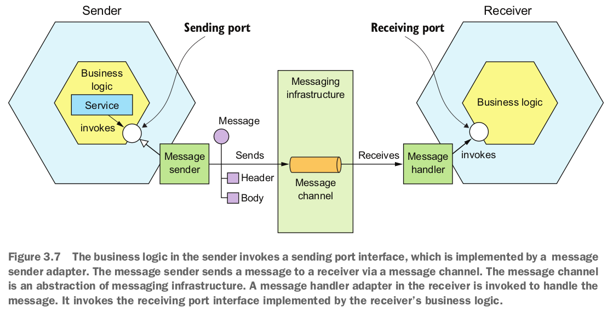
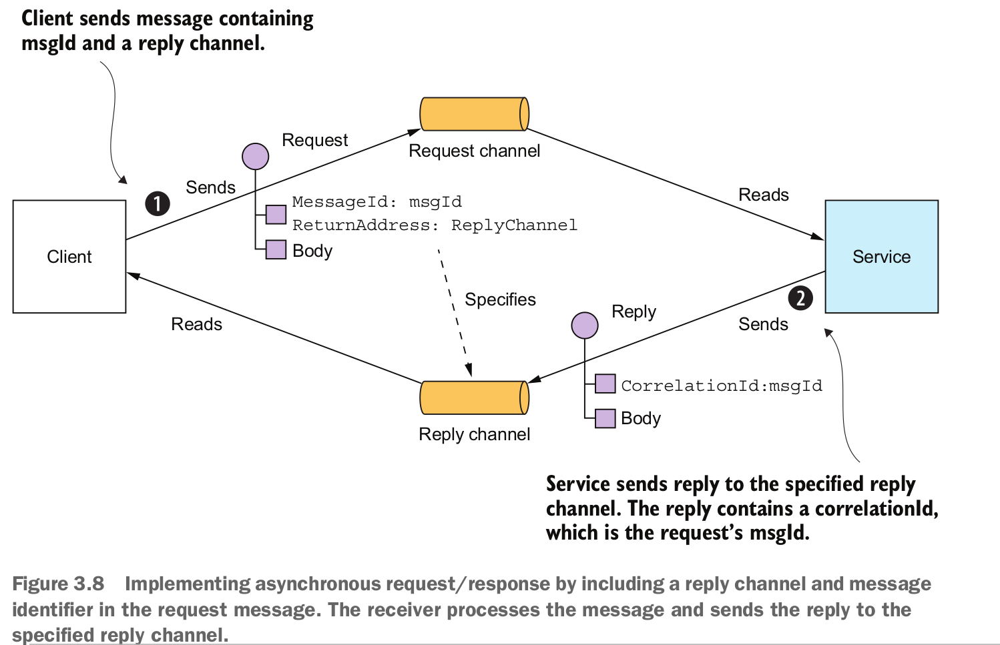
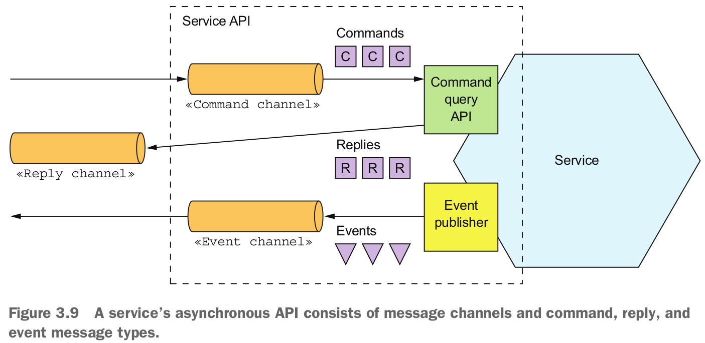
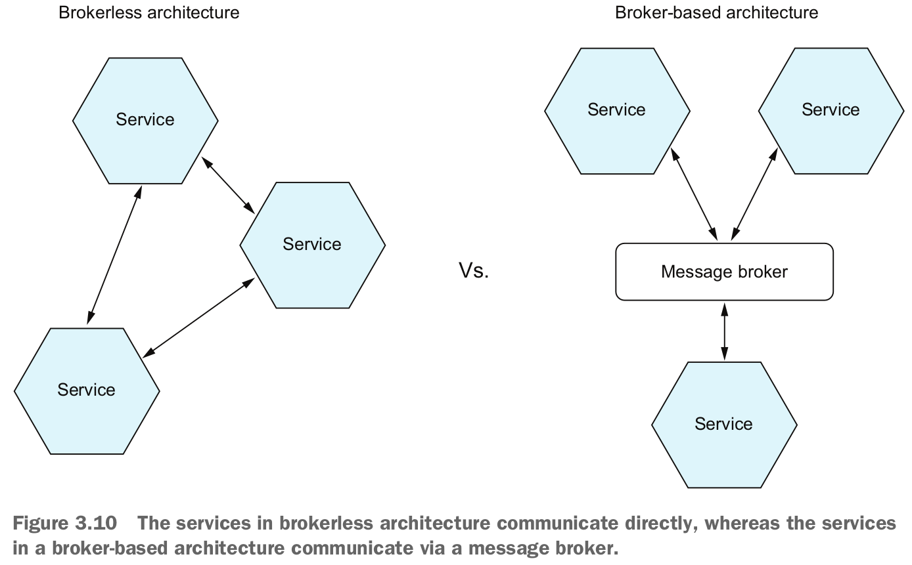
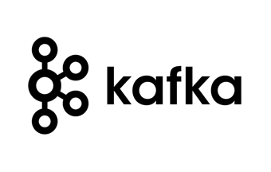
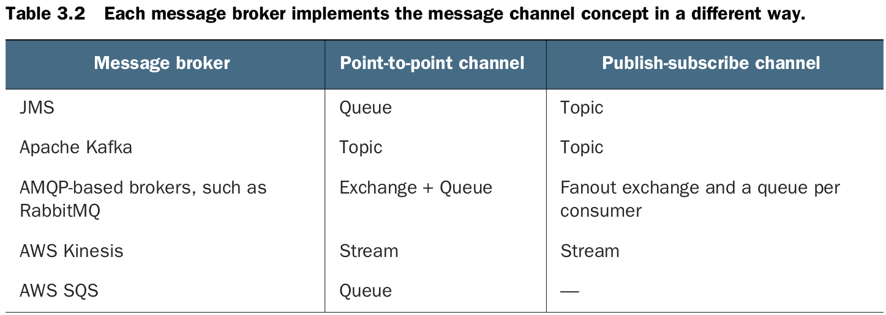
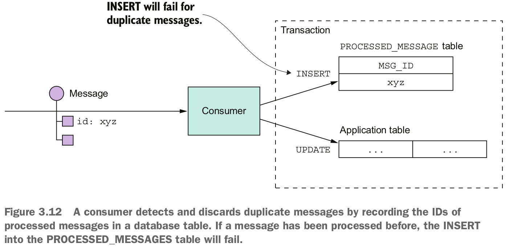
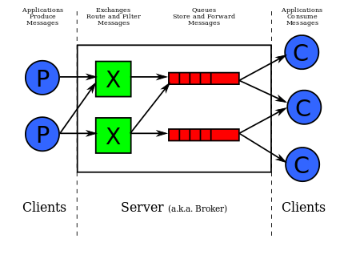

## Licencia {.nota-licencia visibility="uncounted"}

©2023  Micael Gallego, Francisco Gortázar, Michel Maes, Óscar Soto, Iván Chicano Algunos derechos reservados Este documento se distribuye bajo la licencia “Atribución-CompartirIgual 4.0 Internacional”  de Creative Comons Disponible en [https://creativecommons.org/licenses/by-sa/4.0/deed.es](https://creativecommons.org/licenses/by-sa/4.0/deed.es)

## Tecnologías de comunicación

- REST
  - Ya lo hemos visto
- Patrón de mensajes asíncronos (colas de mensajes)

## Patrón de mensajes asíncronos

- Es un patrón de comunicación en el que el emisor del mensaje no espera una respuesta inmediata (asíncrono)
- Las aplicaciones que usan este patrón pueden usar o no un broker de mensajería (una “cola de mensajes”)

---

{width=97%}

---

- **Estilos de interacción con mensajes**
  - Petición/respuesta asíncrono
  - Notificaciones one-way
  - Publicación/Suscripción
  - Publicación/respuestas asíncronas

## Petición/Respuesta asíncrona

- **Petición/Respuesta asíncrona:**
  - Implementado con código **NO** bloqueante
  - La espera no consume hilos (no afecta al rendimiento)
  - Se debería asumir que la respuesta asíncrona va a tardar en llegar y no hacer esperar al cliente

---

{width=85%}

---

- **Especificación de una API asíncrona**

{width=19%}

[https://www.asyncapi.com/](https://www.asyncapi.com/)

{width=87%}

## Patrón de mensajes asíncronos

- **Con** **broker** **o sin** **broker**

{width=78%}

{width=13%}

{width=14%}

{width=15%}

{width=9%}

[https://zeromq.org/](https://zeromq.org/)

---

- **Características de un broker**
  - Lenguajes de programación
  - Estándar de mensajería (AMQP, STOMP…)
  - Orden de los mensajes
  - Garantías de envío
  - Persistencia
  - Durabilidad
  - Escalabilidad
  - Latencia
  - Clientes que compiten (competing consumers)

---

- **Comparación de canales de mensajes entre** **brokers**

{width=93%}

AWS SNS

Topic

-

---

- **Garantías de envío**
  - En condiciones de fallo (crash del broker) se pueden recibir mensajes duplicados (at least once)
  - Si el tratamiento no es idempotente, el receptor tiene que controlar los mensajes repetidos

---

- **Gestión de mensajes duplicados**

{width=81%}

## AMQP

{width=67%}

The Advanced Message Queuing Protocol (AMQP) is an open standard for passing business messages between applications or organizations.

[https://www.amqp.org/](https://www.amqp.org/)

---

{width=73%}

[https://es.wikipedia.org/wiki/Advanced\_Message\_Queuing\_Protocol](https://es.wikipedia.org/wiki/Advanced_Message_Queuing_Protocol) 

---

- **Modelos de comunicación**
- Comunicación uno a muchos con suscripción y de-suscripción
- Mensajes almacenados en la cola si el receptor no está disponible
- Mensajes se “aceptan” (ack) cuando se han procesado para permitir tolerancia a fallos

---

- **AMQP 1.0 broker implementations**
  - Apache **ActiveMQ**, an open-source project at the Apache Foundation
  - Apache Qpid, an open-source project at the Apache Foundation
  - Azure Event Hubs
  - Azure Service Bus
  - Solace PubSub+, a multi-protocol broker in hardware, software, and cloud
- **Pre-1.0 AMQP broker implementations**
  - **RabbitMQ**, an open-source project sponsored by Pivotal, primarily supports AMQP 0.9.1 (también soporta AMQP 1.0 a través de un plugin)
  - JORAM, a Java open-source implementation from the OW2 Consortium.
  - Apache Qpid maintains support for multiple AMQP versions
  - StormMQ, a hosted message queuing service using AMQP. It is offered as a commercial managed service.

---

{width=79%}

RabbitMQ is the most widely deployed open source message broker.

RabbitMQ is lightweight and easy to deploy on premises and in the cloud. It supports multiple messaging protocols. RabbitMQ can be deployed in distributed and federated configurations to meet high-scale, high-availability requirements.

[https://www.rabbitmq.com/](https://www.rabbitmq.com/)

---

- **Características**
- Tipo de comunicación: 
  - Streaming / Eventos de mensajes
  - Petición / respuesta
  - El broker es una aplicación “servidor” y todas las que se quieren comunicar actúan como clientes

---

- **Definición del protocolo**
- Hay protocolo para gestionar conexiones, colas, suscripciones...
- STOMP es un protocolo de alto nivel que permite interoperabilidad entre protocolos de mensajería.
  - Por ejemplo: AMQP y WebSockets

[https://stomp.github.io/](https://stomp.github.io/) 

[https://www.rabbitmq.com/web-stomp.html](https://www.rabbitmq.com/web-stomp.html) 

---

- **Definición del protocolo**
- No hay formato estándar de definición del contenido de los mensajes
- Existen algunas iniciativas que intentan la definición/documentación de APIs en sistemas de mensajería

{width=45%}

[https://www.asyncapi.com/](https://www.asyncapi.com/) 

---

- **Formato de mensajes**
- Permite mensajes binarios o de texto con cualquier formato
- Se puede usar JSON, XML, protobuf...

::: {.columns}
::: {.column width="34%"}
{width=35%}
:::
::: {.column width="66%"}
{width=42%}

{width=46%}
:::
:::

[https://developers.google.com/protocol-buffers/](https://developers.google.com/protocol-buffers/)

[https://www.json.org/](https://www.json.org/)

[https://www.w3.org/XML/](https://www.w3.org/XML/)

---

- **Interoperabilidad**
- Existen clientes para múltiples tecnologías y lenguajes
- Muy interoperable

---

- **Despliegue de RabbitMQ**
- Docker

[https://www.rabbitmq.com/download.html](https://www.rabbitmq.com/download.html) 

```
$ docker run --rm -p 5672:5672 -p 15672:15672 rabbitmq:4.0-management
```

- Consola de gestión

[http://localhost:15672/](http://localhost:15672/) 

User: guest Pass: guest

---

- **Implementación en Java**
  - Integración con SpringBoot

[https://spring.io/guides/gs/messaging-rabbitmq/](https://spring.io/guides/gs/messaging-rabbitmq/) 

[https://docs.spring.io/spring-amqp/docs/current/reference/html/#amqp](https://docs.spring.io/spring-amqp/docs/current/reference/html/#amqp)

---

- **Ejemplos**
  - Texto plano:
    - Spring/comunicacion-rabbitmq-ejem1-producer
    - Spring/comunicacion-rabbitmq-ejem1-consumer
  - JSON:
    - Spring/comunicacion-rabbitmq-ejem1-producer
    - Spring/comunicacion-rabbitmq-ejem1-consumer

[https://github.com/codeurjc/dad2425/tree/main/parte\_3/tema\_3.2\_colas](https://github.com/codeurjc/dad2425/tree/main/parte_3/tema_3.2_colas) 

::: {.enlace-repo}
[`comunicacion-rabbitmq-ejem1-consumer`](https://github.com/codeurjc/dad/tree/main/parte_3/tema_3.2_colas/comunicacion-rabbitmq-ejem1-consumer), [`comunicacion-rabbitmq-ejem1-producer`](https://github.com/codeurjc/dad/tree/main/parte_3/tema_3.2_colas/comunicacion-rabbitmq-ejem1-producer)
:::

