## Contenidos

1. ¿Por qué eventos?
2. Conceptos: eventos, comandos, productores, consumidores y brokers
3. Eventos dentro de una aplicación (Spring)
4. Publicación/suscripción entre servicios (RabbitMQ)
5. Garantías de entrega, idempotencia y errores
6. Consistencia: el problema de la doble escritura y el patrón *outbox*
7. Transacciones distribuidas con eventos: sagas
8. *Event sourcing* y CQRS
9. Evolución de eventos, observabilidad y Kafka vs RabbitMQ
10. Ejercicio

::: {.ejemplo}
**Código de los ejemplos**: carpeta [`parte_3/tema_3.3_eventos`](https://github.com/codeurjc/dad/tree/main/parte_3/tema_3.3_eventos) del repositorio de la asignatura.
:::

# ¿Por qué eventos?

## El problema del acoplamiento

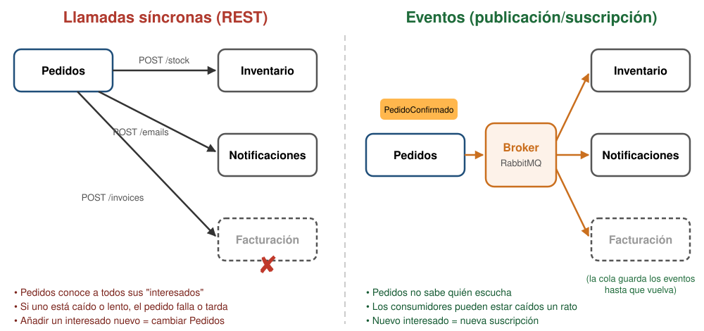{fig-align="center" width="92%"}

## Tipos de acoplamiento

* **Temporal**: el servicio llamado tiene que estar disponible *en ese momento*
    - Disponibilidad compuesta: 4 servicios al 99,5 % → el conjunto al ~98 %
* **De conocimiento**: el emisor sabe quién tiene que enterarse y cómo llamarle
* **De rendimiento**: la latencia total es la suma de las latencias (y el más lento manda)

Una **arquitectura dirigida por eventos** (*Event-Driven Architecture*, EDA) invierte la dependencia:

* El productor **anuncia hechos** que han ocurrido y no sabe quién los escucha
* Los consumidores **reaccionan** a los hechos que les interesan, a su ritmo
* Un **broker** almacena y distribuye los eventos entre ambos

::: {.callout-note}
En el tema 3.1 vimos colas de mensajes con RabbitMQ. Ahora las usamos para **diseñar** sistemas alrededor de eventos.
:::

# Conceptos

## Comandos, eventos y consultas

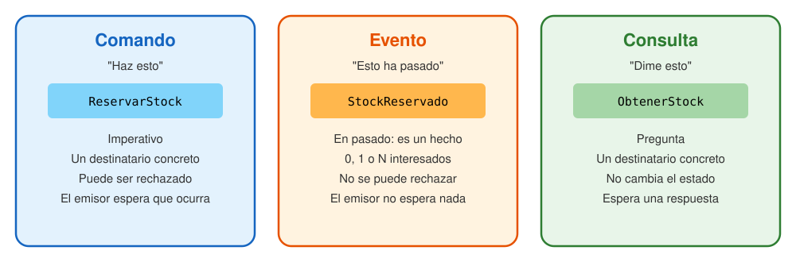{fig-align="center" width="92%"}

* Un mismo hecho de negocio puede viajar como comando o como evento: **la diferencia es quién decide**
* Los **eventos de dominio** del tema 1.3 (DDD) son los candidatos naturales a eventos entre servicios

## Anatomía de un evento

```json
{
  "eventId": "8b1f6c2e-3d1a-4b0e-9f57-2c9a1d7e4f10",   // identificador único: deduplicar
  "type": "pedido.confirmado",                         // qué ha pasado (en pasado)
  "version": 1,                                        // versión del esquema
  "occurredAt": "2026-11-21T10:15:30Z",                // cuándo pasó
  "source": "servicio-pedidos",                        // quién lo publica
  "correlationId": "c0ffee-42",                        // para seguir un flujo entre servicios
  "data": {                                            // los datos del hecho
    "orderId": "P-1a2b3c4d",
    "customerEmail": "ana@urjc.es",
    "lines": [ { "product": "libro-ddd", "quantity": 2, "unitPrice": 45.50 } ],
    "total": 91.00
  }
}
```

* Los eventos son **inmutables**: un hecho pasado no se modifica (se publica otro evento)
* Estándar para el "sobre" del evento: [CloudEvents](https://cloudevents.io) (CNCF)

## Cuatro patrones muy distintos

Martin Fowler distingue cuatro cosas que solemos llamar "dirigido por eventos":

{fig-align="center" width="90%"}

## *Event notification* vs *event-carried state transfer*

::: columns
::: {.column width="50%"}
**Event notification**

```json
{ "type": "pedido.confirmado",
  "orderId": "P-42" }
```

* Eventos pequeños
* El consumidor llama al productor si necesita más datos → **vuelve el acoplamiento**
:::
::: {.column width="50%"}
**Event-carried state transfer**

```json
{ "type": "pedido.confirmado",
  "orderId": "P-42",
  "customerEmail": "ana@urjc.es",
  "lines": [...], "total": 91.00 }
```

* El consumidor tiene todo lo que necesita
* Puede mantener **su propia copia** de los datos (réplica local)
* Eventos más grandes, datos duplicados
:::
:::

# Eventos dentro de una aplicación

## Eventos en memoria con Spring

::: {.ejemplo}
**[eventos-ejem1](https://github.com/codeurjc/dad/tree/main/parte_3/tema_3.3_eventos/eventos-ejem1)**: un servicio publica `OrderPlaced` y tres *listeners* reaccionan de formas distintas.
:::

```java
@Service
public class OrderService {

    @Transactional
    public Long placeOrder(String customerEmail, BigDecimal total) {
        Order order = orders.save(new Order(customerEmail, total));
        events.publishEvent(new OrderPlaced(order.getId(), customerEmail, total, Instant.now()));
        if (total.compareTo(FRAUD_LIMIT) > 0) {
            throw new IllegalStateException("Pedido sospechoso de fraude: " + total);  // rollback
        }
        return order.getId();
    }
}
```

* `ApplicationEventPublisher` es un bus de eventos **en memoria** dentro del proceso
* Desacopla módulos de un monolito (como los *bounded contexts* de `ddd-ejem3`)

## ¿Cuándo se ejecuta cada *listener*?

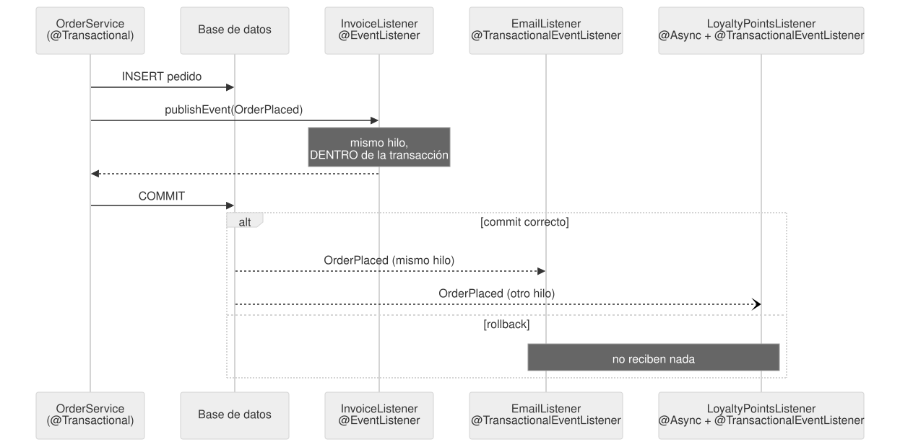{fig-align="center" width="78%"}

## Tres formas de escuchar

```java
@EventListener                                            // síncrono, dentro de la transacción
public void on(OrderPlaced event) { ... generar factura ... }

@TransactionalEventListener(phase = TransactionPhase.AFTER_COMMIT)   // solo si hay commit
public void on(OrderPlaced event) { ... enviar email ... }

@Async @TransactionalEventListener                        // tras el commit, en otro hilo
public void on(OrderPlaced event) { ... calcular puntos de fidelidad ... }
```

```bash
curl -X POST localhost:8080/orders -H 'Content-Type: application/json' \
     -d '{"email":"ana@urjc.es","total":120}'
curl -X POST localhost:8080/orders -H 'Content-Type: application/json' \
     -d '{"email":"eva@urjc.es","total":20000}'        # supera el límite: rollback
curl localhost:8080/log
["factura:1","email:1","puntos:1","factura:2"]         # ¡factura de un pedido que no existe!
```

::: {.aviso}
Los eventos en memoria **se pierden** si el proceso se cae antes de procesarlos. Para comunicar servicios necesitamos un **broker** que los guarde.
:::

# Publicación/suscripción entre servicios

## Exchanges de RabbitMQ (repaso)

Los productores publican en un **exchange**; las **colas** se enlazan (*binding*) a él:

| Tipo | Enruta a las colas... | Uso típico |
|---|---|---|
| `direct` | cuyo binding coincide **exactamente** con la clave de enrutado | Comandos a un servicio concreto |
| `fanout` | **todas** las enlazadas (ignora la clave) | *Broadcast* |
| `topic` | cuyo patrón (`*`, `#`) encaja con la clave | **Eventos**: cada consumidor elige qué le interesa |
| `headers` | según cabeceras del mensaje | Enrutado por atributos |

::: {.callout-tip}
Para eventos, `topic` con claves jerárquicas (`pedido.confirmado`, `pedido.cancelado`, `pago.rechazado`...) es la opción más flexible.
:::

## Ejemplo 2: un productor, varios suscriptores

::: {.ejemplo}
**[eventos-ejem2](https://github.com/codeurjc/dad/tree/main/parte_3/tema_3.3_eventos/eventos-ejem2)**: `pedidos` publica eventos; `inventario` y `notificaciones` se suscriben con sus propias colas.
:::

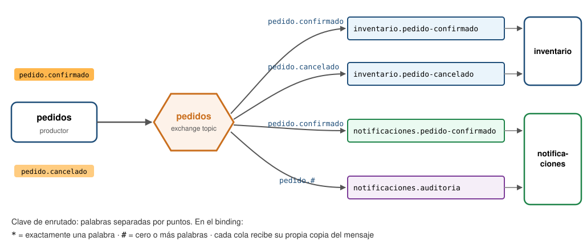{fig-align="center" width="85%"}

## El productor no conoce a los consumidores

```java
@Bean
public TopicExchange pedidosExchange() {
    return new TopicExchange("pedidos");
}

@Bean
public MessageConverter messageConverter() {
    return new JacksonJsonMessageConverter();           // los eventos viajan en JSON
}
```

```java
public OrderPlaced placeOrder(String customerEmail, List<Line> lines) {
    ...
    OrderPlaced event = new OrderPlaced(UUID.randomUUID().toString(), Instant.now(),
                                        orderId, customerEmail, lines, total);
    rabbit.convertAndSend("pedidos", "pedido.confirmado", event);
    return event;
}
```

* Solo declara el **exchange**. No declara colas: no sabe quién escucha
* Añadir un consumidor nuevo **no requiere tocar** el servicio de pedidos

## Cada consumidor declara sus colas

```java
@Bean
public Queue placedQueue() {
    return new Queue("inventario.pedido-confirmado", true);      // durable
}

@Bean
public Binding placedBinding() {
    return BindingBuilder.bind(placedQueue()).to(pedidosExchange()).with("pedido.confirmado");
}
```

```java
@RabbitListener(queues = "inventario.pedido-confirmado")
public void on(OrderPlaced event) {
    for (Line line : event.lines()) {
        stock.remove(line.product(), line.quantity());
    }
}
```

* La cola es **del consumidor**: si está caído, los eventos esperan en ella
* `notificaciones` enlaza otra cola con `pedido.#` y recibe **todos** los eventos de pedidos (auditoría)

## *Tolerant reader*

Cada consumidor define **su propia vista** del evento, solo con lo que necesita:

```java
// En inventario: no le interesan ni el email ni los precios
@JsonIgnoreProperties(ignoreUnknown = true)
public record OrderPlaced(String eventId, String orderId, List<Line> lines) { }

// En notificaciones: no le interesan las líneas
@JsonIgnoreProperties(ignoreUnknown = true)
public record OrderPlaced(String orderId, String customerEmail, BigDecimal total) { }
```

* El productor puede **añadir campos** sin romper a nadie
* No compartimos una librería de clases entre servicios: compartimos un **contrato** (el JSON)

## Publicación/suscripción vs consumidores competidores

```{.default}
                        ┌─ cola inventario ────────┬──▶ inventario (instancia 1)
exchange "pedidos" ─────┤                          └──▶ inventario (instancia 2)   ← competidores
                        └─ cola notificaciones ────────▶ notificaciones
```

* **Distintos servicios** → **distintas colas**: cada uno recibe una copia (pub/sub)
* **Varias instancias del mismo servicio** → **la misma cola**: se reparten los mensajes (escalado horizontal, tema 5)

::: {.callout-note}
Con varias instancias compitiendo por una cola **se pierde el orden global** de los mensajes. Si el orden importa (p. ej. por pedido), hay que particionar.
:::

## Probar el ejemplo 2

```bash
cd parte_3/tema_3.3_eventos/eventos-ejem2
docker compose up -d                        # RabbitMQ: consola en http://localhost:15672

cd inventario     && mvn spring-boot:run    # en otra terminal
cd notificaciones && mvn spring-boot:run    # en otra terminal
cd pedidos        && mvn spring-boot:run    # en otra terminal

curl -X POST localhost:8080/orders -H 'Content-Type: application/json' \
  -d '{"email":"ana@urjc.es","lines":[{"product":"libro-ddd","quantity":2,"unitPrice":45.5}]}'
curl -X POST localhost:8080/orders/{orderId}/cancel
```

::: {.small}
**Experimento**: para `inventario`, crea varios pedidos y vuelve a arrancarlo. ¿Qué pasa con los eventos? Mira la cola en la consola de RabbitMQ.
:::

# Garantías de entrega

## ¿Cuántas veces llega un mensaje?

| Garantía | Cómo se consigue | Riesgo |
|---|---|---|
| **Como mucho una vez** (*at-most-once*) | Se confirma (*ack*) antes de procesar | **Perder** mensajes |
| **Al menos una vez** (*at-least-once*) | Se confirma **después** de procesar; reintentos | **Duplicados** |
| **Exactamente una vez** (*exactly-once*) | No existe "gratis" en un sistema distribuido | --- |

* En la práctica: **al menos una vez + consumidores idempotentes** = "efectivamente una vez"
* Los duplicados aparecen por: reintentos del productor, caídas antes del *ack*, reentregas del broker, el *relay* del outbox...

## Idempotencia

> Una operación es **idempotente** si ejecutarla varias veces tiene el mismo efecto que ejecutarla una vez.

Técnicas:

* **Idempotente por naturaleza**: `stock = 7` (sí) vs `stock = stock - 1` (no)
* **Tabla de mensajes procesados** (*inbox*): guardar el `messageId` en la misma transacción que el efecto
* **Clave natural**: "reservar stock para el pedido P-42" → si ya existe la reserva, no hacer nada
* **Máquina de estados**: un pedido ya `APPROVED` ignora un `pago.aceptado` repetido

```java
public synchronized boolean reserve(String orderId, String productId, int quantity) {
    if (reservations.containsKey(orderId)) {
        return true;                      // mensaje repetido: ya estaba reservado
    }
    ...
}
```

## Errores al consumir: reintentos y *dead letter queues*

{fig-align="center" width="85%"}

* **Error transitorio** (BD caída, *timeout*): reintentar con espera creciente (*backoff*)
* **Error permanente** (mensaje mal formado, regla de negocio): no reintentar → **DLQ**
* Sin DLQ, un mensaje "venenoso" se reintenta para siempre y **bloquea la cola**

## Orden de los mensajes

* RabbitMQ conserva el orden **dentro de una cola**, con un único consumidor
* Con consumidores competidores, reintentos o varias colas, el orden **no está garantizado**
* Estrategias:
    - Diseñar consumidores que **toleren** el desorden (comprobar estado, versiones)
    - Incluir un **número de versión/secuencia** en el evento y descartar los antiguos
    - **Particionar** por clave (todos los eventos del pedido P-42 a la misma partición) → Kafka

::: {.aviso}
"Pedido cancelado" llegando antes que "pedido confirmado" no es una situación exótica: **pasa**.
:::

# Consistencia y el patrón *outbox*

## El problema de la doble escritura

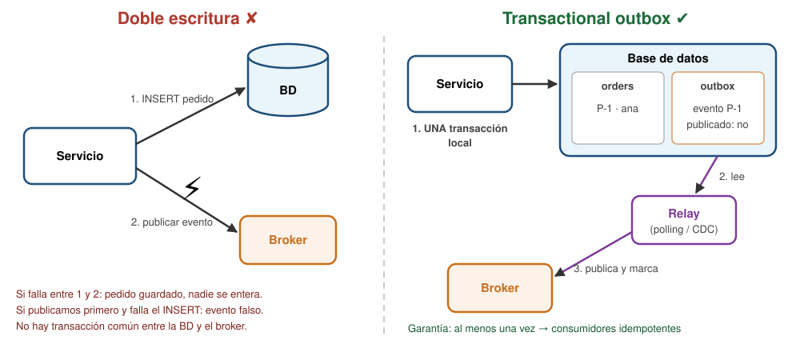{fig-align="center" width="95%"}

## Ejemplo 3: *transactional outbox*

::: {.ejemplo}
**[eventos-ejem3](https://github.com/codeurjc/dad/tree/main/parte_3/tema_3.3_eventos/eventos-ejem3)**: `pedidos` guarda el pedido y el evento en la misma transacción; un *relay* lo publica; `facturacion` es un consumidor idempotente.
:::

```java
@Transactional
public String placeOrder(String customer, BigDecimal amount) {
    String orderId = "P-" + UUID.randomUUID().toString().substring(0, 8);
    orders.save(new Order(orderId, customer, amount));

    OrderPlaced event = new OrderPlaced(orderId, customer, amount, Instant.now());
    outbox.save(new OutboxMessage(UUID.randomUUID().toString(), orderId, "pedido.confirmado",
                                  json.writeValueAsString(event), Instant.now()));
    return orderId;
}
```

* Pedido y evento se guardan **juntos o ninguno**: es una transacción **local**

## El *relay* del outbox

```java
@Scheduled(fixedDelayString = "${outbox.relay.delay}")
@Transactional
public void publishPending() {
    for (OutboxMessage m : outbox.findTop50ByPublishedAtIsNullOrderByCreatedAtAsc()) {
        Message message = MessageBuilder.withBody(m.getPayload().getBytes(StandardCharsets.UTF_8))
                .setContentType(MessageProperties.CONTENT_TYPE_JSON)
                .setMessageId(m.getId())               // el consumidor lo usará para deduplicar
                .build();
        rabbit.send("pedidos", m.getRoutingKey(), message);
        m.markPublished(Instant.now());
    }
}
```

* Si se cae entre `send` y `markPublished`, el mensaje **se vuelve a enviar** → al menos una vez
* Alternativa al *polling*: **Change Data Capture** (p. ej. [Debezium](https://debezium.io) lee el *log* de la BD)

## El consumidor idempotente

```java
@RabbitListener(queues = "facturacion.pedido-confirmado")
public void on(OrderPlaced event, @Header(AmqpHeaders.MESSAGE_ID) String messageId) {
    invoices.handle(messageId, event);
}

@Transactional
public boolean handle(String messageId, OrderPlaced event) {
    if (processed.existsById(messageId)) {
        log.warn("Mensaje {} duplicado: se ignora", messageId);
        return false;
    }
    invoices.save(new Invoice(event.orderId(), event.customer(), event.amount()));
    processed.save(new ProcessedMessage(messageId, Instant.now()));   // misma transacción
    return true;
}
```

## Outbox de principio a fin

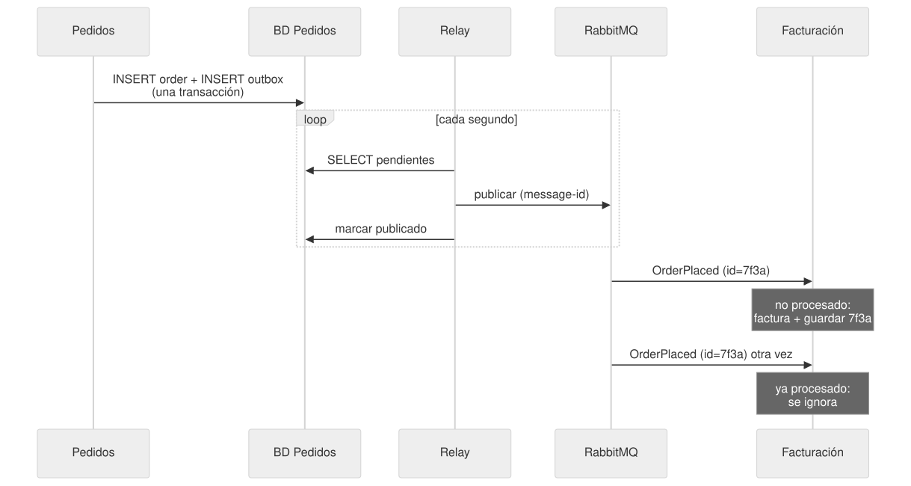{fig-align="center" width="80%"}

# Sagas

## Transacciones que cruzan servicios

* Cada servicio tiene **su propia base de datos** → no hay una transacción ACID común
* El *two-phase commit* (2PC/XA) existe, pero bloquea recursos, depende de un coordinador y muchos brokers y BD NoSQL no lo soportan
* **Saga**: una secuencia de **transacciones locales**; cada una publica un evento que dispara la siguiente
* Si un paso falla, se ejecutan **transacciones de compensación** que deshacen semánticamente los pasos anteriores
    - Reservar stock ↔ liberar la reserva
    - Cobrar ↔ devolver el dinero
    - Enviar email ↔ enviar email de disculpa (¡no todo se puede deshacer!)

::: {.small}
*Héctor García-Molina y Kenneth Salem, "Sagas" (1987)*
:::

## Coreografía vs orquestación

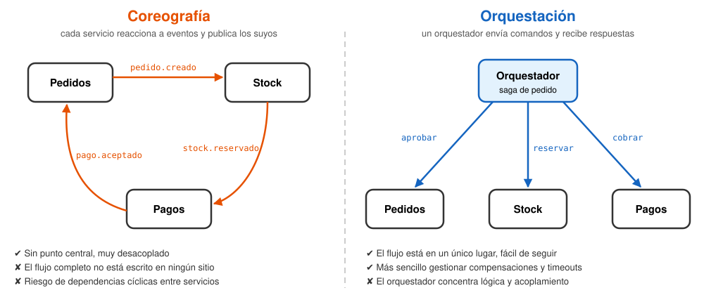{fig-align="center" width="95%"}

## Consistencia eventual

* Durante la saga el sistema está en un estado **intermedio** visible: pedido `PENDING`
* La API lo refleja: `202 Accepted` + consultar el estado después (o notificar por WebSocket, tema 3.2)
* Las sagas **no tienen aislamiento** (la "I" de ACID): otros pueden ver datos a medio procesar
    - Contramedidas: estados *pending*, bloqueos semánticos, versionado, reordenar pasos

::: {.callout-tip}
Ordena los pasos para que los **difíciles de compensar** vayan al final: es más fácil liberar una reserva de stock que devolver un pago o "des-enviar" un paquete.
:::

# *Event sourcing* y CQRS

## *Event sourcing*

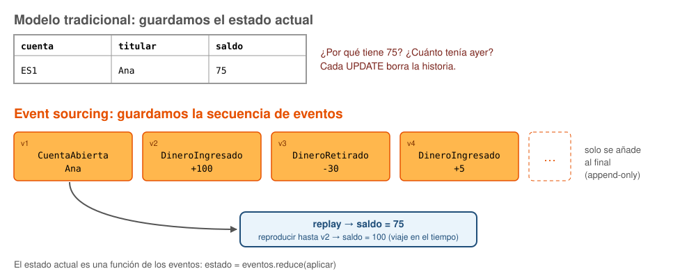{fig-align="center" width="92%"}

## Ejemplo 4: una cuenta bancaria con *event sourcing*

::: {.ejemplo}
**[eventos-ejem4](https://github.com/codeurjc/dad/tree/main/parte_3/tema_3.3_eventos/eventos-ejem4)**: agregado `BankAccount` reconstruido a partir de eventos, *event store* con concurrencia optimista y proyecciones CQRS.
:::

```java
public sealed interface AccountEvent {
    record AccountOpened(String accountId, String owner, Instant occurredAt) implements AccountEvent { }
    record MoneyDeposited(String accountId, BigDecimal amount, Instant occurredAt) implements AccountEvent { }
    record MoneyWithdrawn(String accountId, BigDecimal amount, Instant occurredAt) implements AccountEvent { }
    record AccountClosed(String accountId, Instant occurredAt) implements AccountEvent { }
}
```

```java
private void apply(AccountEvent event) {            // aplicar un evento: SIN reglas
    switch (event) {
        case AccountOpened e  -> { id = e.accountId(); owner = e.owner(); open = true; }
        case MoneyDeposited e -> balance = balance.add(e.amount());
        case MoneyWithdrawn e -> balance = balance.subtract(e.amount());
        case AccountClosed e  -> open = false;
    }
    version++;
}
```

## Comandos: comprobar reglas y generar eventos

```java
public void withdraw(BigDecimal amount) {
    requireOpen();
    requirePositive(amount);
    if (balance.compareTo(amount) < 0) {
        throw new AccountException("Saldo insuficiente: " + balance + " < " + amount);
    }
    record(new MoneyWithdrawn(id, amount, now()));   // apply + guardar como pendiente
}
```

```java
private void execute(String accountId, Consumer<BankAccount> command) {
    List<AccountEvent> history = store.load(accountId);
    BankAccount account = BankAccount.replay(history);              // 1. reconstruir
    int expectedVersion = account.version();
    command.accept(account);                                        // 2. ejecutar
    store.append(accountId, expectedVersion, account.pullPendingEvents());  // 3. añadir
}
```

* `append` falla con `ConcurrencyException` si otro escribió entre medias (**bloqueo optimista**)

## CQRS: *Command Query Responsibility Segregation*

{fig-align="center" width="90%"}

* **Escritura**: modelo optimizado para validar reglas (el agregado)
* **Lectura**: modelos **desnormalizados** para cada pantalla/consulta (proyecciones)
* Las proyecciones se pueden **borrar y reconstruir** reprocesando todos los eventos

## *Event sourcing*: ventajas e inconvenientes

::: columns
::: {.column width="50%"}
**Ventajas** ✔

* Auditoría completa "gratis"
* **Viaje en el tiempo**: estado en cualquier momento
* Nuevas proyecciones sobre la historia pasada
* Los eventos ya están ahí para publicarlos
* Depurar = reproducir los eventos
:::
::: {.column width="50%"}
**Inconvenientes** ✘

* Curva de aprendizaje, más complejo que CRUD
* Consultas → necesitas proyecciones (CQRS)
* **Los eventos no se pueden cambiar**: versionado y *upcasting*
* *Snapshots* si los *streams* son muy largos
* Borrar datos personales (RGPD) es delicado
:::
:::

```bash
curl localhost:8080/accounts/{id}/events            # el event store
curl localhost:8080/accounts/{id}/balance?atVersion=2  # viaje en el tiempo
curl localhost:8080/accounts/richest?n=3            # proyección
```

# Más allá

## Evolución de los eventos

Los eventos son un **contrato público**: cambiarlos puede romper a consumidores que no controlamos.

* Cambios **compatibles**: añadir campos opcionales (con *tolerant reader*)
* Cambios **incompatibles**: renombrar, quitar o cambiar el tipo de un campo
    - Publicar una **versión nueva** del evento (`pedido.confirmado.v2` o campo `version`)
    - Mantener ambas versiones durante la migración
    - *Upcasting*: convertir eventos antiguos al formato nuevo al leerlos
* **Registro de esquemas** (*schema registry*) con Avro, Protobuf o JSON Schema: valida la compatibilidad antes de desplegar
* Documentación de APIs asíncronas: [AsyncAPI](https://www.asyncapi.com)

## Observabilidad

* Con eventos, **"¿por qué este pedido está PENDING?"** es más difícil de responder
* **Correlation ID**: el mismo identificador viaja en todos los mensajes de un flujo
* **Trazas distribuidas** (OpenTelemetry, Micrometer Tracing): el contexto de traza viaja en las cabeceras de los mensajes
* Métricas clave: **longitud de las colas**, tasa de mensajes, edad del mensaje más antiguo, tamaño de las DLQ
* Registrar los eventos publicados y consumidos (como la cola de auditoría `pedido.#` del ejemplo 2)

## RabbitMQ vs Kafka

| | RabbitMQ | Apache Kafka |
|---|---|---|
| Modelo | **Colas**: el mensaje se borra al confirmarse | **Log** distribuido: los mensajes se conservan (días, para siempre) |
| Enrutado | Rico: exchanges, bindings, patrones | Por *topic* y partición |
| Consumidores | Compiten por los mensajes de una cola | Cada grupo lleva su *offset*; puede **releer** |
| Orden | Por cola | Por **partición** (clave) |
| Rendimiento | Muy bueno | Altísimo *throughput* |
| Encaja con | Tareas, comandos, eventos entre servicios | *Streaming*, *event sourcing*, analítica, CDC |

::: {.small}
Ambos sirven para EDA. Kafka permite que un consumidor nuevo procese **toda la historia** de eventos.
:::

## ¿Cuándo usar una arquitectura dirigida por eventos?

::: columns
::: {.column width="50%"}
**Buena idea** ✔

* Varios servicios reaccionan a los mismos hechos
* Picos de carga: la cola amortigua
* Integración entre *bounded contexts*
* Procesos largos que no requieren respuesta inmediata
* Auditoría, analítica, réplicas de datos
:::
::: {.column width="50%"}
**Cuidado** ✘

* El usuario necesita la respuesta **ya** (consultas)
* Se requiere consistencia fuerte inmediata
* Equipos sin experiencia en sistemas distribuidos
* El flujo completo es difícil de seguir y de depurar
* Más infraestructura que operar
:::
:::

## Resumen

* Los **eventos** anuncian hechos y desacoplan productores de consumidores en el **tiempo** y en el **conocimiento**
* **En memoria** (Spring) para módulos de una aplicación; **broker** (RabbitMQ, Kafka) entre servicios
* *Topic exchange*: cada consumidor tiene **su cola** y elige los eventos que le interesan
* Asume **al menos una vez** → consumidores **idempotentes**, reintentos y DLQ
* **Outbox**: guarda el cambio y el evento en la misma transacción local
* **Sagas**: transacciones distribuidas con compensaciones (coreografía u orquestación)
* ***Event sourcing***: los eventos son el estado; **CQRS**: modelos de lectura separados

## Ejemplos del tema

| Proyecto | Contenido |
|---|---|
| [eventos-ejem1](https://github.com/codeurjc/dad/tree/main/parte_3/tema_3.3_eventos/eventos-ejem1) | Eventos en memoria con Spring: `@EventListener`, `@TransactionalEventListener`, `@Async` |
| [eventos-ejem2](https://github.com/codeurjc/dad/tree/main/parte_3/tema_3.3_eventos/eventos-ejem2) | Publicación/suscripción con *topic exchange*: `pedidos`, `inventario`, `notificaciones` |
| [eventos-ejem3](https://github.com/codeurjc/dad/tree/main/parte_3/tema_3.3_eventos/eventos-ejem3) | *Transactional outbox* (`pedidos`) y consumidor idempotente (`facturacion`) |
| [eventos-ejem4](https://github.com/codeurjc/dad/tree/main/parte_3/tema_3.3_eventos/eventos-ejem4) | *Event sourcing* y CQRS: cuenta bancaria, *event store* y proyecciones |
| [eventos-ejer1](https://github.com/codeurjc/dad/tree/main/parte_3/tema_3.3_eventos/eventos-ejer1) | Solución del ejercicio 1: saga coreografiada |

: {tbl-colwidths="[22,78]"}

# Ejercicio

## Ejercicio 1: saga coreografiada (I)

::: {.ejercicio}
Una tienda online tiene tres servicios, cada uno con sus propios datos: **Pedidos**, **Stock** y **Pagos** (monedero de saldo prepagado). Implementa el proceso de compra como una **saga coreografiada** con RabbitMQ.
:::

1. `POST /orders` crea un pedido en estado `PENDING`, responde `202 Accepted` y publica `pedido.creado`
2. **Stock** intenta reservar las unidades: publica `stock.reservado` o `stock.rechazado`
3. **Pagos** cobra el importe del monedero del cliente: publica `pago.aceptado` o `pago.rechazado`
4. **Pedidos** pasa el pedido a `APPROVED` o `REJECTED` (guardando el motivo); `GET /orders/{id}` lo muestra
5. Si el pago se rechaza, **Stock** debe **compensar** liberando la reserva
6. Todos los consumidores deben ser **idempotentes** (los mensajes pueden llegar duplicados)

## Ejercicio 1: saga coreografiada (II)

**Camino feliz**

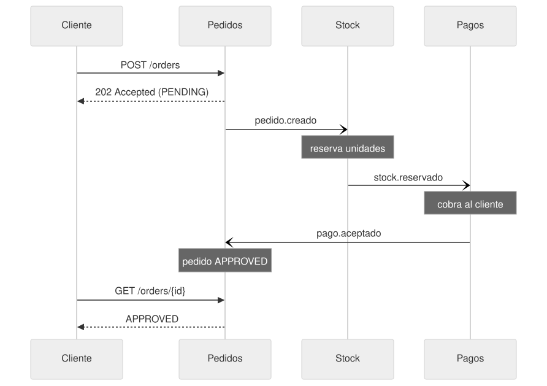{fig-align="center" width="70%"}

## Ejercicio 1: saga coreografiada (III)

**Pago rechazado → compensación**

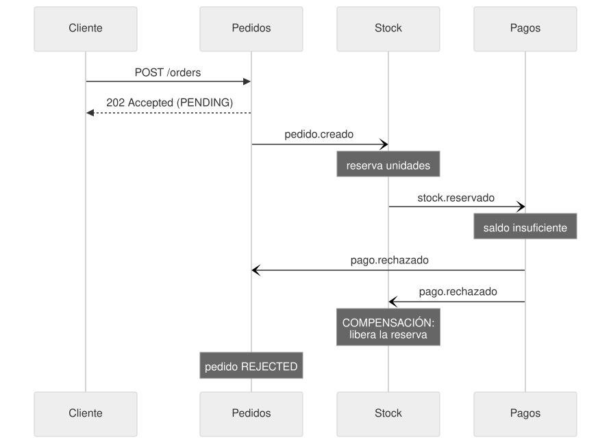{fig-align="center" width="70%"}

## Ejercicio 1: saga coreografiada (IV)

Requisitos técnicos:

* Tres proyectos Spring Boot independientes y un `docker-compose.yml` con RabbitMQ
* Un exchange `topic` llamado `tienda`; cada servicio declara **sus** colas y *bindings*
* Cada servicio define **su propia versión** de los eventos que consume (*tolerant reader*)
* Datos en memoria; la lógica de stock y monederos en clases sin Spring con **tests unitarios** (incluida la idempotencia)
* Prueba los dos caminos: `ana` tiene 500 € de saldo y `luis` solo 20 €

::: {.ejemplo}
**Solución**: [eventos-ejer1](https://github.com/codeurjc/dad/tree/main/parte_3/tema_3.3_eventos/eventos-ejer1) (inténtalo antes de mirarla)
:::

## Ejercicio 1: para pensar


* ¿Qué pasa si **Pagos** está caído durante 5 minutos? ¿Y si se cae **Pedidos**?
* ¿Cómo implementarías un *timeout* para que un pedido no quede `PENDING` para siempre?
* ¿Qué cambiaría con una saga **orquestada**? ¿Qué servicio sería el orquestador?
* ¿Dónde sería necesario el patrón *outbox*?
* Si se crean dos pedidos a la vez del último ejemplar, ¿qué pasa? ¿Y si llega `pago.rechazado` antes que `stock.reservado` a Stock?

## Referencias

* Martin Fowler. [What do you mean by "Event-Driven"?](https://martinfowler.com/articles/201701-event-driven.html) (2017)
* Chris Richardson. *Microservices Patterns*. Manning, 2018 — y [microservices.io](https://microservices.io/patterns/) (Saga, Transactional outbox, Event sourcing, CQRS, Idempotent consumer)
* Gregor Hohpe y Bobby Woolf. *Enterprise Integration Patterns*. Addison-Wesley, 2003
* Adam Bellemare. *Building Event-Driven Microservices*. O'Reilly, 2020
* Martin Kleppmann. *Designing Data-Intensive Applications*. O'Reilly, 2017 (cap. 11)
* Greg Young. [CQRS Documents](https://cqrs.files.wordpress.com/2010/11/cqrs_documents.pdf)
* [Documentación de Spring AMQP](https://docs.spring.io/spring-amqp/reference/) y [tutoriales de RabbitMQ](https://www.rabbitmq.com/tutorials)
