## Licencia {.nota-licencia visibility="uncounted"}

©2023  Micael Gallego, Francisco Gortázar, Michel Maes, Óscar Soto, Iván Chicano Algunos derechos reservados Este documento se distribuye bajo la licencia “Atribución-CompartirIgual 4.0 Internacional”  de Creative Comons Disponible en [https://creativecommons.org/licenses/by-sa/4.0/deed.es](https://creativecommons.org/licenses/by-sa/4.0/deed.es)

# Virtualización

## Virtualización

- La virtualización es una técnica que permite la **emulación de algún recurso tecnológico**, como puede ser una plataforma de hardware, un sistema operativo, un dispositivo de almacenamiento u otros recursos de red

---

- Actualmente la virtualización se presenta en dos niveles:
- **Máquina virtual:** Virtualización de un entorno de ejecución para la ejecución de aplicaciones. Ejemplos: JVM (Java Virtual Machine), CLR (Common Language Runtime) de .NET, V8 de JavaScript
- **Virtualización del hardware:** Virtualización de un hardware completo en el que se puede ejecutar un sistema operativo como si ejecutara sobre HW real

## Virtualización de sistemas

- En un entorno virtualizado se tienen varios sistemas operativos
  - Sistema operativo **anfitrión (****host****)**:
    - Es el sistema operativo que se arranca en el HW físico
    - Sólo puede haber un único sistema operativo host en una máquina física
  - Sistema operativo **invitado (****guest****):**
    - Es el sistema operativo que se ejecuta sobre el HW virtualizado
    - Pueden existir varios sistemas guest ejecutándose a la vez en un mismo host. Varias máquinas virtuales

## Virtualización vs Emulación

- Se consigue un **mayor rendimiento en la virtualización** si el sistema operativo invitado puede ejecutarse nativamente en la CPU del sistema operativo anfitrión. 
- Es decir, cuando la **arquitectura** para la que se ha compilado el SO invitado se ejecuta nativamente por la CPU, **no traducción de las instrucciones máquina**

---

- Por ejemplo, un **Windows 10 de 32bits** para **X86** se virtualiza con mayor rendimiento sobre una **CPU x86 de 32 o 64bits** que sobre una **CPU PowerPC**
- Las **CPUs** modernas tienen soporte de virtualización para conseguir **un rendimiento prácticamente nativo**
  - **Intel VT-x**
  - **AMD SVM**

---

- Se denomina **emulador** al software de virtualización que permite la ejecución de software diseñado para una arquitectura diferente que la CPU
- La emulación se consigue mediante la **traducción de instrucciones máquina** y tiene un impacto importante en rendimiento
- Uno de los emuladores más famosos es **MAME** emulando procesadores de máquinas de arcade. Existe incluso una versión en **JavaScript**

## Gestión de sistemas virtualizados

- La virtualización se permite gracias al **hypervisor**, también llamado gestor de máquinas virtuales, virtual machine manager (VMM). 
- Un **hypervisor** es un software (apoyado por el soporte hardware) que permite la ejecución de múltiples sistemas operativos invitados sobre el sistema operativo anfitrión

{width=31%}

## Hipervisor/VMM

- Pieza software que se encarga de proporcionar los mecanismos específicos de virtualización.
  - Tipo 1 (nativo, bare metal): Directamente sobre el hardware
  - Tipo 2 (hosted): Aplicación que ejecuta dentro del SO
- También llamado Virtual Machine Manager (VMM).

## Hipervisor tipo 1 (nativo)

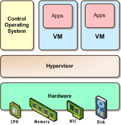{width=90%}

## Hipervisor tipo 2 (hosted)

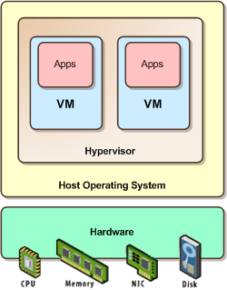{width=90%}

## Ventajas e inconvenientes de la virtualización

- **Ventajas**
  - Ejecución de un **sistema operativo diferente** al instalado
    - Windows vs linux
    - Versiones diferentes del SO
    - Versiones de desarrollo de un SO 
  - Baja utilización de la infraestructura
    - Del orden del 10-15 % por servidor

---

- **Ventajas**
  - Posibilidad de **clonar y mover la máquina virtual** de un ordenador físico a otro
    - Profesor a alumnos
    - Portátil vs ordenador de sobremesa
    - Diferentes servidores en el CPD de datos
    - Mecanismo de copia de seguridad
  - **Otras**
    - Estudio de código malicioso como virus gracias al aislamiento
    - Aprovechamiento de recursos con varios guests en un mismo host 

---

- **Ventajas**
  - Menor inversión en infraestructura
  - Menor coste de mantenimiento
  - Mayor flexibilidad y aprovechamiento de los recursos
  - Mayor seguridad y tolerancia a fallos

---

- **Inconvenientes**
  - El inconveniente podría ser la penalización en rendimiento
  - Existen bastantes pruebas de rendimiento comparando diferentes hypervisores frente a la ejecución directa en “hierro” (bare metal)
  - En general la penalización es asumible frente a las ventajas que proporciona, sobre todo en servidores

## Comparativa de rendimiento

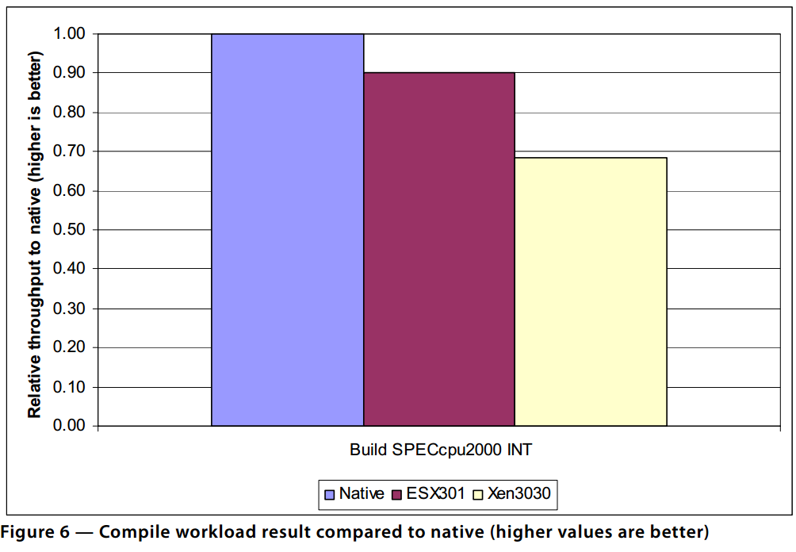{width=72%}

[http://www.vmware.com/pdf/hypervisor\_performance.pdf](http://www.vmware.com/pdf/hypervisor_performance.pdf) 

---

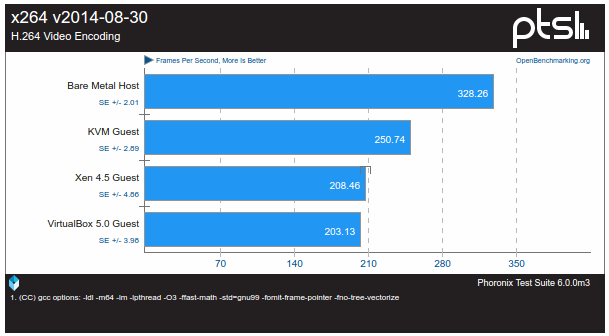{width=79%}

[http://www.phoronix.com/scan.php?page=article&item=ubuntu-1510-virt&num=1](http://www.phoronix.com/scan.php?page=article&item=ubuntu-1510-virt&num=1) 

## Software de virtualización

::: {.columns}
::: {.column width="69%"}
{width=35%}

{width=41%}

{width=36%}
:::
::: {.column width="31%"}
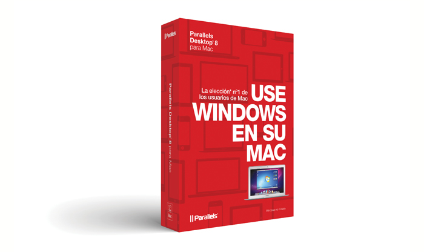{width=68%}
:::
:::

{width=39%}

{width=39%}

{width=30%}

{width=34%}

# Computación en la nube

## Computación en la nube

- La **computación en la nube** **(****Cloud computing****)** es una nueva forma de entender la gestión de servicios en los proveedores de alojamiento en Internet

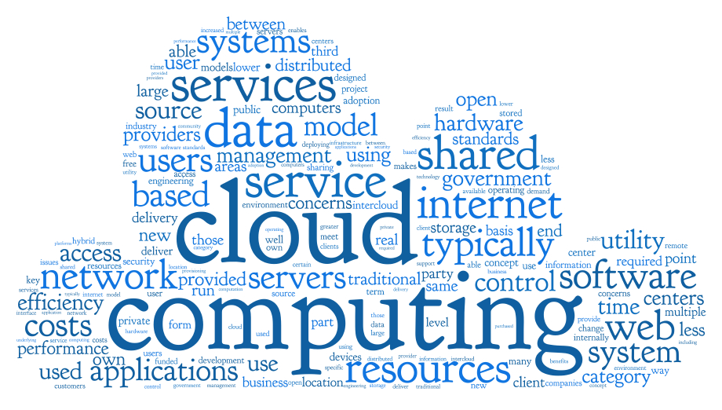{width=65%}

---

::: {.columns}
::: {.column width="46%"}
**Los proveedores de cloud computing** son empresas de **alojamiento** (hosting) que alquilan recursos de computación: máquinas dedicadas, máquinas compartidas...
:::
::: {.column width="54%"}
{width=92%}
:::
:::

## Definición de Cloud

- “El Cloud es un gran conjunto de recursos virtuales fácilmente utilizables y accesibles (tales como hardware, plataformas de desarrollo y/o servicios)…
- …Este conjunto se puede reconfigurar de forma dinámica para ajustarse a una carga variable (escala), permitiendo un uso óptimo de los recursos…
- …Estos recursos se explotan normalmente mediante un modelo de pago-por-uso en el que el Proveedor de Servicios ofrece garantías mediante acuerdos a medida”
- Luis M. Vaquero , Luis Rodero-Merino, Juan Caceres , Maik Lindner.  A Break in the Cloud: Towards a Cloud Definition (2009) 

## ¿Por qué una nube?

::: {.columns}
::: {.column width="51%"}
- Desde hace décadas, la nube se usa frecuentemente como una representación abstracta de Internet.
- Es una estructura opaca, pero dinámica.

- Como entidades externas, nos interesa su función y contenido, pero no su estructura interna.
:::
::: {.column width="49%"}
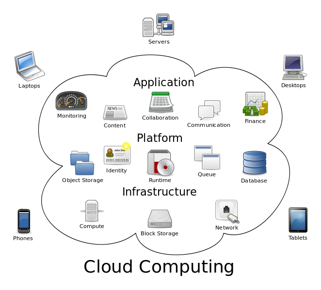{width=90%}
:::
:::

## Control de los recursos en la nube

- Cuando los proveedores utilizan la palabra **cloud** generalmente se refieren a la posibilidad de **configurar** y **redimensionar los recursos** que se usan de forma rápida y sencilla, o manualmente **vía web** o usando **APIs REST**

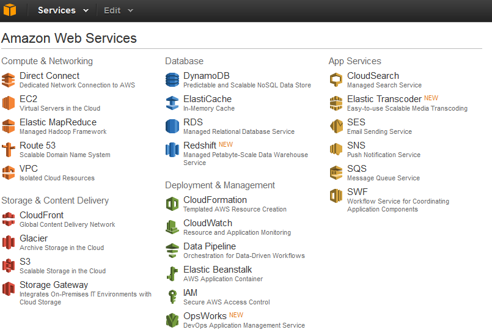{width=43%}

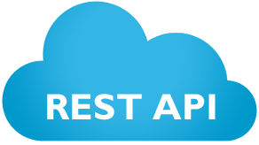{width=30%}

## Elasticidad en la nube

- La diferencia con los alojamientos tradicionales consiste en la **elasticidad** de los recursos
- El software es verdaderamente **escalable.** Si necesita más recursos hardware, los puede conseguir de forma **automática**

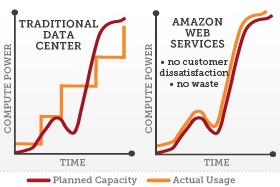{width=55%}

Actual usage

Planned capacity

## Costes por tiempo de uso

- Como el uso de recursos es tan dinámico, se suele cobrar por tiempo de uso de los recursos (**horas o minutos**), sin tener que hacer un contrato previo con un tiempo de permanencia determinado.

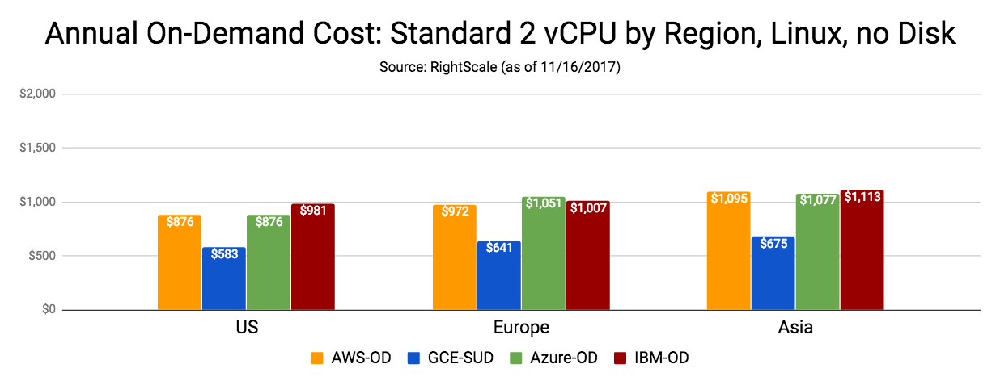{width=87%}

https://www.rightscale.com/blog/cloud-cost-analysis/comparing-cloud-instance-pricing-aws-vs-azure-vs-google-vs-ibm

## ¿Cómo es un Cloud “en realidad”?

::: {.columns}
::: {.column width="51%"}
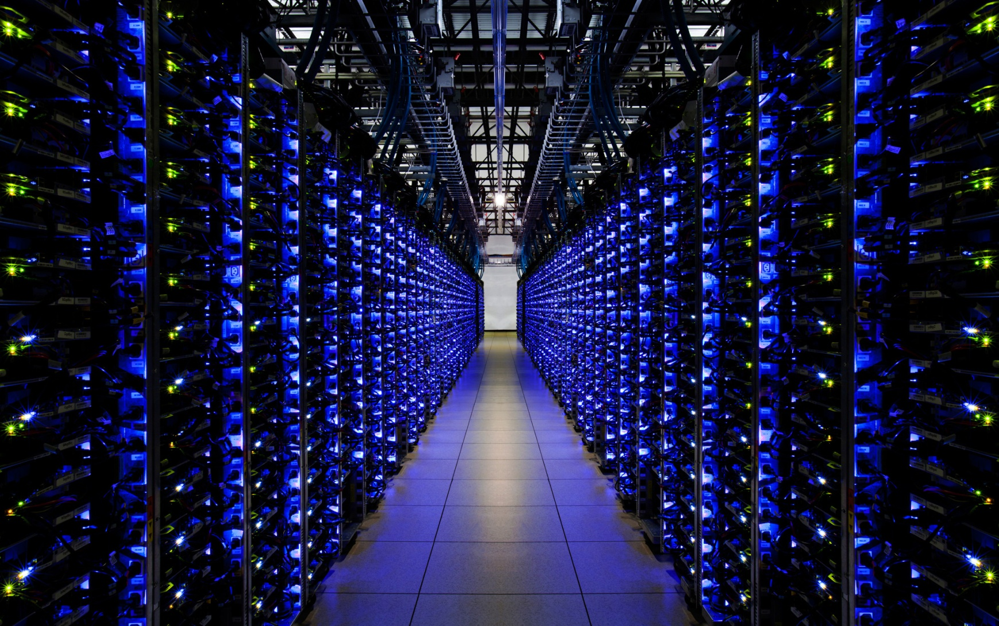{width=73%}
:::
::: {.column width="49%"}
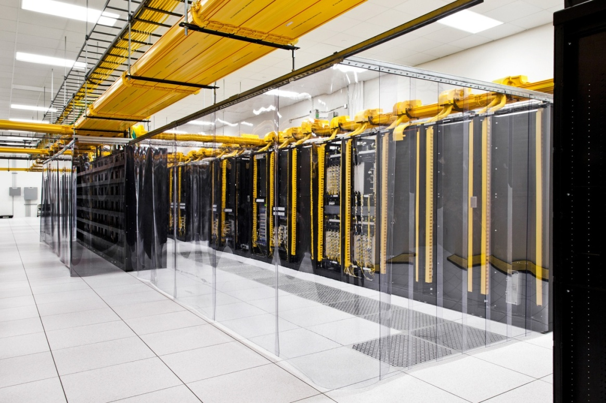{width=90%}

Datacenters de Google en Iowa y Georgia www.google.com/about/datacenters
:::
:::

## Características del Cloud

- **Elasticidad y Escalabilidad:** los recursos pueden crecer (elasticidad), lo cual permite al cloud ofrecer a los clientes escalabilidad.
- **Auto-abastecimiento de servicios:** los clientes seleccionan qué recursos y cuánta cantidad necesitan.
- **Interfaces estándar:** Las aplicaciones de un cloud deben usar APIs estándar.
- **Herramientas de control de uso y facturación:** Los usuarios del cloud pagan única y exclusivamente por lo que consumen.
- **Calidad de Servicio**

## Ventajas del Cloud

::: {.columns}
::: {.column width="53%"}
- Minimiza la inversión en hardware y software.
- Facilita la gestión del software.
- Capacidad de cómputo y almacenamiento virtualmente ilimitada.
:::
::: {.column width="47%"}
{width=79%}
:::
:::

## Desventajas del Cloud

::: {.columns}
::: {.column width="57%"}
- Requiere una conexión a Internet de alta velocidad.
- Problemas de seguridad y fiabilidad de los datos.
- La ejecución de aplicaciones HPC en entornos Cloud no ha sido todavía solucionada.

- Interoperabilidad entre distintos sistemas basados en el Cloud.
:::
::: {.column width="43%"}
{width=82%}
:::
:::

## Virtualización en la nube

- Los recursos de **computación en la nube** suelen estar **virtualizados**
- Aunque en algunas ocasiones pueden ser **máquinas físicas**

{width=24%}

{width=39%}

## Computación en la nube

- Los proveedores de **cloud computing** ofrecen diversos tipos de servicios, tanto de bajo nivel como de alto nivel. 
  - Máquinas virtuales (**instancias**)
  - **Imágenes** para crear instancias (Ubuntu, MySQL...)
  - Sistema de **copias de seguridad** de los servidores completos
  - **Balanceadores de carga** entre servidores
  - **Bases de datos administradas** por el proveedor
  - Servicios de gestión de **logs**, **monitorización**, **alarmas**…
  - Plataforma **auto-escalable** para ejecución de aplicaciones

---

- Proveedores más conocidos

{width=43%}

{width=25%}

{width=52%}

---

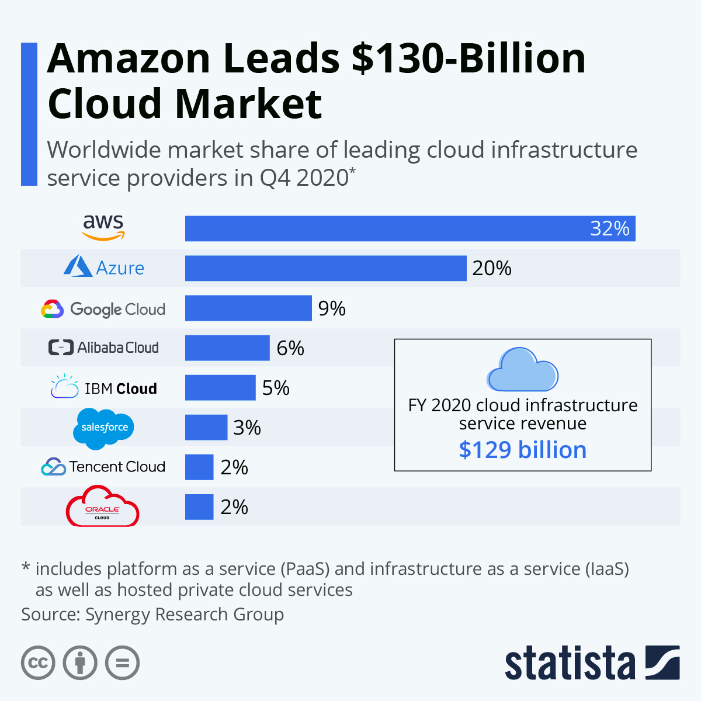{width=56%}

- Cuota de mercado de los principales proveedores cloud
- [https://www.statista.com/chart/18819/worldwide-market-share-of-leading-cloud-infrastructure-service-providers/](https://www.statista.com/chart/18819/worldwide-market-share-of-leading-cloud-infrastructure-service-providers/) 

---

- Los servicios ofrecidos por los proveedores pueden ser de diferentes niveles de abstracción:
  - **Desarrolladores**
    - Infraestructura como servicio (bajo nivel)
    - Plataforma como servicio (nivel medio)
  - **Usuario final**
    - Software como servicio (alto nivel)

---

- **Infraestructura como servicio**
  - Infraestructure as a Service (IaaS)
  - Servicios: 
    - Servidores (instances) 
    - Balanceadores de carga (load balancer)
    - Gestión de imágenes (images)
    - Copias se seguridad de servidores
    - Almacenamiento de datos
    - Direcciones IP
    - Servidores DNS

---

- **Plataforma como servicio**
  - Platform as a Service (PaaS)
  - Plataforma para el despliegue de aplicaciones web:
    - La plataforma está diseñada para ser **escalable de forma automática** (sin intervención del desarrollador/administrador)
    - Dependiendo del proveedor existen plataformas para las tecnologías mas usadas: **Java, PHP, Ruby, .NET..**
    - La plataforma ofrece servicios adicionales como un servicio: **Bases de datos**, **servidor de correo**, **bus de comunicaciones**, etc…

---

- **Software como Servicio**
  - Software as a Service (SaaS)
  - El software se ofrece como un servicio por Internet (vía web)
    - El usuario no instala el software, lo usa vía web
    - Generalmente se paga por uso o por número de usuarios
    - Normalmente están destinados al usuario final, aunque algunos servicios están orientados a desarrolladores
    - Ejemplos: Dropbox, GMail, GoogleDocs, Microsoft 365, iCloud, flickr 

## Nubes privadas

- El modelo de gestión de recursos en los proveedores en la nube tiene tantas ventajas que también se aplica para que las empresas puedan gestionar sus recursos 

{width=40%}

---

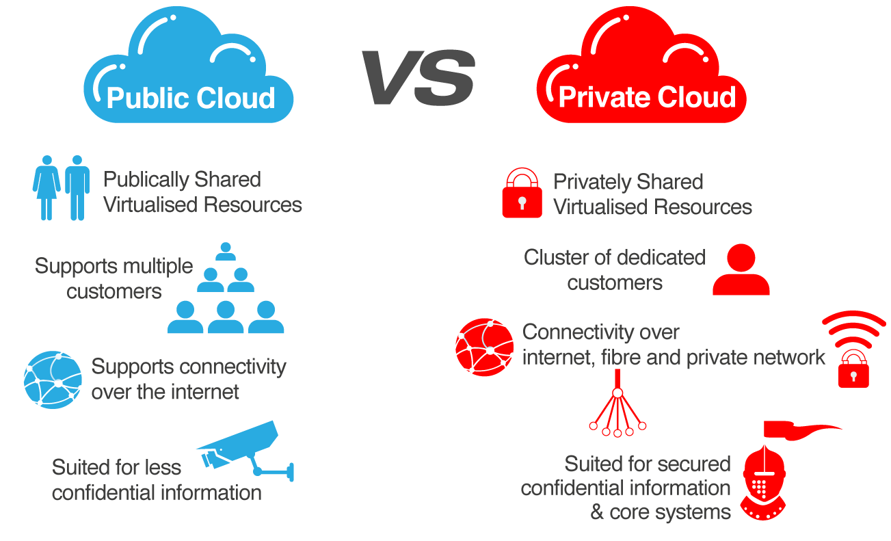{width=79%}

[http://www.placerdome.com/hybrid-cloud-an-innovative-service-that-is-taking-the-industry-by-storm/](http://www.placerdome.com/hybrid-cloud-an-innovative-service-that-is-taking-the-industry-by-storm/) 

---

- Existen **diferentes tecnologías** que lo permiten instalar nubes privadas para controlar un data center
- Ofrecen **APIs REST compatibles** con los **proveedores públicos** (para facilitar la migración de aplicaciones y evitar el vendor locking)
- Algunos proveedores como **Azure e IBM** te permiten instalar parte de su nube privada en tu CPD

---

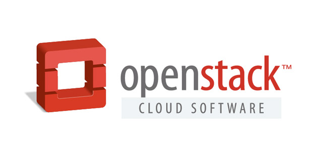{width=66%}

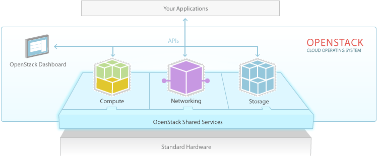{width=78%}

---

- **OpenStack**
  - Es el más popular para gestionar un cluster con los servicios de un proveedor en la nube
  - Servicios básicos:
    - **Computación:** Máquinas virtuales KVM (a través de libvirt), Xen, VMWare…
    - **Almacenamiento:** Similar a Amazon s3 (almacenamiento de ficheros)

[https://www.openstack.org/](https://www.openstack.org/) 

# Contenedores

## Contenedores

- Las **máquinas virtuales** y la **computación en la nube** han revolucionado la forma en la que se **desarrollan** y se **despliegan aplicaciones**
- Pero existen algunos inconvenientes:
  - Las VMs tardan **minutos en arrancar**
  - Se desperdician recursos (especialmente memoria) porque se está ejecutando un **SO invitado completo**

---

- Los **contenedores** son una tecnología que ofrece unas **ventajas similares** a las VMs pero **aprovechando** mejor los recursos:
  - Los contenedores tardan **milisegundos** en arrancar
  - Consumen únicamente la **memoria** que necesita la app ejecutada en el contenedor. Una VMs **reserva la memoria completa**

---

- **¿Por qué son tan eficientes los contenedores?**
  - Para ejecutar un contenedor no se necesita **hypervisor** porque no se ejecuta un sistema operativo invitado y no hay que simular HW
  - Un contenedor es un **paquete** que contiene una app y todo el sw necesario para que se ejecute (python, Java, gcc, libs….)
  - El contenedor es ejecutado directamente por el **kernel del host** como si fuera una app más pero de forma **aislada del resto**

---

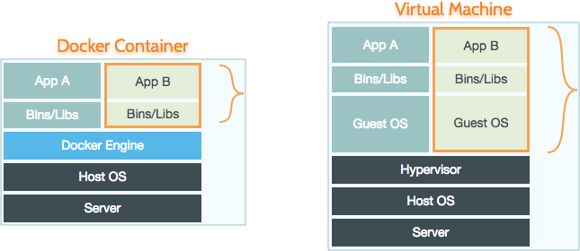{width=90%}

---

**Principales diferencias**

| **Máquinas Virtuales** | **Contenedores** |
|---|---|
| Más pesadas | Más ligeras |
| Varios procesos | Un único proceso |
| Conexión por ssh (aunque esté en local) | Acceso directo al contenedor |
| Más seguridad porque están más aisladas del host | Potencialmente menor seguridad porque se ejecutan como procesos en el host |

---

- **Formato de distribución y ejecución de servicios**
  - Cada sistema linux tiene su **propio** sistema de **distribución y ejecución de servicios**
  - Las **apps comparten recursos del servidor** sin ningún tipo de aislamiento entre ellas
  - Un **servicio** depende de las **versiones concretas** de librerías instaladas (problemas de compatibilidad)
  - Los contenedores se pueden ver como **un estádar**   **empaquetado y ejecución** de servicios en linux

---

- **Formato de distribución y ejecución de servicios**

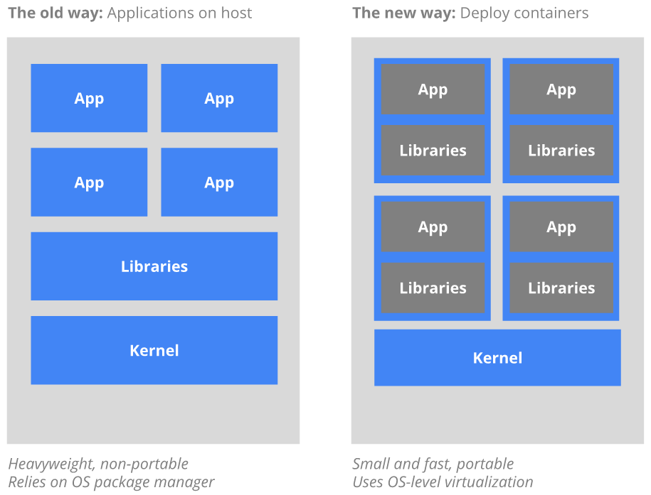{width=58%}

---

- **Tecnologías de contenedores**
  - La tecnología más **madura está en linux**. Los contenedores en **windows están en desarrollo**
  - Debido a la **integración** de los contenedores con el SO (se ejecutan como apps) tienen que ser del **mismo sistema operativo.** Un contenedor linux sólo se ejecutará en una máquina linux
  - Existen **herramientas para desarrolladores** que permiten ejecutar **contenedores linux en windows** mediante **virtualización**

---

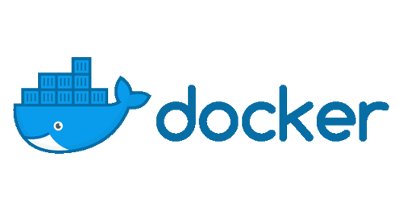{width=55%}

- Es la tecnología de contenedores **más popular**
- Es para **linux**, aunque dispone de herramientas para **desarrolladores en windows y mac**
- Existe un **repositorio de imágenes** (hub) con contenedores públicos

[https://www.docker.com/](https://www.docker.com/) 

---

- Existen otras tecnologías de contedores menos populares pero que también se usan
  - **Linux Containers (LXC)**
    - [https://linuxcontainers.org/](https://linuxcontainers.org/) 
  - **OpenVZ**
    - [https://openvz.org](https://openvz.org/) 

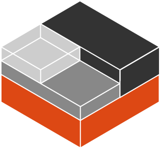{width=16%}

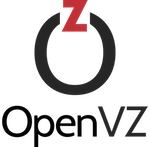{width=16%}

## Despliegue de contenedores

- Las arquitecturas basadas en **microservicios** se han popularizado mucho con los **contenedores**
- Cada **microservicio** se ejecuta en un **contenedor** (o varios por **escalabilidad**)
- **Orquestación:** Organización de **contenedores** y **servidores físicos** para que sean tratados como una **única app** (o varias)

---

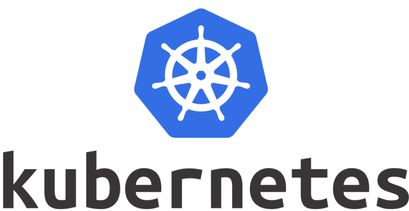{width=73%}

[http://kubernetes.io/](http://kubernetes.io/) 

---

- Existen diversas formas de **ejecutar contenedores** en un **proveedor cloud**
  - Ejecución **manual** de contenedores en una VM (IaaS)
  - **Instalación de un orquestador** de contenedores en un cluster de Vms
  - Uso de **servicios de orquestación** ofrecidos por el proveedor cloud

## Contenedores en la nube

- Muchos proveedores **PaaS** están ofreciendo la posibilidad de ejecutar la app como un **contenedor docker**

**Basadas en kubernetes**

**Orquestación propietaria**

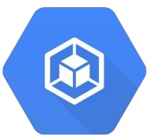{width=8%}

Google Container Engine (GKE)

Amazon EC2 Container Service (ECS)

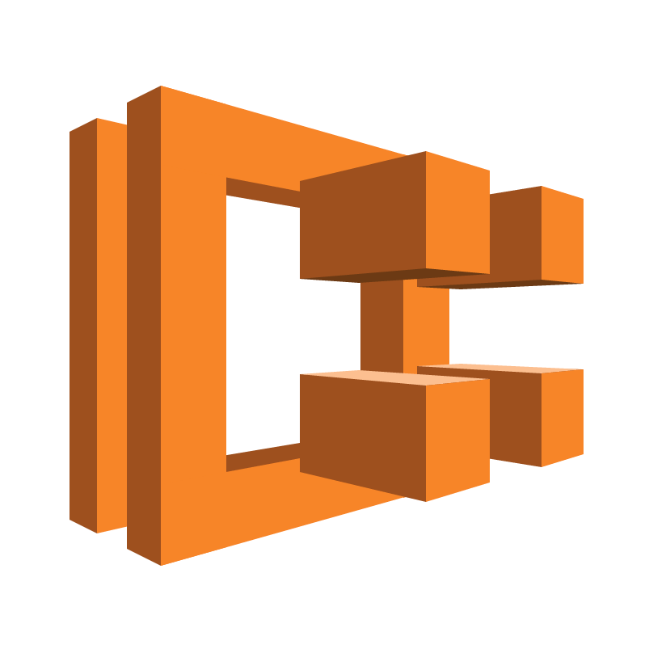{width=8%}

{width=19%}

{width=24%}

{width=17%}

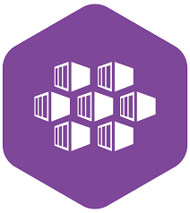{width=8%}

Azure Container Service (AKS)

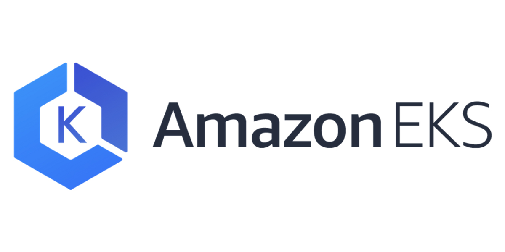{width=19%}

# Conclusiones

## Conclusiones

- **Proceso de desarrollo**
  - Las **máquinas virtuales** y los **proveedores de cloud computing** han cambiado la forma de desarrollar y desplegar aplicaciones para siempre
  - El proceso de **creación y publicación** de software es mucho **más continuo** desde el portátil hasta el servidor

---

- **Proceso de desarrollo**
  - Los **administradores (sysadmin)** han dado paso a la **cultura devops**, en la que los desarrolladores administran sus recursos de computación y **despliegan sus apps**

---

- **Microservicios**
  - Las aplicaciones son cada vez **más grandes**, **más complejas** y soportan **más carga** 
  - Las aplicaciones **monolíticas** están dando paso a las que tienen una arquitectura de **microservicios, más elásticas y manejables**

---

- **Microservicios**
  - Cada **equipo de desarrollo** implementa y opera un microservicio **independiente** y **reutilizable**
  - Los **contenedores** están acelerando la adopción porque cada **microservicio** se ejecuta como uno o varios **contenedores**

