## Licencia {.nota-licencia visibility="uncounted"}

©2025 Micael Gallego, Francisco Gortázar, Michel Maes, Óscar Soto, Iván Chicano Algunos derechos reservados Este documento se distribuye bajo la licencia “Atribución-CompartirIgual 4.0 Internacional” de Creative Comons Disponible en [https://creativecommons.org/licenses/by-sa/4.0/deed.es](https://creativecommons.org/licenses/by-sa/4.0/deed.es)

## Docker

- Introducción a Docker
- Conceptos básicos de Docker
- Imágenes Docker
- Gestión de Contenedores
- Volúmenes en Docker
- Configuración de contenedores
- Aplicaciones de consola
- Redes en Docker

# Introducción a Docker

## Introducción a Docker

{width=67%}

Los **contenedores Docker** permiten empaquetar,

distribuir y ejecutar servicios de red, con un formato

**estándar**

---

{width=89%}

---

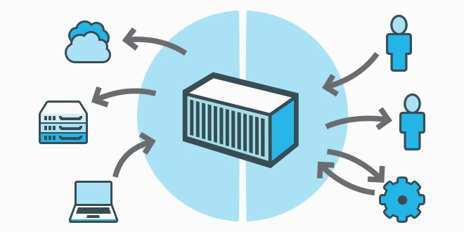{width=82%}

---

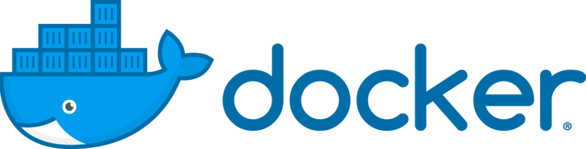{width=49%}

- Es la tecnología de contenedores **más popular** (aunque existen otras tecnologías de contenedores)
- Muy utilizada en sistemas **linux**, aunque dispone de herramientas para **desarrolladores en Windows y Mac**
- Con **repositorio de imágenes** (DockerHub) con imágenes públicas de contenedores
- Creada en **2013**

## ¿Qué son los contenedores Docker?

Introducción a Docker

- Son aplicaciones empaquetadas con **todas sus dependencias**
- Se pueden ejecutar en **cualquier sistema operativo**
  - En linux de forma **óptima**
  - En windows y mac con **virtualización ligera**
- Se **descargan de forma automática** si no están disponibles en el sistema
- Por defecto están aisladas del host (mayor seguridad)
- Sólo es necesario tener instalado **Docker**

## Introducción a Docker

**Formato de distribución y ejecución de servicios en linux**

- Cada sistema linux tiene su propio sistema de **distribución y ejecución** **de servicios**
- Los servicios **comparten recursos del servidor** sin ningún tipo de aislamiento entre ellas
- Un **servicio** depende de las **versiones concretas de librerías** instaladas
- Pueden aparecer problemas cuando varios servicios necesitan **versiones diferentes de las mismas librerías**

---

**Formato de distribución y ejecución de servicios con Docker**

- Los contenedores son un nuevo estándar de **empaquetado,** **distribución y ejecución de servicios en linux**
- Cada paquete contiene el **binario del servicio** y todas las **librerías y dependencias** para que ese servicio se pueda ejecutar en un **kernel linux**
- Se prefiere la potencial **duplicación de librerías** frente a los potenciales **problemas de compatibilidad** entre servicios

---

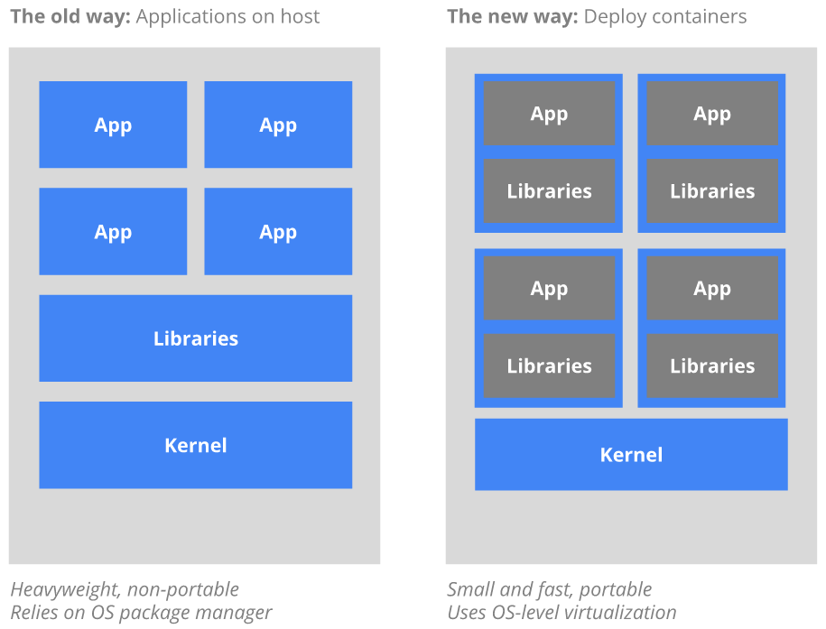{width=58%}

---

**Tipos de aplicaciones:**

- Aplicaciones **de red**:
  - Web, bbdd, colas de mensajes, cachés, etc.
- Aplicaciones **de línea de comandos**:
  - Compiladores, generadores de sitios web, conversores de vídeo, generadores de informes…

---

**Tipos de aplicaciones:**

- Aplicaciones gráficas:
  - Es posible pero no está diseñado para ello
  - Alternativas en linux

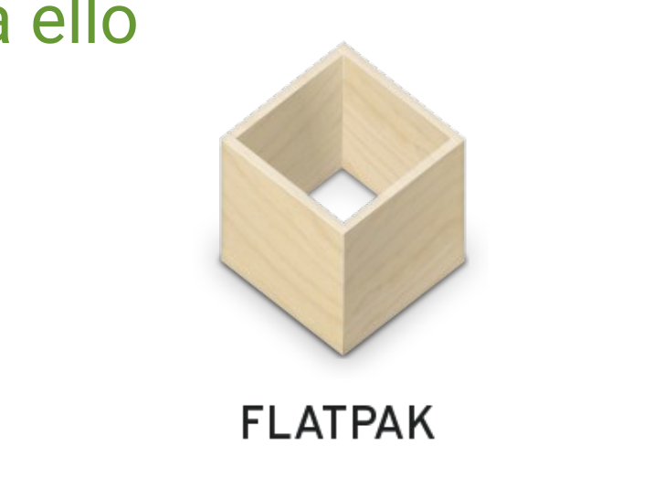{width=33%}

{width=39%}

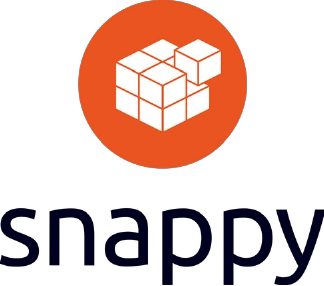{width=15%}

[https://snapcraft.io/](https://snapcraft.io/)

[https://flatpak.org/](https://flatpak.org/)

---

**Sistemas operativos soportados**

- Contenedores **linux**
  - Más usados y más maduros
  - En linux se ejecutan directamente por el kernel
  - En win y mac se ejecutan en máquinas virtuales ligeras gestionadas por docker
- Contenedores **windows**
  - Menos usados y menos maduros
  - Sólo se pueden ejecutar en windows server

## ¿Cómo funciona Docker?

Introducción a Docker

- Ejecuta procesos linux de forma aislada del resto con **namespaces** y **cgroups**
- Permiten definir un sistema de ficheros “virtual” específico para el proceso
- Cuando se ejecuta el servicio tiene un entorno similar al que tendría si estuviera en su **propia máquina**
- Se tienen ventajas similares a las **máquinas virtuales** pero de forma mucho **más eficiente**

---

Introducción a Docker

- Los **contenedores** son una tecnología que ofrece unas **ventajas** **similares** a las VMs pero **aprovechando** mejor los recursos:
  - Los contenedores tardan **milisegundos** en arrancar
  - Consumen únicamente la **memoria** que necesita la app ejecutada en el contenedor.
    - Una VMs **reserva la memoria completa** y es usada por el sistema operativo huesped (guest) y la aplicación

## ¿Por qué son tan eficientes los contenedores?

Introducción a Docker

- Para ejecutar un contenedor no se necesita **hypervisor** porque **no** **se ejecuta** un sistema operativo invitado y no hay que simular HW
- Un contenedor es un **paquete** que contiene una **app** y todo el sw necesario para que se ejecute (python, Java, gcc, libs….)
- El contenedor es ejecutado directamente por el **kernel del sistema** **operativo** como si fuera una aplicación normal pero de forma **aislada del resto**

## Introducción a Docker

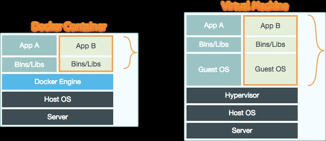{width=86%}

---

**Principales diferencias**

| Máquinas Virtuales | Contenedores |
|---|---|
| Más pesadas | Más ligeras |
| Varios procesos | Optimizadas para un único proceso (aunque pueden tener varios) |
| Conexión por ssh (aunque esté en local) | Acceso directo al contenedor |
| Más seguridad porque están más aisladas del host | Potencialmente menor seguridad porque se ejecutan como procesos en el host |

# Conceptos básicos de Docker

## Conceptos básicos de Docker

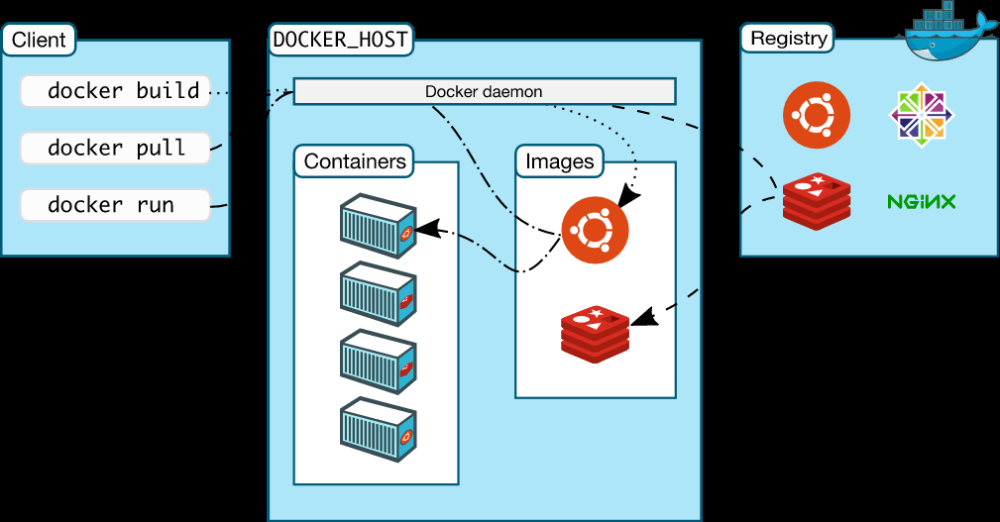{width=72%}

## Imágen Docker

Conceptos básicos de Docker

- Ficheros a los que tendrá acceso el contenedor cuando se ejecute.
  - Herramientas/librerías de una distribución linux menos el kernel (**ubuntu, alpine**)
  - Runtime de ejecución (**Java**)
  - La aplicación en sí (**webapp.jar**)

---

Conceptos básicos de Docker

- Un contenedor siempre se inicia desde una **imagen**
- Si se quiere arrancar un contenedor partiendo de una imagen que no está disponible, **se descarga** **automáticamente** de Internet

## Docker Registry

Conceptos básicos de Docker

- **Servicio remoto** para subir y descargar imágenes
- Puede guardar varias “versiones” (**tags**) de la misma imagen
- Las diferentes versiones de una misma imagen se almacenan en un **repositorio (mysql, drupal...)**
- **Docker Hub** es un registro público y gratuito gestionado por Docker Inc.
- Puedes instalar un **registro privado**

## Conceptos básicos de Docker

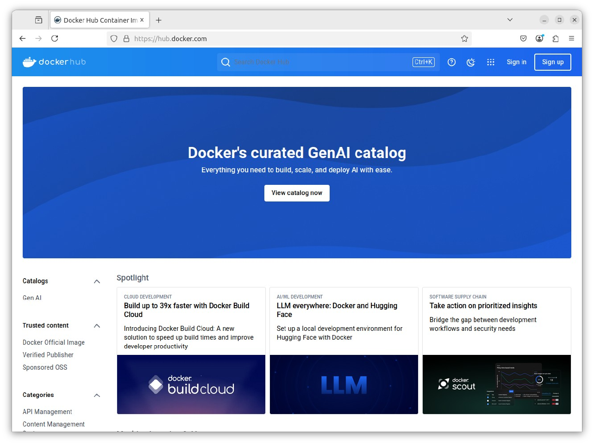{width=58%}

**DockerHub**

---

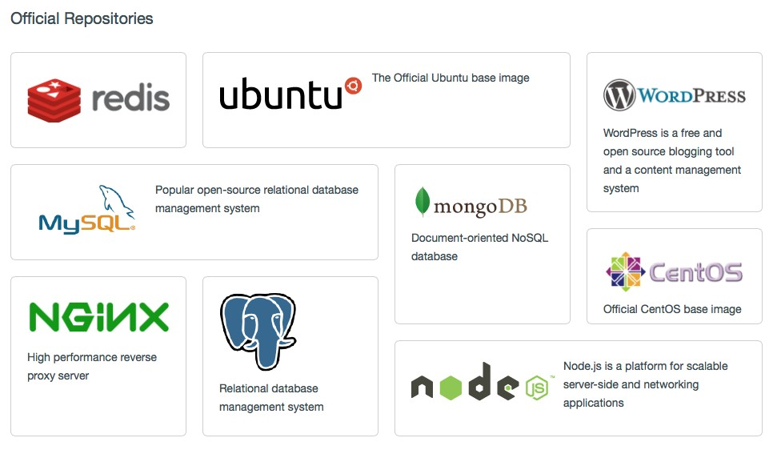{width=82%}

- **Docker Hub**: Algunos repositorios oficiales

v

## Contenedor Docker

Conceptos básicos de Docker

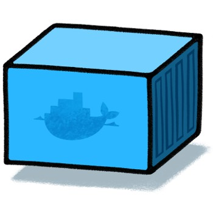{width=15%}

- Representa la **aplicación en ejecución**
- Un contenedor se crea desde **una imagen**
- Si la aplicación escribe un fichero, el fichero queda dentro del contenedor, **no se modifica la imagen**
- Los contenedores se pueden **arrancar, pausar y parar**
- Puede haber **varios contenedores ejecutandose** a la vez partiendo desde la **misma imagen**

## Docker Engine

Conceptos básicos de Docker

- **Proceso encargado** de gestionar docker
- Gestiona las **imágenes** (descarga, creación, subida, etc...)
- Gestiona los **contenedores** (arranque, parada, etc..)
- Habitualmente se controla desde el **cliente docker por** **línea de comandos** (aunque también se puede controlar por API REST)

## Docker client

Conceptos básicos de Docker

- Herramienta por línea de comandos (Command line interface, CLI) para controlar las imágenes y los contenedores

```
$ docker <params>
```

## Instalación de Docker

Conceptos básicos de Docker

- **Linux**:
  - Docker Engine
    - Ejecución nativa
    - Funcionalidad completa
  - Docker Desktop for Linux
    - Usa virtualización ligera
    - Funcionalidad algo más limitada
- **Windows y Mac**
  - Docker Desktop for Mac & Windows
    - Usa virtualización ligera para ejecutar el kernel de linux
    - Funcionalidad algo más limitada que linux

---

Conceptos básicos de Docker

- **Linux:**
  - Ubuntu: [https://docs.docker.com/engine/install/ubuntu/](https://docs.docker.com/engine/install/ubuntu/)
  - Otras distros: [https://docs.docker.com/engine/install/](https://docs.docker.com/engine/install/)
  - Docker for Desktop (Ubuntu, Debian y Fedora): [https://docs.docker.com/desktop/install/linux-install/](https://docs.docker.com/desktop/install/linux-install/)
- **Windows:**
  - Microsoft Windows 10 y 11 Home, Education, Enterprise y Pro: [https://docs.docker.com/desktop/install/windows-install/](https://docs.docker.com/desktop/install/windows-install/)
- **Mac**:
  - Apple macOS Big Sur (11) o superior con Intel o Apple Silicon: [https://docs.docker.com/desktop/install/mac-install/](https://docs.docker.com/desktop/install/mac-install/)

## Conceptos básicos de Docker

- Ejecutar “**hello-world**” en un contendor

This message shows that your installation appears to be working correctly.La primera vez la imagen se

descarga

```yaml
$ docker run hello-world
Unable to find image 'hello-world:latest' locally
latest: Pulling from library/hello-world
03f4658f8b78: Pull complete
a3ed95caeb02: Pull complete
Digest: sha256:8be990ef2aeb16dbcb9271ddfe2610fa6658d13f6dfb8bc72074cc1ca36966a7
Status: Downloaded newer image for hello-world:latest
```

```
Hello from Docker.
...
```

---

- Ejecutar “**hello-world**” en un contendor

La segunda vez se usa la  vez la

imagen descargada

```
$ docker run hello-world
Hello from Docker.
This message shows that your installation appears to be working correctly.
...
```

---

- Inspeccionar los contendores existentes

Muestra los contenedores del sistema.

Todos ellos tienen el estado STATUS Exited. Estos contenedores no se

están ejecutando (pero consumen espacio en disco)

```
$ docker ps -a
```

```
CONTAINER ID   IMAGE        COMMAND         CREATED          STATUS                    PORTS NAMES
a6a9d46d0b2f   alpine       "echo 'hello'"  6 minutes ago    Exited (0) 6 minutes ago        lonely_kilby
ff0a5c3750b9   alpine       "ls -l"         8 minutes ago    Exited (0) 8 minutes ago        elated_ramanujan
c317d0a9e3d2   hello-world  "/hello"        34 seconds ago   Exited (0) 34 seconds ago       stupefied_mcclintock
```

# Imágenes Docker

## Imágenes Docker

- Para ejecutar un contenedor es necesario tener una **imagen** en la máquina
- Las imágenes se descargan de un docker registry **(registro)**
- Cada registro tiene un repositorio por cada imagen con múltiples versiones (**tags**)
- **DockerHub** es un registro gratuito en el que cualquiera puede subir imágenes públicas

---

**Imágenes oficiales vs de usuario**

- Oficiales (nombre)
  - Creadas por compañías o comunidades de confianza
- De usuario (usuario/nombre)
  - Cualquier usuario puede crear una cuenta y subir sus propias imágenes

---

**Inspección de las imágenes descargadas**

[https://docs.docker.com/reference/cli/docker/image/](https://docs.docker.com/reference/cli/docker/image/)

```
                      $ docker image ls
$ docker image ls
REPOSITORY             TAG       IMAGE ID       CREATED       SIZE
seqvence/static-site   latest    92a386b6e686   2 hours ago   190.5 MB
nginx                  latest    af4b3d7d5401   3 hours ago   190.5 MB
python                 2.7       1c32174fd534   14 hours ago  676.8 MB
postgres               9.4       88d845ac7a88   14 hours ago  263.6 MB
containous/traefik     latest    27b4e0c6b2fd   4 days ago    20.75 MB
...
```

## Tags

Imágenes Docker

- El “tag” de una imagen es como su versión
- El nombre está inspirado en los tags de git. Es una etiqueta
- “latest” es la versión por defecto que se descarga si no se especifica versión. Normalmente apunta la la última versión estable de la imagen

---

Imágenes Docker

Tag

```
$ docker image ls
REPOSITORY             TAG       IMAGE ID       CREATED       SIZE
seqvence/static-site   latest    92a386b6e686   2 hours ago   190.5 MB
nginx                  latest    af4b3d7d5401   3 hours ago   190.5 MB
python                 2.7       1c32174fd534   14 hours ago  676.8 MB
postgres               9.4       88d845ac7a88   14 hours ago  263.6 MB
Containous/traefik     latest    27b4e0c6b2fd   4 days ago    20.75 MB
...
            $ docker run hello-world:linux
```

# Gestión de Contenedores

## Gestión de Contenedores

- Servidor web en un contenedor

```bash
docker run --name static-site \
   -e AUTHOR="Your Name" -d \
   -p 9000:80 codigusdev/static-site
```

---

- Servidor web en un contenedor

**--name static-site**

Nombre personalizado que le damos al contenedor

```bash
docker run --name static-site \
   -e AUTHOR="Your Name" -d \
   -p 9000:80 codigusdev/static-site
```

---

- Servidor web en un contenedor

**-e AUTHOR="Your Name"**

Pasar variables de entorno a la aplicación que se ejecuta en

el contenedor

```bash
docker run --name static-site \
   -e AUTHOR="Your Name" -d \
   -p 9000:80 codigusdev/static-site
```

---

- Servidor web en un contenedor

**-d**

Ejecuta el contenedor en segundo plano (no bloquea la shell

durante la ejecución)

```bash
docker run --name static-site \
   -e AUTHOR="Your Name" -d \
   -p 9000:80 codigusdev/static-site
```

---

- Servidor web en un contenedor

**-p 9000:80**

Conecta (bind) el puerto **9000 del host** al puerto **80 del**

**contenedor**

```bash
docker run --name static-site \
   -e AUTHOR="Your Name" -d \
   -p 9000:80 codigusdev/static-site
```

---

- Servidor web en un contenedor

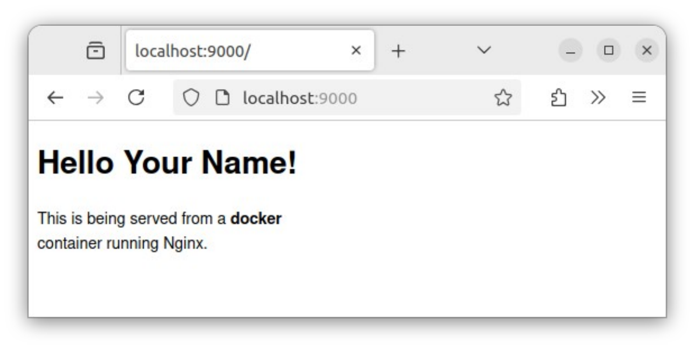{width=59%}

## Contenedores en ejecución

Gestión de Contenedores

El id del contenedor es **cfb197ca8b63**

Este id se usa para referirte al

STATUS es UP

contenedor

```
$ docker ps
```

```
CONTAINER ID   IMAGE                    COMMAND                  CREATED       STATUS       PORTS          NAMES
cfb197ca8b63   codigusdev/static-site   "/bin/sh -c 'cd /usr…"   5 hours ago   Up 5 hours   9000->80/tcp   static-site
```

## Logs

Gestión de Contenedores

- Obtener la salida estándar de un contenedor
- Útil para contenedores arrancados en segundo plano

```
$ docker logs static-site
```

## Parar y borrar contenedores

Gestión de Contenedores

- Parar un contenedor en ejecución
- Borrar los ficheros del contenedor parado

```
$ docker stop cfb197ca8b63
```

```
$ docker rm cfb197ca8b63
```

---

Gestión de Contenedores

- Parar y borrar en un comando
- Parar y borrar todos los contenedores

```
$ docker rm -f static-site
```

```
$ docker rm -f $(docker ps -a -q)
```

## Ejercicio 1

- Ejecuta una web con Drupal en un contenedor Docker
  - Revisa la documentación de la página de DockerHub de Drupal

[https://hub.docker.com/\_/drupal](https://hub.docker.com/_/drupal)

  - Accede al drupal desde un navegador web

## Ejercicio 1 - Solución

- Ejecuta una web con Drupal en un contenedor Docker
  - Comando:
  - URL en el navegador: localhost:8080

```
$ docker run --name some-drupal -p 8080:80 -d drupal
```

# Volúmenes en Docker

## Volúmenes en Docker

- Los contenedores pueden acceder a **carpetas** y **ficheros del host**
- Ejemplos de uso:
  - Ficheros de **configuración**
  - Ficheros de **entrada y salida** (compiladores, servidores web…)
  - Carpetas para guardar los datos de una **BBDD**
- Por cada carpeta del host a la que se quiere acceder, se configura un **volumen**, indicando qué **carpeta del host** es visible en qué **carpeta del contendor**

---

- Configuración de volúmenes al ejecutar un contenedor
- Configurar la carpeta en la que se ejecuta el comando (variable de entorno PWD)

[https://docs.docker.com/engine/storage/volumes/](https://docs.docker.com/engine/storage/volumes/)

```
$ docker run -v <host_dir>:<container_dir> <image>
```

```
$ docker run -v "$PWD:<container_dir>” <image>
```

---

**Ejemplo volúmenes: Contenedor NGINX**

- La imagen oficial del servidor web NGINX puede servir por http (web) ficheros del host

{width=33%}

[https://hub.docker.com/\_/nginx](https://hub.docker.com/_/nginx)

- Sirve los ficheros de la carpeta **/usr/share/nginx/html**

---

**Ejemplo volúmenes: Contenedor NGINX**

- Carpeta del contendor: **/usr/share/nginx/html**
- Carpeta del host: **$PWD (carpeta actual)**
- Modo de solo lectura (**:ro**)
- Abre el navegador en http://127.0.0.1:9000/some\_file
- “some\_file” es un fichero de la carpeta en la que se ejecuta el comando

```
$ docker run -d -p 9000:80 \
   -v "$PWD:/usr/share/nginx/html:ro" \
   nginx:1.27.4
```

---

**Ejemplo volúmenes: Contenedor NGINX**

```
$ echo "HOLA MUNDO" > example.txt
$ docker run -d -p 9000:80 -v "$PWD:/usr/share/nginx/html:ro" nginx:1.27.4
```

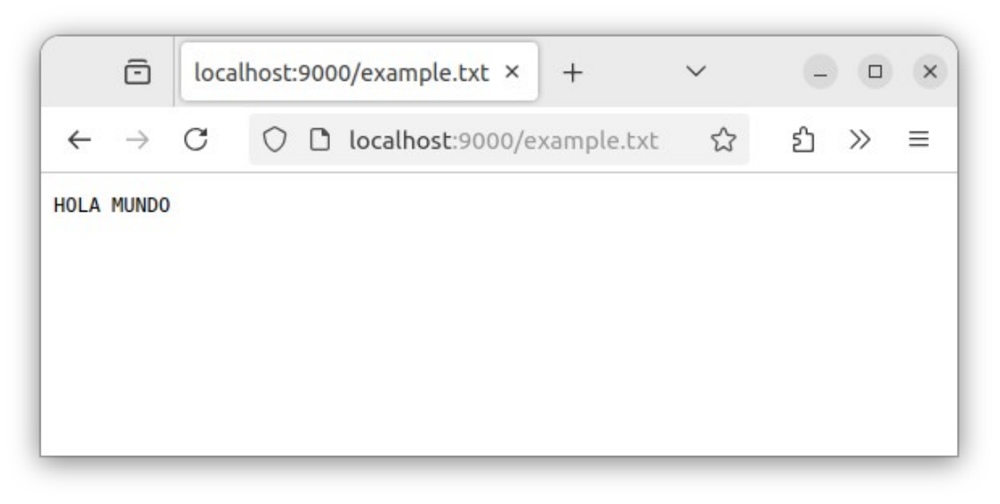{width=51%}

# Configuración de contenedores

## Configuración de contenedores

- Dependiendo de cómo se haya creado la imagen, un contenedor puede configurarse de diferentes formas cuando se ejecuta:
  - Sin configuración (ejecución por defecto)
  - Configuración con variables de entorno

```
$ docker run <imagen>
```

```
$ docker run -e <NAME>=<value> <imagen>
```

---

**Ejemplo: Base de datos MySQL dockerizada con variables de entorno**

- Arranque contenedor:
- Configuración con variables de entorno:
  - MYSQL\_DATABASE, MYSQL\_USER, MYSQL\_PASSWORD

[https://hub.docker.com/\_/mysql/](https://hub.docker.com/_/mysql/)

```
$ docker run --rm \
   -e MYSQL_ROOT_PASSWORD=password \
   -e MYSQL_DATABASE=test \
   -p 3306:3306 -d mysql:9.2
```

---

- Dependiendo de cómo se haya creado la imagen, un contenedor puede configurarse de diferentes formas cuando se ejecuta:
  - Parámetros del comando por defecto
  - Comando y parámetros (cuando no hay comando por defecto)

```
$ docker run <imagen> <params>
```

```
$ docker run <imagen> <comando> <params>
```

---

**Ejemplo de imagen Docker con un parámetro**

- El comando por defecto es **mysqld**
- El parámetro es **"--version"**

```
$ docker run mysql --version
/usr/sbin/mysqld  Ver 9.3.0 for Linux on x86_64 
(MySQL Community Server - GPL)
```

---

**Ejemplo: Comandos Git desde terminal**

- La imagen alpine/git permite utilizar Git como una aplicación por consola
  - Usamos el parámetro **clone** para clonar el repositorio indicado en la carpeta actual gracias a los volúmenes

```
$ docker run -v "$PWD:/app" \
    alpine/git clone https://github.com/docker/getting-started.git \ 
    /app/getting-started
```

---

**Ejemplo de imagen Docker con un comando**

- El comando es **echo**
- El parámetro es **"Hola desde Docker"**

```
$ docker run ubuntu:24.04 echo "Hola desde Docker"
Hola desde Docker
```

# Aplicaciones de consola

## Aplicaciones de consola

- El uso principal de un contenedor es empaquetar aplicaciones (de consola o servicio de red)
- En ocasiones queremos ejecutar comandos de forma interactiva “**dentro del contenedor**”
- La mayoría de las imágenes tienen el binario de una consola (shell):  **/bin/sh** o **/bin/bash** (dependiendo de la imagen)

---

**Ejemplo: Shell en un contendor con ubuntu**

- La opción **-it** se usa para que se conecte la terminal al proceso del contenedor de forma interactiva
- Usados de esta forma los contenedores se parecen a una **máquina virtual** **ligera** a la que se accede por **ssh**

```
$ docker run -it ubuntu:24.04 /bin/sh
# ls
bin   dev  home  lib64 mnt  proc  run srv  tmp  var
boot  etc  lib media opt  root  sbin  sys  usr
# exit
```

---

**Ejemplo: Shell en un contendor con ubuntu**

- Es posible ejecutar un **comando** dentro de un contenedor en ejecución (**exec**)
- Se suele ejecutar una shell para poder **inspeccionar el sistema de** **ficheros** del contenedor para **depurar** problemas

```
$ docker exec -it <container_name> /bin/sh
# ls
bin   dev  home  lib64 mnt  proc  run srv  tmp  var
boot  etc  lib media opt  root  sbin  sys  usr
# exit
```

---

**Ejemplo: Compilación usando Maven**

- Podemos usar la imagen oficial de Maven para compilar y empaquetar un proyecto Java
  - Usaremos el proyecto **docker\_ejem1\_spring-jar**

```
$ cd docker_ejem1_spring-jar
$ docker run --rm -v "$PWD:/app" -w /app maven:3.9 mvn clean package
```

## Ejercicio 2

- Partiendo del ejemplo de base de datos con MySQL visto anteriormente, revisa la documentación de MySQL para aprender cómo persistir los datos almacenados en un volumen

[https://hub.docker.com/\_/mysql](https://hub.docker.com/_/mysql)

- Utiliza el nombre **mysql-example** para el contenedor
- Crea una tabla de ejemplo y comprueba que existe.
  - Puedes usar los siguientes comandos, que utilizan una shell interactiva sobre el contenedor
- Borra el contenedor y lánzalo de nuevo. Comprueba que la tabla no se ha borrado

```
$ docker exec -it mysql-example mysql -u root -p
mysql> USE test
mysql> CREATE TABLE Products (name VARCHAR(255), stock INT );
mysql> SHOW TABLES;
```

## Ejercicio 2 - Solución

```
$ docker run --rm \
   -e MYSQL_ROOT_PASSWORD=password \
   -e MYSQL_DATABASE=test \
   --name mysql-example \
   -v "$PWD/data:/var/lib/mysql" \
   -p 3306:3306 -d mysql:9.2
```

# Redes en Docker

## Interfaces de red por defecto en Docker

Redes en Docker

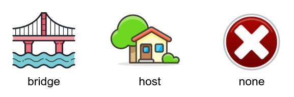{width=48%}

- **Bridge**: Red por defecto al lanzar un contenedor, proporciona aislamiento al utilizar una red privada diferente a la red del Host. Permite la comunicación entre contenedores en la misma red pero sin poder utilizar el nombre de los contenedores
- **Host**: Esta red elimina el aislamiento entre el Host y los contenedores. Utiliza la red del Host y su IP, esto implica que los puertos del contenedor estarán directamente disponibles en el Host
- **None**:  Esta red no permitirá la salida a internet del container ni la comunicación entre contenedores

## Redes en Docker

- Si creamos una red nueva los contenedores de esa red podrán **verse** utilizando su **nombre de servicio (DNS)**
- Los contenedores de la red por defecto **(bridge)** también pueden verse, pero solo utilizando las **IPs** de los contenedores
- En **Linux** podremos conectarnos a los contenedores levantados utilizando su **IP**, no es necesario bindear los puertos. En **Windows** y **Mac** siempre será necesario bindear los puertos que queramos atacar desde fuera del contenedor

---

- Ejecución de un servidor web sin bindear puertos (Linux)
- Obtener la IP de un contenedor en ejecución (sólo Linux)
- Abrir http://172.17.0.2/ en el navegador web

```
$ docker run -d --name nginx \
   -v "$PWD:/usr/share/nginx/html:ro" nginx:1.27.4
```

```
$ docker inspect -f \
    '{{range.NetworkSettings.Networks}}{{.IPAddress}}{{end}}' \
    nginx
172.17.0.2
```

---

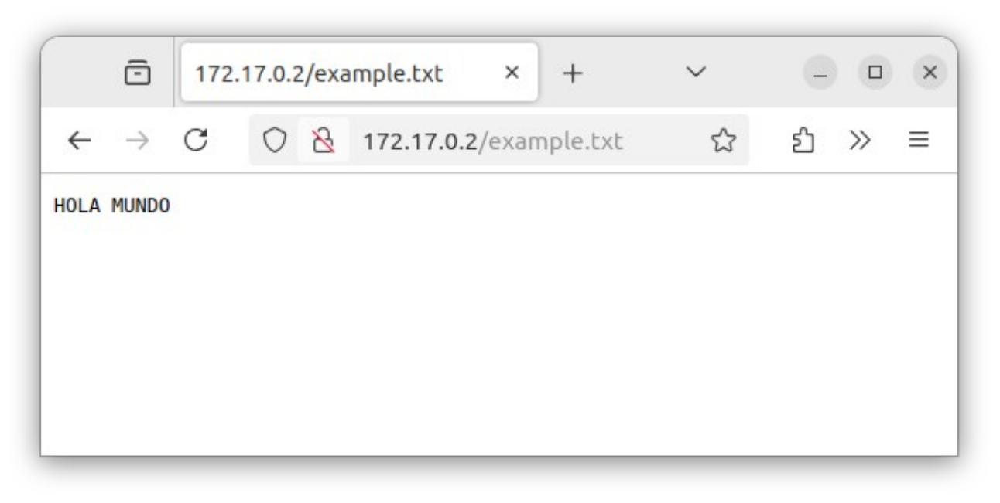{width=59%}

::: {.columns}
::: {.column width="32%"}
{width=38%}
:::
::: {.column width="68%"}
Esta funcionalidad (usar la IP) solo está disponible en sistemas Linux
:::
:::

---

- Ejecución de un servidor web **bindeando puertos** **(Windows)**

```
$ docker run -d -p 9000:80 \
 -v "${PWD}:/usr/share/nginx/html:ro" nginx:1.27.4
```

---

- Listado de las redes disponibles
- Creación de una nueva red
- Conectar un container a una determinada red

```
$ docker network ls
```

```
$ docker network create some-network
```

```
$ docker run --network some-network alpine
```

---

**Ejemplo: Conexión entre 2 contenedores**

- Veremos un ejemplo en el que conectaremos dos contenedores usando una red de Docker
  - Una base de datos MySQL
  - Una aplicación Drupal (servicio web) **localhost:8080**

```{dot}
//| fig-width: 7.6
//| fig-height: 2.3
// El ejemplo de Drupal: el navegador entra por el puerto 80 del contenedor de
// Drupal, que habla con MySQL por el 3306, los dos en la misma red.
digraph drupal {
  rankdir=LR; bgcolor="transparent"; ranksep=0.8; nodesep=0.4;
  node [fontname="Lato", fontsize=12];
  edge [color="#333333", arrowsize=0.8, fontname="Lato", fontsize=10];

  browser [shape=box, style="filled,rounded", fillcolor="#ffffff",
           color="#2e75b6", label="Browser\nlocalhost:8080"];

  subgraph cluster_red {
    label="drupal-network"; labelloc=b; fontsize=11; fontcolor="#1f4e79";
    style=filled; fillcolor="#9dc3e6"; color="#2e75b6";
    drupal [shape=box, style=filled, fillcolor="#2e75b6", fontcolor="white",
            label="Drupal\nContainer"];
    mysql  [shape=box, style=filled, fillcolor="#2e75b6", fontcolor="white",
            label="MySQL\nContainer"];
    drupal -> mysql [label="Puerto 3306", color="#1f3864", fontcolor="#1f3864"];
  }

  browser -> drupal [label="Puerto 80"];
}
```

---

**Ejemplo: Conexión entre 2 contenedores**

- Creamos una nueva red
- Ejecutamos un contenedor MySQL y lo conectamos en la red creada
- Ejecutamos un contenedor Drupal y lo conectamos en la red creada

```
$ docker network create drupal-network
```

```
$ docker run -d --name mysql --network drupal-network \
    -e MYSQL_DATABASE=drupal -e MYSQL_USER=user \
    -e MYSQL_PASSWORD=pass -e MYSQL_ROOT_PASSWORD=pass \
    mysql:9.2
```

```
$ docker run -d --network drupal-network --name drupal \
    -p 8080:80 drupal:10.4.6
```

---

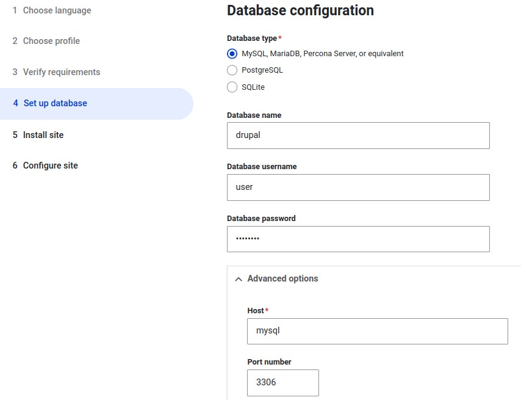{width=56%}

{width=56%}

**Conectar Drupal con la base**

**de datos**

Utilizaremos los datos de

usuario, contraseña y nombre de la base de datos definidos en el

contenedor de **“mysql”** Database name: **drupal**

Username: **user**

Databasepassword: **pass**

---

{width=56%}

{width=56%}

**Conectar Drupal con la base**

**de datos**

Utilizaremos el nombre del contenedor **“mysql”** para conectarnos con la base de

datos

Esto es posible debido a que los

servicios **“mysql”** y **“drupal”**

están en la misma red y pueden utilizar la resolución de nombres

proporcionada por Docker

