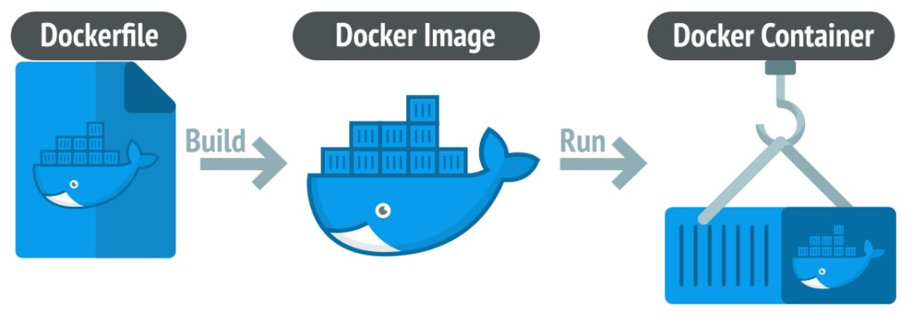
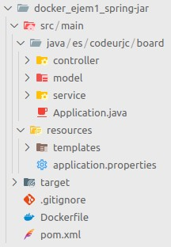
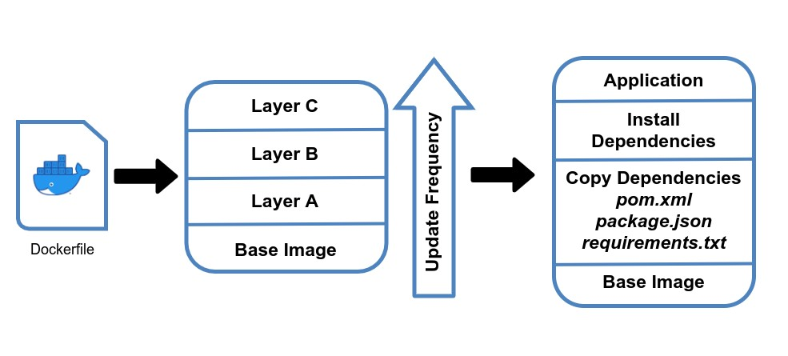
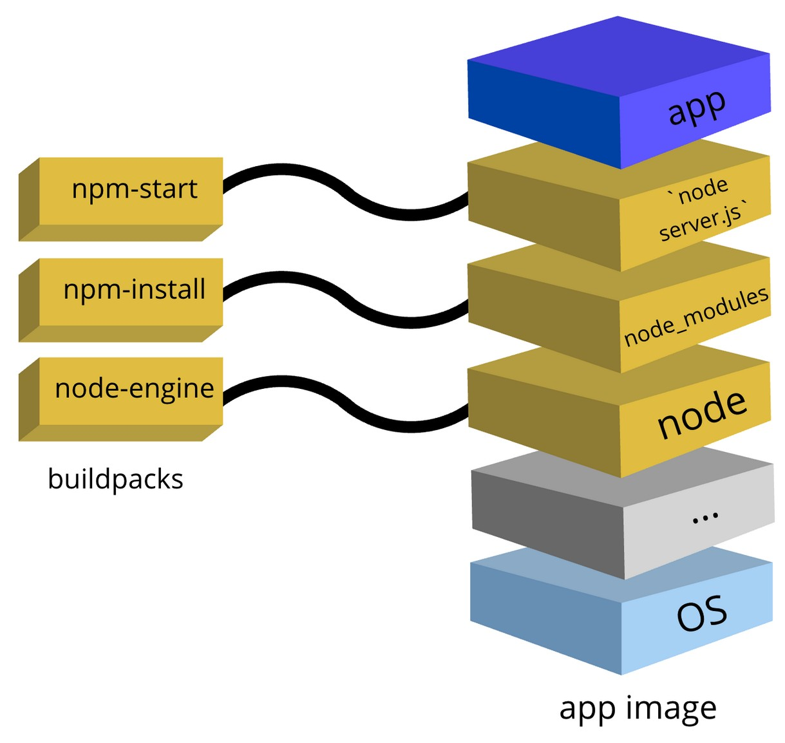
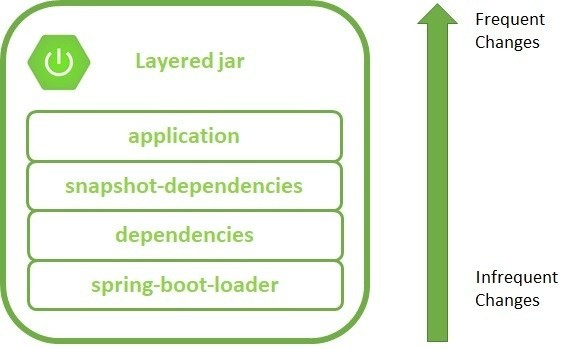

## Licencia {.nota-licencia visibility="uncounted"}

©2025 Micael Gallego, Francisco Gortázar, Michel Maes, Óscar Soto, Iván Chicano Algunos derechos reservados Este documento se distribuye bajo la licencia “Atribución-CompartirIgual 4.0 Internacional” de Creative Comons Disponible en [https://creativecommons.org/licenses/by-sa/4.0/deed.es](https://creativecommons.org/licenses/by-sa/4.0/deed.es)

## Creación de imágenes

- Para generar imágenes Docker realizaremos los siguientes pasos
  - **Crear un Dockerfile**: Este es un archivo de texto que contiene todas las instrucciones necesarias para construir la imagen.
    - Define el sistema operativo base, las dependencias, los archivos de la aplicación y cómo se debe ejecutar la aplicación dentro del contenedor.
  - **Construir la imagen**: Se utiliza el comando **docker build** en la línea de comandos de Docker en el directorio que contiene el Dockerfile (al que llamaremos "contexto de construcción").
    - Docker lee el Dockerfile instrucción por instrucción para crear las "capas" de la imagen.

## Dockerfile

Creación de imágenes

- Fichero usado para describir el contenido de una imagen docker
- Contenido:
  - Imagen en la que se basará la nueva imagen
  - Comandos que añaden el software necesario a la imagen base
  - Ficheros de la aplicación para incluir en la imagen
  - Puertos abiertos para poder bindearlos al host
  - Comando por defecto a ejecutar al arrancar el contenedor

## Creación de imágenes

{width=85%}

Fuente: [https://linuxiac.com/what-is-docker-container/](https://linuxiac.com/what-is-docker-container/)

## Dockerizar una aplicación Java

::: {.columns}
::: {.column width="69%"}
Creación de imágenes

- Crearemos una imagen Docker para empaquetar (dockerizar) una aplicación Spring

- Se trata de una aplicación web sencilla que gestiona anuncios (Posts)
:::
::: {.column width="31%"}
{width=80%}

{width=80%}
:::
:::

---

Creación de imágenes

- Contenido de la imagen docker:
  - Java Runtime Enviroment (**JRE**)
  - Código compilado de la aplicación con todas sus dependencias (**JAR**)
- Una vez creada la imagen, se puede **ejecutar la aplicación** **dockerizada**
- También se puede **publicar en DockerHub** (o cualquier otro registro) para compartirla

---

Creación de imágenes

- Cuando la aplicación está implementada con un lenguaje compilado, se realizan dos pasos:
  - 1) **Compilar** la aplicación (preferiblemente en un contenedor)
  - 2) **Empaquetar** la aplicación en un contenedor

## Compilar una aplicación Java en un contenedor

Creación de imágenes

- Compilar y generar el fichero .jar
  - “**mvn package**” es el comando de compilación y empaquetado
  - **-w** configura el directorio de trabajo
  - **-v** “$PWD”:/app monta la carpeta actual en /app dentro del contenedor para que el código esté disponible

```
$ cd docker_ejem1_spring-jar
$ docker run --rm -v "$PWD:/app" -w /app maven:3.9 mvn clean package
```

---

Creación de imágenes

**ejem1\_spring-jar**

- La aplicación compilada y empaquetada es un fichero .jar que se encuentra en la carpeta **target**
- Para ejecutar ese fichero es necesario el **Java Runtime** **Environment (JRE)**, pero no es necesario un compilador ni otras herramientas de construcción como Maven
- Se ejecuta con el comando

```
$ java -jar target/spring-webapp-0.1.0.jar
```

## Dockerizar una aplicación Java

Creación de imágenes

**ejem1\_spring-jar**

- Hay que crear un nuevo contenedor a partir de una imagen base Java para poder ejecutar el .jar (No se necesita maven)
- Hay que copiar el fichero .jar recién creado
- Al arrancar el contenedor, se ejecutará

```
$ java -jar app.jar
```

## Construir la imagen

Creación de imágenes

**ejem1\_spring-jar**

**Dockerfile**

```
# Selecciona la imagen base
FROM eclipse-temurin:21-jre
# Define el directorio de trabajo para el comando
WORKDIR /usr/src/app/
# Copia de la aplicación compilada y la renombra a "app.jar"
COPY target/*.jar /usr/src/app/app.jar
# Indica el puerto que expone el contenedor
EXPOSE 8080
# Comando que se ejecuta al hacer docker run
CMD [ "java", "-jar", "app.jar" ]
```

---

Creación de imágenes

**ejem1\_spring-jar**

- Se puede crear una imagen para que sea usada únicamente en la máquina que se ha creado
- Lo más habitual es crear una imagen para subirla a un registro de imágenes (como DockerHub)
  - Creamos una cuenta en DockerHub
  - Conectamos nuestra máquina a DockerHub

```
$ docker login
```

---

Creación de imágenes

**ejem1\_spring-jar**

- En la carpeta del Dockerfile se ejecuta
  - **miusuario** corresponde al usuario creado en DockerHub
  - **web-posts** es el nombre del repositorio al que subir la imagen
  - **.** es la ruta del Dockerfile

```
$ docker build -t miusuario/web-posts .
```

---

Creación de imágenes

**ejem1\_spring-jar**

- Acciones ejecutadas:
  - Se ejecuta un nuevo contenedor partiendo de la imagen base
  - Se ejecutan los comandos (RUN y COPY) del Dockerfile en ese contenedor
  - El resultado se empaqueta en el nuevo contenedor

## Ejecutar la nueva imagen

Creación de imágenes

**ejem1\_spring-jar**

- Abrir [http://localhost:8080/](http://localhost:8080/)  en el navegador web

```
$ docker run -p 8080:8080 miusuario/web-posts
...
2025-04-21T18:46:44.914Z  INFO 1 --- [           main] 
o.s.b.w.embedded.tomcat.TomcatWebServer  : Tomcat started on port 8080 (http)
2025-04-21T18:46:44.931Z  INFO 1 --- [           main] 
es.codeurjc.board.Application            : Started Application in 1.834 seconds
```

## Publicar la imagen

Creación de imágenes

**ejem1\_spring-jar**

- La imagen se sube a DockerHub y se hace pública
- Cualquiera puede ejecutar un contenedor partiendo de esa imagen
- Se pueden instalar registros privados en una organización

```
$ docker push miusuario/web-posts
```

## Multistage Dockerfile

Creación de imágenes

- Se han realizado dos pasos para dockerizar la aplicación
  - Paso 1: Compilar el código fuente y generar el binario usando un contenedor
  - Paso 2: Crear un contenedor con el binario generado
- Los **Multistage Dockerfiles** son ficheros Dockerfile que permiten definir varios pasos.
- Cada paso se ejecuta en su propio contenedor

[https://docs.docker.com/build/building/multi-stage/](https://docs.docker.com/build/building/multi-stage/)

## 

```
# Imagen base para el contenedor de compilación
FROM maven:3.9.9-eclipse-temurin-21-jammy AS builder
# Define el directorio de trabajo donde ejecutar comandos
WORKDIR /project
# Copia el código del proyecto
COPY /src /project/src
COPY pom.xml /project/
# Compila proyecto y descarga librerías
RUN mvn -B package -DskipTests
```

**ejem2\_spring-multistage**

```
# Imagen base para el contenedor de la aplicación
FROM eclipse-temurin:21-jre
# Define el directorio de trabajo donde se encuentra el JAR
WORKDIR /usr/src/app/
# Copia el JAR del contenedor de compilación
COPY --from=builder /project/target/*.jar /usr/src/app/app.jar
# Indica el puerto que expone el contenedor
EXPOSE 8080
# Comando que se ejecuta al hacer docker run
CMD [ "java", "-jar", "app.jar" ]
```

## Multistage Dockerfile

Creación de imágenes

**Ventajas**

- La ventaja de usar un Multistage Dockerfile es que con un **único comando** se puede compilar y dockerizar la aplicación
- El comando se puede usar en Linux, Windows o Mac, lo que facilita la **portabilidad** de las instrucciones de construcción
- Es muy adecuado para dockerizar aplicaciones en entornos de **integración continua**

---

Creación de imágenes

**Desventajas**

- El contenedor de construcción se borra automáticamente al finalizar su trabajo y puede ser compleja la depuración en caso de problemas porque no se puede acceder a ficheros temporales

## Caché de construcción por capas

Creación de imágenes

- Cambia la plantilla de la web en **/src/main/resources/templates/index.html**
- Construye la imagen de nuevo
- Los pasos del Dockerfile que no han cambiado **NO se vuelven a ejecutar** (se reutilizan de la ejecución previa)
- Cada paso está en una capa **independiente**
- La nueva imagen se crea muy rápidamente

```
$ docker build -t miusuario/web-posts .
```

---

Creación de imágenes

- Aprovechamiento de caché de las capas
- Las dependencias suelen cambiar poco, por eso se instalan antes del código (y quedan en una capa previa)
- El código es lo que más cambia, por eso sus comandos van al final

---

Creación de imágenes

{width=94%}

## 

```
# Imagen base para el contenedor de compilación
FROM maven:3.9.9-eclipse-temurin-21-jammy AS builder
# Define el directorio de trabajo donde ejecutar comandos
WORKDIR /project
# Copia el código del proyecto
COPY /src /project/src
COPY pom.xml /project/
# Compila proyecto y descarga librerías
RUN mvn -B package -DskipTests
```

**ejem2\_spring-multistage**

```
# Imagen base para el contenedor de la aplicación
FROM eclipse-temurin:21-jre
# Define el directorio de trabajo donde se encuentra el JAR
WORKDIR /usr/src/app/
# Copia el JAR del contenedor de compilación
COPY --from=builder /project/target/*.jar /usr/src/app/app.jar
# Indica el puerto que expone el contenedor
EXPOSE 8080
# Comando que se ejecuta al hacer docker run
CMD [ "java", "-jar", "app.jar" ]
```

## Caché de construcción por capas

Creación de imágenes

**ejem2\_spring-multistage**

**ejem3\_spring-multistage-cache**

```
# Copia el código del proyecto
COPY /src /project/src
COPY pom.xml /project/
# Compila proyecto y descarga librerías
RUN mvn -B package -DskipTests
```

```
# Copia las dependencias del proyecto
COPY pom.xml /project/
# Descarga las dependencias del proyecto
RUN mvn dependency:go-offline
# Copia el código del proyecto
COPY /src /project/src
# Compila proyecto y descarga librerías
RUN mvn -B package -DskipTests
```

## Buenas prácticas del Dockerfile

Creación de imágenes

- Cada comando Dockerfile es una capa:
  - Si un comando RUN graba ficheros y el siguiente comando los borra, los ficheros originales quedan en la imagen (en la capa)
  - Se encadenan muchos comandos en un mismo RUN para limpiar los ficheros temporales

[https://docs.docker.com/build/building/best-practices/#run](https://docs.docker.com/build/building/best-practices/#run)

```
RUN apt-get update -& apt-get install -y \
    curl \
    unzip \
    libicu66 \
    && rm -rf /var/lib/apt/lists/*
```

## CMD

Creación de imágenes

- Define un comando predeterminado que se ejecuta al iniciar un contenedor
- Este comando se puede sobreescribir al arrancar la imagen con el comando “**docker run image \[OPTIONS\]**”

[https://dominikbraun.io/blog/docker/dockerfile-run-vs-cmd-vs-entrypoint/](https://dominikbraun.io/blog/docker/dockerfile-run-vs-cmd-vs-entrypoint/)

```dockerfile
FROM alpine:3.12
CMD ["echo", "Hello from CMD"]
$ docker container run my-image
  Hello from CMD
$ docker container run my-image echo "Hello from the CLI"
  Hello from the CLI
```

## ENTRYPOINT

Creación de imágenes

- También define un comando por defecto que se ejecuta al iniciar un contenedor
- El **ENTRYPOINT** es ideal para las imágenes que siempre ejecutan el mismo comando
- Por defecto **ENTRYPOINT** ejecuta el comando “**/bin/sh**”
- A diferencia de **CMD** este comando no se puede reemplazar con el comando “**docker run image \[OPTIONS\]**”
- Todos los comandos que pasemos al **CMD** se enviarán como parámetros al **ENTRYPOINT**

[https://dominikbraun.io/blog/docker/dockerfile-run-vs-cmd-vs-entrypoint/](https://dominikbraun.io/blog/docker/dockerfile-run-vs-cmd-vs-entrypoint/)

---

Creación de imágenes

[https://dominikbraun.io/blog/docker/dockerfile-run-vs-cmd-vs-entrypoint/](https://dominikbraun.io/blog/docker/dockerfile-run-vs-cmd-vs-entrypoint/)

```dockerfile
FROM alpine:3.12
ENTRYPOINT ["echo"]
CMD ["Hello from CMD"]
$ docker run my-image
  Hello from CMD
$ docker run my-image "Hello from the CLI"
  Hello from the CLI
```

## Creación de imágenes

**Aplicación de línea de comandos Java****ejem4\_java-cmd**

```
publicclass Application {
    publicstaticvoid main(String[] args) {
       System.out.println("===========================");
       System.out.println("Command line application");
       System.out.println("===========================");
       System.out.println("=> Read arguments:");
       Arrays.stream(args)
               .forEach(arg -> System.out.println("\t" + arg));
    }
}
```

---

**ejem4\_java-cmd**

```
--.
ENTRYPOINT [ "java", "-jar", "app.jar" ]
CMD ["--server"]
$ docker build -t java-cmd .
$ docker run java-cmd
===========================
Command line application
===========================
=> Read arguments:
     --server
$ docker run java-cmd --override-argument1 --override-argument2
===========================
Command line application
===========================
=> Read arguments:
     --override-argument1
     --override-argument2
```

## Herramientas de creación de imágenes

Creación de imágenes

- Para ciertas aplicaciones de tipos concretos se han creado herramientas más optimizadas para crear las imágenes Docker
  - Google jib
  - **Buildpacks + Packeto**
  - Imagen nativa GraalVM
- Nos centraremos en buildpacks que es la que soporta SpringBoot

## Buildpacks

Creación de imágenes

{width=16%}

{width=37%}

- Traduce el **código** fuente a **imagénes**
- No hay que utilizar Dockerfiles
- Cacheo de capas de forma optimizada
- Multilenguaje
- Imagenes minimas
- Builder y buildpacks

[https://buildpacks.io/](https://buildpacks.io/)

- **Pack** CLI utiliza **Docker**

[https://buildpacks.io/docs/tools/pack/](https://buildpacks.io/docs/tools/pack/)

## Paketo

Creación de imágenes

{width=28%}

- Implementación de Buildpacks
- Nos proporciona diferentes Builders para diferentes lenguajes (Java, Node, python, Go…)
- Existen diferentes implementaciones de otros proveedores (Google, Heroku)

[https://paketo.io/](https://paketo.io/)

[https://cloud.google.com/docs/buildpacks](https://cloud.google.com/docs/buildpacks)

[https://github.com/heroku/cnb-builder-images](https://github.com/heroku/cnb-builder-images)

## Spring Boot y Buildpacks

::: {.columns}
::: {.column width="49%"}
Creación de imágenes

- A partir de Spring Boot 2.3.0
- Soporte para Buildpacks
- JAR con capas
:::
::: {.column width="51%"}
{width=95%}
:::
:::

---

Creación de imágenes

- Compilación utilizando Buildpacks
- Crear imagen de la aplicación Spring Boot utilizando Buildpacks
- Por defecto el nombre de la imagen será “**artifactId:version**”
- Crear imagen especificando un nombre

```
$ mvn spring-boot:build-image
```

```
$ mvn spring-boot:build-image \
 -Dspring-boot.build-image.imageName=miusuario/mi-app:v1
```

---

Creación de imágenes

- También podemos especificar el nombre de la imagen en el fichero pom.xml

```xml
<plugin>
    <groupId>org.springframework.boot</groupId>
    <artifactId>spring-boot-maven-plugin</artifactId>
    <configuration>
       <image>
           <name>miusuario/mi-app:${project.version}</name>
       </image>
    </configuration>
</plugin>
```

## Ejercicio 1

- Crea una imagen usando buildpacks usando la aplicación del ejemplo **docker\_ejem1\_spring-jar**
  - Llámala **\<dockerhub\_user\>/posts** y usa la versión del proyecto
  - Publícala en DockerHub

