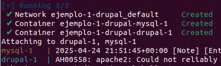
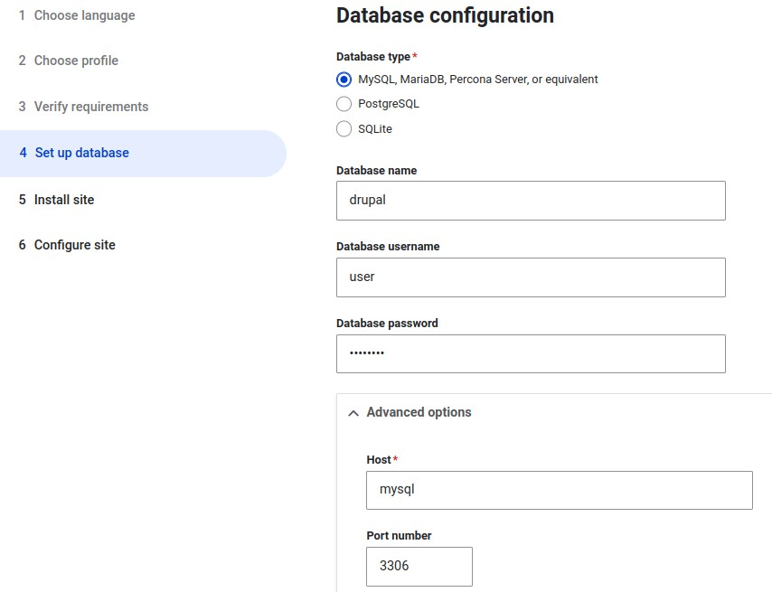
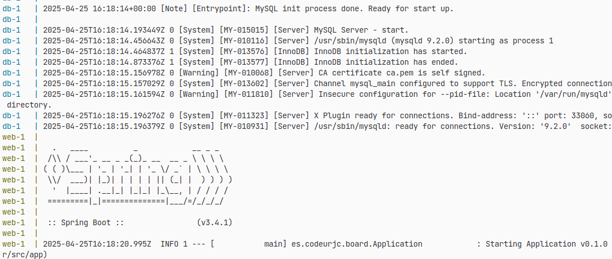
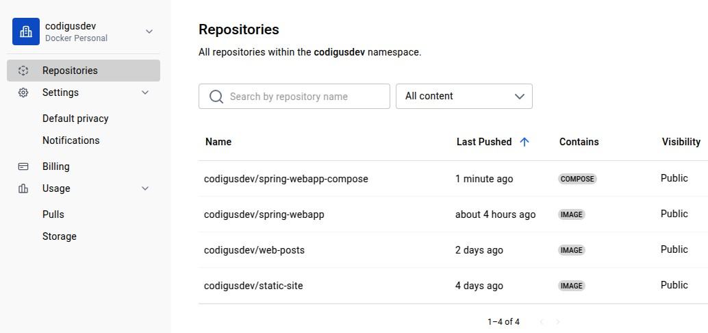

## Licencia {.nota-licencia visibility="uncounted"}

©2025 Micael Gallego, Francisco Gortázar, Michel Maes, Óscar Soto, Iván Chicano Algunos derechos reservados Este documento se distribuye bajo la licencia “Atribución-CompartirIgual 4.0 Internacional” de Creative Comons Disponible en [https://creativecommons.org/licenses/by-sa/4.0/deed.es](https://creativecommons.org/licenses/by-sa/4.0/deed.es)

## Docker Compose

- Introducción
- Ejemplos de Docker Compose
- Construcción de imagenes en Docker Compose
- Espera de servicios
- Publicación de aplicaciones Compose
- Beneficios de Docker Compose

# Introducción

## Introducción

- **Docker Compose** es una herramienta para definir aplicaciones formadas por **varios contenedores**
- Un fichero YAML define los **contenedores** (imagen, puertos, volúmenes…) y cómo se **relacionan** entre sí
- Los contenedores se comunican mediante:
  - Protocolos de red
  - Volúmenes compartidos

---

- El plugin de Docker Compose viene por defecto en todas las versiones de Docker Desktop, al igual que en Docker Engine para Linux
- El fichero YAML se suele llamar
- En la carpeta donde está el fichero, la aplicación se ejecuta con el comando

```bash
docker-compose.yml
```

```
$ docker compose up
```

---

**Definición de cada contenedor**

- Imagen
  - Puede descargarse de DockerHub
  - Puede estar construida localmente
  - Puede construirse con un Dockerfile en el momento de iniciar la aplicación

---

**Definición de cada contenedor**

- Puertos:
  - Mapeados en el host (para ser usados desde localhost)
  - No mapeados (sólo se pueden conectar otros contenedores)
- Volúmenes:
  - Carpetas del host accesible desde el contenedor
  - Compartidos entre contenedores (en una carpeta interna de docker)

# Ejemplos de Docker Compose

## Ejemplos de Docker Compose

- Partimos del ejemplo de Drupal visto en el tema de Docker
  - Una base de datos MySQL
  - Una aplicación Drupal (servicio web) **localhost:8080**

```{dot}
//| fig-width: 7.6
//| fig-height: 2.3
// El ejemplo de Drupal: el navegador entra por el puerto 80 del contenedor de
// Drupal, que habla con MySQL por el 3306, los dos en la misma red.
digraph drupal {
  rankdir=LR; bgcolor="transparent"; ranksep=0.8; nodesep=0.4;
  node [fontname="Lato", fontsize=12];
  edge [color="#333333", arrowsize=0.8, fontname="Lato", fontsize=10];

  browser [shape=box, style="filled,rounded", fillcolor="#ffffff",
           color="#2e75b6", label="Browser\nlocalhost:8080"];

  subgraph cluster_red {
    label="drupal-network"; labelloc=b; fontsize=11; fontcolor="#1f4e79";
    style=filled; fillcolor="#9dc3e6"; color="#2e75b6";
    drupal [shape=box, style=filled, fillcolor="#2e75b6", fontcolor="white",
            label="Drupal\nContainer"];
    mysql  [shape=box, style=filled, fillcolor="#2e75b6", fontcolor="white",
            label="MySQL\nContainer"];
    drupal -> mysql [label="Puerto 3306", color="#1f3864", fontcolor="#1f3864"];
  }

  browser -> drupal [label="Puerto 80"];
}
```

---

- Debíamos crear la red y los contenedores con comandos Docker

```
$ docker network create drupal-network
```

```
$ docker run -d --name mysql --network drupal-network \
    -e MYSQL_DATABASE=drupal -e MYSQL_USER=user \
    -e MYSQL_PASSWORD=pass -e MYSQL_ROOT_PASSWORD=pass \
    -v ./mysql:/var/lib/mysql mysql:9.2
$ docker run -d --network drupal-network --name drupal \
    -p 8080:80 drupal:10.4.6
```

---

```yaml
services:
  drupal:
    image: drupal:10.4.6
      - 8080:80
  mysql:
    image: mysql:9.2
    environment:
      MYSQL_ROOT_PASSWORD: pass
      MYSQL_DATABASE: drupal
      MYSQL_USER: user
      MYSQL_PASSWORD: pass
    volumes:
      - ./mysql:/var/lib/mysql
```

- Utilizando un fichero **docker-compose.yml**

podemos agrupar toda esa ports:

configuración

**ejem1\_drupal**

---

**Servicios**

Cada contenedor es un servicio drupal:

de la app

La propiedad indica el nombre

del servicio

Esta app tiene dos servicios:

“**drupal**” y “**mysql**”

**ejem1\_drupal**

```
services:
```

```yaml
    image: drupal:10.4.6
    ports:
      - 8080:80
  mysql:
    image: mysql:9.2
    environment:
      MYSQL_ROOT_PASSWORD: pass
      MYSQL_DATABASE: drupal
      MYSQL_USER: user
      MYSQL_PASSWORD: pass
    volumes:
      - ./mysql:/var/lib/mysql
```

---

- Docker Compose crea una **red nueva** cuando se ejecuta
- Todos los servicios del Docker Compose estarán **conectados** por defecto en la **nueva red**
- Todos los servicios se podrán ver entre ellos utilizando el **nombre del servicio**
- Desde el servicio **“drupal”** podremos usar el nombre del servicio **“mysql”** para conectarnos con la base de datos

---

**Arrancar la aplicación**

- Ejecutamos el siguiente comando desde el directorio donde está el fichero **docker-compose.yml**

{width=50%}

```
$ docker compose up
```

::: {.desde-nivel-2}
- Crea una red nueva
- Inicia los dos contenedores
- Usa el nombre de la carpeta para nombrar la red y los contenedores

**ejem1\_drupal**
:::

---

{width=56%}

{width=56%}

**Conectar Drupal con la base**

**de datos**

Utilizaremos los datos de

usuario, contraseña y nombre de la base de datos definidos en el

contenedor de **“mysql”** Database name: **drupal**

Username: **user**

Databasepassword: **pass**

---

{width=56%}

{width=56%}

**Conectar Drupal con la base**

**de datos**

Utilizaremos el nombre del contenedor **“mysql”** para conectarnos con la base de

datos

Esto es posible debido a que los

servicios **“mysql”** y **“drupal”**

están en la misma red y pueden utilizar la resolución de nombres

proporcionada por Docker

---

**¿Cómo funciona?**

- Se muestran los logs de todos los contendores
- Para parar la app, **Ctrl+C** en la consola (también **docker compose** **stop**)
- Si se para y arranca de nuevo el servicio sin cambiar la configuración de un contenedor, **se vuelve a iniciar el mismo** (no se crea uno nuevo)
- Los datos de la base de datos no se pierden ya que los estamos guardando en una carpeta del host

---

**¿Cómo funciona?**

- Podemos lanzar los contenedores en **segundo** **plano** con la **flag -d**

```
$ docker compose up -d
```

---

**¿Cómo funciona?**

- Podemos **especificar el nombre del fichero** si no se llama exactamente docker-compose.yml con la **flag -f**

```
$ docker compose -f docker-compose.production.yml up
```

---

**Aplicación Java con base de datos MySQL**

- Utilizaremos el la aplicación **ejem2\_spring**
- La imagen utilizada para la aplicación está subida en DockerHub
- El contenedor de la aplicación Java **fallará** y deberá relanzarse porque la base de datos no estará completamente inicializada

---

```yaml
services:
  web:
    image: codigusdev/spring-webapp:mysql
    ports:
      - 8080:8080
    environment:
      - SPRING_DATASOURCE_USERNAME=root
      - SPRING_DATASOURCE_PASSWORD=password
    depends_on:
      - db
    restart: on-failure
  db:
    image: mysql:9.2
    environment:
      - MYSQL_ROOT_PASSWORD=password
      - MYSQL_DATABASE=test
    volumes:
      - ./mysql:/var/lib/mysql
```

**ejem2\_spring**

**Imagen pública en**

**DockerHub**

Podríamos sustituirla por una

propia que construyamos       - SPRING\_DATASOURCE\_URL=jdbc:mysql://db/test

---

```yaml
services:
  web:
    image: codigusdev/spring-webapp:mysql
    ports:
      - 8080:8080
    environment:
      - SPRING_DATASOURCE_URL=jdbc:mysql://db/test
```

**ejem2\_spring**

**depends\_on**

Indica el orden de **arranque** y

**apagado**. En este caso primero       - SPRING\_DATASOURCE\_USERNAME=root

arrancará el servicio “db” y       - SPRING\_DATASOURCE\_PASSWORD=password

posteriormente “web”

“web” no espera a que la base de db:

datos esté operativa para

arrancar, solo espera que el container “db” esté levantado      - MYSQL\_ROOT\_PASSWORD=password

[https://docs.docker.com/compose/how-tos/startup-order/](https://docs.docker.com/compose/how-tos/startup-order/)      - ./mysql:/var/lib/mysql

```yaml
    depends_on:
      - db
    restart: on-failure
    image: mysql:9.2
    environment:
      - MYSQL_DATABASE=test
    volumes:
```

---

```yaml
services:
  web:
    image: codigusdev/spring-webapp:mysql
    ports:
    environment:
      - SPRING_DATASOURCE_USERNAME=root
      - SPRING_DATASOURCE_PASSWORD=password
    depends_on:
      - db
    restart: on-failure
  db:
    image: mysql:9.2
    environment:
      - MYSQL_ROOT_PASSWORD=password
    volumes:
      - ./mysql:/var/lib/mysql
```

**ejem2\_spring**

**restart**

El contenedor “web” **fallará** al

iniciarse porque **la base de datos**       - 8080:8080

**no estará disponible** (tarda en       - SPRING\_DATASOURCE\_URL=jdbc:mysql://db/test

arrancar la primera vez).

Con la opción **restart:on-failure**

el contenedor se lanzará de

nuevo al fallar

Veremos opciones más

avanzadas para realizar **esperas**      - MYSQL\_DATABASE=test

# Construcción de imagenes en Docker Compose

## Construcción de imagenes en Docker Compose

- Es posible indicarle a Docker Compose que **construya la imagen al lanzar la** **aplicación**
- Crea la imagen con el nombre de la carpeta + el nombre del servicio
  - Ej. docker-compose\_ejem3\_spring\_build-web
- También se puede poner el nombre de forma explícita si se usa el atributo “image”
- Si la imagen ya existe, **no la construye de nuevo** (incluso aunque realicemos cambios en el código fuente)
- Podemos **forzar** la construcción de la imagen

[https://docs.docker.com/reference/cli/docker/compose/up/](https://docs.docker.com/reference/cli/docker/compose/up/)

```
$ docker compose up --build
```

---

```yaml
services:
    build: . 
    ports:
      - 8080:8080
      - SPRING_DATASOURCE_URL=jdbc:mysql://db/test
      - SPRING_DATASOURCE_USERNAME=root
      - SPRING_DATASOURCE_PASSWORD=password
    depends_on:
      - db
    restart: on-failure
  db:
    image: mysql:9.2
    environment:
      - MYSQL_ROOT_PASSWORD=password
      - MYSQL_DATABASE=test
    volumes:
      - ./mysql:/var/lib/mysql
```

**ejem3\_spring\_build**

**Construcción de imagen**web:

Se construirá la imagen

utilizando el Dockerfile que haya environment:

en la misma carpeta

# Espera de servicios

## Espera de servicios

- En ocasiones una aplicación tiene que esperar a que otra esté disponible para poder arrancar correctamente
- Por ejemplo, las aplicaciones Spring fallan al arrancar si la base de datos no estaba aún disponible
  - Muy habitual con MySQL
- Pero puede haber otros contextos en los que necesitemos esperar por un servicio antes de poder arrancar otro que depende de él
- ¿Cómo saber cuándo un servicio está realmente disponible?

## Healthcheck

Espera de servicios

- En docker compose podremos utilizar la propiedad **healthcheck** con la cual definiremos si un servicio está **“sano” o no**
- La propiedad **healthcheck** también se puede definir en el fichero **Dockerfile**
- Si utilizamos la propiedad en el fichero **docker compose** y el **healthcheck** está especificado en la **imagen** este **será** **sobrescrito**

---

Espera de servicios

- Para utilizar la propiedad **healthcheck** debemos especificar un **comando** que chequee si el servicio está **“sano”**
  - El comando comprueba que el servicio responde
  - Este comando deberá devolver 0 si el servicio responde y distinto de 0 en caso contrario
  - Ejemplo para MySQL:  $ mysqladmin ping -h localhost
- También podremos especificar el intervalo de chequeo, el timeout, el número de intentos...

[https://docs.docker.com/compose/how-tos/startup-order/](https://docs.docker.com/compose/how-tos/startup-order/)

---

Espera de servicios

- En Docker Compose podemos indicar el orden de inicio de los servicio utilizando la propiedad **depends\_on**
- También es posible indicar una **condición** de espera en la propiedad **depends\_on**
- Combinando la propiedad **healthcheck** junto a la propiedad **depends\_on** podremos esperar a que un servicio esté correctamente iniciado para iniciar otro

---

Espera de servicios

- En la propiedad **depends\_on** podremos indicar varias condiciones de espera para cada servicio:
  - **service\_started**: Esta es la propiedad por defecto, inicia una vez que el servicio del cual depende es creado
  - **service\_healthy**: Inicia una vez que el servicio del cual depende este en un estado de “sano”
  - **service\_completed\_successfully**: Inicia una vez que el servicio del cual depende ha terminado correctamente

[https://docs.docker.com/reference/compose-file/services/#depends\_on](https://docs.docker.com/reference/compose-file/services/#depends_on)

## ejem4_spring_healthcheck

```yaml
services: 
  web:
    build: .
    ports:
      - 8080:8080
    environment:
      - SPRING_DATASOURCE_URL=jdbc:mysql://db/test
      - SPRING_DATASOURCE_USERNAME=root
      - SPRING_DATASOURCE_PASSWORD=password
    depends_on:
      db:
        condition: service_healthy
  db:
    image: mysql:9.2
    environment:
      - MYSQL_ROOT_PASSWORD=password
      - MYSQL_DATABASE=test
    volumes:
      - ./mysql:/var/lib/mysql
    healthcheck:
      test: ["CMD", "mysqladmin" ,"ping", "-h", "localhost", "-uroot", "-p$$MYSQL_ROOT_PASSWORD"]
      interval: 5s
      timeout: 5s
      start_period: 10s
      retries: 5
```

---

```{.yaml data-lineas="20-25"}
services: 
  web:
    build: .
    ports:
      - 8080:8080
    environment:
      - SPRING_DATASOURCE_URL=jdbc:mysql://db/test
      - SPRING_DATASOURCE_USERNAME=root
      - SPRING_DATASOURCE_PASSWORD=password
    depends_on:
      db:
        condition: service_healthy
  db:
    image: mysql:9.2
    environment:
      - MYSQL_ROOT_PASSWORD=password
      - MYSQL_DATABASE=test
    volumes:
      - ./mysql:/var/lib/mysql
    healthcheck:
      test: ["CMD", "mysqladmin" ,"ping", "-h", "localhost", "-uroot", "-p$$MYSQL_ROOT_PASSWORD"]
      interval: 5s
      timeout: 5s
      start_period: 10s
      retries: 5
```

::: {.nota-codigo}
**healthcheck**

- **test**: comando que chequea la “salubridad” del servicio
- **interval**: tiempo entre chequeos
- **timeout**: tiempo de espera para la respuesta del chequeo
- **start\_period**: tiempo de inicio de los chequeos
- **retries**: número de intentos cuando el chequeo falla
:::

---

```{.yaml data-lineas="10-12"}
services: 
  web:
    build: .
    ports:
      - 8080:8080
    environment:
      - SPRING_DATASOURCE_URL=jdbc:mysql://db/test
      - SPRING_DATASOURCE_USERNAME=root
      - SPRING_DATASOURCE_PASSWORD=password
    depends_on:
      db:
        condition: service_healthy
  db:
    image: mysql:9.2
    environment:
      - MYSQL_ROOT_PASSWORD=password
      - MYSQL_DATABASE=test
    volumes:
      - ./mysql:/var/lib/mysql
    healthcheck:
      test: ["CMD", "mysqladmin" ,"ping", "-h", "localhost", "-uroot", "-p$$MYSQL_ROOT_PASSWORD"]
      interval: 5s
      timeout: 5s
      start_period: 10s
      retries: 5
```

::: {.nota-codigo}
**depends\_on**

Ahora el contenedor “web” se iniciará solo cuando se haya cumplido el **healthcheck**
:::

## Healthcheck

Espera de servicios

{width=94%}

{width=94%}

# Publicación de aplicaciones Compose

## Publicación de aplicaciones Compose

- Docker Compose soporta **OCI Artifacts** para empaquetar y distribuir aplicaciones Docker Compose
  - Los **OCI Artifacts** (Open Container Initiative Artifacts) son un formato estandarizado para empaquetar y distribuir **cualquier** **tipo de artefacto digital** (no solo imágenes Docker)
- El proceso es muy similar al de publicación de imagenes Docker
- Por defecto, se suben a DockerHub

[https://docs.docker.com/compose/how-tos/oci-artifact/](https://docs.docker.com/compose/how-tos/oci-artifact/)

---

- Tiene algunas limitaciones:
  - No permite montar **volúmenes** compartidos en los contenedores
  - Los servicios no pueden tener la **propiedad “build”**
  - En general, no permite referencias a **archivos locales** **de configuración**

[https://docs.docker.com/compose/how-tos/oci-artifact/#limitations](https://docs.docker.com/compose/how-tos/oci-artifact/#limitations)

## ejem5_spring_oci

```{.yaml data-lineas="19,26,27"}
services: 
  web:
    image: codigusdev/spring-webapp:mysql
    ports:
      - 8080:8080
    environment:
      - SPRING_DATASOURCE_URL=jdbc:mysql://db/test
      - SPRING_DATASOURCE_USERNAME=root
      - SPRING_DATASOURCE_PASSWORD=password
    depends_on:
      db:
        condition: service_healthy
  db:
    image: mysql:9.2
    environment:
      - MYSQL_ROOT_PASSWORD=password
      - MYSQL_DATABASE=test
    volumes:
      - db_data:/var/lib/mysql
    healthcheck:
      test: ["CMD", "mysqladmin" ,"ping", "-h", "localhost", "-uroot", "-p$MYSQL_ROOT_PASSWORD"]
      interval: 5s
      timeout: 5s
      start_period: 10s
      retries: 5
volumes:
  db_data:
```

::: {.nota-codigo}
Declaramos un volumen en la sección “**volumes**” del docker-compose.yml. Ese volumen, que no está “bindeado” a una carpeta concreta, se creará si no existe y se usará para persistir información de la carpeta de un contenedor.

El equivalente sin hacer uso de docker compose es: `docker volume create db_data`
:::

## ¿Cómo publico mi aplicación?

Publicación de aplicaciones Compose

- Usaremos el ejemplo **ejem5\_spring\_oci**,que no requiere de construcción de imagen y no usa binding de carpetas
- Nos situamos en la carpeta dónde está nuestro fichero docker- compose.yml
- Nos logueamos en DockerHub
- Publicamos el fichero en un repositorio

[https://docs.docker.com/compose/how-tos/oci-artifact/](https://docs.docker.com/compose/how-tos/oci-artifact/)

```
$ docker login
```

```
$ docker compose publish miusuario/spring-webapp-compose:0.1.0
```

---

Publicación de aplicaciones Compose

{width=83%}

{width=83%}

## ¿Cómo despliego mi aplicación?

Publicación de aplicaciones Compose

- Simplemente lanzamos el comando **docker compose** **up** indicando que el fichero lo debe recuperar como un OCI Artifact
- Podemos probarlo con un artefacto ya existente

```
$ docker compose -f oci://docker.io/miusuario/spring-webapp-compose:0.1.0 up
```

```
$ docker compose -f oci://docker.io/codigusdev/spring-webapp-compose:0.1.0 up
```

# Beneficios de Docker Compose

## Beneficios de Docker Compose

**Ideal para desarrollo**

- Podemos definir una app con múltiples contenedores en un fichero de texto (y subirlo a un repositorio compartido)
- Cualquier desarrollador puede arrancar la app sin tener nada instalado en local (sólo docker y docker compose)
- Es muy cómodo iniciar y parar todos los servicios a la vez y sólo cuando realmente se necesitan (no tienen que estar iniciados al arrancar la app)
- Todos los logs centralizados

---

**Distribución de apps dockerizadas**

- Si todas las imágenes del compose están en DockerHub, para distribuir una app multicontenedor dockerizada basta con descargar el docker- compose.yml y arrancarlo gracias a **OCI Artifacts**.

