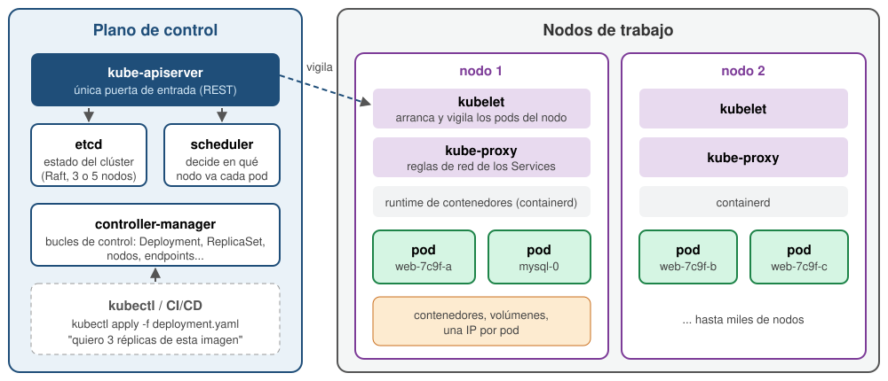
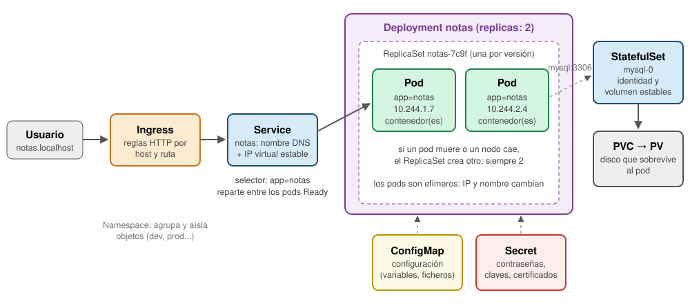
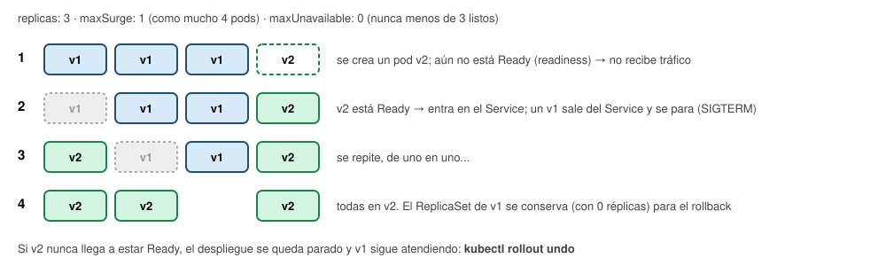
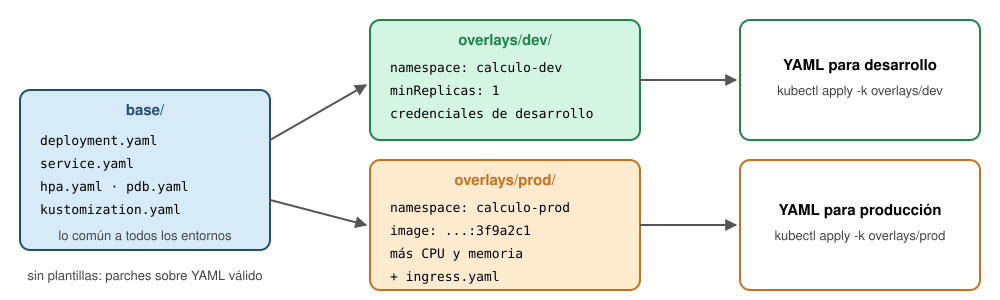

## Contenidos

1. De Docker Compose a un orquestador
2. Arquitectura y modelo declarativo
3. Objetos básicos: Pod, Deployment, Service, ConfigMap, Secret
4. Sondas y recursos
5. Aplicaciones con estado: StatefulSet y volúmenes · Ingress
6. Escalado automático y actualizaciones sin parada
7. Kustomize y despliegue continuo
8. Ejercicio

::: {.ejemplo}
**Código de los ejemplos**: carpeta [`parte_4/tema_4.4_kubernetes`](https://github.com/codeurjc/dad/tree/main/parte_4/tema_4.4_kubernetes). Para probarlos basta un clúster local: [kind](https://kind.sigs.k8s.io/), [minikube](https://minikube.sigs.k8s.io/) o el de Docker Desktop.
:::

# De Compose a Kubernetes

## Lo que Docker Compose no resuelve

Docker Compose describe una aplicación de varios contenedores... **en una sola máquina**. En producción hace falta más:

* **Varias máquinas**: decidir en cuál se ejecuta cada contenedor según la CPU y memoria libres
* **Autorreparación**: si un contenedor o una **máquina entera** cae, volver a arrancarlo en otra
* **Escalado**: añadir y quitar réplicas, incluso automáticamente según la carga
* **Descubrimiento y balanceo**: un nombre estable para un conjunto de réplicas que cambian
* **Actualizaciones sin parada** y vuelta atrás (*rollback*)
* **Configuración y secretos** separados de la imagen
* **Almacenamiento** que sigue al contenedor aunque cambie de máquina

Eso lo hace un **orquestador de contenedores**. El estándar *de facto*: **Kubernetes** (k8s).

## Kubernetes

* Creado por Google (inspirado en Borg) y donado a la **CNCF** en 2015
* **Declarativo**: describes el **estado deseado** en YAML y Kubernetes se encarga de alcanzarlo y mantenerlo
* **Extensible**: recursos propios (CRDs) y operadores (bases de datos, colas, certificados...)
* Funciona igual en un portátil y en un centro de datos:
    - Locales: **kind**, **minikube**, **k3d**, Docker Desktop
    - Gestionados en la nube: **GKE** (Google), **EKS** (AWS), **AKS** (Azure)...
    - En servidores propios: **k3s**, OpenShift, Rancher...

::: {.callout-note}
Kubernetes no construye imágenes ni sustituye a Docker: **ejecuta** las imágenes que generamos con `docker build` (tema 4.2).
:::

# Arquitectura

## Plano de control y nodos

{fig-align="center" width="95%"}

## Estado deseado y bucles de control

```text
 ┌──────────── bucle de control (cada controlador) ────────────┐
 │  1. observar el estado actual   (hay 2 pods de "notas")      │
 │  2. compararlo con el deseado   (replicas: 3)                │
 │  3. actuar para acercarlos      (crear 1 pod)                │
 └──────────────────────────────────────────────────────────────┘
```

* **Nunca** se dice "arranca un contenedor": se dice "**quiero** 3 réplicas" y los controladores reconcilian
* Si un nodo muere, sus pods desaparecen del estado actual y el controlador crea otros en otros nodos
* El estado deseado vive en **etcd**, replicado con **Raft** (tema 1.5): por eso el plano de control tiene 3 o 5 nodos
* Es **idempotente**: `kubectl apply` del mismo fichero dos veces no cambia nada

::: {.callout-tip}
Este modelo hace que los ficheros YAML se puedan guardar en Git y aplicar automáticamente: **infraestructura como código**.
:::

# Objetos básicos

## Los objetos más usados

{fig-align="center" width="95%"}

## Pod y Deployment

::: columns
::: {.column width="50%"}
**Pod**

* Unidad mínima: **uno o varios contenedores** que comparten red (una IP) y volúmenes
* Normalmente un contenedor por pod (más algún *sidecar*)
* Es **efímero**: si muere no "resucita", se crea otro con otra IP y otro nombre
* Casi nunca se crea directamente
:::
::: {.column width="50%"}
**Deployment**

* Mantiene **N réplicas** de una plantilla de pod (a través de un **ReplicaSet**)
* Gestiona las **actualizaciones** (*rolling update*) y el *rollback*
* Para aplicaciones **sin estado**: las réplicas son intercambiables
* Las réplicas se reparten entre nodos
:::
:::

**Etiquetas y selectores**: los objetos se relacionan por **etiquetas**, no por nombre

* El Deployment crea pods con `app: hola` y gestiona los que tengan `app: hola`
* El Service envía tráfico a los pods con `app: hola` que estén listos

## Ejemplo 1: Deployment

::: {.ejemplo}
**[k8s-ejem1](https://github.com/codeurjc/dad/tree/main/parte_4/tema_4.4_kubernetes/k8s-ejem1)**: aplicación Spring Boot que responde con un mensaje, su versión y el **nombre del pod**.
:::

::: columns
::: {.column width="55%"}
```yaml
apiVersion: apps/v1
kind: Deployment
metadata:
  name: hola
spec:
  replicas: 3
  selector:
    matchLabels:
      app: hola
  template:              # plantilla del pod
    metadata:
      labels:
        app: hola
    spec:
      containers:
        - name: hola
          image: codeurjc/k8s-ejem1:v1
          ports:
            - containerPort: 8080
          # + configuración, sondas
          #   y recursos (siguientes)
```
:::
::: {.column width="45%"}
```bash
kubectl apply -f k8s/
kubectl get pods -o wide
```

```text
NAME                   READY  STATUS
hola-6d8f7b9c4-2xkqp   1/1    Running
hola-6d8f7b9c4-8wz5n   1/1    Running
hola-6d8f7b9c4-tq7rj   1/1    Running
```

```bash
kubectl delete pod hola-6d8f7b9c4-2xkqp
kubectl get pods        # ¡ya hay otro!
kubectl scale deployment hola --replicas=5
```
:::
:::

## Service

Los pods cambian de IP y de nombre. Un **Service** da un **nombre DNS** y una **IP virtual** estables y reparte las peticiones entre los pods **listos** que cumplen su selector.

::: columns
::: {.column width="45%"}
```yaml
apiVersion: v1
kind: Service
metadata:
  name: hola
spec:
  type: NodePort
  selector:
    app: hola
  ports:
    - port: 80
      targetPort: 8080
      nodePort: 30080
```
:::
::: {.column width="55%"}
| Tipo | Accesible desde |
|---|---|
| `ClusterIP` (defecto) | Solo dentro del clúster: `http://hola` |
| `NodePort` | Un puerto de cada nodo (30000-32767) |
| `LoadBalancer` | Un balanceador del proveedor de nube |
| *Headless* (`clusterIP: None`) | DNS con las IPs de cada pod |
:::
:::

```bash
kubectl port-forward service/hola 8080:80
for i in $(seq 1 6); do curl -s localhost:8080; echo; done
```

Cada respuesta indica el pod que la atendió: `"pod":"hola-6d8f7b9c4-8wz5n"`, `"pod":"hola-6d8f7b9c4-tq7rj"`...

## ConfigMap y Secret

La **misma imagen** en todos los entornos; lo que cambia es la **configuración** (*12-factor app*).

::: columns
::: {.column width="50%"}
```yaml
apiVersion: v1
kind: ConfigMap
metadata:
  name: hola-config
data:
  APP_MENSAJE: "Hola desde Kubernetes"
  APP_VERSION: "v1"
```
:::
::: {.column width="50%"}
```yaml
apiVersion: v1
kind: Secret
metadata:
  name: hola-secret
type: Opaque
stringData:
  APP_API_KEY: "valor-de-ejemplo"
```
:::
:::

* Se inyectan como **variables de entorno** (`envFrom: configMapRef / secretRef`; `APP_MENSAJE` → `app.mensaje` en Spring) o como **ficheros**
* Las variables se leen al arrancar: tras cambiar el ConfigMap, `kubectl rollout restart deployment hola`
* Los Secrets van en **base64**, que **no es cifrado** (tema 2.7): controlar quién los lee (RBAC), cifrado en reposo de etcd y, mejor, un gestor externo (Vault, *External Secrets*)

## kubectl: lo imprescindible

```bash
kubectl apply -f fichero.yaml        # crear o actualizar (declarativo)
kubectl apply -f carpeta/            # todos los ficheros de una carpeta
kubectl get pods|deploy|svc|all      # listar (-o wide, -o yaml, --watch, -n <namespace>, -A)
kubectl describe pod <pod>           # detalle y EVENTOS: lo primero que mirar si algo falla
kubectl logs <pod> [-f] [--previous] # logs (de la ejecución anterior si se reinició)
kubectl logs -l app=hola --prefix    # logs de todas las réplicas
kubectl exec -it <pod> -- sh         # abrir una shell dentro del contenedor
kubectl port-forward svc/hola 8080:80
kubectl scale deploy hola --replicas=5
kubectl delete -f fichero.yaml
kubectl explain deployment.spec.strategy   # documentación de cada campo
```

Estados que hay que saber interpretar:

* `Pending`: no cabe en ningún nodo (recursos) o espera un volumen
* `ImagePullBackOff`: no encuentra o no puede descargar la imagen
* `CrashLoopBackOff`: el contenedor arranca y termina una y otra vez (ver `logs --previous`)
* `OOMKilled`: superó su límite de memoria

# Sondas y recursos

## Sondas (*probes*)

Kubernetes necesita saber si cada contenedor **funciona** y si **puede atender** peticiones:

| Sonda | Pregunta | Si falla |
|---|---|---|
| `startupProbe` | ¿Ha terminado de arrancar? | Sigue esperando (hasta `failureThreshold`); mientras, no se evalúan las otras |
| `readinessProbe` | ¿Puede recibir tráfico **ahora**? | Se **saca del Service** (no se reinicia) |
| `livenessProbe` | ¿Está vivo o bloqueado? | Se **reinicia** el contenedor |

Spring Boot Actuator ya tiene los dos *endpoints*:

```properties
management.endpoint.health.probes.enabled=true    # /actuator/health/liveness y /readiness
```

::: {.aviso}
La **liveness** no debe comprobar dependencias externas (la base de datos): si la BD cae, reiniciar todos los pods no arregla nada y lo empeora. La **readiness** sí puede incluirlas (con cuidado).
:::

## Sondas en el Deployment

```yaml
readinessProbe:                  # ¿le envío tráfico?
  httpGet:
    path: /actuator/health/readiness
    port: 8080
  periodSeconds: 5
livenessProbe:                   # ¿lo reinicio?
  httpGet:
    path: /actuator/health/liveness
    port: 8080
  periodSeconds: 10
  failureThreshold: 3
startupProbe:                    # mientras arranca (Spring tarda), no aplicar la liveness
  httpGet:
    path: /actuator/health/liveness
    port: 8080
  periodSeconds: 2
  failureThreshold: 30           # hasta 60 s para arrancar
```

Si la imagen no tiene un *endpoint* HTTP: `tcpSocket` (¿acepta conexiones el puerto?) o `exec` (un comando que devuelva 0).

## Recursos: *requests* y *limits*

```yaml
resources:
  requests:          # lo que se RESERVA: el scheduler solo pone el pod en un nodo con esto libre
    cpu: 100m        # 0,1 núcleos
    memory: 256Mi
  limits:            # lo MÁXIMO que puede usar
    memory: 512Mi    # si lo supera: OOMKilled y se reinicia
```

* **CPU**: si se supera el límite, el contenedor se **ralentiza** (*throttling*); no se mata. Muchos equipos no ponen límite de CPU
* **Memoria**: si se supera, se **mata**. La JVM ajusta el *heap* al límite del contenedor (`-XX:MaxRAMPercentage`)
* Sin *requests*, el scheduler no sabe dónde cabe el pod y el autoescalado no puede calcular el % de uso
* Un pod con `requests == limits` tiene la máxima prioridad (QoS *Guaranteed*); sin nada, es el primero en ser expulsado

# Aplicaciones con estado

## StatefulSet y volúmenes persistentes

Una base de datos no es intercambiable: necesita **identidad estable** y **sus datos**.

::: columns
::: {.column width="50%"}
**StatefulSet**

* Pods con nombre fijo y ordenado: `mysql-0`, `mysql-1`...
* DNS propio por pod con un Service *headless*: `mysql-0.mysql`
* Un **volumen por pod** (`volumeClaimTemplates`) que lo sigue aunque cambie de nodo
* Arranque y parada en orden
:::
::: {.column width="50%"}
**Volúmenes**

* **PersistentVolumeClaim** (PVC): "necesito 1 Gi, lectura/escritura"
* **PersistentVolume** (PV): el disco real (de la nube, NFS, local...)
* **StorageClass**: crea los PV automáticamente
* Al borrar el StatefulSet, los PVC **no se borran** (los datos importan)
:::
:::

::: {.callout-tip}
¿Bases de datos **dentro** de Kubernetes? Es posible (mejor con un **operador**: CloudNativePG, MySQL Operator...), pero muchos equipos prefieren una base de datos **gestionada** por el proveedor y dejar en Kubernetes solo los servicios sin estado.
:::

## Ejemplo 2: aplicación con MySQL

::: {.ejemplo}
**[k8s-ejem2](https://github.com/codeurjc/dad/tree/main/parte_4/tema_4.4_kubernetes/k8s-ejem2)**: API de notas (Spring + JPA, 2 réplicas) con MySQL en un StatefulSet.
:::

::: columns
::: {.column width="50%"}
```yaml
kind: StatefulSet
metadata:
  name: mysql
spec:
  serviceName: mysql
  replicas: 1
  template:
    spec:
      containers:
        - name: mysql
          image: mysql:8.4
          volumeMounts:
            - name: datos
              mountPath: /var/lib/mysql
  volumeClaimTemplates:
    - metadata: {name: datos}
      spec:
        accessModes: [ReadWriteOnce]
        resources: {requests: {storage: 1Gi}}
```
:::
::: {.column width="50%"}
```yaml
# En el Deployment de la aplicación
env:
  - name: SPRING_DATASOURCE_URL
    value: jdbc:mysql://mysql:3306/notas
  - name: SPRING_DATASOURCE_PASSWORD
    valueFrom:
      secretKeyRef:
        name: mysql-credenciales
        key: MYSQL_PASSWORD
```

```bash
kubectl delete pod mysql-0
kubectl get pods --watch   # vuelve mysql-0...
curl notas.localhost/api/notas  # ...con los datos
```

* Mientras MySQL arranca, la aplicación falla y Kubernetes la **reinicia** hasta que puede conectar
:::
:::

## Ingress

Un **Ingress** expone servicios HTTP al exterior con **un único punto de entrada**: enruta por *host* y ruta, termina TLS...

::: columns
::: {.column width="50%"}
```yaml
apiVersion: networking.k8s.io/v1
kind: Ingress
metadata:
  name: notas
spec:
  ingressClassName: nginx
  rules:
    - host: notas.localhost
      http:
        paths:
          - path: /
            pathType: Prefix
            backend:
              service:
                name: notas
                port:
                  number: 80
```
:::
::: {.column width="50%"}
* Necesita un **controlador** instalado (NGINX, Traefik, HAProxy, Envoy...): es un balanceador (tema 5.5) configurado automáticamente
* `minikube addons enable ingress`
* TLS: sección `tls` con un Secret con el certificado (o **cert-manager** con Let's Encrypt)
* Su sucesor es la **Gateway API** (`Gateway`, `HTTPRoute`), más expresiva y ya estable
:::
:::

# Escalado y actualizaciones

## Escalado automático

* **Horizontal Pod Autoscaler** (HPA): ajusta las **réplicas** según una métrica: ⌈ réplicas × uso actual / uso objetivo ⌉. CPU o memoria (con **metrics-server**) o propias (peticiones/s, mensajes en cola con KEDA)

::: columns
::: {.column width="55%"}
```yaml
apiVersion: autoscaling/v2
kind: HorizontalPodAutoscaler
metadata:
  name: calculo
spec:
  scaleTargetRef:
    apiVersion: apps/v1
    kind: Deployment
    name: calculo
  minReplicas: 2
  maxReplicas: 10
  metrics:
    - type: Resource
      resource:
        name: cpu
        target:
          type: Utilization
          averageUtilization: 60
```
:::
::: {.column width="45%"}
* Es la **elasticidad** del tema 5.5, hecha por la plataforma
* El % se calcula sobre los **requests**
* Solo funciona bien si la aplicación es **sin estado** y arranca rápido
* `behavior` para no subir y bajar continuamente (ventana de estabilización)
* Además: **VPA** ajusta los *requests*; **Cluster Autoscaler** añade o quita **nodos**
:::
:::

## Actualizaciones progresivas (*rolling update*)

{fig-align="center" width="95%"}

```bash
kubectl set image deployment/calculo calculo=codeurjc/k8s-ejem3:v2
kubectl rollout status deployment/calculo
kubectl rollout undo deployment/calculo
```

## Parar sin perder peticiones

Para actualizar o escalar hacia abajo, Kubernetes **para pods**. Lo que pasa:

1. El pod pasa a `Terminating` y **a la vez** se le quita del Service (tarda un poco en propagarse)
2. Se ejecuta el `preStop` y después se envía **SIGTERM**; si no termina en `terminationGracePeriodSeconds`, **SIGKILL**

::: columns
::: {.column width="50%"}
```yaml
spec:
  terminationGracePeriodSeconds: 40
  containers:
    - name: calculo
      lifecycle:   # salir del Service
        preStop: {sleep: {seconds: 5}}
```
:::
::: {.column width="50%"}
```properties
# Spring: con SIGTERM, no aceptar peticiones nuevas
# y terminar las que están en curso
server.shutdown=graceful
spring.lifecycle.timeout-per-shutdown-phase=20s
```
:::
:::

* **PodDisruptionBudget**: al vaciar un nodo para mantenimiento, "que quede al menos 1 pod"
* Otras estrategias (Argo Rollouts...): ***blue/green*** (cambiar todo el tráfico de golpe) y ***canary*** (un % pequeño primero)

## Ejemplo 3: escalado y actualizaciones

::: {.ejemplo}
**[k8s-ejem3](https://github.com/codeurjc/dad/tree/main/parte_4/tema_4.4_kubernetes/k8s-ejem3)**: servicio que calcula números primos (CPU) con HPA, *rolling update*, PDB y apagado ordenado.
:::

```bash
kubectl apply -k k8s/overlays/dev
kubectl -n calculo-dev run carga --image=busybox:1.37 --restart=Never -- \
  /bin/sh -c "while true; do wget -q -O- http://calculo/primos?hasta=300000 > /dev/null; done"
kubectl -n calculo-dev get hpa --watch
```

```text
# salida aproximada
NAME      REFERENCE            TARGETS        MINPODS   MAXPODS   REPLICAS
calculo   Deployment/calculo   cpu: 12%/60%   1         3         1
calculo   Deployment/calculo   cpu: 187%/60%  1         3         1
calculo   Deployment/calculo   cpu: 187%/60%  1         3         3
calculo   Deployment/calculo   cpu: 71%/60%   1         3         3
```

* Tras parar la carga, el HPA espera la ventana de estabilización (2 min) y vuelve al mínimo
* Mientras se hace un *rolling update*, un bucle de `curl` contra el Service no ve ningún error

# Kustomize y despliegue continuo

## Kustomize: un YAML por entorno

{fig-align="center" width="80%"}

```yaml
# overlays/prod/kustomization.yaml
namespace: calculo-prod
resources: [namespace.yaml, ../../base, ingress.yaml]
images:
  - name: codeurjc/k8s-ejem3
    newTag: v2
patches:
  - path: recursos.yaml        # solo lo que cambia
```

::: {.small}
Integrado en `kubectl` (`apply -k`). `configMapGenerator` añade un *hash* al nombre: si cambia la configuración, los pods se recrean. Alternativa con plantillas: **Helm**.
:::

## Despliegue continuo

{fig-align="center" width="100%"}

* Imágenes con etiqueta **inmutable** (el *hash* del commit), nunca `latest` en producción
* El pipeline tiene credenciales **solo** para su namespace; con `environment` se puede exigir aprobación manual
* ***GitOps*** (Argo CD, Flux): el clúster **se sincroniza** con un repositorio de manifiestos; el pipeline solo hace un commit con la nueva etiqueta. Git es la fuente de verdad y queda auditado

::: {.ejemplo}
Pipeline de ejemplo con GitHub Actions: [`k8s-ejem3/ci/github-actions.yml`](https://github.com/codeurjc/dad/tree/main/parte_4/tema_4.4_kubernetes/k8s-ejem3/ci/github-actions.yml)
:::

## Resumen

* Un **orquestador** reparte contenedores entre máquinas, los reinicia, los escala y los actualiza
* Kubernetes es **declarativo**: estado deseado en YAML + bucles de control que lo mantienen (en etcd, con Raft)
* **Deployment** (sin estado) → pods efímeros; **Service** → nombre estable y balanceo; **Ingress** → entrada HTTP
* Configuración en **ConfigMap** y **Secret**, la misma imagen en todos los entornos
* **Sondas**: *readiness* decide el tráfico, *liveness* decide reinicios; **recursos**: *requests* y *limits*
* **StatefulSet** + **PVC** para lo que tiene estado
* **HPA** para la elasticidad; ***rolling update*** + apagado ordenado para actualizar sin parada
* **Kustomize** para los entornos y **CI/CD** o **GitOps** para desplegar

## Ejemplos del tema

| Proyecto | Contenido |
|---|---|
| [k8s-ejem1](https://github.com/codeurjc/dad/tree/main/parte_4/tema_4.4_kubernetes/k8s-ejem1) | Deployment, Service, ConfigMap, Secret, sondas y recursos con una aplicación Spring Boot mínima |
| [k8s-ejem2](https://github.com/codeurjc/dad/tree/main/parte_4/tema_4.4_kubernetes/k8s-ejem2) | Aplicación con MySQL: StatefulSet, volumen persistente, Service *headless*, Secret e Ingress |
| [k8s-ejem3](https://github.com/codeurjc/dad/tree/main/parte_4/tema_4.4_kubernetes/k8s-ejem3) | HPA, *rolling update*, PDB, apagado ordenado, Kustomize (dev/prod) y pipeline de CI/CD |
| [k8s-ejer1](https://github.com/codeurjc/dad/tree/main/parte_4/tema_4.4_kubernetes/k8s-ejer1) | Solución del ejercicio 1: productor y consumidor con RabbitMQ en Kubernetes |

: {tbl-colwidths="[18,82]"}

```bash
kind create cluster                         # un clúster local en contenedores
docker build -t codeurjc/k8s-ejem1:v1 k8s-ejem1 && kind load docker-image codeurjc/k8s-ejem1:v1
kubectl apply -f k8s-ejem1/k8s/
```

# Ejercicio

## Ejercicio 1: colas en Kubernetes (I)

::: {.ejercicio}
Despliega en Kubernetes la aplicación del [ejemplo 1 del tema 4.3](https://github.com/codeurjc/dad/tree/main/parte_4/tema_4.3/ejemplo-1): un **productor** que publica un mensaje por segundo en RabbitMQ y un **consumidor** que los recibe y los muestra en una página web (imágenes `dad2425/colas-ejem3-producer` y `dad2425/colas-ejem3-consumer`).
:::

Requisitos:

1. RabbitMQ en un **StatefulSet** con volumen persistente. ¿Por qué no un Deployment?
2. Usuario y contraseña de RabbitMQ en un **Secret**, usados por RabbitMQ, el productor y el consumidor
3. 1 réplica del productor y 2 del consumidor, con **recursos** y **sondas** adecuadas (las imágenes no tienen Actuator)
4. La página del consumidor accesible en `http://colas.localhost` con un **Ingress**
5. **Kustomize** con dos entornos: `dev` (1 consumidor, credenciales en el repositorio) y `prod` (3 consumidores, más disco, credenciales **fuera** del repositorio)

## Ejercicio 1: colas en Kubernetes (II)

Comprueba y razona:

* Borra el pod de RabbitMQ: ¿se pierden los mensajes en cola? ¿Qué hacen mientras el productor y los consumidores?
* Escala el consumidor a 3 réplicas: ¿cómo se reparten los mensajes? ¿Qué ve cada navegador en la página web?
* La página usa un **WebSocket**: ¿hace falta afinidad de sesión (*sticky sessions*, tema 5.5) en el Ingress?
* ¿Tendría sentido un HPA para el consumidor? ¿Qué métrica usarías: CPU o la longitud de la cola?

Entrega un script que despliegue el entorno `dev` y compruebe automáticamente que los mensajes llegan.

::: {.ejemplo}
**Solución**: [k8s-ejer1](https://github.com/codeurjc/dad/tree/main/parte_4/tema_4.4_kubernetes/k8s-ejer1) (inténtalo antes de mirarla)
:::

## Referencias

* [Documentación de Kubernetes](https://kubernetes.io/docs/home/) (conceptos, tareas y tutoriales) y la [chuleta de kubectl](https://kubernetes.io/docs/reference/kubectl/quick-reference/)
* [Spring Boot: despliegue en Kubernetes](https://docs.spring.io/spring-boot/how-to/deployment/cloud.html#howto.deployment.cloud.kubernetes) y [sondas de Actuator](https://docs.spring.io/spring-boot/reference/actuator/endpoints.html#actuator.endpoints.kubernetes-probes)
* [Kustomize](https://kubectl.docs.kubernetes.io/references/kustomize/) · [Helm](https://helm.sh/docs/) · [Argo CD](https://argo-cd.readthedocs.io/)
* Marko Lukša. *Kubernetes in Action*. Manning
* Brendan Burns, Joe Beda, Kelsey Hightower y Lachlan Evenson. *Kubernetes: Up and Running*, 3.ª ed. O'Reilly, 2022
* Bilgin Ibryam y Roland Huß. *Kubernetes Patterns*, 2.ª ed. O'Reilly, 2023
