## Licencia {.nota-licencia visibility="uncounted"}

©2025  Micael Gallego, Francisco Gortázar, Michel Maes, Óscar Soto, Iván Chicano Algunos derechos reservados Este documento se distribuye bajo la licencia “Atribución-CompartirIgual 4.0 Internacional”  de Creative Comons Disponible en [https://creativecommons.org/licenses/by-sa/4.0/deed.es](https://creativecommons.org/licenses/by-sa/4.0/deed.es)

## Introducción a pruebas de carga

- Necesitamos herramientas que nos permitan ejercitar el SUT en **diferentes condiciones** y tomar las **medidas de su comportamiento**
- Hay que definir **qué métricas medir** y cómo hacerlo
- En ocasiones se definen **umbrales** sobre esas métricas, o se **compara** con los valores de una **versión previa** (para **evitar regresiones**)
- Se pueden hacer en **fases tempranas del desarrollo** para mantener los parámetros de rendimiento en valores aceptables en todo momento

---

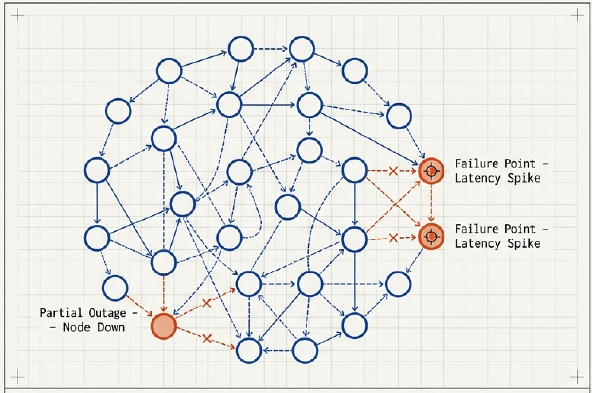{width=58%}

- Principios
  - Extensibilidad
  - Concurrencia
  - Elasticidad
  - Tolerancia a fallos
  - Transparencia
- Problemas
  - Fallos parciales
  - Latencias impredecibles

---

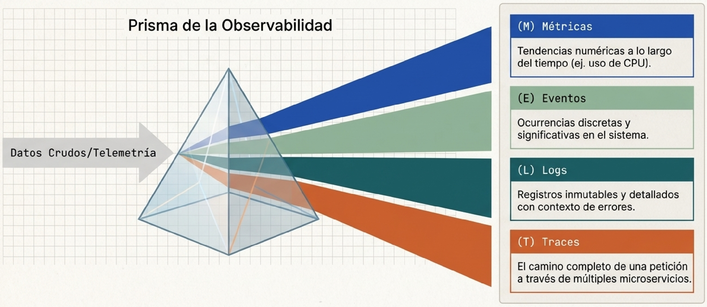{width=100%}

---

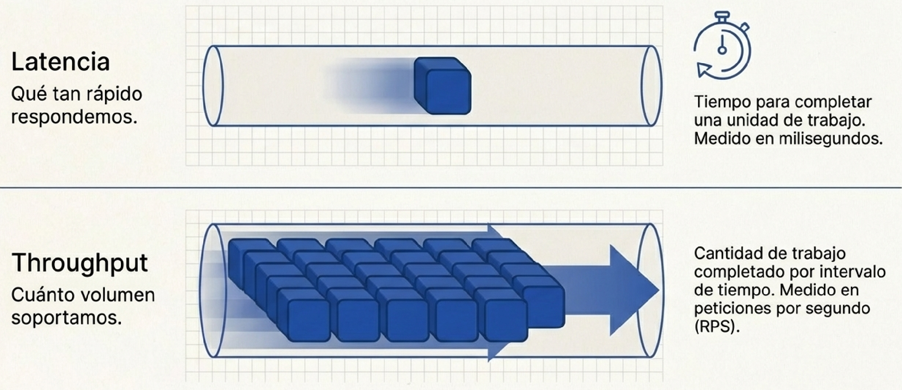{width=100%}

---

- La trampa de los promedios
  - En sistemas software unos pocos valores aislados (outliers) inflan la media aritmética
  - La media oculta lo que realmente los usuarios experimentan

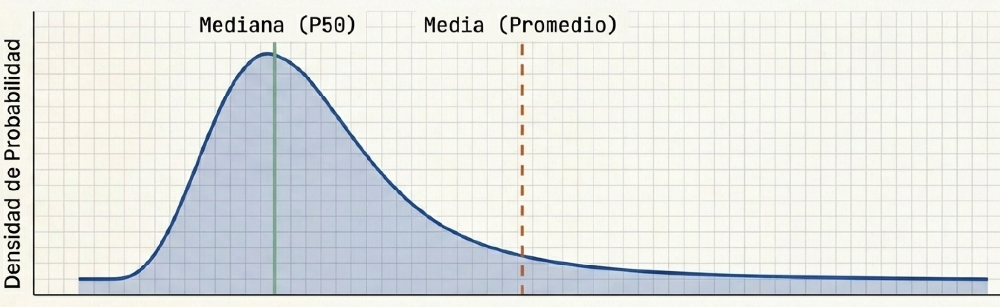{width=100%}

---

- Percentiles
  - Permiten estudiar la latencia en base a la experiencia de los usuarios

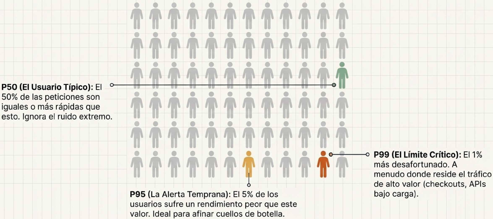{width=100%}

---

- El problema de la cola a escala
  - En un sistema distribuido:
    - Si una petición requiere interactuar con 100 servidores...
    - … y sólo el 1% de las peticiones a un servidor son lentas (P99)...
    - … el 63% de los usuarios experimentará lentitud
  - El rendimiento global es tan rápido como el valor atípico (outlier) más lento

---

- Visualizando la distribución completa de latencia...
  - Los promedios desaparecen
  - Los outliers o valores atípicos afloran

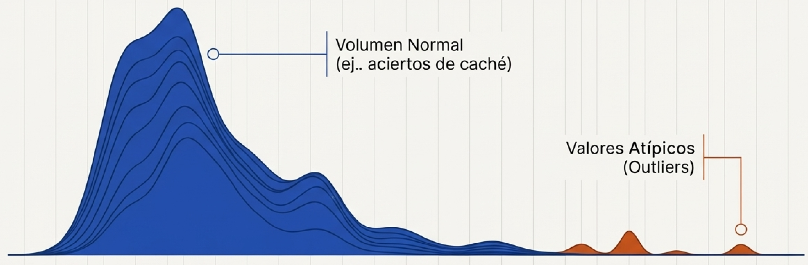{width=100%}

---

- El test de seis sigma (6σ)
  - Si cualquier medida de latencia supera la distancia de seis desviaciones estándar desde la media, hay valores atípicos
  - Probabilidad de ocurrencia por azar: \< 1 entre 500 millones

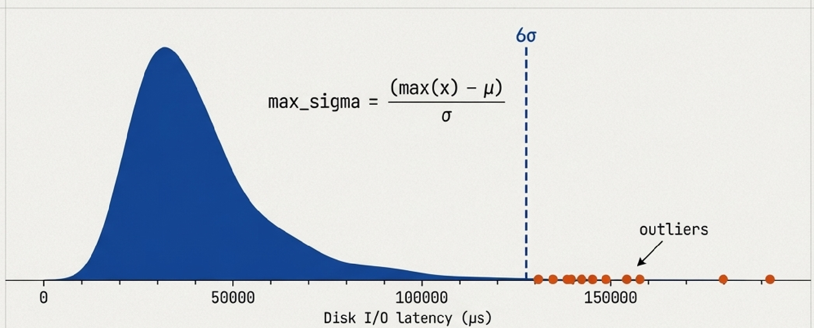{width=100%}

---

- Ley de Little
  - Aumentar el tráfico (λ)
  - Sin reducir la latencia (W)
  - Causa saturación en el sistema (L)

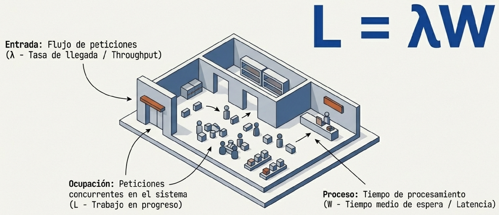{width=99%}

---

- La ilusión de la curva de campana
  - El rendimiento nunca sigue una distribución normal (simétrica)

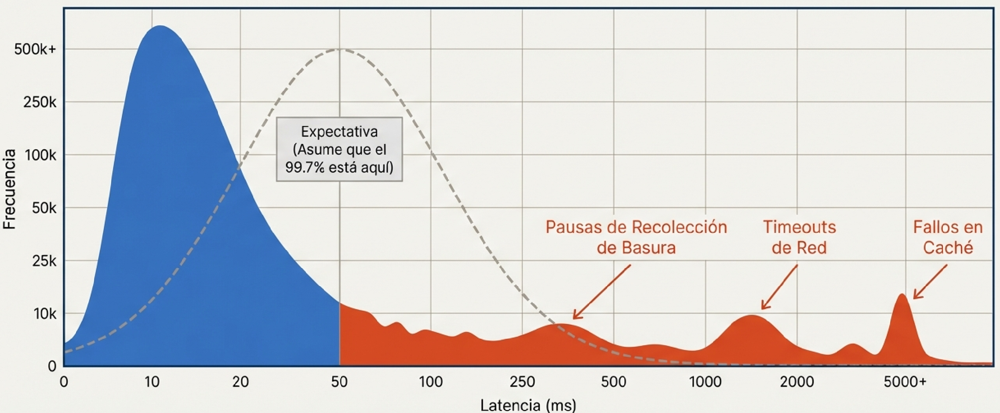{width=100%}

---

- La fragilidad del promedio
  - Un solo valor atípico destruye la precisión matemática de la media

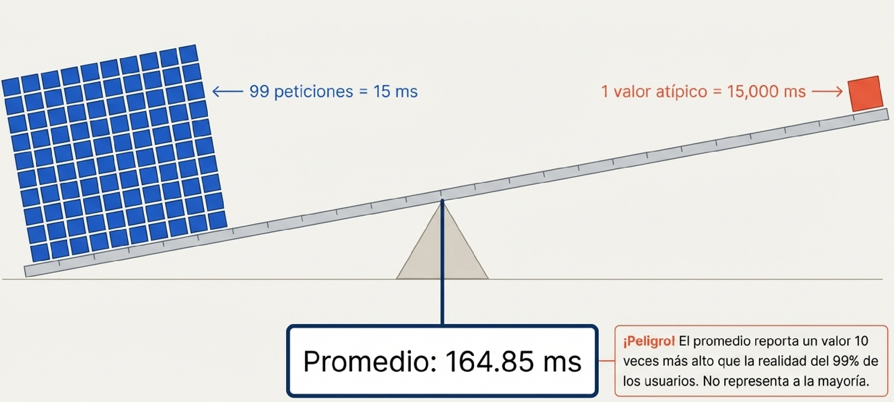{width=100%}

---

- La mediana (p50) ignora la magnitud extrema
  - Los extremos pierden su poder de distorsión

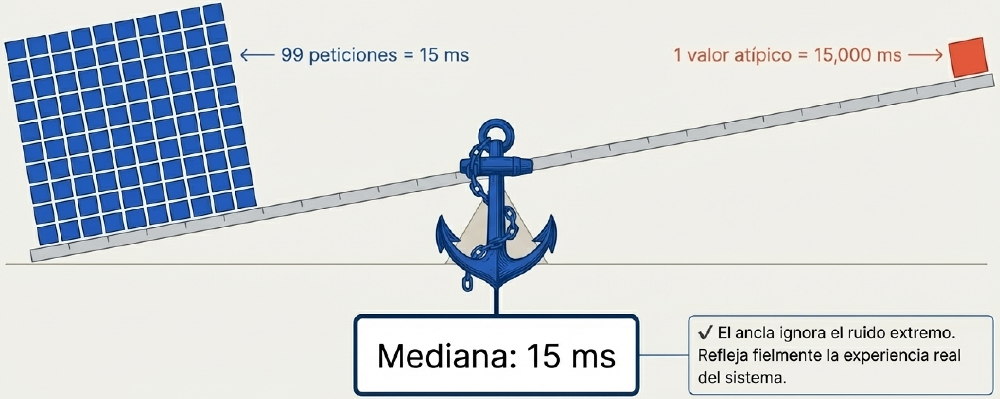{width=100%}

---

- Los percentiles nos permiten auditar porciones exactas de nuestra base de 10.000 usuarios
- Podemos actuar en consecuencia con información no distorsionada

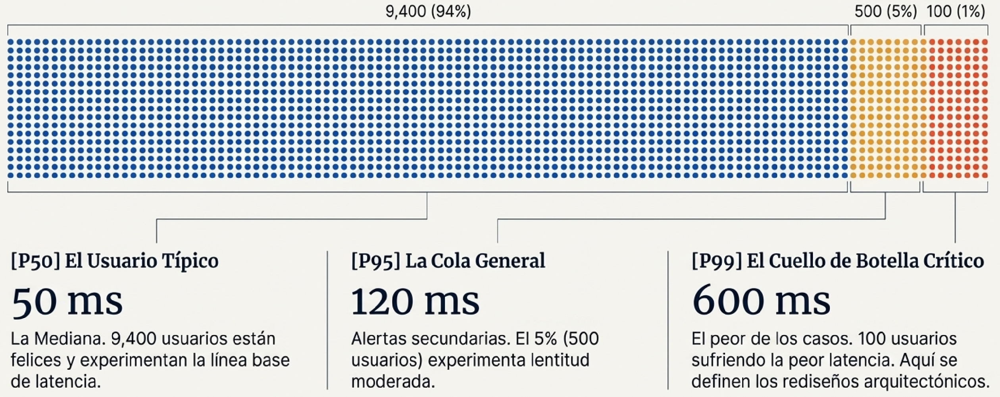{width=100%}

---

- En el software, la realidad a veces es multimodal 
  - Hay dos distribuciones (o más) en una

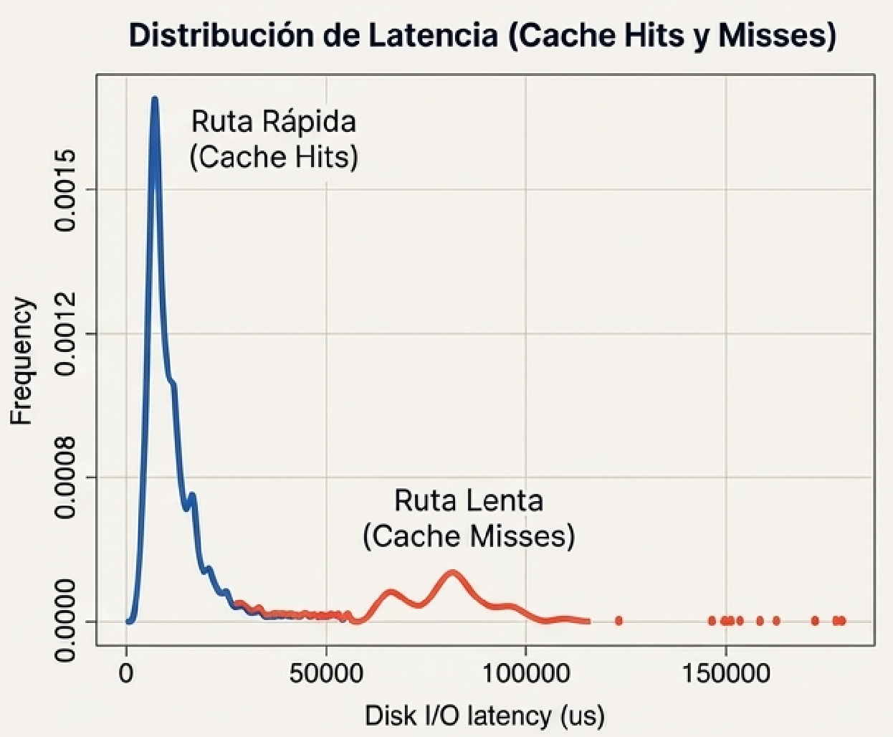{width=56%}

---

- Identificación de outliers vs multimodal

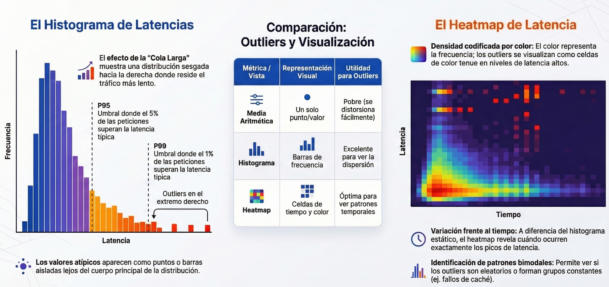{width=100%}

---

- Medidas más utilizadas en aplicaciones web:
  - **Latencia de las peticiones http:** Tiempo desde que se envía una petición hasta que se empieza a recibir la respuesta
  - **Número / % de peticiones incorrectas:** Estado http diferente de 2xx
  - **Ancho de banda:** bytes por segundo
  - **Número de peticiones por segundo:** Depende del número de usuarios (hilos) en paralelo ejercitando el SUT

---

- Medidas estadísticas de la latencia:
  - **Min:** Mínima
  - **Max:** Máxima
  - **Median (p50):** Mediana. Si ordenamos los valores de menor a mayor, el que ocupa la posición central (No es el valor medio)
  - **p95:** La latencia máxima del 95% de las peticiones con menor latencia. Sólo el 5% está por encima de ese valor
  - **p99:** La latencia máxima del 99% de las peticiones con menor latencia. Sólo el 1% está por encima de ese valor

---

- Medidas estadísticas de la latencia:

Complete report @ 2019-01-02T17:32:36.653Z

  Scenarios launched:  300

  Scenarios completed: 300

  Requests completed:  600

  RPS sent: 18.86

  **Request latency:**

    **min: 52.1**

    **max: 11005.7**

    **median: 408.2**

    **p95: 1727.4**

    **p99: 3144**

  Scenario counts:

    0: 300 (100%)

  Codes:

    200: 300

    302: 300

{width=32%}

---

{width=23%}

- Medidas estadísticas de la latencia:

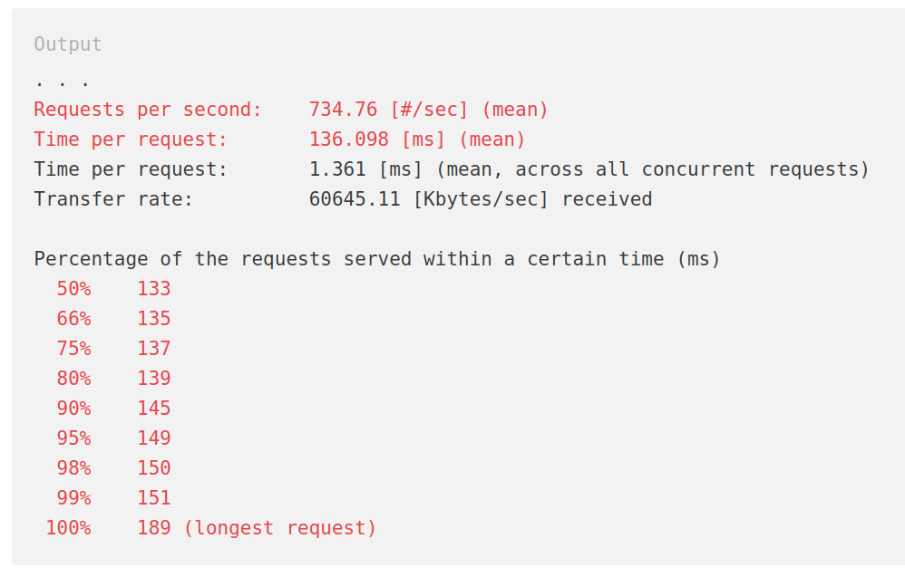{width=91%}

---

- El entorno debe ser **lo más parecido posible al de producción**
- No se deberían ejecutar otro tipo de procesos o pruebas en este entorno para no afectar a la **fiabilidad** de los resultados
- No se recomienda ejecutar la **herramienta de pruebas de carga** en la misma máquina del SUT
  - Pero, para aprender, a veces es inevitable

---

- La mayoría de las veces es necesario **ejecutar estas pruebas de forma distribuida**
  - Varios nodos realizan peticiones sobre el SUT
  - Se pueden simular cargas más parecidas a las reales
  - Vigilar los cuellos de botella
    - Nodos en la misma máquina
    - Ancho de banda de red

---

- **Metodología**
  -  Identificar el entorno de pruebas
    - Entorno físico o virtualizado de pruebas y de producción (hardware, software y red)
    - Herramientas disponibles para las pruebas
  -  Identificar los criterios de aceptación de rendimiento
  -  Planificar y diseñar las pruebas
    - Escenarios, variabilidad de usuarios y su simulación
    - Definir datos de prueba y métricas a recoger

---

- **Metodología**
- 4. Configurar el entorno de prueba
  - Preparar el entorno, las herramientas y los recursos
  - Monitorización para poder recoger datos que sirvan posteriormente para construir las métricas
- 5. Aplicar el diseño de la prueba
  - Desarrollar las pruebas de rendimiento: scripts, ficheros de datos, configuraciones…
- 6. Ejecutar la prueba
- 7. Analizar los resultados
- 8. Repetir

---

- Herramientas para realizar pruebas de carga
- **Open source**
  - **JMeter**
  - Gatling
  - Artillery
  - k6.io

- **Propietarias**
  - **Cloud**
    - BlazeMeter
    - Flood.io
    - CloudTest
    - Loader.io
  - **On premises**
    - LoadRunner
    - Rational Performance Tester

