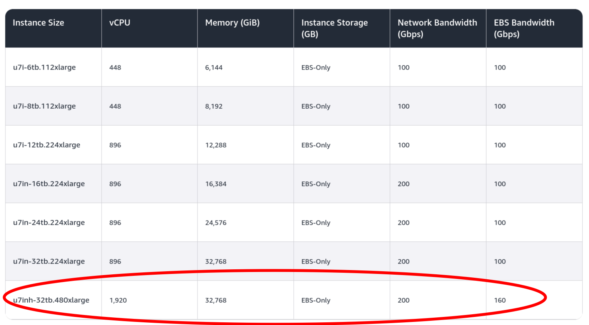
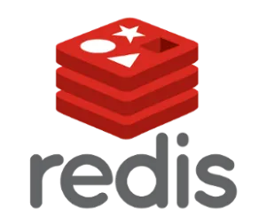
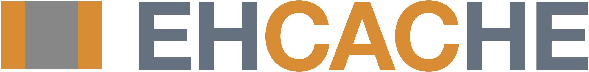
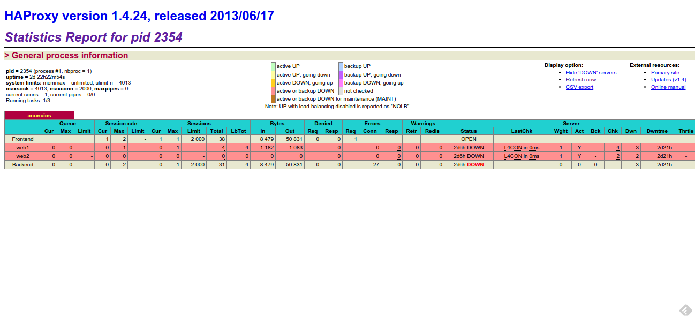
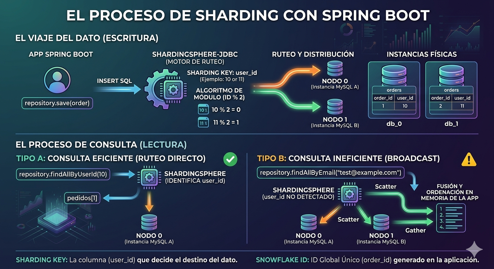

# Introducción

## Introducción

- El término **arquitectura** hace referencia a:
  - La **arquitectura software** de la aplicación que se puede apreciar en los estilos arquitectónicos que presente (arquitectura por capas, broker,  hexagonal...)
- La arquitectura escogida define una **topología,** que es la forma en que dicha aplicación se despliega en los servidores o unidades de despliegue (contenedores, funciones…)

---

- Dependiendo de la **arquitectura software** escogida podremos tener unas **topologías** u otras
- Focalizaremos en los **servicios de Internet**:
  - Aplicaciones web o APIs (REST, gRPC, GraphQL...)
  - Con persistencia

---

- La topología incluye aspectos (sistemas y aplicaciones) que no pertenecen a la lógica de la aplicación, como un **balanceador** **de carga** corriendo en un servidor Linux
- En términos formales, la topología se documenta como parte de la **vista física** de la arquitectura

---

- La topología de todo el sistema debe ajustarse a sus **necesidades**
- Una topología **elástica** (autoescalable) para sólo cien accesos concurrentes podría no merecer la pena por el esfuerzo que requiere
- Es necesario **medir** antes de **actuar**

---

- **¿Cómo actuar?**
  - Escalado vertical: aumentar la capacidad de la máquina
    - En ocasiones es suficiente
    - **Cuidado!!** Cuando una máquina tiene mucha potencia de cómputo suele ser más costosa que dos máquinas de la mitad de potencia

---

{width=85%}

- **¿Cómo actuar?**

Una de las máquinas más potentes de AWS en Abril del 2021 es la u7inh-32tb.480xlarge (448 CPUs y 24 Terabytes de RAM)

[https://aws.amazon.com/es/ec2/instance-types/high-memory/](https://aws.amazon.com/es/ec2/instance-types/high-memory/) 

---

- **¿Cómo actuar?**
  - Si es necesario introducir cambios más drásticos
    - Hacer un cambio 
    - Medir
    - Si todavía no estamos satisfechos, repetir

---

- **Topologías comunes**
  - Centralizada
  - Separación de servidor y base de datos
  - Servidor con caché y base de datos
  - Varios servidores con balanceo de carga y base de datos
  - Varios servidores con balanceo de carga y base de datos replicada
  - Varios servidores con balanceo de carga, base de datos replicada y sharding

---

- **Infraestructura**
  - Para analizar el rendimiento y probar las diferentes opciones usaremos la app REST de anuncios
  - Se inicializa la base de datos al arrancar con un fichero de sql que genera 100.000 registros
  - Se dispone de un panel para ver las métricas relevantes en:
    - localhost:3000
    - User/pass: admin/admin
  - Iremos actualizando el proyecto para ver el impacto de los cambios

# Topología centralizada

## Topología centralizada

- **Topología centralizada**
  - Servidor web y base de datos en la misma máquina

```{dot}
//| fig-width: 6.8
//| fig-height: 1.9
// Todo en una maquina: el servidor web y la base de datos.
digraph centralizada {
  rankdir=LR; bgcolor="transparent"; compound=true; ranksep=0.5;
  node [fontname="Lato", fontsize=12];
  edge [color="#333333", arrowsize=0.8];

  user     [shape=plaintext, label="User"];
  internet [shape=ellipse, style=filled, fillcolor="#f2f2f2", color="#808080", label="Internet"];

  subgraph cluster_maquina {
    label="Machine"; fontsize=11; fontcolor="#555555";
    style=filled; fillcolor="#e2efd9"; color="#a9c48a";
    web [shape=box, style=filled, fillcolor="#5b9bd5", fontcolor="white", label="Web app"];
    db  [shape=cylinder, style=filled, fillcolor="#5b9bd5", fontcolor="white", label="DB"];
    web -> db;
  }

  user -> internet;
  internet -> web;
}
```

---

- **Ventajas**
    - Simplicidad de despliegue y operaciones
    - Conexión entre la aplicación y la base de datos sencilla y rápida (localhost)
- **Problemas**
  - No es tolerante a fallos
  - Sólo soporta escalado vertical
  - Aplicaciones con necesidades diferentes
      - DB: mayor memoria (índices), escritura en disco rápida
      - App web: indiferente

# Separación de servidor y base de datos

## Separación de servidor y bbdd

- **Separación del servidor y la bbdd**
  - Uso de dos máquinas, una para el servidor web y la otra para la base de datos

```{dot}
//| fig-width: 7.4
//| fig-height: 1.9
// Dos maquinas: una para el servidor web y otra para la base de datos, cada
// una dimensionada para lo suyo.
digraph separacion {
  rankdir=LR; bgcolor="transparent"; compound=true; ranksep=0.5;
  node [fontname="Lato", fontsize=12];
  edge [color="#333333", arrowsize=0.8];

  user     [shape=plaintext, label="User"];
  internet [shape=ellipse, style=filled, fillcolor="#f2f2f2", color="#808080", label="Internet"];

  subgraph cluster_web {
    label="Machine (512Mb)"; fontsize=11; fontcolor="#555555";
    style=filled; fillcolor="#e2efd9"; color="#a9c48a";
    web [shape=box, style=filled, fillcolor="#5b9bd5", fontcolor="white", label="Web app"];
  }
  subgraph cluster_db {
    label="Machine (1Gb, SSD)"; fontsize=11; fontcolor="#555555";
    style=filled; fillcolor="#e2efd9"; color="#a9c48a";
    db [shape=cylinder, style=filled, fillcolor="#5b9bd5", fontcolor="white", label="DB"];
  }

  user -> internet;
  internet -> web;
  web -> db;
}
```

---

- **Ventajas**
    - Sigue siendo simple
    - Podemos asociar tamaños de máquinas diferentes a ambos servicios
- **Problemas**
  - Escalado vertical
  - No es tolerante a fallos: Si se cae cualquiera de los dos nodos, se cae la aplicación entera
  - Configuración de la conexión de la aplicación y la base de datos (puertos abiertos, IPs dinámicas…)
  - Consultas costosas implican menor ratio de peticiones por segundo en la aplicación web → Ley de Low 

---

- **Ejemplo:** **ejem1-jmeter/ejem-1**
  - El servidor estará en un contenedor Docker
  - La base de datos en otro
  - Arrancar la aplicación con:
    - docker compose up

::: {.enlace-repo}
[`ejem-1`](https://github.com/codeurjc/dad/tree/main/parte_5/ejem1-jmeter/ejem-1)
:::

## Topología centralizada

- **Ejemplo: ejem1-jmeter/ejem-1**
- Abrir JMeter
  - Abrir el fichero test\_plan.jmx
  - El fichero define un escenario de pruebas donde cada hilo hace dos cosas:
    - Varios GET para obtener la lista de posts
    - Un POST con un nuevo anuncio
  - Ejecutar las pruebas con diferentes valores de la variable Number of threads del elemento Thread group: 1000, 2000, 3000, 5000

::: {.enlace-repo}
[`ejem-1`](https://github.com/codeurjc/dad/tree/main/parte_5/ejem1-jmeter/ejem-1)
:::

# Servidor con caché y base de datos

## Servidor con caché

- Una **caché** es un almacén de datos en **memoria** para servir rápidamente contenido que ha sido cargado de disco o de una base de datos

```{dot}
//| fig-width: 7.2
//| fig-height: 2.1
// La cache vive dentro del servidor web y le evita ir a la base de datos.
digraph cache {
  rankdir=LR; bgcolor="transparent"; compound=true; ranksep=0.5;
  node [fontname="Lato", fontsize=12];
  edge [color="#333333", arrowsize=0.8];

  user     [shape=plaintext, label="User"];
  internet [shape=ellipse, style=filled, fillcolor="#f2f2f2", color="#808080", label="Internet"];

  subgraph cluster_web {
    label="Machine"; fontsize=11; fontcolor="#555555";
    style=filled; fillcolor="#e2efd9"; color="#a9c48a";
    web [shape=box, style=filled, fillcolor="#5b9bd5", fontcolor="white",
         label=<Web app<BR/><BR/><FONT COLOR="#333333" POINT-SIZE="11">&nbsp;&nbsp;Caché&nbsp;&nbsp;</FONT>>];
  }
  subgraph cluster_db {
    label="Machine"; fontsize=11; fontcolor="#555555";
    style=filled; fillcolor="#e2efd9"; color="#a9c48a";
    db [shape=cylinder, style=filled, fillcolor="#5b9bd5", fontcolor="white", label="DB"];
  }

  user -> internet;
  internet -> web;
  web -> db;
}
```

---

- Permite evitar realizar la misma consulta a la base de datos una y otra vez, cuando sabemos que los datos no han cambiado
- O evitar leer el contenido de ficheros estáticos (javascript, html,...)
- Generalmente se implementan como **bases de datos en memoria de tipo clave-valor**

---

- La caché puede ser un **servicio autónomo**, incluso corriendo en su propia máquina

{width=19%}

{width=26%}

- También puede ser un servicio ejecutado por la **propia aplicación**

{width=36%}

{width=39%}

---

- El **servidor web** también puede, con limitaciones, usarse como caché

{width=43%}

{width=42%}

---

- Spring tiene soporte para caché de forma estándar
  - [http://docs.spring.io/spring/docs/current/spring-framework-reference/html/cache.html](http://docs.spring.io/spring/docs/current/spring-framework-reference/html/cache.html)
- Estándar JSR-107
  - [http://docs.spring.io/spring/docs/current/spring-framework-reference/html/cache.html#cache-jsr-107](http://docs.spring.io/spring/docs/current/spring-framework-reference/html/cache.html#cache-jsr-107) 

---

- **@Cacheable**
  - Anotación para usar en métodos
  - Guarda el resultado del método en la caché asociado a los valores de los parámetros
  - Si el método se vuelve a invocar con esos mismos parámetros devuelve el resultado cacheado sin ejecutar el método
  - Los tipos de los argumentos deben implementar correctamente hashCode() y equals() para generar las claves en la caché
  - También es posible proporcionar un generador de claves

---

- **@CacheEvict**
  - Anotación para usar en métodos
  - Elimina una clave de la caché cada vez que se invoca el método
  - Opcionalmente puede eliminar todas las claves
- **@CachePut**
  - Anotación para usar en métodos
  - Permite actualizar una clave de la caché cuando se invoca el método
  - El método se ejecuta y su resultado se utiliza para actualizar el valor asociado a la clave

---

- **Ejemplo: ejem2-cache**
  - Tenemos los siguientes recursos:
    - GET /posts/
    - POST /posts/
    - GET /posts/{id}
  - ¿Cuál cachear?

---

- **Ejemplo: ejem2-cache**
  - Tenemos los siguientes recursos:
    - GET /posts/
    - POST /posts/
    - GET /posts/{id}
  - ¿Cuál cachear?
    - Candidatos:
      - GET /posts/
      - GET /posts/{id}

---

- **Ejemplo:** **ejem2-cache**
  - Tenemos los siguientes recursos:
    - GET /posts/
    - POST /posts/
    - GET /posts/{id}
  - ¿Dónde invalidar la caché?

---

- **Ejemplo:** **ejem2-cache**
  - Tenemos los siguientes recursos:
    - GET /posts/
    - POST /posts/
    - GET /posts/{id}
  - ¿Dónde invalidar la caché?
    - POST /posts/
      - Insertar un nuevo anuncio invalida siempre GET /posts/
      - Insertar un nuevo anuncio podría invalidar GET /posts/{id} si el id es el mismo

---

- **Ejemplo ejem1-jmeter/ejem2-cache-spring**
  - Arrancar la aplicación con docker compose up
  - Utilizar jmeter con el mismo fichero test\_plan.jmx para comprobar la reducción del tiempo en las peticiones una vez cacheadas
    - Abrir el fichero jmx
    - Ajustar la ip y el puerto
    - Comprobar los tiempos

# Balanceadores de carga: múltiples servidores

## Balanceadores de carga

- **Balanceador**
  - Se establece como primera línea de fuego
  - Tiene asociados servidores que pueden servir las peticiones que le llegan
    - Distribuye las peticiones entre estos servidores

{width=70%}

---

- **Balanceador**

```{dot}
//| fig-width: 7.6
//| fig-height: 2.4
// El balanceador reparte las peticiones entre varias maquinas con la
// aplicacion, que comparten una misma base de datos.
digraph balanceador {
  rankdir=LR; bgcolor="transparent"; compound=true; ranksep=0.55; nodesep=0.3;
  node [fontname="Lato", fontsize=12];
  edge [color="#333333", arrowsize=0.8];

  user     [shape=plaintext, label="User"];
  internet [shape=ellipse, style=filled, fillcolor="#f2f2f2", color="#808080", label="Internet"];

  subgraph cluster_lb {
    label="Machine"; fontsize=11; fontcolor="#555555";
    style=filled; fillcolor="#e2efd9"; color="#a9c48a";
    lb [shape=box, style=filled, fillcolor="#ffd966", label="Load\nBalancer"];
  }
  subgraph cluster_w1 {
    label="Machine"; fontsize=11; fontcolor="#555555";
    style=filled; fillcolor="#e2efd9"; color="#a9c48a";
    web1 [shape=box, style=filled, fillcolor="#5b9bd5", fontcolor="white", label="Web app"];
  }
  subgraph cluster_w2 {
    label="Machine"; fontsize=11; fontcolor="#555555";
    style=filled; fillcolor="#e2efd9"; color="#a9c48a";
    web2 [shape=box, style=filled, fillcolor="#5b9bd5", fontcolor="white", label="Web app"];
  }
  subgraph cluster_db {
    label="Machine"; fontsize=11; fontcolor="#555555";
    style=filled; fillcolor="#e2efd9"; color="#a9c48a";
    db [shape=cylinder, style=filled, fillcolor="#5b9bd5", fontcolor="white", label="DB"];
  }

  user -> internet;
  internet -> lb;
  lb -> web1;
  lb -> web2;
  web1 -> db;
  web2 -> db;
}
```

---

- **Balanceador**
  - Puede distribuir las peticiones usando diferentes políticas
  - Si detecta servidores caídos evita enviarles peticiones
  - Pueden ser de dos tipos
    - Balanceadores de nivel 4 
    - Balanceadores de nivel 7

---

- **Balanceador de nivel 4**
  - Hace referencia a la capa 4 en la torre OSI (transporte: TCP/UDP)
  - Toma decisiones basándose exclusivamente en
    - IP
    - Puerto TCP o UDP
  - Redirige paquetes
  - Muy eficiente

---

- **Balanceador de nivel 7**
  - Hace referencia a la capa 7 en la torre OSI (aplicación: HTTP, FTP, DNS)
  - Toma decisiones basándose en
    - IP
    - Puerto TCP o UDP
    - HTTP (urls y parámetros)
    - ...
  - Actúa como proxy
  - Son mucho más flexibles

---

- **Algoritmos de balanceo**
  - Aleatorio
    - Se escoge de forma aleatoria una máquina a la que enviar la petición

---

- **Algoritmos de balanceo**
  - Round-robin
    - Pasa cada petición al siguiente servidor de la lista

```{dot}
//| fig-width: 7.4
//| fig-height: 2.9
// Round-robin: las tres primeras peticiones van una a cada servidor, en orden.
digraph roundrobin {
  rankdir=LR; bgcolor="transparent"; ranksep=2.6; nodesep=0.18;
  node [fontname="Lato", fontsize=11];
  edge [color="#595959", arrowsize=0.7, fontname="Lato", fontsize=11];

  node [shape=plaintext];
  p1 [label="Peticion 1"]; p2 [label="Peticion 2"]; p3 [label="Peticion 3"];
  p4 [label="Peticion 4"]; p5 [label="Peticion 5"];

  node [shape=box, style=filled, fillcolor="#e8e8e8", color="#7f7f7f"];
  lb [label="Balan\nceador", height=1.4];
  s1 [label="Servidor 1"]; s2 [label="Servidor 2"]; s3 [label="Servidor 3"];

  { rank=same; p1; p2; p3; p4; p5; }
  { rank=same; s1; s2; s3; }

  p1 -> lb; p2 -> lb; p3 -> lb; p4 -> lb; p5 -> lb;
  lb -> s1 [label="Peticion 1"];
  lb -> s2 [label="Peticion 2"];
  lb -> s3 [label="Peticion 3"];
}
```

---

- **Algoritmos de balanceo**
  - Round-robin
    - Pasa cada petición al siguiente servidor de la lista

```{dot}
//| fig-width: 7.4
//| fig-height: 2.9
// Round-robin, segunda vuelta: la cuarta y la quinta peticion vuelven al
// primer y al segundo servidor.
digraph roundrobin_sigue {
  rankdir=LR; bgcolor="transparent"; ranksep=2.6; nodesep=0.18;
  node [fontname="Lato", fontsize=11];
  edge [color="#595959", arrowsize=0.7, fontname="Lato", fontsize=11];

  node [shape=plaintext];
  p1 [label="Peticion 1"]; p2 [label="Peticion 2"]; p3 [label="Peticion 3"];
  p4 [label="Peticion 4"]; p5 [label="Peticion 5"];

  node [shape=box, style=filled, fillcolor="#e8e8e8", color="#7f7f7f"];
  lb [label="Balan\nceador", height=1.4];
  s1 [label="Servidor 1"]; s2 [label="Servidor 2"]; s3 [label="Servidor 3"];

  { rank=same; p1; p2; p3; p4; p5; }
  { rank=same; s1; s2; s3; }

  p1 -> lb; p2 -> lb; p3 -> lb; p4 -> lb; p5 -> lb;
  lb -> s1 [label="Peticion 4"];
  lb -> s2 [label="Peticion 5"];
  lb -> s3 [style=invis];
}
```

---

- **Algoritmos de balanceo**
  - Round-robin con pesos
    - Permite enviar proporcionalmente más peticiones a unas máquinas que a otras

```{dot}
//| fig-width: 7.4
//| fig-height: 2.9
// Round-robin con pesos: el servidor de peso 2 recibe el doble de peticiones.
digraph pesos {
  rankdir=LR; bgcolor="transparent"; ranksep=2.6; nodesep=0.18;
  node [fontname="Lato", fontsize=11];
  edge [color="#595959", arrowsize=0.7, fontname="Lato", fontsize=11];

  node [shape=plaintext];
  p1 [label="Peticion 1"]; p2 [label="Peticion 2"]; p3 [label="Peticion 3"];
  p4 [label="Peticion 4"]; p5 [label="Peticion 5"];

  node [shape=box, style=filled, fillcolor="#e8e8e8", color="#7f7f7f"];
  lb [label="Balan\nceador", height=1.4];
  s1 [label="Servidor 1\nPeso = 1"];
  s2 [label="Servidor 2\nPeso = 2"];
  s3 [label="Servidor 3\nPeso = 1"];

  { rank=same; p1; p2; p3; p4; p5; }
  { rank=same; s1; s2; s3; }

  p1 -> lb; p2 -> lb; p3 -> lb; p4 -> lb; p5 -> lb;
  lb -> s1 [label="Peticion 1"];
  lb -> s2 [label="Peticion 2 y 3"];
  lb -> s3 [label="Peticion 4"];
}
```

---

- **Algoritmos de balanceo**
  - Round-robin con pesos
    - Permite enviar proporcionalmente más peticiones a unas máquinas que a otras

```{dot}
//| fig-width: 7.4
//| fig-height: 2.9
// Round-robin con pesos, siguiente vuelta: la quinta peticion vuelve al
// primer servidor.
digraph pesos_sigue {
  rankdir=LR; bgcolor="transparent"; ranksep=2.6; nodesep=0.18;
  node [fontname="Lato", fontsize=11];
  edge [color="#595959", arrowsize=0.7, fontname="Lato", fontsize=11];

  node [shape=plaintext];
  p1 [label="Peticion 1"]; p2 [label="Peticion 2"]; p3 [label="Peticion 3"];
  p4 [label="Peticion 4"]; p5 [label="Peticion 5"];

  node [shape=box, style=filled, fillcolor="#e8e8e8", color="#7f7f7f"];
  lb [label="Balan\nceador", height=1.4];
  s1 [label="Servidor 1\nPeso = 1"];
  s2 [label="Servidor 2\nPeso = 2"];
  s3 [label="Servidor 3\nPeso = 1"];

  { rank=same; p1; p2; p3; p4; p5; }
  { rank=same; s1; s2; s3; }

  p1 -> lb; p2 -> lb; p3 -> lb; p4 -> lb; p5 -> lb;
  lb -> s1 [label="Peticion 5"];
  lb -> s2 [style=invis];
  lb -> s3 [style=invis];
}
```

---

- **Algoritmos de balanceo**
  - Basados en la latencia
    - Se envía la petición al servidor que más rápido está respondiendo
    - Útil si los servidores están en diferentes regiones
    - O si un servidor está muy cargado y tarda en responder

```{dot}
//| fig-width: 7.4
//| fig-height: 2.9
// Balanceo por latencia: todas las peticiones van al servidor que responde
// mas rapido.
digraph latencia {
  rankdir=LR; bgcolor="transparent"; ranksep=2.6; nodesep=0.18;
  node [fontname="Lato", fontsize=11];
  edge [color="#595959", arrowsize=0.7, fontname="Lato", fontsize=11];

  node [shape=plaintext];
  p1 [label="Peticion 1"]; p2 [label="Peticion 2"]; p3 [label="Peticion 3"];
  p4 [label="Peticion 4"]; p5 [label="Peticion 5"];

  node [shape=box, style=filled, fillcolor="#e8e8e8", color="#7f7f7f"];
  lb [label="Balan\nceador", height=1.4];
  s1 [label="Servidor 1\nLatencia = 10ms"];
  s2 [label="Servidor 2\nLatencia = 200ms"];
  s3 [label="Servidor 3\nLatencia = 75ms"];

  { rank=same; p1; p2; p3; p4; p5; }
  { rank=same; s1; s2; s3; }

  p1 -> lb; p2 -> lb; p3 -> lb; p4 -> lb; p5 -> lb;
  lb -> s1 [label="Peticiones 1,2,3,4 y 5"];
  lb -> s2 [style=invis];
  lb -> s3 [style=invis];
}
```

---

- **Algoritmos de balanceo**
  - Basados en el ancho de banda
    - Se envía la petición al servidor con menos ancho de banda utilizado
  - Basados en el número de conexiones
    - Se envían peticiones a los servidores con menor número de peticiones
  - Basados en la prioridad
    - Se envían la peticiones por la conexión viva de mayor prioridad
  - Basados en la IP del origen y/o destino (persistencia)
    - En base al origen y/o el destino, todas las peticiones del mismo origen o destino se envían al mismo servidor (sticky sessions)
  - Basados en la URL (nivel 7)
    - En función de la url la petición se dirige a unos servidores u otros
  - Basados en parámeros de la URL (nivel 7)

---

- **Haproxy**
  - Balanceador open source
  - Funciona en nivel 4 y nivel 7
  - Dispone de una página de estadísticas
  - Lo usaremos dockerizado (imagen oficial)

{width=26%}

---

- Página de estadísticas
  - Indica cuántos servidores está viendo HAProxy y su estado
  - Los caídos se muestran en rojo, los que responden en verde
  - HAProxy puede determinar si un servidor está vivo

{width=100%}

---

- **HAProxy: configuración**
  - Crear un fichero haproxy.cfg
  - Configuraciones globales:

```
Global 							# Sección global
	log stdout format raw local0		# Configura el log
Defaults 							# Sección de opciones por defecto
	log global 					# Log a utilizar para HAProxy
	mode http 					# Modo (http → nivel 7, tcp → nivel 4)
	option httplog					# Activa el log http (servidores y clientes)
 	option dontlognull 				# No logar nulls
	timeout connect 5000 			# Timeout para conexiones a un servidor
	timeout client 50000 			# Timeout para conexiones con los clientes
	timeout server 50000			# Timeout para conexiones con los servidores
```

---

- **HAProxy: configuración**
  - Timeout connect:
    - Tiempo máximo que HAProxy esperará cuando intente establecer conexión con un servidor
    - Si salta el timeout, considera que el servidor está caído y busca otro al que enviar la petición
  - Timeout client y timeout server:
    - Tiempo máximo que HAProxy mantendrá las conexiones (con cliente o servidor) abiertas sin que se reciba ningún dato
    - Pasado ese tiempo las conexiones se liberan
    - Necesario para liberar recursos

---

- **HAProxy: configuración**
  - Configurar servidor DNS Docker:
    - Permite a HAProxy detectar servidores automáticamente

```
# --- CONFIGURACIÓN DEL RESOLVER (DNS de Docker) ---
resolvers 
	docker_dns nameserver dns1 127.0.0.11:53	# DNS por defecto de Docker 
	resolve_retries 3 
	timeout retry 1s 
	hold valid 10s 						# Tiempo que considera válida la IP antes de re-consultar
```

---

- **HAProxy: configuración**
  - Panel de estadísticas:

```
# --- PANEL DE ESTADÍSTICAS ---
frontend					# Cada url que se exponga hacia fuera se configura en un frontend 
	stats bind *:8404 		# Escucha en el 8404 de todas las interfaces de red (*)
	stats enable 			# Activa las stats
	stats uri /stats 		# Uri. La url completa será: http://localhost:8404/stats
	stats refresh 5s 		# Tiempo de refresco por defecto de las estadísticas mostradas
	stats admin if LOCALHOST 	# Permite gestionar servidores desde la web
```

---

- **HAProxy: configuración**
  - Frontend de la aplicación:

```
# --- BALANCEADOR PARA LA APP SPRING ---
frontend 						# El frontend para la app
	http-in bind *:80 			# http://localhost:80
	default_backend spring_apps		# El backend define los servidores para balancear
```

---

- **HAProxy: configuración**
  - Backend de la aplicación:

```
backend spring_apps		# Los servidores se definen en un backend 
	balance roundrobin 	# Algoritmo de balanceo
	option httpchk GET /actuator/health # Comprobación de si el servidor está activo (Requiere Spring Boot Actuator)
	# 'init-addr last,libc,none' evita que HAProxy falle si la App aún no ha arrancado 
	# 'resolvers docker_dns' activa el descubrimiento dinámico a través del resolver configurado
	server-template app- 6 spring-app:8080 check resolvers docker_dns init-addr last,libc,none
```

---

- **Ejemplo: ejem1-jmeter/****ejem2-cache**
  - Topología: balanceador de carga y caché en memoria
  - App: ejem2-cache-spring

---

- **Ejemplo: ejem1-jmeter/****ejem2-cache**
  - La caché en memoria tiene dos problemas:
    - Lecturas: si leo de la app1 y después de la app2, app1 tiene la caché, pero app2 no
    - Escrituras: si escribo en app1, app1 invalidará la caché, pero app2 no

---

- **Caché distribuída**
  - La solución con balanceo es usar una caché distribuida (Redis, Memcached)
  - La aplicación Spring verifica si el dato está en la caché redis
    - Si es así, devuelve el dato en redis
    - En caso contrario:
      - Hace la consulta
      - Inserta el resultado en redis y lo devuelve

---

- **Integración de Spring con Redis**
  - La integración es tan sencilla como con la caché local

```java
@Configuration
@EnableCaching
public class CacheConfiguration {
@Bean
public RedisCacheConfiguration redisCacheManager() {
	return RedisCacheConfiguration.defaultCacheConfig()
          .entryTtl(Duration.ofMinutes(10)) // Los productos viven 10 min en caché
          .disableCachingNullValues()
          .serializeValuesWith(RedisSerializationContext.SerializationPair
            .fromSerializer(new GenericJackson2JsonRedisSerializer()));	
}
}
```

---

- **Ejemplo: ejem1-jmeter/****ejem2-cache-redis**
  - Topología: balanceador de carga y caché en redis
  - App: ejem2-cache-redis

# Replicación de bases de datos

## Replicación de bases de datos

- Varias bases de datos pueden trabajar juntas en modo primario/secundario(s) para:
  - Conseguir tolerancia a fallos
    - Una base de datos secundaria toma el relevo cuando la primaria falla
  - Balancear la carga
    - Las consultas se distribuyen entre varias bases de datos
    - Pero las escrituras siempre van al primario
- Ambos enfoques tienen sus problemas

---

```{dot}
//| fig-width: 5.6
//| fig-height: 4.1
// Una base de datos primaria y dos secundarias, cada una en su maquina.
digraph replicacion {
  bgcolor="transparent"; ranksep=0.7; nodesep=1.2;
  node [fontname="Lato", fontsize=12];
  edge [color="#5b9bd5", arrowsize=0.8];

  subgraph cluster_p {
    label="Machine"; fontsize=11; fontcolor="#555555";
    style=filled; fillcolor="#e2efd9"; color="#a9c48a";
    primario [shape=cylinder, style=filled, fillcolor="#5b9bd5", fontcolor="white",
              label="DB\nPrimario"];
  }
  subgraph cluster_s1 {
    label="Machine"; fontsize=11; fontcolor="#555555";
    style=filled; fillcolor="#e2efd9"; color="#a9c48a";
    sec1 [shape=cylinder, style=filled, fillcolor="#5b9bd5", fontcolor="white",
          label="DB\nSecundario"];
  }
  subgraph cluster_s2 {
    label="Machine"; fontsize=11; fontcolor="#555555";
    style=filled; fillcolor="#e2efd9"; color="#a9c48a";
    sec2 [shape=cylinder, style=filled, fillcolor="#5b9bd5", fontcolor="white",
          label="DB\nSecundario"];
  }

  primario -> sec1;
  primario -> sec2;
}
```

## Tolerancia a fallos

- Un servidor denominado **primario** o **maestro** atiende las peticiones de lectura y escritura
- Un servidor denominado **secundario** o **worker** reproduce todas las operaciones de escritura del maestro
- Cuando la conexión con el primario se pierde el secundario toma el relevo garantizando la disponibilidad de la aplicación

## Balanceo de carga

- Múltiples servidores se reparten las lecturas (balanceo)
  - Se puede conseguir con haproxy, por ejemplo
  - El propio driver de MySQL tiene un modo replication
- El primario a veces no se utiliza para lectura de forma que esté libre para las escrituras

## Sharding

- ¿Qué pasa si el volumen de datos que tenemos que manejar excede la capacidad de una sola base de datos?
- Los discos duros tienen una capacidad límite
- Además los índices crecerían hasta un tamaño inmanejable en memoria → caída de rendimiento

---

- Para solucionar este problema es necesario recurrir al **sharding**
- Se reparten los datos en diferentes bases de datos **independientes**
  - No se conocen unas a otras
- Se necesita una clave de sharding para el particionado de los datos
  - Hay diferentes algoritmos de particionado
  - Se requiere utilizar una librería para gestionarlo o un proxy específico

---

- La clave de sharding es crítica:
  - Debe particionar el conjunto de datos en subconjuntos de tamaños parecidos
  - Todas las consultas deben incluir esta clave para saber a qué base de datos consultar
  - Si la consulta no incluye la clave en el WHERE:
    - Hay que consultar todas las bases de datos
    - Hacer un join en memoria en la aplicación
    - Es extremadamente ineficiente y peligroso → OutOfMemoryError

---

- Ejemplo:
  - Tabla de Posts y comentarios
  - Podemos generar el id del post en la aplicación (en lugar de usar la autogeneración en base de datos)
  - Posteriormente usamos como clave de sharding ese id:
    - Los ids pares van a una base de datos
    - Los impares a otra

## 

{width=100%}

## Sharding

- El sharding debería ser la última opción:
  - Es sumamente complejo de gestionar:
    - Elección de claves de sharding
    - Gestión de consultas
  - Puede ser muy ineficiente si no se tiene sumo cuidado:
    - Uso de la clave de sharding en todas las consultas

## Arquitecturas escalables

- Introducción
- Arquitectura centralizada
- Separación de servidor y base de datos
- Servidor con caché y base de datos
- Balanceadores de carga: múltiples servidores
- Replicación de bases de datos
- **Otras soluciones arquitectónicas**

## Otras soluciones arquitectónicas

- Múltiples zonas geográficas
- Múltiples proveedores
- Content Delivery Networks

---

- **Múltiples zonas geográficas**
  - Podemos replicar los servicios en múltiples zonas
  - Necesario si damos servicios a usuarios en diferentes regiones del globo
  - Pero además proporciona seguridad
    - Balanceadores pueden redirigir tráfico si una zona se cae
  - Problema de la consistencia: ¿cómo se replican los datos entre zonas?

---

- **Múltiples proveedores**
  - Proporciona seguridad si un proveedor sufre problemas
  - Permite equilibrar costes: escalar en el proveedor más barato
  - Problemas
    - Consistencia de los datos
    - Coste de transferencia de datos entre proveedores
    - Gestión (APIs diferentes, servicios diferentes...)

---

- **Content Delivery Networks (CDNs)**
  - Servicio que permite subir contenido principalmente estático o que cambia poco
    - Imágenes
    - Vídeos
  - Disponen de servidores por todo el globo
    - Los datos se replican a todos los servidores
  - Cuando un cliente pide un recurso almacenado en el CDN se le sirve del servidor del CDN más cercano
    - Reduce latencia
    - Reduce tiempo de carga

