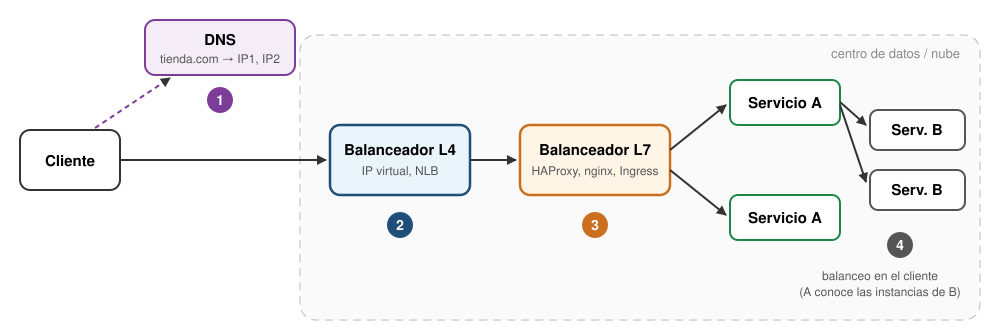
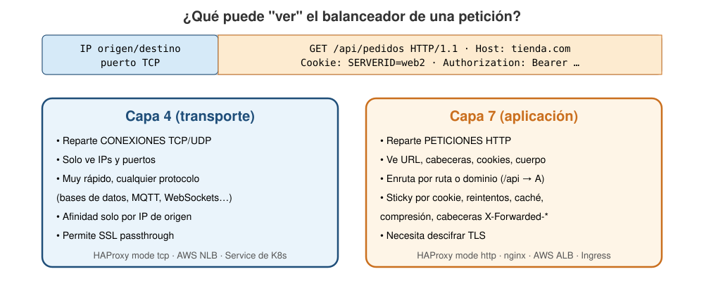
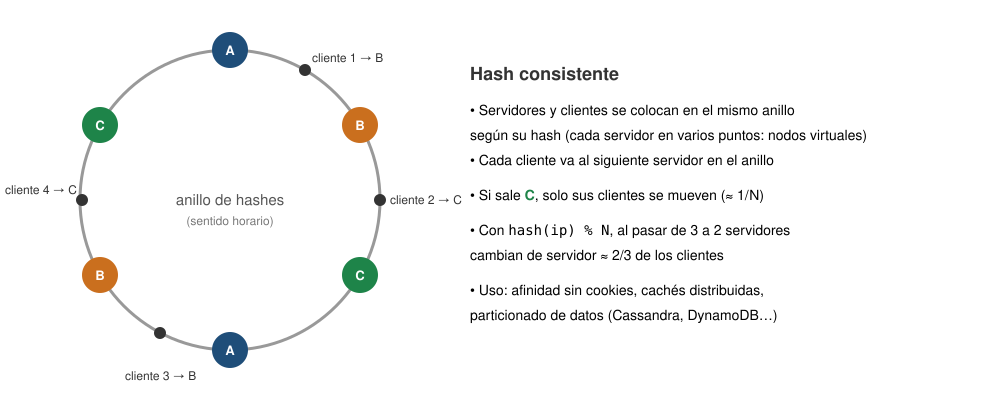
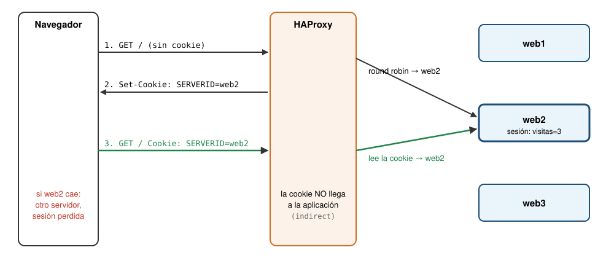
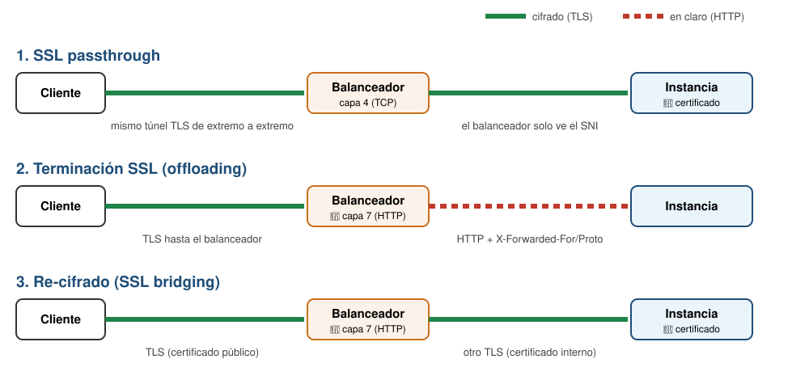
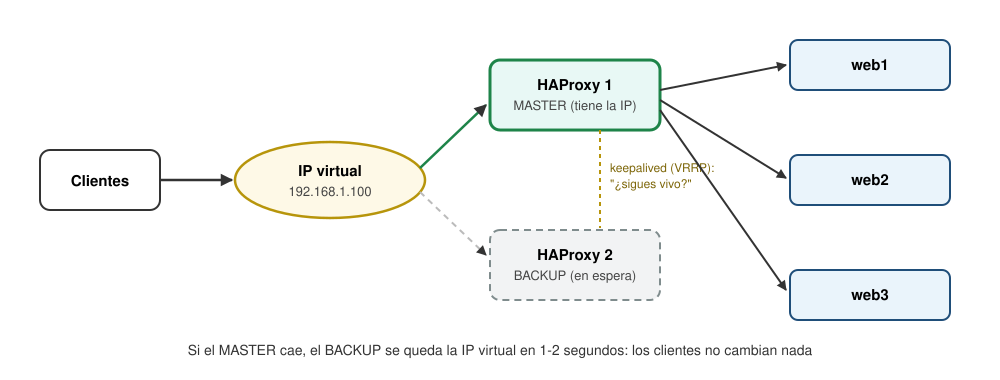
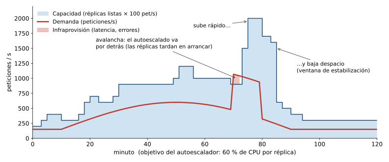

## Contenidos

1. ¿Por qué balancear la carga?
2. Dónde se balancea: DNS, capa 4, capa 7 y en el cliente
3. Algoritmos de balanceo
4. Comprobaciones de salud
5. El problema del estado: *sticky sessions* y sesiones externalizadas
6. TLS en el balanceador: terminación, *SSL passthrough* y re-cifrado
7. Alta disponibilidad del propio balanceador
8. Elasticidad: qué es y cómo conseguirla
9. Ejercicio

::: {.ejemplo}
**Código de los ejemplos**: carpeta [`parte_5/tema_5.5_balanceo`](https://github.com/codeurjc/dad/tree/main/parte_5/tema_5.5_balanceo) del repositorio de la asignatura.
:::

# ¿Por qué balancear? {background-color="#1f4e79"}

## Escalar hacia arriba o hacia fuera

::: columns
::: {.column width="50%"}
**Escalado vertical** (*scale up*)

* Una máquina más grande: más CPU, más memoria
* Sin cambios en la aplicación
* ✘ Tiene un **límite** físico y económico
* ✘ Sigue siendo un **punto único de fallo**
* ✘ Ampliar suele requerir **parar**
:::
::: {.column width="50%"}
**Escalado horizontal** (*scale out*)

* Más máquinas iguales trabajando en paralelo
* ✔ Crece casi sin límite y por pasos pequeños
* ✔ Si cae una instancia, las demás siguen
* ✔ Permite **elasticidad**: añadir y quitar según la demanda
* ✘ Necesita **repartir el trabajo** → **balanceador de carga**
:::
:::

::: {.callout-note}
Un **balanceador de carga** recibe las peticiones de los clientes y las reparte entre varias instancias del servicio, ocultando cuántas hay y cuáles están vivas.
:::

## Qué aporta un balanceador

* **Escalabilidad**: reparte la carga entre N instancias
* **Disponibilidad**: deja de enviar tráfico a las instancias caídas
* **Mantenimiento sin cortes**: sacar instancias para actualizarlas (*rolling update*)
* **Un único punto de entrada**: TLS, compresión, cabeceras de seguridad, límites de tasa...
* **Enrutado**: `/api` a un servicio, `/static` a otro (capa 7)

::: {.ejemplo}
En el tema 5 ya montamos HAProxy delante de varias instancias (`ejem4-haproxy`). Aquí profundizamos en cómo funciona y en sus problemas.
:::

# Dónde se balancea {background-color="#1f4e79"}

## Niveles de balanceo

{fig-align="center" width="92%"}

* **1. DNS**: el nombre resuelve a varias IPs. Simple pero lento de reaccionar (cachés, TTL) y sin comprobación de salud real
* **2 y 3. Balanceador dedicado** (capa 4 o 7): el caso más habitual
* **4. En el cliente**: el propio cliente conoce las instancias y elige (Spring Cloud LoadBalancer, gRPC, *service mesh*)

## Capa 4 vs capa 7

{fig-align="center" width="95%"}

# Algoritmos de balanceo {background-color="#ca6f1e"}

## Algoritmos más comunes

| Algoritmo | Cómo elige | Cuándo usarlo |
|---|---|---|
| **Round robin** | Por turnos | Instancias iguales y peticiones parecidas |
| **Round robin ponderado** | Por turnos, según un peso | Instancias de distinta capacidad |
| **Menos conexiones** | La que tiene menos peticiones en curso | Peticiones de duración muy variable |
| **Hash de origen** | `hash(IP cliente)` | Afinidad sin cookies (p. ej. capa 4) |
| **Hash consistente** | Anillo de hashes | Afinidad que sobrevive a cambios de tamaño |
| **Aleatorio / dos opciones** | Dos al azar, la menos cargada | Muchos balanceadores sin estado compartido |

::: {.small}
En HAProxy: `balance roundrobin | leastconn | source | uri | hdr(...) | random(2)`, y `weight N` en cada `server`.
:::

## Round robin ponderado "suave"

Con pesos 3 y 1, el reparto ingenuo envía ráfagas: `A A A B A A A B`. El algoritmo de nginx las intercala: `A A B A A A B A`.

```java
public synchronized Backend choose(List<Backend> healthy, String clientKey) {
    int total = 0;
    Backend best = null;
    for (Backend b : healthy) {
        int current = currentWeights.getOrDefault(b.id(), 0) + b.weight();   // cada uno suma su peso
        currentWeights.put(b.id(), current);
        total += b.weight();
        if (best == null || current > currentWeights.get(best.id())) {
            best = b;                                                     // gana el mayor acumulado
        }
    }
    currentWeights.put(best.id(), currentWeights.get(best.id()) - total);  // y "paga" el total
    return best;
}
```

::: {.ejercicio}
Este código forma parte de la solución del ejercicio del tema ([balanceo-ejer1](https://github.com/codeurjc/dad/tree/main/parte_5/tema_5.5_balanceo/balanceo-ejer1)).
:::

## Hash consistente

{fig-align="center" width="95%"}

# Comprobaciones de salud {background-color="#148f77"}

## *Health checks*

* **Activas**: el balanceador pregunta periódicamente (`GET /actuator/health`)
    - Un servidor que falla N veces sale del balanceo; vuelve cuando responde M veces
* **Pasivas**: el balanceador observa las respuestas reales (errores, *timeouts*) y reacciona
* Distinguir **vivo** de **listo para recibir tráfico** (*liveness* vs *readiness*):
    - Arrancando, calentando cachés, apagándose → vivo pero **no listo**

```haproxy
backend web
    option httpchk GET /actuator/health/readiness
    http-check expect status 200
    default-server inter 2s fall 3 rise 2     # cada 2 s; 3 fallos = caído; 2 éxitos = vuelve
    server web1 10.0.0.11:8080 check
```

## Apagado ordenado (*graceful shutdown*)

Quitar una instancia sin perder peticiones (despliegues, escalar hacia abajo):

1. La instancia deja de estar **ready** → el balanceador deja de enviarle tráfico nuevo
2. Termina las peticiones **en curso** (con un tiempo máximo)
3. Cierra conexiones y se apaga

```properties
server.shutdown=graceful
spring.lifecycle.timeout-per-shutdown-phase=20s
management.endpoint.health.probes.enabled=true
```

::: {.aviso}
Sin apagado ordenado, **cada vez que el autoescalado quita una instancia** algunos usuarios ven errores.
:::

# El problema del estado {background-color="#b03a2e"}

## Ejemplo 1: round robin con sesión en memoria

::: {.ejemplo}
**[balanceo-ejem1](https://github.com/codeurjc/dad/tree/main/parte_5/tema_5.5_balanceo/balanceo-ejem1)**: tres instancias detrás de HAProxy; cada una cuenta las visitas del usuario en su `HttpSession`.
:::

```java
@GetMapping("/")
public Visit visit(HttpSession session) {
    Integer visits = (Integer) session.getAttribute("visits");
    visits = visits == null ? 1 : visits + 1;
    session.setAttribute("visits", visits);
    return new Visit(instance, session.getId(), visits);
}
```

```bash
$ docker compose up --build                    # haproxy-roundrobin.cfg
$ for i in 1 2 3 4; do curl -s -b c.txt -c c.txt localhost:8080; echo; done
{"instance":"a1f3…","sessionId":"6C1E…","visits":1}
{"instance":"9b2c…","sessionId":"0A77…","visits":1}     ← otra instancia: otra sesión
{"instance":"77de…","sessionId":"F3B9…","visits":1}
{"instance":"a1f3…","sessionId":"6C1E…","visits":2}
```

## ¿Dónde guardamos el estado?

{fig-align="center" width="92%"}

## *Sticky sessions*

**Afinidad de sesión**: todas las peticiones de un usuario van a la **misma instancia**.

{fig-align="center" width="80%"}

## *Sticky sessions* en HAProxy

```haproxy
backend web
    balance roundrobin
    cookie SERVERID insert indirect nocache dynamic
    dynamic-cookie-key clave-del-ejemplo
    option redispatch              # si el servidor de la cookie cae, se elige otro
    server-template web 10 web:8080 check resolvers docker init-addr none
```

| Variante | Cómo funciona |
|---|---|
| `cookie X insert` | El balanceador **crea** su propia cookie con el servidor elegido |
| `cookie JSESSIONID prefix` | Añade el servidor como **prefijo** de la cookie de la aplicación |
| `balance source` | Afinidad por **IP** de origen (sin cookies; problema con NAT y móviles) |
| `stick-table` | Tabla en memoria clave → servidor (IP, cabecera, parámetro de la URL...) |

::: {.small}
`HAPROXY_CFG=haproxy-sticky.cfg docker compose up` → todas las peticiones van a la misma instancia y el contador crece.
:::

## *Sticky sessions*: inconvenientes

* **Reparto desigual**: un usuario muy activo carga siempre la misma instancia
* **Caída de una instancia** → sus usuarios pierden la sesión (carrito, login...)
* **Escalar hacia abajo** es delicado: quitar una instancia corta sesiones
* **Instancias nuevas** apenas reciben carga (los usuarios ya están "pegados")
* Necesitan **capa 7** (cookies) o caen en la afinidad por IP

::: {.callout-tip}
Las *sticky sessions* son un parche útil para aplicaciones con estado heredadas, o para **mejorar el rendimiento** (cachés locales calientes), pero **no deben ser necesarias para que la aplicación sea correcta**.
:::

## Ejemplo 2: sesión en Redis

::: {.ejemplo}
**[balanceo-ejem2](https://github.com/codeurjc/dad/tree/main/parte_5/tema_5.5_balanceo/balanceo-ejem2)**: el **mismo controlador** que el ejemplo 1, con Spring Session guardando la `HttpSession` en Redis. Round robin, sin *sticky sessions*.
:::

```xml
<dependency>
    <groupId>org.springframework.boot</groupId>
    <artifactId>spring-boot-starter-data-redis</artifactId>
</dependency>
<dependency>
    <groupId>org.springframework.session</groupId>
    <artifactId>spring-session-data-redis</artifactId>
</dependency>
```

```java
@SpringBootApplication
@EnableRedisHttpSession          // la HttpSession se lee y se escribe en Redis
public class Application { ... }
```

```bash
$ for i in 1 2 3 4; do curl -s -b c.txt -c c.txt localhost:8080; echo; done
{"instance":"a1f3…","visits":1}  {"instance":"9b2c…","visits":2}  {"instance":"77de…","visits":3} …
```

* Las instancias son **intercambiables** (*stateless*): requisito para la **elasticidad**

# TLS en el balanceador {background-color="#7d3c98"}

## Tres formas de manejar HTTPS

{fig-align="center" width="92%"}

## Comparativa

::: {.small}

| | Terminación | Passthrough | Re-cifrado |
|---|---|---|---|
| ¿Quién descifra? | Balanceador | Instancias | Ambos |
| Capa del balanceador | 7 | **4** | 7 |
| Enrutar por URL, cookies, cabeceras | ✔ | ✘ (solo SNI) | ✔ |
| *Sticky sessions* por cookie | ✔ | ✘ (solo por IP) | ✔ |
| Tráfico interno cifrado | ✘ | ✔ | ✔ |
| Certificados que gestionar | 1 | N (uno por instancia) | 1 + internos |
| CPU de cifrado | Balanceador | Instancias | Ambos |
| IP real del cliente en la app | `X-Forwarded-For` | ✘ (PROXY protocol) | `X-Forwarded-For` |
| Autenticación con certificado de cliente (mTLS) en la app | ✘ | ✔ | ✘ |

:::

## ¿Cuándo usar *SSL passthrough*?

* **Requisitos de cumplimiento** (PCI-DSS, sanidad): el tráfico no puede ir en claro **nunca**, ni siquiera dentro del centro de datos, y el balanceador no debe ver los datos
* La aplicación necesita el **certificado del cliente** (mTLS de extremo a extremo)
* Protocolos que **no son HTTP** sobre TLS (bases de datos, MQTT, AMQPS...)
* El balanceador es de un tercero en el que no se confía con las claves privadas

::: {.aviso}
Precio: el balanceador **no ve nada** de la petición. Nada de enrutado por ruta, ni cookies, ni cabeceras `X-Forwarded-For`, ni WAF. La afinidad solo puede ser por IP de origen.
:::

## Ejemplo 3: SSL passthrough con HAProxy

::: {.ejemplo}
**[balanceo-ejem3](https://github.com/codeurjc/dad/tree/main/parte_5/tema_5.5_balanceo/balanceo-ejem3)**: la misma aplicación con los tres modos (`haproxy-passthrough.cfg`, `haproxy-terminacion.cfg`, `haproxy-recifrado.cfg`).
:::

```haproxy
frontend https
    bind :443
    mode tcp                                          # capa 4: no se descifra nada
    tcp-request inspect-delay 5s
    tcp-request content accept if { req_ssl_hello_type 1 }   # espera al ClientHello de TLS
    use_backend web if { req_ssl_sni -i app.localhost }      # el SNI viaja sin cifrar
    default_backend web

backend web
    mode tcp
    balance source                                    # afinidad por IP: no hay cookies visibles
    option ssl-hello-chk                              # salud: ¿completa un saludo TLS?
    server-template web 10 web:8443 check resolvers docker init-addr none
```

```properties
# Cada instancia tiene su certificado (application.properties)
server.port=8443
server.ssl.key-store=classpath:keystore.p12
```

## Terminación y re-cifrado

```haproxy
frontend https
    bind :443 ssl crt /usr/local/etc/haproxy/certs/lb.pem    # el balanceador tiene el certificado
    bind :80
    http-request redirect scheme https unless { ssl_fc }
    option forwardfor                                         # añade X-Forwarded-For
    http-request set-header X-Forwarded-Proto https if { ssl_fc }
    default_backend web

backend web
    cookie SERVERID insert indirect nocache dynamic           # en capa 7 vuelve la cookie
    server-template web 10 web:8080 check ...                 # terminación: HTTP plano
  # server-template web 10 web:8443 ssl verify none check ... # re-cifrado: otra vez TLS
```

```properties
# La aplicación debe confiar en las cabeceras del balanceador (application-http.properties)
server.forward-headers-strategy=native
```

```bash
$ curl -k https://localhost:8443/          # compara la respuesta en cada modo
{"instance":"…","scheme":"https","secure":true,"tlsCipher":"TLS_AES_256_GCM_SHA384",
 "remoteAddr":"172.18.0.5","xForwardedFor":null, …}                  ← passthrough
{"instance":"…","scheme":"https","secure":true,"tlsCipher":null,
 "remoteAddr":"172.18.0.1","xForwardedFor":"172.18.0.1", …}          ← terminación
```

# Alta disponibilidad del balanceador {background-color="#555"}

## El balanceador no puede ser el punto único de fallo

{fig-align="center" width="92%"}

* En la nube: balanceadores gestionados (AWS ELB, Google Cloud Load Balancing...) ya replicados
* Varios balanceadores **activos** a la vez: DNS con varias IPs o *anycast*

# Elasticidad {background-color="#1e8449"}

## Escalabilidad vs elasticidad

* **Escalabilidad**: *capacidad* de atender más carga añadiendo recursos
* **Elasticidad**: ajustar **automáticamente** los recursos a la demanda **en cada momento**, hacia arriba **y hacia abajo**

> *"The degree to which a system is able to adapt to workload changes by provisioning and de-provisioning resources in an autonomic manner, such that at each point in time the available resources match the current demand as closely as possible."*
>
> --- Herbst, Kounev y Reussner (2013)

* **Infraprovisión** → latencias altas, errores, usuarios perdidos
* **Sobreprovisión** → pagar por máquinas ociosas
* Se mide por la **rapidez** y la **precisión** con que la capacidad sigue a la demanda

## Elasticidad en acción

{fig-align="center" width="95%"}

::: {.small}
Simulación de [balanceo-ejem4](https://github.com/codeurjc/dad/tree/main/parte_5/tema_5.5_balanceo/balanceo-ejem4) (`ElasticitySimulation`): cada réplica atiende 100 pet/s, objetivo 60 % de CPU, las réplicas tardan 2 minutos en estar listas.
:::

## Cómo conseguir elasticidad (I): la aplicación

1. **Sin estado** en las instancias: sesiones, ficheros subidos, cachés... fuera (Redis, BD, almacenamiento de objetos)
2. **Arranque rápido**: cuanto antes esté lista una instancia, antes alivia la carga
    - Imágenes pequeñas, poca inicialización, CDS/AOT, *GraalVM native image*
3. **Sondas de salud** (*readiness/liveness*) para entrar y salir del balanceo
4. **Apagado ordenado**: quitar instancias no puede romper peticiones
5. **Configuración externa** e instancias idénticas (inmutables): una nueva es igual que las demás
6. **Descubrimiento dinámico**: el balanceador se entera solo de las instancias nuevas

::: {.callout-note}
Son casi los mismos requisitos de los "*Twelve-Factor Apps*" (procesos sin estado, *disposability*, configuración en el entorno...).
:::

## Cómo conseguir elasticidad (II): la plataforma

{fig-align="center" width="90%"}

| Qué medir | Ejemplo | Comentario |
|---|---|---|
| Uso de recursos | CPU al 60 % | El más común; no siempre refleja la carga real |
| Tráfico | 100 peticiones/s por instancia | Bueno para servicios web |
| Latencia | p95 < 300 ms | Lo que nota el usuario, pero reacciona tarde |
| Trabajo pendiente | Mensajes en la cola | Ideal para consumidores (KEDA) |

## Estrategias de autoescalado

* **Reactivo** (por umbrales): si la métrica supera el objetivo, añadir; si baja, quitar
* **Programado**: más instancias de 9 a 18 h, en Black Friday, antes de un evento
* **Predictivo**: aprende el patrón (diario, semanal) y escala **antes** de que llegue la carga

Para no oscilar (*flapping*):

* **Tolerancia**: no reaccionar a pequeñas desviaciones
* **Subir rápido, bajar despacio**: ventana de estabilización antes de quitar
* **Enfriamiento** (*cooldown*): esperar a que las nuevas instancias se noten
* **Límites**: mínimo (disponibilidad) y máximo (presupuesto, base de datos)

## El algoritmo del HPA de Kubernetes

```java
public int desiredReplicas(int currentReplicas, double currentMetric) {
    double ratio = currentMetric / target;
    int raw = Math.abs(ratio - 1.0) <= tolerance
            ? currentReplicas                                  // dentro de la tolerancia
            : (int) Math.ceil(currentReplicas * ratio);         // proporcional
    raw = clamp(Math.min(raw, currentReplicas * 2));            // como mucho duplicar
    recentRecommendations.addLast(raw);                         // ventana de estabilización
    ...
    if (raw < currentReplicas) {                                // para BAJAR, el máximo reciente
        return clamp(Math.min(currentReplicas, maxOf(recentRecommendations)));
    }
    return raw;
}
```

<p style="text-align:center"><b>réplicas deseadas = ⌈ réplicas actuales × métrica actual / métrica objetivo ⌉</b></p>

::: {.small}
Ejemplo: 4 réplicas al 90 % de CPU con objetivo 60 % → ⌈4 × 1,5⌉ = 6 réplicas
:::

## Ejemplo 4: autoescalado en Kubernetes

::: columns
::: {.column width="50%"}
```yaml
apiVersion: autoscaling/v2
kind: HorizontalPodAutoscaler
metadata:
  name: work
spec:
  scaleTargetRef:
    apiVersion: apps/v1
    kind: Deployment
    name: work
  minReplicas: 2
  maxReplicas: 10
  metrics:
    - type: Resource
      resource:
        name: cpu
        target:
          type: Utilization
          averageUtilization: 60
  behavior:
    scaleDown:
      stabilizationWindowSeconds: 120
```
:::
::: {.column width="50%"}
```yaml
# deployment.yaml (extracto)
resources:
  requests:
    cpu: 250m     # sin requests no hay % de CPU
readinessProbe:
  httpGet:
    path: /actuator/health/readiness
    port: 8080
lifecycle:
  preStop:
    sleep:
      seconds: 5  # da tiempo al balanceador
```

```bash
kubectl apply -f k8s/
kubectl get hpa work --watch
kubectl apply -f k8s/load-generator.yaml
NAME  TARGETS       MINPODS MAXPODS REPLICAS
work  cpu: 12%/60%  2       10      2
work  cpu: 187%/60% 2       10      4
work  cpu: 96%/60%  2       10      8
work  cpu: 58%/60%  2       10      9
```
:::
:::

## Elasticidad: más allá de las instancias

* **El cuello de botella se mueve**: más instancias = más conexiones a la base de datos
    - *Pool* de conexiones limitado, réplicas de lectura (tema 5.6), cachés
* **Escalar a cero** (*serverless*, Knative, KEDA): sin tráfico, sin coste... y con **arranque en frío**
* **Escalado vertical automático** (VPA): ajustar CPU y memoria de cada instancia
* **Escalado del clúster**: si no caben más pods, añadir nodos (Cluster Autoscaler, Karpenter)
* **Pruebas de carga** (JMeter, Gatling, k6) para validar la configuración antes de producción

::: {.aviso}
La elasticidad no es gratis: **instancias sin estado**, buenas **métricas** (tema 5.8, observabilidad) y **pruebas de carga** para ajustar umbrales.
:::

## Resumen

* El balanceador reparte la carga, oculta las caídas y es el **punto de entrada** del sistema
* **Capa 4** reparte conexiones; **capa 7** entiende HTTP (rutas, cabeceras, cookies)
* **Comprobaciones de salud** y **apagado ordenado** para que las instancias entren y salgan sin errores
* **Sticky sessions**: afinidad por cookie o IP; útiles, pero el objetivo es tener instancias **sin estado**
* **SSL passthrough**: cifrado de extremo a extremo a costa de perder la capa 7
* **Elasticidad**: ajustar automáticamente las instancias a la demanda (medir → decidir → actuar)

## Ejemplos del tema

| Proyecto | Contenido |
|---|---|
| [balanceo-ejem1](https://github.com/codeurjc/dad/tree/main/parte_5/tema_5.5_balanceo/balanceo-ejem1) | HAProxy con round robin y con *sticky sessions*; descubrimiento de réplicas por DNS |
| [balanceo-ejem2](https://github.com/codeurjc/dad/tree/main/parte_5/tema_5.5_balanceo/balanceo-ejem2) | Sesión en Redis con Spring Session: instancias sin estado |
| [balanceo-ejem3](https://github.com/codeurjc/dad/tree/main/parte_5/tema_5.5_balanceo/balanceo-ejem3) | *SSL passthrough*, terminación y re-cifrado |
| [balanceo-ejem4](https://github.com/codeurjc/dad/tree/main/parte_5/tema_5.5_balanceo/balanceo-ejem4) | Elasticidad: algoritmo de autoescalado, simulación y HPA de Kubernetes |
| [balanceo-ejer1](https://github.com/codeurjc/dad/tree/main/parte_5/tema_5.5_balanceo/balanceo-ejer1) | Solución del ejercicio 1: balanceador de carga HTTP en Java |

: {tbl-colwidths="[22,78]"}

# Ejercicio {background-color="#ca6f1e"}

## Ejercicio 1: tu propio balanceador (I)

::: {.ejercicio}
Implementa un **balanceador de carga HTTP de capa 7** en Java con Spring Boot. Usa como servidores tres instancias de `balanceo-ejem1` en los puertos 8081, 8082 y 8083.
:::

1. Modela los servidores (`Backend`) y una interfaz `Strategy` con cuatro algoritmos, en **Java puro** y con tests:
    - *Round robin*, *round robin* ponderado (intercalado), menos conexiones y hash consistente de la IP
2. Un controlador que reciba **cualquier** petición (`/**`), elija servidor, la reenvíe con `java.net.http.HttpClient` y devuelva la respuesta
    - Añade `X-Forwarded-For` y una cabecera `X-Backend` con el servidor elegido
3. **Sticky sessions** con una cookie `LB_SERVER`; si su servidor ha caído, elegir otro y reescribirla
4. **Comprobaciones de salud** activas (cada 2 s) y pasivas (si falla al reenviar, marcarlo caído y reintentar con otro)
5. Todo configurable en `application.properties` (servidores, pesos, algoritmo, *sticky*)

## Ejercicio 1: tu propio balanceador (II)

```bash
cd ../balanceo-ejem1
mvn spring-boot:run -Dspring-boot.run.arguments=--server.port=8081   # y 8082, 8083
cd ../balanceo-ejer1 && mvn spring-boot:run

curl -i -c c.txt -b c.txt localhost:8080/       # X-Backend: s1, Set-Cookie: LB_SERVER=s1
curl localhost:8080/lb/status                   # estado de cada servidor
```

Para pensar:

* Para una de las instancias en mitad de una prueba. ¿Cuántas peticiones fallan con y sin comprobación pasiva?
* Con *sticky sessions*, ¿qué pasa con el contador de visitas cuando cae "tu" instancia?
* Prueba `least-connections` con peticiones lentas y rápidas mezcladas. ¿Por qué reparte mejor que *round robin*?
* ¿Qué tendrías que cambiar para soportar **SSL passthrough**?

::: {.ejemplo}
**Solución**: [balanceo-ejer1](https://github.com/codeurjc/dad/tree/main/parte_5/tema_5.5_balanceo/balanceo-ejer1) (inténtalo antes de mirarla)
:::

## Referencias

* [Documentación de HAProxy](https://docs.haproxy.org/) y [HAProxy: SSL passthrough vs SSL termination](https://www.haproxy.com/blog/haproxy-ssl-termination)
* [Kubernetes: Horizontal Pod Autoscaling](https://kubernetes.io/docs/tasks/run-application/horizontal-pod-autoscale/)
* [Spring Session](https://docs.spring.io/spring-session/reference/) y [Spring Boot: Graceful Shutdown](https://docs.spring.io/spring-boot/reference/web/graceful-shutdown.html)
* N. R. Herbst, S. Kounev, R. Reussner. *Elasticity in Cloud Computing: What It Is, and What It Is Not*. ICAC 2013
* D. Karger et al. *Consistent Hashing and Random Trees*. STOC 1997
* Martin Kleppmann. *Designing Data-Intensive Applications*. O'Reilly, 2017 (cap. 1 y 6)
* [The Twelve-Factor App](https://12factor.net/)
