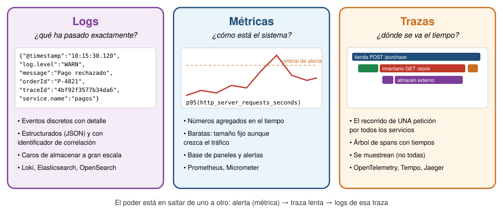
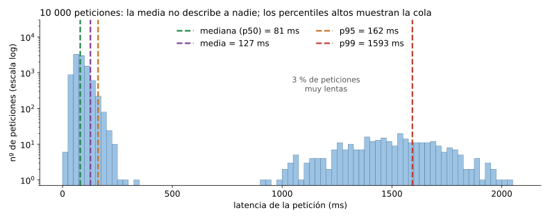
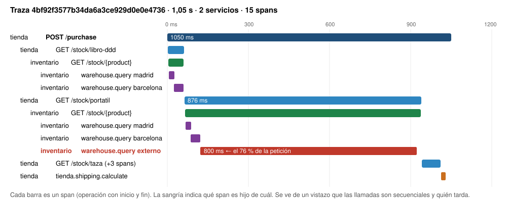
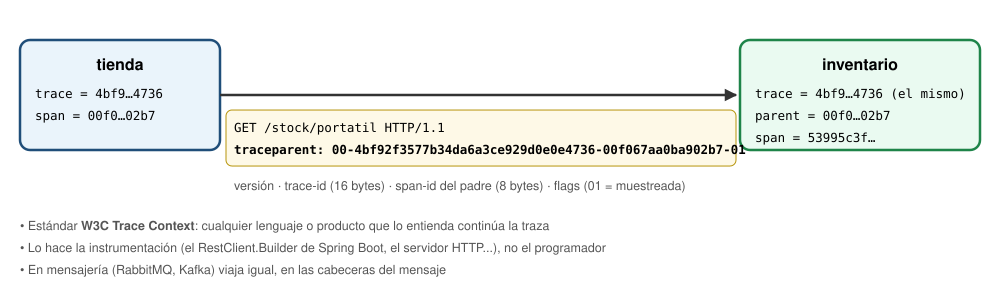
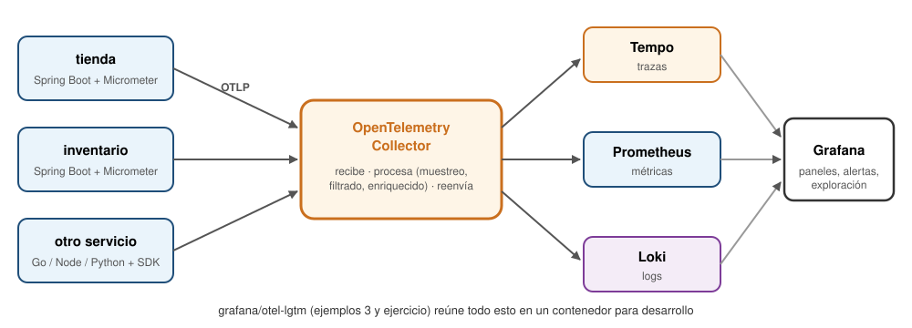
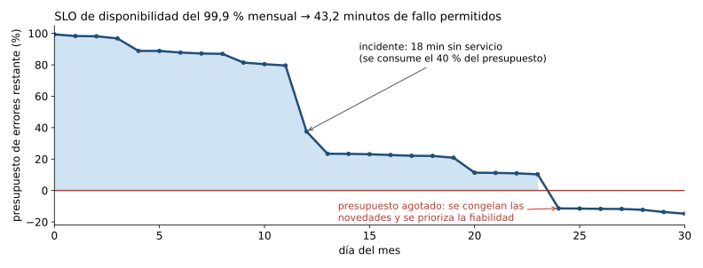

## Contenidos

1. Monitorización y observabilidad
2. Las tres señales: logs, métricas y trazas
3. Logs estructurados e identificadores de correlación
4. Métricas: Micrometer, Prometheus y Grafana
5. Qué medir: RED, USE y las cuatro señales doradas
6. Trazas distribuidas con OpenTelemetry
7. SLI, SLO, presupuesto de errores y alertas
8. De la alerta a la causa
9. Ejercicio

::: {.ejemplo}
**Código de los ejemplos**: carpeta [`parte_5/tema_5.8_observabilidad`](https://github.com/codeurjc/dad/tree/main/parte_5/tema_5.8_observabilidad) del repositorio de la asignatura.
:::

# Monitorización y observabilidad

## El problema

En un monolito, una petición lenta se investiga con un depurador o un *profiler* en **un** proceso.

En un sistema distribuido:

* Una petición atraviesa **muchos servicios**, cada uno con **varias instancias** que aparecen y desaparecen
* Los fallos son **parciales**: una instancia lenta, una cola que crece, un 1 % de errores
* Los logs están repartidos en decenas de máquinas y contenedores efímeros
* "**Funciona en mi máquina**" no sirve: el problema solo aparece con la carga y los datos de producción

> *¿Por qué el 2 % de los pedidos tarda más de 3 segundos desde el martes?*

## Monitorización vs observabilidad

::: columns
::: {.column width="50%"}
**Monitorización**

* Vigilar **lo que ya sabemos** que puede fallar
* Paneles y alertas predefinidos
* "¿Está la CPU por encima del 90 %?"
* Responde a los ***known unknowns***
:::
::: {.column width="50%"}
**Observabilidad**

* Poder **preguntar cosas nuevas** al sistema sin desplegar código nuevo
* Explorar: filtrar, agrupar, saltar de una señal a otra
* "¿Qué tienen en común los pedidos lentos?"
* Responde a los ***unknown unknowns***
:::
:::

::: {.callout-note}
**Observabilidad** (de la teoría de control): poder deducir el estado interno de un sistema a partir de sus salidas. Hay que **instrumentar** el código para que emita salidas útiles.
:::

## Las tres señales

{fig-align="center" width="95%"}

# Logs

## Logs estructurados

::: columns
::: {.column width="50%"}
**Texto libre** ✘

```text
10:15:30 WARN El usuario ana ha
intentado pagar 120.0 euros
con la tarjeta y ha fallado
```

* Cada desarrollador escribe a su manera
* Buscar "pagos fallidos de más de 100 €" = expresiones regulares frágiles
:::
::: {.column width="50%"}
**Estructurados** ✔

```json
{"@timestamp":"2026-11-21T10:15:30Z",
 "log.level":"WARN",
 "service.name":"tienda",
 "message":"Pago rechazado",
 "user":"ana","amount":120.0,
 "reason":"fondos_insuficientes",
 "correlationId":"7f3a…"}
```

* Cada dato es un **campo** consultable
* `level=WARN AND amount>100`
:::
:::

## Logs estructurados en Spring Boot

::: {.ejemplo}
**[obs-ejem1](https://github.com/codeurjc/dad/tree/main/parte_5/tema_5.8_observabilidad/obs-ejem1)**: logs JSON (formato ECS), pares clave-valor e identificador de correlación.
:::

```properties
# application-json.properties (otros formatos: logstash, gelf)
logging.structured.format.console=ecs
logging.structured.ecs.service.version=1.0.0
```

```java
// ✘ El dato está enterrado en el texto
log.info("El usuario " + user + " compra por " + amount + " euros");

// ✔ Mensaje fijo + pares clave-valor (API fluida de SLF4J 2) → campos JSON
log.atInfo().addKeyValue("user", user).addKeyValue("amount", amount).log("Inicio de compra");
```

* **Niveles** con criterio: `ERROR` (alguien tiene que actuar), `WARN` (algo raro pero controlado), `INFO` (hechos de negocio), `DEBUG` (desarrollo)
* **Nunca** datos sensibles: contraseñas, tarjetas, tokens, datos personales innecesarios

## Identificador de correlación

Un valor único por petición que aparece en **todas** sus líneas de log, en **todos** los servicios.

```java
@Component
@Order(Ordered.HIGHEST_PRECEDENCE)
public class CorrelationIdFilter extends OncePerRequestFilter {

    protected void doFilterInternal(HttpServletRequest request, HttpServletResponse response,
                                    FilterChain chain) throws ServletException, IOException {
        String id = request.getHeader("X-Correlation-Id");
        if (id == null || !VALID.matcher(id).matches()) {
            id = UUID.randomUUID().toString();          // nunca confíes en una cabecera
        }
        MDC.put("correlationId", id);                   // el log lo añade a cada línea
        response.setHeader("X-Correlation-Id", id);
        try {
            chain.doFilter(request, response);
        } finally {
            MDC.remove("correlationId");                // los hilos se reutilizan
        }
    }
}
```

::: {.small}
Con trazas distribuidas (ejemplo 3), el `traceId` cumple esta función y Spring lo añade al MDC sin escribir el filtro.
:::

## Centralizar los logs

* Las aplicaciones escriben a la **salida estándar** (*Twelve-Factor*: los logs son un flujo de eventos)
* Un agente los recoge y los envía a un almacén centralizado
    - **Loki** (Grafana): indexa solo etiquetas, barato
    - **Elasticsearch / OpenSearch** + Kibana: índice completo, búsquedas potentes
* Retención limitada y **muestreo** de los logs más ruidosos: los logs cuestan dinero

```{.default}
contenedor ──stdout──▶ agente (Promtail, Fluent Bit, OTel Collector)
                          ──▶ Loki / Elasticsearch ──▶ Grafana / Kibana
```

# Métricas

## Métricas con Micrometer

* **Micrometer**: fachada de métricas (como SLF4J para los logs) para Prometheus, OTLP, Datadog...
* Spring Boot Actuator publica **automáticamente**: peticiones HTTP, JVM (memoria, GC, hilos), *pool* de conexiones, Tomcat, caché...
* Las de **negocio** las añadimos nosotros

::: {.small}

| Tipo | Qué mide | Ejemplo |
|---|---|---|
| `Counter` | Algo que solo crece | Pedidos realizados |
| `Gauge` | Valor actual que sube y baja | Carritos activos, tamaño de una cola |
| `Timer` | Duración y número de eventos | Tiempo de la pasarela de pago |
| `DistributionSummary` | Distribución de valores | Importe de los pedidos |

:::

::: {.aviso}
**Cardinalidad**: cada combinación de etiquetas es una serie temporal. Etiquetar con `userId` u `orderId` crea millones de series y tumba Prometheus. Etiquetas con **pocos** valores: método de pago, resultado, endpoint.
:::

## Ejemplo 2: métricas de negocio

::: {.ejemplo}
**[obs-ejem2](https://github.com/codeurjc/dad/tree/main/parte_5/tema_5.8_observabilidad/obs-ejem2)**: tienda con métricas propias, Prometheus con reglas de alerta y Grafana con un panel ya configurado.
:::

```java
public ShopMetrics(MeterRegistry registry) {
    Gauge.builder("shop.carts.active", activeCarts, AtomicInteger::get).register(registry);
    this.paymentTimer = Timer.builder("shop.payment.duration")
            .publishPercentileHistogram()                        // para calcular p95, p99
            .register(registry);
    ...
}

public void orderPlaced(String paymentMethod, double amount) {
    Counter.builder("shop.orders")
            .tag("payment", paymentMethod)                       // card | paypal | transfer
            .tag("result", "ok")
            .register(registry).increment();
    orderAmount.record(amount);
}
```

```java
boolean paid = metrics.paymentTimer().record(this::callPaymentGateway);   // mide la duración
```

## Prometheus

{fig-align="center" width="85%"}

```bash
$ curl -s localhost:8080/actuator/prometheus | grep shop_orders
shop_orders_total{payment="card",result="ok"} 1532.0
shop_orders_total{payment="card",result="rejected"} 81.0
shop_orders_total{payment="paypal",result="ok"} 498.0
```

## PromQL

```promql
# Peticiones por segundo a /orders (media del último minuto)
sum(rate(http_server_requests_seconds_count{uri="/orders"}[1m]))

# Porcentaje de errores
sum(rate(http_server_requests_seconds_count{uri="/orders", status=~"5.."}[1m]))
  / sum(rate(http_server_requests_seconds_count{uri="/orders"}[1m]))

# Percentil 95 de la latencia, agregando TODAS las instancias
histogram_quantile(0.95,
  sum by (le) (rate(http_server_requests_seconds_bucket{uri="/orders"}[1m])))

# Pedidos por segundo desglosados por método de pago y resultado
sum by (payment, result) (rate(shop_orders_total[1m]))
```

::: {.small}
`rate()` convierte un contador creciente en "eventos por segundo". Los percentiles se calculan en Prometheus a partir del **histograma** (buckets `le`) y no en cada instancia: los percentiles no se pueden promediar.
:::

## Media vs percentiles

{fig-align="center" width="95%"}

* La **media** mezcla lo rápido y lo lento y no describe la experiencia de nadie
* El **p99** es lo que sufre 1 de cada 100 peticiones... y un usuario hace muchas peticiones
* Usa siempre **percentiles** (p50, p95, p99) para la latencia

## Grafana

```bash
cd obs-ejem2 && docker compose up --build      # 2 réplicas + carga + Prometheus + Grafana
```

* `http://localhost:9090` → Prometheus: consultas PromQL y estado de las alertas
* `http://localhost:3000` → Grafana: panel **DAD / Tienda (RED y negocio)**, ya aprovisionado

```yaml
# grafana/provisioning/datasources/prometheus.yml: la fuente de datos se configura sola
datasources:
  - name: Prometheus
    type: prometheus
    url: http://prometheus:9090
```

::: {.callout-tip}
Panel y fuente de datos **como código** (ficheros en el repositorio): se revisan, se versionan y se recrean igual en todos los entornos.
:::

## Qué medir

| Método | Para | Señales |
|---|---|---|
| **RED** (Tom Wilkie) | Servicios (peticiones) | **R**ate (peticiones/s), **E**rrors (fallos/s), **D**uration (latencia) |
| **USE** (Brendan Gregg) | Recursos (CPU, disco, *pool*) | **U**tilization, **S**aturation (cola, espera), **E**rrors |
| **Cuatro señales doradas** (Google SRE) | Sistemas de cara al usuario | Latencia, tráfico, errores, saturación |

* Empezar por **RED en cada servicio** y **USE en cada recurso compartido**
* Añadir métricas de **negocio**: pedidos por minuto, importe, registros... A veces la primera señal de un fallo técnico es una caída en las ventas

# Trazas distribuidas

## Trazas y *spans*

* **Traza**: el recorrido completo de **una** petición por todo el sistema
* **Span**: una operación dentro de la traza, con inicio, duración, servicio, atributos y **padre**

{fig-align="center" width="92%"}

## Propagación del contexto

{fig-align="center" width="95%"}

## OpenTelemetry

* **Estándar abierto** (CNCF) para generar y exportar logs, métricas y trazas
    - API y SDK para muchos lenguajes, protocolo **OTLP**, convenciones semánticas
    - Independiente del proveedor: se cambia el *backend* sin tocar el código

{fig-align="center" width="85%"}

## Ejemplo 3: trazas en Spring Boot 4

::: {.ejemplo}
**[obs-ejem3](https://github.com/codeurjc/dad/tree/main/parte_5/tema_5.8_observabilidad/obs-ejem3)**: `tienda` llama a `inventario` por cada producto; trazas y métricas a `grafana/otel-lgtm`.
:::

::: {.small}
Dependencias: `spring-boot-starter-actuator`, `spring-boot-starter-opentelemetry` y `spring-boot-starter-restclient`
:::

```properties
# Muestrear el 100 % de las peticiones (por defecto, el 10 %)
management.tracing.sampling.probability=1.0
management.opentelemetry.tracing.export.otlp.endpoint=http://localhost:4318/v1/traces
management.otlp.metrics.export.url=http://localhost:4318/v1/metrics
logging.pattern.correlation=[${spring.application.name:},%X{traceId:-},%X{spanId:-}]
```

```java
@Bean
RestClient inventarioClient(RestClient.Builder builder, @Value("${inventario.url}") String url) {
    // El builder de Spring Boot ya está instrumentado: crea un span por llamada
    // y envía la cabecera traceparent. RestClient.builder() a secas ROMPERÍA la traza.
    return builder.baseUrl(url).build();
}
```

* Sin escribir más código: span del servidor HTTP, del cliente HTTP, propagación y `traceId` en los logs

## Spans propios

Lo automático cubre HTTP, bases de datos, mensajería... Para operaciones internas interesantes, la **Observation API** de Micrometer crea a la vez un **span** y una **métrica**:

```java
int units = Observation.createNotStarted("inventario.warehouse.query", observations)
        .lowCardinalityKeyValue("warehouse", warehouse)   // etiqueta en la traza Y en la métrica
        .highCardinalityKeyValue("product", product)      // solo en la traza (cardinalidad alta)
        .observe(() -> query(warehouse, product));
```

```bash
cd obs-ejem3 && docker compose up --build
J='Content-Type: application/json'
curl -X POST localhost:8080/purchase -H "$J" -d '["libro-ddd","taza"]'
curl -X POST localhost:8080/purchase -H "$J" -d '["libro-ddd","portatil","taza"]'
# Grafana http://localhost:3000 → Explore → Tempo → service.name = tienda
```

```text
INFO [inventario,4bf92f3577b34da6a3ce929d0e0e4736,53995c3f42cd8ad8] portatil disponible en externo
```

::: {.small}
Línea de log de inventario: con el `traceId` se encuentra la traza, y desde la traza, todos sus logs.
:::

## Muestreo

* Guardar **todas** las trazas de un sistema con mucho tráfico es carísimo
* **Muestreo en la cabeza** (*head sampling*): se decide al empezar la traza (p. ej. el 10 %)
    - Sencillo y barato, pero puede descartar justo la traza del error
* **Muestreo en la cola** (*tail sampling*, en el Collector): se decide al terminar
    - "Guarda todas las trazas con error o de más de 1 s, y el 1 % del resto"
* La decisión viaja en el `traceparent` (*flag* `01`): todos los servicios respetan la del primero

```properties
# Por defecto en Spring Boot: el 10 %
management.tracing.sampling.probability=0.1
```

# SLO y alertas

## SLI, SLO y SLA

* **SLI** (*Service Level Indicator*): una medida de la calidad del servicio
    - "Proporción de peticiones a `/orders` que responden sin error en menos de 500 ms"
* **SLO** (*Objective*): el objetivo interno para ese indicador
    - "El 99,9 % de las peticiones de cada mes"
* **SLA** (*Agreement*): compromiso contractual con el cliente, con penalizaciones
    - Siempre **menos exigente** que el SLO, para tener margen

::: {.callout-note}
**100 % no es un objetivo razonable**: cada "9" más es muchísimo más caro, y los usuarios no notan la diferencia entre 99,99 % y 100 % (su red móvil falla más que eso).
:::

## Presupuesto de errores

{fig-align="center" width="92%"}

* **Presupuesto** = 100 % − SLO. Mientras quede, se puede arriesgar (desplegar, experimentar)
* Si se agota: prioridad a la **fiabilidad** sobre las nuevas funcionalidades

## Alertas que sirven

```yaml
# obs-ejem2/prometheus/alertas.yml
- alert: MuchosErrores
  expr: |
    sum(rate(http_server_requests_seconds_count{uri="/orders", status=~"5.."}[1m]))
      / sum(rate(http_server_requests_seconds_count{uri="/orders"}[1m])) > 0.10
  for: 1m                                  # que dure: evita alertas por un pico aislado
  labels:
    severity: page                         # despertar a alguien
  annotations:
    summary: "Más del 10 % de los pedidos fallan"
```

* Alertar por **síntomas** que nota el usuario (errores, latencia), no por causas (CPU al 80 %)
* Cada alerta que despierta a alguien debe requerir **acción humana inmediata**; lo demás, un *ticket*
* Mejor aún: alertar por **tasa de consumo del presupuesto** (*burn rate*): "a este ritmo, agotamos el presupuesto del mes en 2 días"
* Demasiadas alertas → **fatiga**: se acaban ignorando todas

# De la alerta a la causa

## Flujo de diagnóstico

{fig-align="center" width="95%"}

* **Exemplars**: cada punto de un histograma de latencia guarda el `traceId` de una petición real → del panel a la traza en un clic
* Logs con `traceId` → de la traza a los logs de esa petición en todos los servicios

## Buenas prácticas

* Instrumentar **desde el principio**: añadir observabilidad durante un incidente es tarde
* Usar las **convenciones** (nombres de métricas y atributos de OpenTelemetry) para que las herramientas las entiendan
* **Logs estructurados**, con `traceId`, sin datos sensibles
* Métricas con etiquetas de **baja cardinalidad**; los detalles, en las trazas
* **Comprobaciones de salud** (`/actuator/health`) para el orquestador; métricas para las personas
* Paneles y alertas **como código**
* La observabilidad también **consume recursos**: muestreo, retención y niveles de log adecuados

## Resumen

* En un sistema distribuido no se puede depurar paso a paso: hay que **instrumentar**
* **Logs** (qué pasó), **métricas** (cómo está), **trazas** (dónde se va el tiempo)
* Logs **estructurados** con **identificador de correlación** / `traceId`
* Métricas con **Micrometer** y **Prometheus**; latencia con **percentiles**; RED y USE
* Trazas con **OpenTelemetry**: spans, propagación con `traceparent`, muestreo
* **SLO** y **presupuesto de errores** para decidir; alertas por **síntomas**
* El valor está en **saltar entre señales**: alerta → panel → traza → logs

## Ejemplos del tema

| Proyecto | Contenido |
|---|---|
| [obs-ejem1](https://github.com/codeurjc/dad/tree/main/parte_5/tema_5.8_observabilidad/obs-ejem1) | Logs estructurados (ECS) con pares clave-valor e identificador de correlación en el MDC |
| [obs-ejem2](https://github.com/codeurjc/dad/tree/main/parte_5/tema_5.8_observabilidad/obs-ejem2) | Métricas de negocio con Micrometer, Prometheus con reglas de alerta y panel de Grafana |
| [obs-ejem3](https://github.com/codeurjc/dad/tree/main/parte_5/tema_5.8_observabilidad/obs-ejem3) | Trazas distribuidas con OpenTelemetry entre `tienda` e `inventario`, con spans propios |
| [obs-ejer1](https://github.com/codeurjc/dad/tree/main/parte_5/tema_5.8_observabilidad/obs-ejer1) | Solución del ejercicio 1: encontrar el cuello de botella entre `pedidos` y `pagos` |

: {tbl-colwidths="[20,80]"}

# Ejercicio

## Ejercicio 1: el misterio de los pagos lentos (I)

::: {.ejercicio}
Una tienda tiene dos servicios: **pedidos** recibe `POST /orders {"card":"visa","amount":30}` y llama a **pagos** (`POST /payments`), que comprueba el fraude y llama al proveedor de la tarjeta (VISA o AMEX). Desde que se aceptan tarjetas AMEX, **todos** los pagos van lentos a ratos... también los de VISA. Nadie sabe por qué.
:::

1. Implementa los dos servicios (simula el antifraude con 15 ms; el proveedor VISA tarda 40 ms y el de AMEX entre 300 y 500 ms). Las llamadas a los proveedores comparten un único cliente que **no admite llamadas concurrentes** (`synchronized`)
2. Añade **observabilidad**:
    - Logs **estructurados** con el `traceId` en cada línea
    - **Trazas** que crucen los dos servicios, con spans propios para el antifraude y para la llamada al proveedor (etiqueta `provider`)
    - Una **métrica** de pedidos por resultado (¡sin el id del pedido como etiqueta!)
3. Levántalo con un `docker-compose.yml` con `grafana/otel-lgtm` y un generador de carga (10 % AMEX)

## Ejercicio 1: el misterio de los pagos lentos (II)

4. Construye en Grafana un panel **RED** de `/orders` y `/payments` (peticiones/s, % de errores, p50/p95/p99)
5. Define un **SLO**: "el 99 % de los pedidos responde en menos de 300 ms". ¿Se cumple? Escribe la consulta PromQL del SLI
6. **Encuentra la causa** usando las trazas: ¿por qué un pago VISA tarda 400 ms si su proveedor responde en 40?
7. Arréglalo y **demuestra con las métricas** que el p99 mejora

Para pensar:

* ¿Qué span añadirías para que la causa sea evidente a la primera?
* ¿Por qué la media de latencia apenas se mueve y el p99 se dispara?
* ¿Qué alerta habría avisado del problema antes que los clientes?

::: {.ejemplo}
**Solución**: [obs-ejer1](https://github.com/codeurjc/dad/tree/main/parte_5/tema_5.8_observabilidad/obs-ejer1) (inténtalo antes de mirarla)
:::

## Referencias

* Charity Majors, Liz Fong-Jones, George Miranda. *Observability Engineering*. O'Reilly, 2022
* Betsy Beyer et al. *Site Reliability Engineering*. O'Reilly, 2016 — [cap. 4 (SLO) y 6 (monitorización)](https://sre.google/sre-book/table-of-contents/)
* [OpenTelemetry](https://opentelemetry.io/docs/) y [W3C Trace Context](https://www.w3.org/TR/trace-context/)
* [OpenTelemetry with Spring Boot](https://spring.io/blog/2025/11/18/opentelemetry-with-spring-boot/) (blog de Spring, 2025)
* [Spring Boot: Observability](https://docs.spring.io/spring-boot/reference/actuator/observability.html) y [Micrometer](https://docs.micrometer.io/micrometer/reference/)
* [Prometheus: consultas](https://prometheus.io/docs/prometheus/latest/querying/basics/) y [Grafana](https://grafana.com/docs/grafana/latest/)
* Brendan Gregg. [The USE Method](https://www.brendangregg.com/usemethod.html) · Tom Wilkie. *The RED Method*
